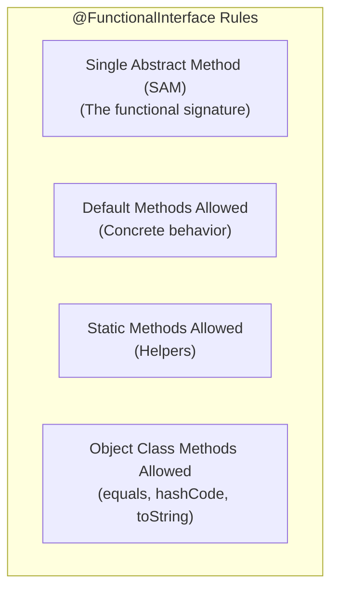
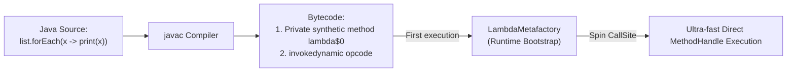
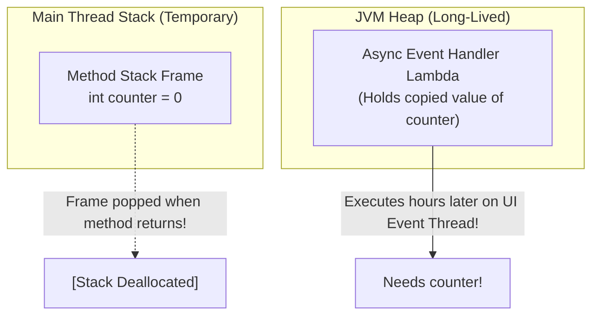
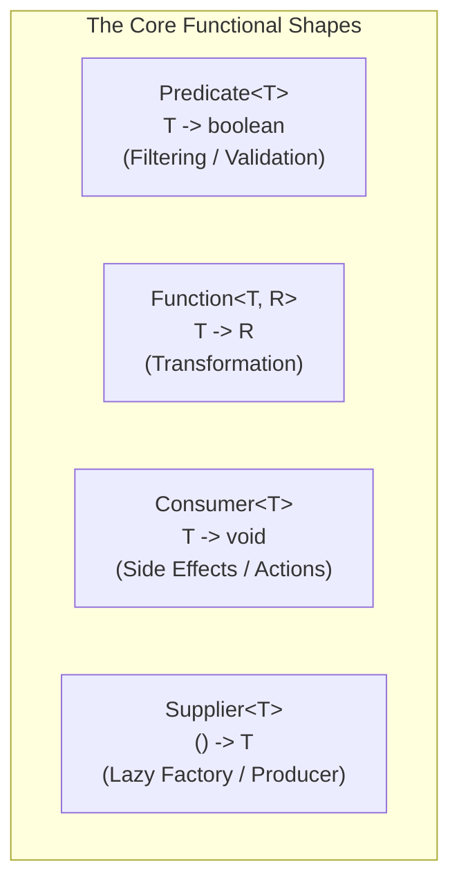

In 2014, Java 8 delivered the biggest architectural shift in the history of the Java language: **Lambda Expressions** and the **`java.util.function`** ecosystem.

Before Java 8, if you wanted to pass behavior into a method—such as a custom comparator, a thread task, or an event listener—you were forced to write verbose **Anonymous Inner Classes**. This resulted in noisy boilerplate, bloated class file counts (`MyService$1.class`), and wasteful heap allocations.

Lambdas transformed Java from a strictly imperative, object-oriented language into a modern hybrid language capable of clean, declarative functional programming.

However, Java lambdas are **not** mere syntactic sugar for anonymous inner classes. The JDK architects engineered an entirely new runtime execution model based on **`invokedynamic`** and **`LambdaMetafactory`**. Understanding how lambdas operate at the bytecode level, how variable capture works, and how to compose higher-order functions is essential for every modern Java engineer.

---

## Anatomy of a Functional Interface

A **Functional Interface** is an interface that contains **exactly one abstract method (SAM - Single Abstract Method)**.

To prevent future developers from accidentally breaking the functional contract by adding a second abstract method, always annotate your interface with **`@FunctionalInterface`**:

```java
@FunctionalInterface
public interface CryptoPaymentProcessor {
    // Exactly ONE abstract method
    boolean processPayment(String walletAddress, double amountInEth);

    // Default methods do NOT count toward the Single Abstract Method rule
    default void logTransaction(String txId) {
        System.out.println("Recorded transaction: " + txId);
    }

    // Static utility methods are allowed
    static boolean isValidWallet(String address) {
        return address != null && address.startsWith("0x");
    }

    // Methods inherited from java.lang.Object (equals, hashCode, toString) do NOT count
    @Override
    boolean equals(Object obj);
}
```



---

## How Lambdas Work Under the Hood: `invokedynamic` and `LambdaMetafactory`

When junior developers see a lambda, they assume the compiler generates a hidden anonymous inner class. 

Let's dispel that myth immediately: **The compiler does NOT create an anonymous inner class!**

If Java created an anonymous class for every lambda:
1. Every lambda would generate a separate `.class` file on disk (e.g. `OrderService$$Lambda$1.class`), bloating JAR sizes.
2. The JVM would have to load, verify, and link thousands of tiny class files into Metaspace at boot time, severely degrading application startup performance.
3. Every single execution of a lambda would force a brand-new object allocation on the Heap.

### The Bytecode Desugaring Process
Instead, Java 8 leverages the **`invokedynamic` (indy)** bytecode instruction introduced in Java 7:



1. **Synthetic Method Extraction:** `javac` takes the lambda body and desugars it into a `private static synthetic` (or instance) method inside your existing class:
   ```java
   // Generated secretly by javac inside your class:
   private static synthetic void lambda$main$0(String text) {
       System.out.println(text);
   }
   ```
2. **`invokedynamic` CallSite:** In place of the lambda, `javac` emits an `invokedynamic` instruction pointing to the bootstrap method **`java.lang.invoke.LambdaMetafactory.metafactory()`**.
3. **Runtime Spin:** On the first execution, `LambdaMetafactory` generates an ultra-lightweight dynamic call site using `MethodHandle`s.
4. **Zero-Allocation Singleton Caching:** If the lambda is **non-capturing** (does not access local variables), the JVM instantiates the function object **exactly once** and caches it as a singleton. Subsequent invocations incur **zero heap memory allocations**!

---

## Variable Capture and the "Effectively Final" Mandate

A lambda can reference variables from its enclosing scope, but only if those variables are **`final`** or **effectively final** (assigned once and never modified thereafter):

```java
public void processOrders(List<Order> orders) {
    int discountThreshold = 100; // Effectively final

    // ✅ Legal: discountThreshold is never modified
    orders.removeIf(order -> order.getAmount() < discountThreshold);

    // discountThreshold = 200; // ❌ If uncommented, causes compile error above!
}
```

### Why Can't Local Variables Be Mutated Inside a Lambda?
Why does Java forbid this?

```java
// ❌ COMPILE ERROR: Variable used in lambda must be final or effectively final
int counter = 0;
button.onClick(event -> counter++); // Error!
```

The reason lies in the fundamental difference between **Stack Memory** and **Heap Memory**:



1. Local variables live in a method's **Stack Frame**. When the method completes, its stack frame is instantly popped and destroyed.
2. But a lambda can be passed to another thread or stored in a field to be executed hours later on the **Heap**!
3. If the lambda referenced the raw stack variable, it would try to access deallocated stack memory, causing memory corruption.
4. Therefore, Java **makes a copy** of the variable's value into the lambda instance.
5. If Java allowed the lambda to modify its copy, the original stack variable wouldn't change, causing baffling state synchronization bugs. To preserve deterministic semantics without allocating heap pointer boxes (like JavaScript closures), Java mandates that captured local variables must be effectively final.

---

## The Core Functional Interfaces (`java.util.function`)

Rather than forcing developers to invent custom interfaces for every method, the JDK provides 43 built-in functional interfaces categorized into four primary shapes:



| Interface | Method Signature | Conceptual Role | Example Real-World Use Case |
|---|---|---|---|
| **`Predicate<T>`** | `boolean test(T t)` | Evaluates a condition | `order -> order.isShipped()` |
| **`Function<T, R>`** | `R apply(T t)` | Transforms input to output | `user -> user.getEmail()` |
| **`Consumer<T>`** | `void accept(T t)` | Consumes input (side-effect) | `log -> logger.info(log)` |
| **`Supplier<T>`** | `T get()` | Generates or supplies data lazily | `() -> UUID.randomUUID()` |
| **`UnaryOperator<T>`** | `T apply(T t)` | Transforms `T -> T` | `String::trim` |
| **`BinaryOperator<T>`** | `T apply(T a, T b)` | Combines two `T` values | `(acc, next) -> acc + next` |

### Primitive Specializations (Zero-Boxing)
Using `Predicate<Integer>` causes boxing overhead (`int` wrapped into `Integer` on the Heap). For hot performance loops, always use primitive specializations:

```java
// ❌ Generates heap allocation churn due to Integer boxing
Predicate<Integer> isPositive = n -> n > 0;

// ✅ Zero allocations! Works directly on raw primitive ints
IntPredicate isPositiveFast = n -> n > 0;
LongConsumer auditTimer = timestamp -> metrics.record(timestamp);
DoubleFunction<String> currencyFormatter = amount -> "$" + amount;
```

---

## Method References: Clean Declarative Syntax

A **Method Reference (`::`)** is a shorthand syntactic abbreviation for a lambda that simply delegates directly to an existing method or constructor.

There are four distinct flavors of method references:

| Type | Syntax | Equivalent Lambda |
|---|---|---|
| **1. Static Method Reference** | `Math::max` | `(a, b) -> Math.max(a, b)` |
| **2. Bound Instance Method** | `System.out::println` | `x -> System.out.println(x)` |
| **3. Unbound Instance Method** | `String::toUpperCase` | `str -> str.toUpperCase()` |
| **4. Constructor Reference** | `ArrayList::new` | `() -> new ArrayList<>()` |

### Bound vs. Unbound Instance References
This distinction frequently confuses developers:
- **Bound Instance Reference:** The target object is already specified outside the lambda (`myService::process`). The lambda takes the argument and passes it to the bound instance.
- **Unbound Instance Reference:** The method is an instance method, but the target object is supplied as the **first parameter of the lambda** (`String::length` translates to `(String s) -> s.length()`).

---

## Functional Composition: Building Declarative Pipelines

One of the greatest advantages of functional programming is **composability**: combining small, single-purpose functions into robust processing pipelines using default methods:

### Composing Predicates: `and()`, `or()`, `negate()`

```java
Predicate<User> isActive = User::isActive;
Predicate<User> isPremium = User::isPremiumTier;
Predicate<User> isBanned = User::isBlacklisted;

// Fluent boolean composition:
Predicate<User> eligibleForPromotion = isActive
        .and(isPremium)
        .and(isBanned.negate());

List<User> winners = users.stream().filter(eligibleForPromotion).toList();
```

### Composing Functions: `andThen()` vs. `compose()`
- **`f.andThen(g)`**: Executes `f` first, then feeds its result into `g` (`g(f(x))`).
- **`f.compose(g)`**: Executes `g` first, then feeds its result into `f` (`f(g(x))`).

```java
Function<String, String> trim = String::trim;
Function<String, String> addHeader = s -> "AUTH: " + s;

// trim executed FIRST, then addHeader:
Function<String, String> pipeline = trim.andThen(addHeader);

System.out.println(pipeline.apply("   secret_token   ")); // "AUTH: secret_token"
```

---

## Summary & Mental Model Checkpoint

1. **`@FunctionalInterface`**: Enforces the Single Abstract Method (SAM) contract while allowing default and static methods.
2. **`invokedynamic` Desugaring**: Lambdas are compiled into synthetic private methods and dynamically linked via `LambdaMetafactory`, avoiding anonymous inner class overhead.
3. **Zero-Allocation Singletons**: Non-capturing lambdas are cached as singletons; they allocate zero heap memory on repeated invocations.
4. **Effectively Final Invariant**: Captured local variables must not be modified after assignment to protect against stack deallocation race conditions.
5. **Primitive Specializations**: Use `IntPredicate`, `LongConsumer`, and `DoubleFunction` in hot paths to eradicate autoboxing GC pressure.
6. **Method References**: Syntactic sugar for direct delegation; understand Bound (`object::method`) vs Unbound (`Class::method`).
7. **Combinator Pattern**: Compose pipelines fluently using `Predicate.and()`, `Predicate.or()`, and `Function.andThen()`.

---

## 🎯 Senior Engineer Interview Questions

### How does Java compile and execute a Lambda Expression under the hood, and why did the architects choose `invokedynamic` instead of anonymous inner classes?
> **Answer:** If the compiler translated lambdas into anonymous inner classes (like `new Runnable() { ... }`), every lambda would generate a separate `.class` file on disk, bloating deployment sizes and burdening the JVM ClassLoader with loading and verifying thousands of classes into Metaspace at startup. Furthermore, every invocation would allocate a new object on the heap. Instead, `javac` compiles the body of a lambda into a `private synthetic` method inside the enclosing class, and replaces the lambda instantiation site with an `invokedynamic` bytecode instruction pointing to `LambdaMetafactory.metafactory()`. At runtime, the first time the instruction is encountered, `LambdaMetafactory` generates an ultra-fast call site using `MethodHandle`s. For non-capturing lambdas, it instantiates a single instance and caches it as a constant, resulting in zero subsequent heap allocations.

### Why must variables captured by a Lambda Expression be `final` or "effectively final"? What physical memory reality prevents mutating local variables inside a lambda?
> **Answer:** Local variables reside on the thread's execution Stack Frame. When a method exits, its stack frame is immediately popped and deallocated. However, a lambda expression can escape the declaring method—for example, submitted to an asynchronous `ExecutorService` or stored in a long-lived field—and execute long after the creating thread's stack frame has been destroyed. To enable this, the JVM copies the captured variable's value into the lambda's heap representation. If Java allowed the lambda to mutate this variable, the lambda would mutate its isolated copied value without affecting the original stack variable (or vice versa), breaking consistency and confusing developers. Supporting true mutable local closures would require allocating variable references in heap-allocated mutable boxes (like JavaScript), introducing pervasive heap allocation overhead for stack primitives. Java mandates effective finality to preserve stack-allocation performance and deterministic semantics.

### What is the difference between a "Bound Instance Method Reference" and an "Unbound Instance Method Reference"? Give code examples of both.
> **Answer:** A **Bound Instance Method Reference** is bound to a specific, pre-existing object instance outside the lambda expression. The instance is evaluated when the reference is created, and the functional method accepts only the parameters required by the target method. For example: `PrintStream out = System.out; Consumer<String> c = out::println;`—the method reference is bound to `out`, matching `(String msg) -> out.println(msg)`. An **Unbound Instance Method Reference** is defined on a class type rather than an existing object. The functional interface's first parameter serves as the target instance upon which the method will be invoked at runtime. For example: `Function<String, String> f = String::toUpperCase;`—this matches `(String str) -> str.toUpperCase()`. Here, `str` is unbound and supplied at invocation time as the first argument.

### How does using primitive functional interfaces (e.g. `IntPredicate`) prevent GC pauses in high-throughput data processing pipelines compared to standard generic interfaces (e.g. `Predicate<Integer>`)?
> **Answer:** Standard generic functional interfaces operate on reference types due to generic type erasure. A `Predicate<Integer>` defines the abstract method `boolean test(Integer t)`. When filtering millions of primitive `int` values (such as processing telemetry streams or stock prices), passing primitive `int` values requires the compiler to invoke `Integer.valueOf(int)`. This autoboxes every primitive integer into a 16-to-24-byte `java.lang.Integer` heap object with an object header and memory padding. In a tight loop processing 10,000,000 values, this creates over 200 Megabytes of temporary garbage objects on the young generation heap, triggering frequent Minor GC Stop-the-World pauses. In contrast, primitive-specialized interfaces like `IntPredicate` declare `boolean test(int value)` natively. They pass primitive integers directly through CPU registers or stack slots without allocating any heap objects, eliminating autoboxing and garbage collection overhead entirely.