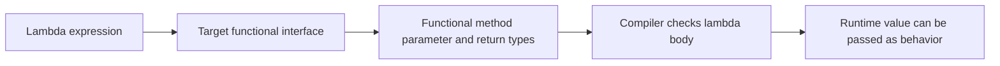

Many APIs need an action supplied by their caller: a sort needs a comparison rule, a button needs a callback, and a collection operation needs a condition. Before lambdas, Java often expressed these actions with verbose anonymous classes. Lambdas make the behavior concise while keeping the target interface and type checking explicit.

This lesson uses Java 21. Lambda expressions and the `java.util.function` package were introduced in Java 8.

## A lambda implements a functional interface

A **functional interface** has one abstract method that defines its functional contract. It may also contain default, static, or private methods. The `@FunctionalInterface` annotation is optional, but asks the compiler to check that the interface continues to satisfy the rule.

```java
public class LambdaBasics {
    @FunctionalInterface
    interface StringTransform {
        String transform(String input);
    }

    public static void main(String[] args) {
        StringTransform trim = text -> text.trim();
        String normalized = trim.transform("  Java  ");
        System.out.println(normalized);
    }
}
```

The lambda is not an untyped piece of code. The variable's target type says the parameter is a `String` and the result must be a `String`. The compiler checks the body against that method signature.

The same implementation can be written with an anonymous class, but a lambda is more concise:

```java
public class AnonymousImplementation {
    interface StringTransform {
        String transform(String input);
    }

    public static void main(String[] args) {
        StringTransform trim = new StringTransform() {
            @Override
            public String transform(String input) {
                return input.trim();
            }
        };
        System.out.println(trim.transform("  Java  "));
    }
}
```

Use the form that best expresses intent. Lambdas are especially useful for short behavior passed to an API; long multi-step business logic often deserves a named method or class.

## Lambda syntax and target typing

A lambda has parameters, an arrow, and either an expression body or a block body:

```java
import java.util.Comparator;
import java.util.function.Function;
import java.util.function.Predicate;

public class LambdaSyntax {
    public static void main(String[] args) {
        Predicate<String> hasText = value -> !value.isBlank();
        Comparator<String> byLength =
                (left, right) -> Integer.compare(left.length(), right.length());
        Runnable task = () -> System.out.println("Run");

        Function<String, Integer> length = value -> {
            int result = value.length();
            return result;
        };
        task.run();
        System.out.println(hasText.test("Java"));
        System.out.println(byLength.compare("Java", "C"));
        System.out.println(length.apply("Java"));
    }
}
```

For a single parameter, parentheses may be omitted. Parameter types are often inferred from the target functional interface, though they can be written explicitly. A block body with a non-void result must return a value on every normal completion path.

**Target typing** is why a lambda usually cannot stand alone without a target type:

```java
import java.util.function.Predicate;

public class TargetType {
    public static void main(String[] args) {
        Predicate<String> nonEmpty = text -> !text.isEmpty();
        System.out.println(nonEmpty.test("Java"));
    }
}
```

If a method is overloaded with multiple functional-interface parameter types, the compiler may not have enough information to choose the intended overload. Supply a typed variable or an explicit cast at that call site rather than relying on ambiguous inference.



The functional interface supplies the lambda's type; the lambda body is checked against its single abstract method.

## The standard functional interfaces

The `java.util.function` package provides common shapes so APIs do not need a custom interface for every operation:

| Interface | Abstract method | Shape | Typical use |
|---|---|---|---|
| `Predicate<T>` | `boolean test(T)` | `T -> boolean` | Filter or validate a value |
| `Function<T, R>` | `R apply(T)` | `T -> R` | Transform a value |
| `Consumer<T>` | `void accept(T)` | `T -> void` | Perform an action, often with a side effect |
| `Supplier<T>` | `T get()` | `() -> T` | Produce a value lazily |
| `UnaryOperator<T>` | `T apply(T)` | `T -> T` | Transform a value without changing its type |
| `BiFunction<T, U, R>` | `R apply(T, U)` | `(T, U) -> R` | Combine two inputs into a result |

Use primitive-specialized interfaces such as `IntPredicate` or `ToIntFunction<T>` when they fit the API and avoid unnecessary boxing in a hot path. Do not select a specialized type solely on an unmeasured performance assumption.

## Method references

A method reference is shorthand for a lambda that delegates to an existing method or constructor:

```java
import java.util.ArrayList;
import java.util.function.Consumer;
import java.util.function.Function;
import java.util.function.Supplier;

public class MethodReferenceExample {
    public static void main(String[] args) {
        Function<String, Integer> length = String::length;
        Consumer<String> printer = System.out::println;
        Supplier<ArrayList<String>> newList = ArrayList::new;
        printer.accept(String.valueOf(length.apply("Java")));
        System.out.println(newList.get());
    }
}
```

Common forms include:

- A static method reference, such as `Integer::parseInt`.
- An instance method on a particular object, such as `System.out::println`.
- An instance method on a value supplied as the first argument, such as `String::trim`.
- A constructor reference, such as `ArrayList::new`.

The referenced method's signature must be compatible with the target functional method. A method reference does not bypass overload resolution; the target type helps determine which overload is applicable.

## Capturing local variables

A lambda may refer to a local variable from its enclosing scope only when that local variable is final or **effectively final** (assigned once and never changed after initialization):

```java
import java.util.function.Predicate;

public class CapturedLocal {
    public static void main(String[] args) {
        int minimumLength = 4;
        Predicate<String> longEnough =
                text -> text.length() >= minimumLength;
        System.out.println(longEnough.test("Java"));
    }
}
```

This rule means the local variable's value can be captured safely. It does not make an object referenced by that variable immutable or thread-safe:

```java
import java.util.function.Supplier;

public class CapturedObject {
    public static void main(String[] args) {
        StringBuilder prefix = new StringBuilder("job:");
        Supplier<String> currentPrefix = prefix::toString;
        prefix.append("urgent"); // The captured object itself is still mutable
        System.out.println(currentPrefix.get());
    }
}
```

The variable `prefix` is not reassigned, but the object it refers to can change. If a lambda runs asynchronously or concurrently, captured mutable state still needs the same ownership and synchronization care as any other shared state.

Instance and static fields do not have the effectively-final restriction. That flexibility is not a concurrency guarantee; accessing mutable fields from multiple threads still requires an appropriate memory-visibility and synchronization design.

## Composition and side effects

Several functional interfaces provide default methods for composition:

```java
import java.util.function.Function;
import java.util.function.Predicate;

public class CompositionExample {
    public static void main(String[] args) {
        Predicate<String> startsWithA = text -> text.startsWith("A");
        Predicate<String> shortText = text -> text.length() < 10;
        Predicate<String> accepted = startsWithA.and(shortText);

        Function<String, String> trim = String::trim;
        Function<String, String> upper = String::toUpperCase;
        Function<String, String> normalized = trim.andThen(upper);
        System.out.println(accepted.test("Ada"));
        System.out.println(normalized.apply(" Java "));
    }
}
```

`Predicate.and` and `Predicate.or` use short-circuit evaluation. `Function.andThen` applies the first function and then the second; `compose` applies the supplied function first. If one operation throws, the exception is relayed to the caller.

`Consumer` is specifically intended for operations that act through side effects. Keep side effects visible and controlled: hidden mutation inside a predicate or mapper can make code harder to reason about and can create bugs when a later API evaluates the behavior more than once or in an unexpected order.

Lambdas are often described as “functional programming,” but Java lambdas do not make a computation pure automatically. A lambda may read mutable state, perform I/O, throw exceptions, or mutate shared objects.

## Runtime model: do not assume one allocation per lambda

A lambda is represented through the JVM's invokedynamic and method-handle machinery, but the language does not promise that each evaluation allocates a new object or that a non-capturing lambda has one specific singleton identity. Treat lambda identity as an implementation detail; compare behavior, not lambda references.

The JIT may optimize lambda-based calls through inlining and other transformations, but this depends on runtime conditions. Use clear APIs first and benchmark before replacing lambdas with manual loops for performance reasons.

## Practical rules

- Define a custom functional interface when it expresses a domain-specific operation or checked-exception contract.
- Prefer standard `java.util.function` interfaces when their parameter and return shapes match.
- Give overloaded lambda calls an explicit target type when inference is ambiguous.
- Use method references when they improve readability, not just to shorten a line.
- Treat captured mutable objects and fields as shared state when lambdas can escape or run concurrently.
- Avoid side effects in transformations and predicates unless that behavior is explicit in the API contract.

## Further reading

- [The Java Language Specification, Java SE 21, Lambda Expressions](https://docs.oracle.com/javase/specs/jls/se21/html/jls-15.html#jls-15.27)
- [The Java Language Specification, Functional Interfaces](https://docs.oracle.com/javase/specs/jls/se21/html/jls-9.html#jls-9.8)
- [Java 21 `java.util.function` package](https://docs.oracle.com/en/java/javase/21/docs/api/java.base/java/util/function/package-summary.html)
- [Java 21 `Function`](https://docs.oracle.com/en/java/javase/21/docs/api/java.base/java/util/function/Function.html), [`Predicate`](https://docs.oracle.com/en/java/javase/21/docs/api/java.base/java/util/function/Predicate.html), and [`Consumer`](https://docs.oracle.com/en/java/javase/21/docs/api/java.base/java/util/function/Consumer.html)
