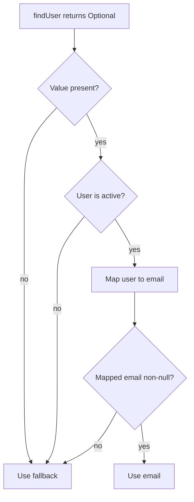

A method that returns a reference can use `null` to mean “no result,” but every caller must remember to check before dereferencing it. `Optional<T>` makes that possibility explicit in the return type: a result either contains a non-null `T` or is empty.

This lesson uses Java 21. `Optional` was introduced in Java 8. Its primary use is as a method return type when the absence of a result is meaningful; it is not intended to wrap every reference in an application.

## Creating an Optional result

Use the factory that matches what the method knows:

```java
import java.util.Optional;

public class OptionalCreation {
    static Optional<String> findNickname(String userId) {
        String valueFromLegacyStore = userId.equals("ada") ? "Ada" : null;
        return Optional.ofNullable(valueFromLegacyStore);
    }

    public static void main(String[] args) {
        Optional<String> known = Optional.of("Grace");
        Optional<String> maybe = findNickname("ada");
        Optional<String> missing = Optional.empty();

        System.out.println(known.isPresent());
        System.out.println(maybe.orElse("unknown"));
        System.out.println(missing.isEmpty());
    }
}
```

- `Optional.of(value)` requires a non-null value and throws `NullPointerException` for `null`.
- `Optional.ofNullable(value)` converts a possibly-null reference to either a present or empty optional.
- `Optional.empty()` explicitly represents no result.

An API that promises an `Optional` should return `Optional.empty()`, not a `null` Optional reference. The latter reintroduces the same ambiguity the type is meant to remove. Do not compare an optional to `Optional.empty()` with `==`; the API does not guarantee that empty optionals are a singleton. Use `isEmpty()` or `isPresent()`.

## Transforming and filtering without unwrapping

`map` transforms the contained value only when one is present. `filter` keeps it only when a predicate matches. If a `map` function returns `null`, the result becomes empty. When the transformation itself returns an `Optional`, use `flatMap` to avoid producing a nested `Optional<Optional<T>>`.

```java
import java.util.Map;
import java.util.Optional;

public class OptionalChaining {
    record User(String email, boolean active) {}

    private static final Map<Long, User> USERS = Map.of(
            1L, new User("ada@example.test", true),
            2L, new User("inactive@example.test", false));

    static Optional<User> findUser(long id) {
        return Optional.ofNullable(USERS.get(id));
    }

    public static void main(String[] args) {
        String email = findUser(1L)
                .filter(User::active)
                .map(User::email)
                .orElse("no active user");

        String missing = findUser(99L)
                .filter(User::active)
                .map(User::email)
                .orElse("no active user");

        System.out.println(email);
        System.out.println(missing);
    }
}
```

Each operation preserves the absence state: if a lookup is empty or the predicate rejects the user, later mapping functions are skipped and the pipeline remains empty. When a function already returns an optional, `flatMap` composes it directly:

```java
import java.util.Map;
import java.util.Optional;

public class OptionalFlatMap {
    record Address(String city) {}
    record Customer(long id, Address address) {}

    private static final Map<Long, Customer> CUSTOMERS = Map.of(
            7L, new Customer(7L, new Address("Oslo")));

    static Optional<Customer> findCustomer(long id) {
        return Optional.ofNullable(CUSTOMERS.get(id));
    }

    static Optional<Address> addressOf(Customer customer) {
        return Optional.ofNullable(customer.address());
    }

    public static void main(String[] args) {
        String city = findCustomer(7L)
                .flatMap(OptionalFlatMap::addressOf)
                .map(Address::city)
                .orElse("address unavailable");
        System.out.println(city);
    }
}
```

If a `flatMap` mapper returns `null` instead of an `Optional`, Java throws `NullPointerException`; that is a broken mapper contract, not another spelling of empty.

## Choosing an action or fallback

Use `ifPresent` when an action is meaningful only for a present value. Java 9 added `ifPresentOrElse` for a present action and an empty action. Prefer transformations for value-producing code; reserve these methods for effects such as logging, metrics, or updating an external system.

For a fallback value:

- `orElse(value)` returns the contained value or the supplied fallback.
- `orElseGet(supplier)` calls the supplier only if the optional is empty.
- `orElseThrow()` returns the value or throws `NoSuchElementException`.
- `orElseThrow(supplier)` lets the caller choose the exception, including a domain-specific one.

The distinction between `orElse` and `orElseGet` matters when constructing a fallback is costly or has a side effect:

```java
import java.util.Optional;

public class OptionalFallback {
    record User(String name) {}

    static User createGuest() {
        System.out.println("Creating fallback");
        return new User("guest");
    }

    public static void main(String[] args) {
        Optional<User> present = Optional.of(new User("Ada"));
        Optional<User> empty = Optional.empty();

        User eager = present.orElse(createGuest());
        User lazy = present.orElseGet(OptionalFallback::createGuest);
        User fromEmpty = empty.orElseGet(OptionalFallback::createGuest);

        System.out.println(eager.name());
        System.out.println(lazy.name());
        System.out.println(fromEmpty.name());
    }
}
```

Java evaluates method arguments before invoking a method, so `createGuest()` runs before `orElse` is called even when the optional is present. The supplier passed to `orElseGet` runs only for an empty optional. Use `orElseThrow` at a boundary where absence is exceptional rather than returning a magic value:

```java
import java.util.Map;
import java.util.NoSuchElementException;
import java.util.Optional;

public class OptionalRequiredValue {
    private static final Map<String, String> CONFIG = Map.of("region", "eu-west");

    static Optional<String> findSetting(String key) {
        return Optional.ofNullable(CONFIG.get(key));
    }

    public static void main(String[] args) {
        String region = findSetting("region")
                .orElseThrow(() -> new NoSuchElementException("Missing region"));
        System.out.println(region);
    }
}
```

## Following the presence path

The diagram traces the `findUser(1L)` pipeline above. An empty lookup or a rejected user bypasses mapping; both arrive at the same fallback:



## Optional and streams

Java 9 added `Optional.stream()`, which produces a sequential stream containing the value when present or an empty stream otherwise. It is useful for flattening a stream of optional results:

```java
import java.util.List;
import java.util.Optional;

public class OptionalStream {
    public static void main(String[] args) {
        List<Optional<String>> lookups = List.of(
                Optional.of("Ada"),
                Optional.empty(),
                Optional.of("Grace"));

        List<String> names = lookups.stream()
                .flatMap(Optional::stream)
                .toList();

        System.out.println(names);
    }
}
```

This connects the Optional API to the Streams API: `Optional.stream()` turns “zero or one value” into the stream model, so empty results disappear naturally from a flattened pipeline.

## Boundaries and common mistakes

- **Do not call `get()` without establishing presence.** It throws `NoSuchElementException` when empty. Prefer `orElse`, `orElseGet`, or `orElseThrow` to make the policy visible.
- **Do not return `null` instead of `Optional.empty()`.** A null Optional is still a null dereference risk.
- **Do not use `Optional` as a universal null wrapper.** The API is primarily intended for method return values that may have no result. Choose field and parameter types based on the domain and the surrounding API contract.
- **Do not expect `Optional` to make a present value non-nullable everywhere.** The factory methods enforce a non-null contained value, but an API boundary can still hand you a null Optional reference if it violates its contract.
- **Do not use identity comparison or synchronization on `Optional`.** It is a value-based class; equal instances should be treated as interchangeable, and synchronization on them is unsupported.
- **Use primitive-specialized optionals when boxing is undesirable in numeric APIs.** Java provides `OptionalInt`, `OptionalLong`, and `OptionalDouble`; there is no general `Optional<T>` specialization for every primitive type.

An Optional models one particular state: a method may have no value to return. It does not explain why a result is absent, represent multiple errors, or replace a richer result type when callers need those distinctions.

## Practical rules

- Return `Optional<T>` when “no result” is a normal, meaningful outcome.
- Use `of` for a known non-null value, `ofNullable` at nullable boundaries, and `empty` for an intentional absence.
- Keep transformations in `map`, `flatMap`, and `filter`; unwrap once when choosing the final result.
- Pick `orElse` for a cheap, already-available fallback and `orElseGet` for deferred fallback work.
- Use `orElseThrow` when absence violates the caller's expectation, and choose an exception that describes the failure.
- Keep Optional contracts non-null: a method returning Optional must return an Optional instance every time.

## Further reading

- [Java 21 `Optional`](https://docs.oracle.com/en/java/javase/21/docs/api/java.base/java/util/Optional.html)
- [Java Language Specification, Java SE 21, Section 15.7.4: Argument Lists are Evaluated Left-to-Right](https://docs.oracle.com/javase/specs/jls/se21/html/jls-15.html#jls-15.7.4)
