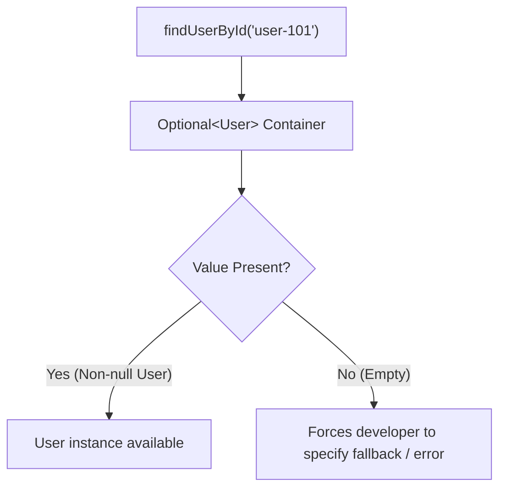
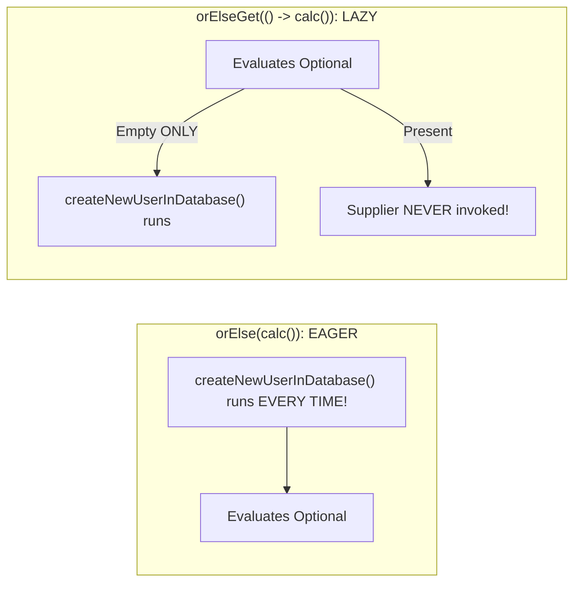

In 1965, British computer scientist Sir Tony Hoare invented the `null` reference while designing the ALGOL W programming language. Decades later, he publicly apologized, calling it his **"Billion-Dollar Mistake"**:

> *"I call it my billion-dollar mistake. It was the invention of the null reference in 1965... This has led to innumerable errors, vulnerabilities, and system crashes, which have probably caused a billion dollars of pain and damage in the last forty years."*

In Java, this mistake manifests as the most notorious runtime exception in history: **`NullPointerException` (NPE)**.

Java 8 introduced **`java.util.Optional<T>`** to solve this problem. However, many developers misunderstand its purpose, treating it as a magic replacement for all nullable variables, which introduces memory bloat, serialization failures, and new runtime bugs.

Understanding the true architectural contract of `Optional<T>`—along with **monadic composition (`flatMap`)**, **eager vs. lazy evaluation traps**, and the **4 cardinal sins of Optional**—is critical to designing robust, crash-proof Java applications.

---

## The Core Philosophy: An Explicit Return Contract

What does a method signature like this tell you?

```java
public User findUserById(String id);
```

Does it return a valid `User`? Or does it return `null` if the user is missing from the database? 

The code signature is silent. The caller has no idea whether they must check for `null`. If they forget, the application crashes in production with an NPE.

Now look at the modern design:

```java
public Optional<User> findUserById(String id);
```

The method signature is completely honest. It is an **explicit contractual warning** to the caller: *"This operation might not find a user under normal business conditions. You are forced to handle the empty case before you can access the value."*



---

## Creating Optionals: The Three Factories

```java
// 1. Optional.of(value): MUST be non-null! Throws NPE immediately if null.
// Use when you are 100% certain the value cannot be null.
Optional<String> guaranteed = Optional.of("Ada Lovelace");

// 2. Optional.ofNullable(value): Safe bridge from legacy nullable code.
// If user is null, returns Optional.empty(); otherwise returns Optional.of(user).
String legacyInput = readFromLegacyDatabase();
Optional<String> safeBridge = Optional.ofNullable(legacyInput);

// 3. Optional.empty(): Explicit empty token.
// Never return null from a method whose return type is Optional!
Optional<String> emptyToken = Optional.empty();
```

> [!CAUTION]
> **Never return `null` from a method that returns `Optional`!**
> Returning `null` instead of `Optional.empty()` completely destroys the type's purpose, forcing callers to write `if (opt != null && opt.isPresent())`, which is twice as fragile as traditional null checks.

---

## The Eager vs. Lazy Trap: `orElse()` vs. `orElseGet()`

One of the most insidious performance bugs in Java microservices is confusing **`orElse()`** with **`orElseGet()`**:

```java
// What happens if the user IS present?
Optional<User> existingUser = userRepository.findByEmail("admin@company.com");

// Scenario A: orElse (EAGER)
User userA = existingUser.orElse(createNewUserInDatabase());

// Scenario B: orElseGet (LAZY)
User userB = existingUser.orElseGet(() -> createNewUserInDatabase());
```

### Why Scenario A Causes Severe Production Bugs
In Java, method arguments are **evaluated eagerly before the method is invoked**:
- In **`existingUser.orElse(createNewUserInDatabase())`**, Java executes `createNewUserInDatabase()` **first**, allocating database records and sending network queries, **even if `existingUser` is already present!**
- In **`existingUser.orElseGet(() -> createNewUserInDatabase())`**, the lambda `Supplier` is passed as a callback. Java invokes the supplier **strictly and only if the Optional is empty**!



### The Senior Engineer's Rule:
- Use **`orElse(defaultValue)`** only for cheap, pre-existing constants (e.g. `orElse("GUEST")` or `orElse(0)`).
- Use **`orElseGet(() -> compute())`** whenever the fallback requires computation, memory allocation, or network/database calls.
- Use **`orElseThrow(() -> new DomainException("..."))`** when the absence of a value represents an illegal business state.

---

## Monadic Composition: Transforming Without Unwrapping

Stop writing imperative `if (opt.isPresent())` blocks! 

`Optional` is a monad: it provides functional transformation methods (`map`, `filter`, `flatMap`) that let you manipulate data while keeping it safely inside the container:

```java
record Address(String city, String zipCode) {}
record User(String username, Address address, boolean active) {}

Optional<User> userOpt = userRepository.findById("USR-99");

// 1. filter: Discards value if condition fails
// 2. map: Extracts address (if active user exists)
// 3. map: Extracts city (if address exists)
// 4. orElse: Safe default fallback
String city = userOpt
        .filter(User::active)
        .map(User::address)
        .map(Address::city)
        .orElse("Unknown City");
```

### The Power of `flatMap` for Nested Optionals
What if a getter method itself returns an `Optional`?

```java
public class ProfileService {
    public Optional<User> findUser(String id) { ... }
    public Optional<String> findSecondaryEmail(User user) { ... }
}

// ❌ Using map() produces an ugly nested Optional<Optional<String>>:
Optional<Optional<String>> nested = profileService.findUser("USR-1")
        .map(user -> profileService.findSecondaryEmail(user));

// ✅ Using flatMap() flattens the nested boxes into a clean Optional<String>:
Optional<String> email = profileService.findUser("USR-1")
        .flatMap(profileService::findSecondaryEmail);
```

---

## Modern Additions in Java 9 Through Java 21

Modern Java versions brought three high-impact additions to `Optional`:

### `ifPresentOrElse()` (Java 9)
Replaces the traditional `if/else` block with two distinct consumer actions:

```java
userOpt.ifPresentOrElse(
        user -> auditService.logLogin(user.username()), // Runs if present
        () -> auditService.logFailedAttempt("missing")   // Runs if empty
);
```

### `or()` (Java 9)
Chains fallback Optional providers lazily:

```java
// Tries Cache first -> falls back to Database -> falls back to Remote API
Optional<User> user = findInCache(id)
        .or(() -> findInDatabase(id))
        .or(() -> findInRemoteService(id));
```

### `stream()` (Java 9)
Transforms an `Optional<T>` into a `Stream<T>` of 0 or 1 element. This allows seamless integration with Stream flattening pipelines:

```java
List<String> userIds = List.of("U1", "U2", "U3");

// Flattens existing users, automatically dropping any missing/empty results!
List<User> activeUsers = userIds.stream()
        .map(userRepository::findUserById) // returns Stream<Optional<User>>
        .flatMap(Optional::stream)          // Unwraps present values, discards empty ones!
        .toList();
```

---

## The 4 Cardinal Sins of `Optional` in Production

While `Optional` is fantastic for method return types, misusing it in other layers of your application causes severe architectural problems:

### Sin 1: Never Use `Optional` as a Class Field
```java
// ❌ ARCHITECTURAL SIN: Optional as a field
public class Customer {
    private String id;
    private Optional<String> middleName; // BAD!
}
```
**Why it fails:**
1. **Serialization Crash:** `Optional` does **NOT** implement `java.io.Serializable`. If you serialize `Customer` via standard Java serialization, JSON libraries, or cache frameworks, it throws `java.io.NotSerializableException`.
2. **Memory Footprint Overhead:** Every `Optional` instance is a separate object on the Heap consuming 16 to 24 bytes of memory plus an additional reference pointer. For a service caching 10,000,000 customers, this wastes hundreds of megabytes of RAM! Use plain nullable fields: `private String middleName;`.

### Sin 2: Never Pass `Optional` as a Method Parameter
```java
// ❌ ARCHITECTURAL SIN: Optional as parameter
public void updateUser(String id, Optional<String> newEmail) { ... }
```
**Why it fails:**
It forces callers to write awkward wrappers: `updateUser("1", Optional.of("a@b.com"))`. Even worse, a caller can pass `updateUser("1", null)`, which immediately triggers the very `NullPointerException` you were trying to avoid! Use method overloading or nullable parameters instead.

### Sin 3: Never Wrap Collections in an `Optional`
```java
// ❌ ARCHITECTURAL SIN: Optional wrapping a collection
public Optional<List<Order>> getOrders(String userId) { ... }
```
**Why it fails:**
A collection is already a container that can represent absence! Returning `Optional.empty()` versus an empty `List` creates two confusing representations of "no orders". **Always return an empty collection (`Collections.emptyList()` or `List.of()`)**.

### Sin 4: Never Call `.get()` Without Checking
Calling `opt.get()` on an empty `Optional` throws `NoSuchElementException`. If you find yourself writing `if (opt.isPresent()) return opt.get();`, you are merely writing disguised null checks! Use `.orElse()`, `.orElseGet()`, or `.orElseThrow()`.

---

## Primitive Specializations: `OptionalInt`, `OptionalLong`, `OptionalDouble`

Wrapping a primitive `int` in `Optional<Integer>` forces the JVM to allocate a heap box for the `Integer` AND a heap box for the `Optional`—a double allocation penalty!

For numeric calculations, use the zero-boxing primitive specializations:

```java
// ✅ Zero autoboxing allocations!
OptionalInt maxScore = IntStream.of(78, 92, 85).max();
if (maxScore.isPresent()) {
    int score = maxScore.getAsInt(); // Primitive int access
}
```

---

## Summary & Mental Model Checkpoint

1. **Return Contract Only**: `Optional<T>` is strictly an explicit return contract warning callers that a result may be absent.
2. **Never Return `null`**: A method returning `Optional` must return `Optional.empty()`, never `null`.
3. **Eager vs Lazy**: `orElse(val)` evaluates eagerly; `orElseGet(() -> val)` evaluates lazily only when empty.
4. **Monadic Fluent Chains**: Use `.map()`, `.filter()`, and `.flatMap()` to transform data safely without imperative `.get()` unwrapping.
5. **No Fields or Parameters**: Never use `Optional` for fields (not `Serializable`, high memory overhead) or method arguments.
6. **No Collections**: Return empty collections (`List.of()`) instead of `Optional<List<T>>`.
7. **Primitive Specializations**: Use `OptionalInt`, `OptionalLong`, and `OptionalDouble` to eliminate autoboxing heap pressure.

---

## 🎯 Senior Engineer Interview Questions

### Why does the Java language architect team recommend using `Optional<T>` exclusively as a method return type, and why is using `Optional` as a class field considered an anti-pattern?
> **Answer:** `Optional<T>` was introduced in Java 8 with a very specific, limited design intent: to serve as a library-level method return type for stream terminal operations (like `findFirst()` or `max()`) and service queries where the absence of a result is a normal, expected business outcome. Using `Optional` as an instance field in an entity or DTO is an anti-pattern for two primary reasons: (1) **Lack of Serializability:** `Optional` does not implement `java.io.Serializable`. Storing an `Optional` in a field breaks standard Java object serialization, RMI, distributed cache replication (e.g. Hazelcast/Infinispan), and requires specialized custom serializers in JSON frameworks like Jackson. (2) **Memory Overhead:** In a 64-bit JVM with Compressed Oops, an empty or populated `Optional` is an extra heap object reference occupying 16 to 24 bytes of memory plus the 4-byte reference pointer itself. Wrapping 10 nullable fields in `Optional` across millions of in-memory domain objects wastes gigabytes of heap space compared to standard nullable references (`null` consumes zero additional bytes beyond the reference pointer itself).

### What is the runtime performance difference between `optional.orElse(expensiveMethod())` and `optional.orElseGet(() -> expensiveMethod())`?
> **Answer:** Java evaluates method call arguments eagerly prior to method invocation. In `optional.orElse(expensiveMethod())`, the runtime evaluates `expensiveMethod()` immediately on the calling thread before `orElse` is entered—meaning the expensive computation, database query, or object allocation executes **every single time**, even when the `Optional` is already populated with a valid value! The computed fallback is simply evaluated and discarded. Conversely, `optional.orElseGet(Supplier)` accepts a functional lambda callback. The JVM evaluates the Optional container first; if a value is present, it returns the value immediately and the lambda is never invoked. The expensive computation runs lazily, **strictly and only if the Optional is empty**, preventing unnecessary CPU and I/O overhead.

### How does `Optional.flatMap()` differ from `Optional.map()`, and what design pattern does this implement?
> **Answer:** Both methods transform the value contained inside an `Optional` if present. However, they handle the return type of the mapping function differently. `Optional.map(Function<T, R>)` expects a mapping function that returns a plain value `R`, and it automatically wraps that result in a new `Optional<R>` (or returns `Optional.empty()` if the result is null). If the mapping function itself returns an `Optional<R>` (such as calling a method that returns an Optional), using `map()` produces a deeply nested container of type `Optional<Optional<R>>`. In contrast, `Optional.flatMap(Function<T, Optional<R>>)` expects the mapper function to return an `Optional<R>` directly; it unwraps the outer layer and flattens the result into a clean, single-layer `Optional<R>`. This implements the monadic **bind** operation (`>>=`) from category theory and functional programming, enabling the fluent chaining of operations that each might independently produce an empty result.

### How does Java 9's `Optional.stream()` bridge the gap between optional values and the Streams API when filtering collections of optional results?
> **Answer:** In Java 8, if you had a collection of identifiers and mapped each identifier to an `Optional<User>` via a repository lookup, you ended up with a `Stream<Optional<User>>`. To unwrap and filter down to only present users, developers were forced to write awkward, two-step filters: `.filter(Optional::isPresent).map(Optional::get)`. Java 9 introduced `Optional.stream()`, which converts an `Optional<T>` into a sequential `Stream<T>` containing either one element (if present) or zero elements (if empty). By passing this to `Stream.flatMap(Optional::stream)`, each empty Optional evaluates to an empty sub-stream and is transparently discarded, while each present Optional emits its single contained value. This simplifies the pipeline into a single, clean declarative pass: `userIds.stream().map(repo::findById).flatMap(Optional::stream).toList()`.