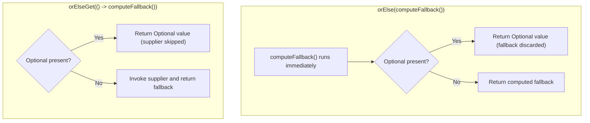

Look at a traditional Java repository method:

```java
public User findById(String id)
```

Nothing in that signature tells the caller whether `findById` returns `null` when no user exists, or throws an exception. Every caller has to guess, read the implementation, or sprinkle defensive `if (user != null)` checks everywhere. Forget one check, and production code fails with a `NullPointerException` far away from where the `null` originally came from.

Java 8 introduced `java.util.Optional<T>` to make "this result might be absent" explicit in the type system:

```java
public Optional<User> findById(String id)
```

Now the compiler forces the caller to acknowledge the empty case before unwrapping the `User`. Used as intended, `Optional` eliminates a large class of accidental `NullPointerException` bugs. Used in the wrong places, such as entity fields or method parameters, it creates awkward APIs and unnecessary heap overhead.

## Creating Optionals: `of`, `ofNullable`, and `empty`

`Optional` has no public constructor. You create instances through three static factory methods:

```java
// 1. Optional.of(value): fails fast with NullPointerException if value is null.
// Use when a null here would indicate a bug in your code.
Optional<String> present = Optional.of("alice@example.com");

// 2. Optional.ofNullable(value): returns Optional.of(value) if non-null, or Optional.empty() if null.
// Use when wrapping values from legacy APIs, Map.get(), or nullable fields.
String maybeHeader = request.getHeader("X-Trace-Id");
Optional<String> traceId = Optional.ofNullable(maybeHeader);

// 3. Optional.empty(): represents an explicit absence of a value.
Optional<String> absent = Optional.empty();
```

> [!WARNING]
> Never return `null` from a method whose return type is `Optional<T>`. Returning `null` forces callers to write `if (opt != null && opt.isPresent())`, defeating the entire point of `Optional`. Always return `Optional.empty()`.

## Consuming and Extracting Values

Once you hold an `Optional<T>`, avoid falling back into imperative `isPresent()` + `get()` blocks, which are just verbose null checks in disguise. `Optional` gives you targeted methods for each situation.

### Running Side Effects: `ifPresent` and `ifPresentOrElse`

When you only want to run an action if a value exists, use `ifPresent(Consumer<T>)`:

```java
userRepository.findById(userId)
        .ifPresent(user -> notificationService.sendWelcome(user));
```

If you need an action for both branches, Java 9 added `ifPresentOrElse(Consumer<T>, Runnable)`:

```java
userRepository.findById(userId).ifPresentOrElse(
        user -> auditLog.recordLogin(user.id()),
        () -> auditLog.recordUnknownUser(userId)
);
```

### Providing Fallbacks: `orElse` vs. `orElseGet`

One of the most common subtle bugs with `Optional` comes from mixing up `orElse(T other)` and `orElseGet(Supplier<? extends T> supplier)`:

```java
Optional<User> existing = userRepository.findByEmail(email);

// Eager: createDefaultUser() ALWAYS runs, even when 'existing' is present!
User userA = existing.orElse(createDefaultUser(email));

// Lazy: createDefaultUser() ONLY runs if 'existing' is empty
User userB = existing.orElseGet(() -> createDefaultUser(email));
```

Java evaluates all method arguments **before** entering the method body. In `existing.orElse(createDefaultUser(email))`, Java calls `createDefaultUser(email)` first, hands the returned object to `orElse`, and then immediately discards it if `existing` already had a value. If `createDefaultUser` writes a row to a database, calls an HTTP endpoint, or allocates heavy objects, that work happens on every single call.



A simple guideline keeps this straight:

- Use **`orElse(value)`** only for already-computed constants or cheap literals, such as `orElse("guest")`, `orElse(0)`, or `orElse(List.of())`.
- Use **`orElseGet(() -> ...)`** whenever constructing the fallback involves computation, allocation, or I/O.

### Throwing When Absent: `orElseThrow`

When an empty `Optional` means the caller cannot continue, use `orElseThrow`:

```java
// Custom domain exception
User user = userRepository.findById(userId)
        .orElseThrow(() -> new UserNotFoundException("No user found for id " + userId));

// Java 10+ no-arg overload: throws NoSuchElementException (clearer intent than get())
User required = userRepository.findById(userId).orElseThrow();
```

Prefer no-arg `orElseThrow()` (added in Java 10) over `get()`. Both throw `NoSuchElementException` when empty, but `orElseThrow()` makes the failure contract obvious to anyone reading the code.

## Mapping and Chaining Optionals

Instead of unwrapping at every step to check for absence, you can transform and filter values while keeping them inside `Optional`.

### `filter` and `map`

`filter(Predicate<T>)` turns a present `Optional` into `Optional.empty()` if the value fails the predicate. `map(Function<T, U>)` transforms the value if present and wraps the result in a new `Optional` (or returns `Optional.empty()` if the mapping function returns `null`).

```java
record Address(String city, String country) {}
record User(String username, boolean active, Address address) {}

String city = userRepository.findById(userId)
        .filter(User::active)
        .map(User::address)
        .map(Address::city)
        .orElse("Unknown");
```

If the user is missing, inactive, has a `null` address, or has a `null` city, every remaining step in the chain is skipped and `"Unknown"` is returned cleanly with zero nested `if` statements.

### Flattening Nested Optionals with `flatMap`

When a mapping step itself returns an `Optional`, calling `map()` creates a double-wrapped `Optional<Optional<U>>`. Use `flatMap()` to keep the chain flat:

```java
public interface ProfileService {
    Optional<User> findUser(String id);
    Optional<String> findBackupEmail(User user);
}

// Awkward nested wrapper:
Optional<Optional<String>> nested = profileService.findUser(id)
        .map(profileService::findBackupEmail);

// Flat and readable:
Optional<String> backupEmail = profileService.findUser(id)
        .flatMap(profileService::findBackupEmail);
```

### Chaining Fallback Sources with `or()` (Java 9+)

While `orElseGet()` unwraps the `Optional` into a raw `T`, `or(Supplier<Optional<T>>)` stays inside `Optional` and lazily tries another `Optional`-returning source only if the current one is empty:

```java
Optional<User> user = cache.findUser(userId)
        .or(() -> primaryDb.findUser(userId))
        .or(() -> legacyApi.fetchUser(userId));
```

Each supplier runs only if every previous lookup came back empty.

### Bridging `Optional` and Streams with `stream()` (Java 9+)

When you map a stream of IDs to `Optional<User>` lookups, you get a `Stream<Optional<User>>`. Java 9 added `Optional.stream()`, which turns an `Optional` into a `Stream` of 0 or 1 element. Pairing it with `flatMap` cleanly drops empty results and unwraps present ones:

```java
List<User> foundUsers = requestedIds.stream()
        .map(userRepository::findById)
        .flatMap(Optional::stream)
        .toList();
```

In Java 8, the same operation required `.filter(Optional::isPresent).map(Optional::get)`.

## Why `Optional` Belongs on Return Types (and Not Elsewhere)

The JDK designers had a narrow goal for `Optional`: provide a clear return type for methods (like `Stream.findFirst()` or repository queries) that legitimately may have no result. Extending it beyond return types usually backfires.

### Do Not Use `Optional` for Class Fields

```java
// Avoid: hurts serialization, frameworks, and memory usage
public class Customer {
    private String id;
    private Optional<String> middleName;
}
```

There are three concrete reasons to keep fields as plain nullable references and return `Optional` from getters if desired:

1. **Not `Serializable`**: `Optional` intentionally does not implement `java.io.Serializable`. Using it as a field breaks Java serialization, many distributed cache codecs, and JPA/Hibernate entity mappings.
2. **Extra heap overhead**: Each `Optional` is a separate heap object (typically 16 bytes with Compressed Oops on 64-bit HotSpot) plus the reference to it. A plain `null` reference allocates zero extra objects.
3. **JSON/framework friction**: Libraries like Jackson require extra modules (`Jdk8Module`) to serialize `Optional` fields, and distinguishing "field absent" from "field explicitly null" still needs care.

If you want `Optional` ergonomics for callers of a domain object, store a nullable field internally and expose an `Optional` getter:

```java
public class Customer {
    private final String id;
    private final String middleName; // Nullable internal field

    public Optional<String> middleName() {
        return Optional.ofNullable(middleName);
    }
}
```

### Do Not Use `Optional` as a Method Parameter

```java
// Avoid: forces verbose wrapping at every call site
public List<Order> searchOrders(String customerId, Optional<LocalDate> fromDate)
```

Accepting `Optional` parameters forces every caller to write `Optional.of(...)` or `Optional.empty()`, and nothing stops a caller from passing `null` for the `Optional` itself. Method overloading (or a small search criteria record/builder) gives callers a much cleaner API:

```java
public List<Order> searchOrders(String customerId) {
    return searchOrders(customerId, null);
}

public List<Order> searchOrders(String customerId, LocalDate fromDate) {
    // Handle nullable fromDate internally
}
```

### Do Not Wrap Collections or Arrays in `Optional`

Never return `Optional<List<Order>>` or `Optional<Map<String, String>>`. Collections already represent absence cleanly by being empty (`List.of()`, `Set.of()`, `Map.of()`). Wrapping a collection in `Optional` creates two different ways to mean "nothing found" (an empty `Optional` vs. an `Optional` containing an empty list), forcing callers to check both.

### Value-Based Class Caveat

`Optional` is documented as a **value-based class**. Never use `==` to compare two `Optional` instances (use `.equals()`), and never synchronize on an `Optional` object (`synchronized (opt)`). Future JVM enhancements (such as Project Valhalla value classes) may change object identity semantics for value-based classes.

## Primitive Specializations: `OptionalInt`, `OptionalLong`, `OptionalDouble`

Wrapping a primitive `int` in `Optional<Integer>` pays for two heap objects: the boxed `Integer` and the `Optional` wrapper around it. For numeric results, especially from primitive streams (`IntStream`, `LongStream`, `DoubleStream`), use `OptionalInt`, `OptionalLong`, and `OptionalDouble`:

```java
OptionalInt highestScore = IntStream.of(78, 92, 85).max();
int result = highestScore.orElse(0);

OptionalDouble average = DoubleStream.of(12.5, 18.0, 14.5).average();
average.ifPresent(avg -> System.out.printf("Average: %.2f%n", avg));
```

Note that the primitive `Optional` classes are smaller APIs than `Optional<T>`: they have `isPresent`, `isEmpty` (Java 11+), `ifPresent`, `ifPresentOrElse`, `orElse`, `orElseGet`, `orElseThrow`, and `stream()`, but they do **not** have `map` or `flatMap`.

## Interview Questions

### Why does `Optional.orElse(expensiveCall())` behave differently from `Optional.orElseGet(() -> expensiveCall())`?

Java evaluates method arguments eagerly before calling the method. With `orElse(expensiveCall())`, `expensiveCall()` executes unconditionally on every invocation, even when the `Optional` already holds a value; the fallback result is simply thrown away. With `orElseGet(() -> expensiveCall())`, you pass a `Supplier` lambda that `orElseGet` invokes only when the `Optional` is empty. Use `orElse` for cheap constants and `orElseGet` for anything involving computation, allocation, or I/O.

### Why is `Optional` recommended for method return types but discouraged for class fields and method parameters?

`Optional` was designed specifically to communicate a possibly absent return value so callers handle it explicitly. As a class field, it breaks `Serializable` contracts (and JPA entities), adds extra heap object overhead per field, and complicates serialization frameworks. As a method parameter, it degrades call-site readability (requiring `Optional.of`/`Optional.empty` everywhere) while still leaving the parameter itself vulnerable to `null`. Method overloading or a request object solves optional parameters cleanly, while nullable private fields with `Optional`-returning getters work well for domain classes.

### When do you use `Optional.flatMap()` instead of `Optional.map()`?

`map(Function<T, U>)` takes a function returning a plain value `U` and wraps that result inside an `Optional<U>`. If your transformation method already returns an `Optional<U>`, calling `map` produces a nested `Optional<Optional<U>>`. `flatMap(Function<T, Optional<U>>)` expects the mapper to return an `Optional<U>` and returns it directly without double-wrapping, letting you chain multiple fallible lookups cleanly.

### Why should a method never return `Optional<List<T>>`?

A `List` (or any collection) already has a standard representation for "no elements": an empty list (`List.of()`). Wrapping it in `Optional` creates an ambiguous second empty state (`Optional.empty()` versus `Optional.of(List.of())`), complicates calling code, and adds an unnecessary wrapper allocation. Returning an empty collection lets callers iterate or stream directly without any extra unwrapping.
