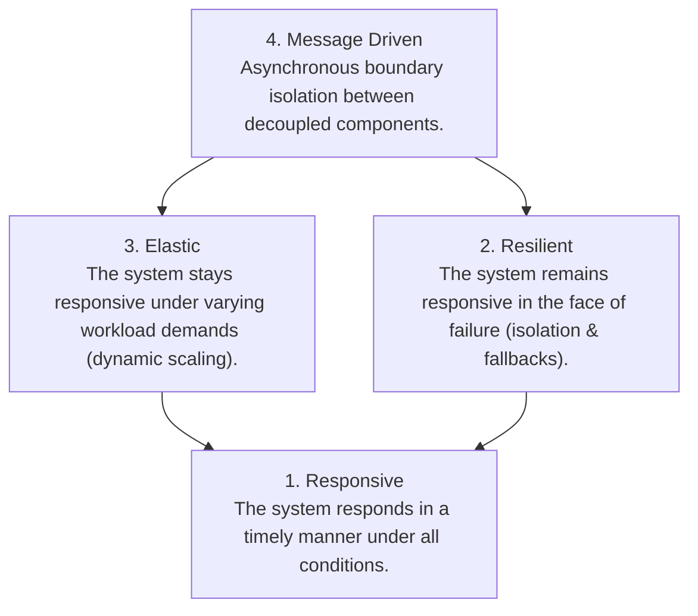
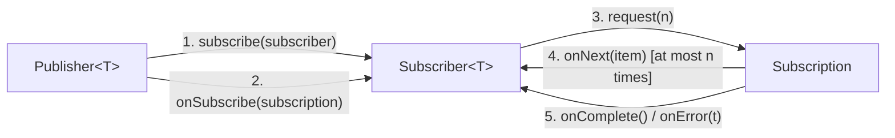
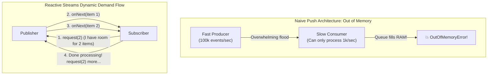
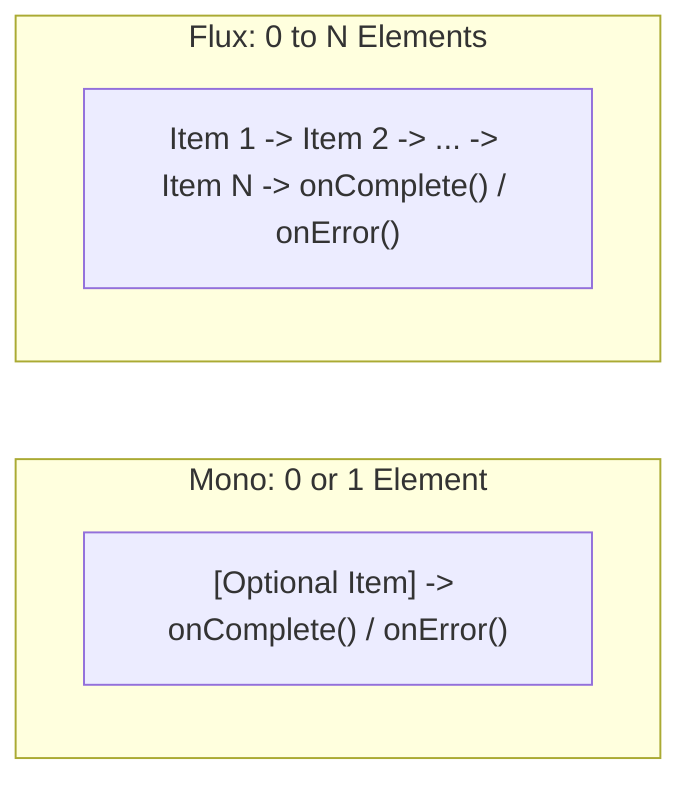
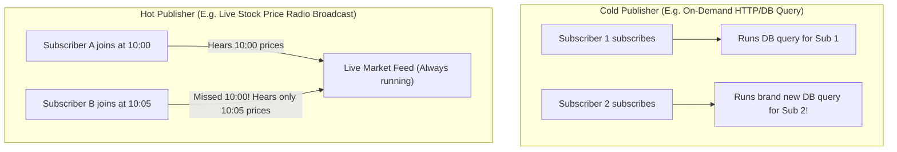
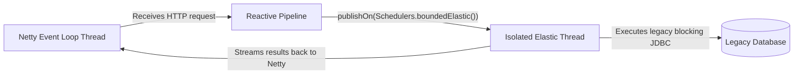

In traditional synchronous web applications (like classic Spring MVC), servers follow the **Thread-per-Request** model: each incoming HTTP request claims a dedicated operating system thread from a thread pool (e.g. Tomcat's pool of 200 threads).

While the thread waits for a database query to return, an external microservice to respond, or a file to read from disk, **the thread is completely blocked**. It sits idle, doing zero CPU work, yet holding ~1 MB of native stack memory.

When 10,000 concurrent users hit the server, the thread pool is instantly exhausted. Requests queue up, latency explodes, and the server crashes with `OutOfMemoryError`.

To overcome this scaling barrier, the industry developed **Reactive Programming**.

Reactive programming is an asynchronous programming paradigm focused on **non-blocking data streams** and the propagation of change through **Backpressure**. Understanding how the **Reactive Streams specification**, the **JDK `Flow` API**, and **Project Reactor (`Mono` and `Flux`)** work under the hood is crucial for architecting modern, high-throughput event-driven microservices.

---

## The Four Tenets of The Reactive Manifesto

In 2014, engineers from Lightbend, Netflix, and Pivotal published **The Reactive Manifesto**, outlining four architectural pillars for resilient distributed systems:



1. **Responsive:** Consistently low latency, meeting strict SLAs.
2. **Resilient:** Failures are isolated to individual components without cascading across the entire architecture.
3. **Elastic:** Scales throughput up and down smoothly based on traffic demands.
4. **Message-Driven:** Uses asynchronous non-blocking message passing to decouple senders from receivers.

---

## The Reactive Streams Specification

To standardize non-blocking asynchronous data pipelines across Java vendors (RxJava, Akka Streams, Project Reactor, Vert.x), the industry created the **Reactive Streams Specification**.

In Java 9, the JDK officially integrated this contract directly into the standard library under **`java.util.concurrent.Flow`**:



### The Four Interfaces of `java.util.concurrent.Flow`

1. **`Publisher<T>`**: Emits an unbounded, sequenced stream of items to subscribers based on received demand:
   ```java
   public interface Publisher<T> {
       void subscribe(Subscriber<? super T> subscriber);
   }
   ```
2. **`Subscriber<T>`**: Receives stream events and items:
   ```java
   public interface Subscriber<T> {
       void onSubscribe(Subscription subscription); // First signal received
       void onNext(T item);                         // Data element received
       void onError(Throwable throwable);          // Terminal error event
       void onComplete();                           // Terminal success event
   }
   ```
3. **`Subscription`**: The control link connecting one Publisher to one Subscriber. **This is where Backpressure lives!**
   ```java
   public interface Subscription {
       void request(long n); // Subscriber requests 'n' items (flow control)
       void cancel();        // Subscriber cancels the subscription
   }
   ```
4. **`Processor<T, R>`**: A pipeline stage that acts simultaneously as both a `Subscriber<T>` and a `Publisher<R>`.

---

## Backpressure: The Heart of Reactive Systems

In classic asynchronous push architectures, a fast producer can emit 100,000 events per second, while a slow consumer (e.g., writing to a disk or external API) can only process 1,000 events per second. 

Without flow control:
- Events accumulate in unconstrained memory buffers.
- The consumer runs out of heap space and crashes with `OutOfMemoryError`.



**Backpressure is dynamic pull-push flow control.** 
- The Subscriber dictates the transmission rate by calling `subscription.request(n)`.
- The Publisher is strictly forbidden from sending more than `n` items.
- If the subscriber has no capacity, it does not request items, forcing the producer to slow down or apply an overflow strategy!

### Backpressure Overflow Strategies
When a producer cannot slow down (e.g., a hardware network socket receiving live telemetry), you must define an explicit overflow policy:
- **`onBackpressureBuffer()`**: Queues elements in a bounded memory buffer until the subscriber catches up.
- **`onBackpressureDrop()`**: Silently drops excess incoming items that exceed the consumer's demand.
- **`onBackpressureLatest()`**: Keeps only the most recent item, overwriting previous unconsumed items (ideal for stock tickers and UI sliders).
- **`onBackpressureError()`**: Emits an `IllegalStateException` immediately when the consumer is overwhelmed.

---

## Project Reactor: `Mono` and `Flux`

While the JDK provides the standard `Flow` interfaces, it contains no operational operators (like `map` or `filter`). In production, the enterprise standard library is **Project Reactor** (which powers Spring WebFlux).

Reactor introduces two fundamental publishers:



1. **`Mono<T>`**: Emits at most **one item** (0 or 1), then terminates. Ideal for asynchronous HTTP responses, database lookups by ID, or tasks returning `void` (`Mono<Void>`).
2. **`Flux<T>`**: Emits **zero to many items** (0 to N), potentially infinite. Ideal for real-time WebSocket feeds, Kafka event streams, and file chunk processing.

### The Golden Rule of Reactive Programming
> **"NOTHING HAPPENS UNTIL YOU SUBSCRIBE!"**

Writing a reactive pipeline simply builds an assembly blueprint. No database query is executed, no network socket is opened, and no memory is allocated until a subscriber triggers demand:

```java
// ⚠️ NO WORK HAPPENS HERE! This merely constructs a pipeline descriptor:
Flux<String> userPipeline = Flux.just("alice", "bob", "charlie")
        .filter(name -> name.startsWith("a"))
        .map(String::toUpperCase);

// ✅ WORK COMMENCES NOW! Calling .subscribe() triggers onSubscribe and request(n):
userPipeline.subscribe(
        item -> System.out.println("Received: " + item),     // onNext
        error -> System.err.println("Error: " + error),      // onError
        () -> System.out.println("Processing complete!")     // onComplete
);
```

---

## Hot vs. Cold Publishers

Understanding the temperature of your publisher prevents massive architectural bugs:



### Cold Publishers (The Default)
A cold publisher generates data **fresh on-demand for each subscriber**.
- Like streaming a movie on Netflix: whenever you press "Play", the movie starts from the beginning for you, completely independent of other viewers.
- Examples: `Flux.just()`, `Flux.fromIterable()`, reactive database queries (R2DBC).

### Hot Publishers
A hot publisher emits data **regardless of whether any subscribers exist**.
- Like a live FM radio broadcast: if you tune in 15 minutes late, you miss the first 15 minutes of the broadcast. All subscribers share the same active stream.
- Examples: Kafka consumer topics, WebSocket price tickers, system mouse clicks.

---

## Schedulers: Thread Hopping and Non-Blocking I/O

In a reactive system, your pipeline runs on a tiny event-loop thread pool (Netty's event loop typically has only 1 thread per CPU core).

> [!CAUTION]
> **The Fatal Reactive Sin: Blocking the Event Loop!**
> If you execute a blocking database call (JDBC) or `Thread.sleep()` inside a reactive operator, you freeze the Netty event loop thread. A single blocked thread can stall thousands of concurrent user connections!

### Isolate Blocking Work with Schedulers
Reactor provides **`Schedulers`** to control which thread pools execute different stages of the pipeline:

- **`Schedulers.parallel()`**: Fixed-size pool for CPU-bound computations (sized to CPU cores).
- **`Schedulers.boundedElastic()`**: Dynamically growing pool engineered to safely offload **legacy blocking I/O** (blocking JDBC calls, file reading) without starving the event loop.



```java
public Mono<UserProfile> fetchUserProfile(String userId) {
    return Mono.fromCallable(() -> legacyBlockingJdbcQuery(userId))
            // Offloads blocking JDBC call to a dedicated thread pool!
            .subscribeOn(Schedulers.boundedElastic())
            .map(this::transformToDto);
}
```

- **`subscribeOn(Scheduler)`**: Dictates which thread pool runs the source emission.
- **`publishOn(Scheduler)`**: Switches thread context for all downstream operators following the `publishOn` call.

---

## Reactive Streams vs. Java 21 Project Loom (Virtual Threads)

With the arrival of **Virtual Threads in Java 21**, developers often ask: *Is Reactive Programming obsolete?*

The answer is **No, but the trade-offs have shifted fundamentally**:

| Dimension | Reactive Programming (Project Reactor) | Project Loom (Virtual Threads) |
|---|---|---|
| **Programming Model** | **Declarative / Monadic:** Pipelines built via operators (`map`, `flatMap`, `zip`). | **Imperative / Synchronous:** Familiar `try-catch`, sequential loops, direct returns. |
| **Backpressure Support** | **Built-in First Class:** Dynamic pull-push flow control (`request(n)`). | **None:** Must be implemented manually via semaphores, queues, or rate limiters. |
| **Debugging & Stack Traces** | Notoriously difficult; stack traces span across async scheduler boundaries. | **Effortless:** Standard stack traces show the exact line and sequential call hierarchy. |
| **Ideal Use Case** | Real-time event streams (WebSockets, SSE), complex multi-stream transformations, micro-batching. | High-throughput request-response REST APIs, standard database I/O services. |

---

## Summary & Mental Model Checkpoint

1. **The Core Problem**: Blocking I/O wastes expensive OS threads, creating the thread-per-request scalability wall.
2. **Four Roles of Flow**: `Publisher` (producer), `Subscriber` (consumer), `Subscription` (flow control link), and `Processor` (transformer).
3. **Backpressure Contract**: The subscriber controls flow rate by calling `subscription.request(n)`. Producers must never exceed demand.
4. **`Mono` vs `Flux`**: `Mono` emits 0 or 1 item; `Flux` emits 0 to N items.
5. **Subscription Mandate**: Nothing executes in a reactive pipeline until `.subscribe()` is called.
6. **Cold vs Hot**: Cold publishers generate data per subscriber (Netflix); Hot publishers broadcast regardless of subscribers (Live Radio).
7. **Never Block Event Loops**: Always isolate legacy blocking I/O using `.subscribeOn(Schedulers.boundedElastic())`.

---

## 🎯 Senior Engineer Interview Questions

### What is the Reactive Streams specification, and how does its `Subscription.request(long n)` mechanism implement backpressure?
> **Answer:** The Reactive Streams specification (formalized in Java 9 as `java.util.concurrent.Flow`) is a standard for asynchronous stream processing with non-blocking backpressure. Under naive asynchronous push architectures, a fast publisher can flood a slower subscriber, causing queue saturation and eventual `OutOfMemoryError`. The `Subscription.request(long n)` method inverts control into a dynamic pull-push model: when a subscriber connects, it receives a `Subscription` handle via `onSubscribe()`. The subscriber must explicitly request demand by calling `subscription.request(n)`. The publisher is strictly forbidden by the specification from invoking `onNext()` more than `n` times until the subscriber issues further demand. If the subscriber is busy processing, it stops requesting items, forcing the publisher to pause emission, buffer within bounded limits, or drop elements according to a defined overflow policy.

### What is the difference between a Cold Publisher and a Hot Publisher in Project Reactor? Give a real-world architectural example of each.
> **Answer:** A **Cold Publisher** produces data on-demand and independently for each subscriber. The underlying data generation logic (such as opening a database cursor or creating an HTTP connection) is deferred until a subscriber calls `.subscribe()`. Every subscriber observes the entire sequence of data from the beginning. An example is a reactive database query using R2DBC (`repository.findById(id)`): each subscriber triggers a fresh database query. In contrast, a **Hot Publisher** emits data continuously regardless of whether any active subscribers exist. Subscribers that join mid-stream observe only data emitted after their subscription time, missing earlier items. An example is a real-world telemetry stream from an IoT sensor or a financial stock exchange price feed over WebSockets: market prices fluctuate whether or not a client is connected to receive them.

### What happens when you invoke a blocking operation (such as JDBC or `Thread.sleep()`) inside a Project Reactor operator without specifying a Scheduler? How do you fix it?
> **Answer:** In reactive web frameworks like Spring WebFlux, the execution pipeline runs on a non-blocking event-loop thread pool (typically Netty worker threads sized to the number of physical CPU cores, e.g. 8 threads on an 8-core server). If a developer executes a blocking operation (like traditional blocking JDBC or `RestTemplate`) directly inside a reactive operator (such as `map` or `flatMap`), the underlying Netty event loop thread is halted in an OS blocked state waiting for I/O. Because the event loop thread pool is tiny, blocking just a few threads halts request processing for hundreds or thousands of concurrent user connections multiplexed on those threads, causing total system paralysis. To fix this, blocking operations must be explicitly isolated using the **`subscribeOn(Schedulers.boundedElastic())`** or **`publishOn(Schedulers.boundedElastic())`** operators. This instructs Reactor to offload the blocking task to an isolated, elastic thread pool with automatic thread capping and queueing, keeping the core event-loop threads free to service incoming network traffic.

### How do Java 21 Virtual Threads (Project Loom) alter the architectural justification for using reactive frameworks like Project Reactor for standard REST APIs?
> **Answer:** Historically, reactive programming (e.g. Spring WebFlux with Project Reactor) was the only viable way in Java to achieve high concurrency (100,000+ simultaneous connections) without exhausting system memory, because standard OS threads allocate ~1 MB of stack memory each and incur heavy kernel context-switching overhead. However, reactive programming comes with massive cognitive overhead: asynchronous monadic syntax, loss of standard `try-catch` exception propagation, and unreadable stack traces that cross thread scheduling boundaries. Java 21 Virtual Threads solve the underlying scalability problem at the JVM runtime level. Virtual threads are extremely lightweight (~hundreds of bytes) and managed in user-space. When a virtual thread performs a blocking I/O operation (like blocking JDBC or HTTP), the JVM automatically unmounts it from its underlying OS carrier thread without blocking kernel resources. For standard request-response REST APIs, Virtual Threads allow developers to write simple, readable, synchronous imperative code that scales just as effectively as reactive code. However, reactive programming remains superior for **continuous streaming architectures, complex multi-stream transformations (`zip`, `merge`), and scenarios requiring granular backpressure flow control**.