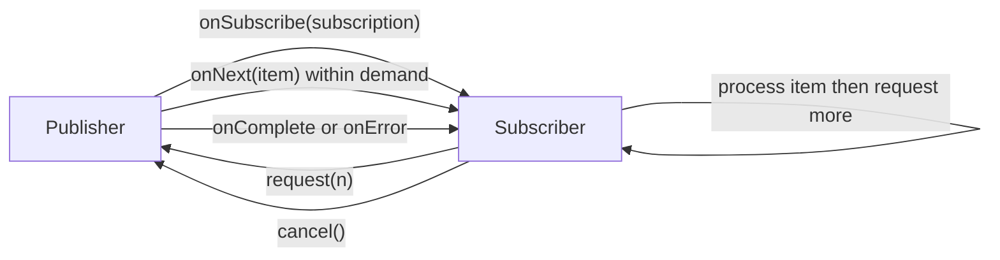

An ordinary method call returns when its work is done. In an asynchronous system, a producer may emit values over time while a consumer is still processing earlier values. If the producer can outpace the consumer, queued work and memory use can grow without bound.

Reactive Streams standardizes how asynchronous producers and consumers exchange data with **backpressure**: the consumer communicates how many items it is ready to receive. Java 9 added the related `java.util.concurrent.Flow` interfaces to the JDK, and libraries such as Project Reactor build higher-level operators and publisher types on this model.

This lesson uses the Java 21 `Flow` API and the Reactor Core API as documented in its current reference guide. The Reactor examples require Reactor Core on the classpath; this repository does not include that Java dependency.

## The publisher-subscriber protocol

The protocol has four roles:

- A **Publisher** produces a sequence of values.
- A **Subscriber** receives values and terminal signals.
- A **Subscription** connects one publisher to one subscriber and carries demand and cancellation.
- A **Processor** is both a subscriber and a publisher, transforming or relaying data between stages.

The basic signal sequence is `onSubscribe`, zero or more `onNext` signals, then at most one terminal signal: `onComplete` or `onError`. A subscriber requests demand through its subscription; values must not be sent beyond that demand. The subscriber can cancel when it no longer needs values.



The feedback loop is the key idea: the subscriber controls its outstanding demand instead of being forced to accept an unlimited push of values.

## Backpressure in Java Flow

`Flow.Publisher`, `Flow.Subscriber`, `Flow.Subscription`, and `Flow.Processor` correspond to the Reactive Streams protocol. The JDK's `SubmissionPublisher` is a concrete asynchronous publisher useful for examples; its per-subscriber buffers can absorb short-lived rate differences, but they are bounded. Its `submit` method blocks if buffers are saturated, so it is not an unlimited queue.

This subscriber requests one item at a time. It requests the next item only after processing the current one:

```java
import java.util.concurrent.CountDownLatch;
import java.util.concurrent.Flow;
import java.util.concurrent.SubmissionPublisher;
import java.util.concurrent.TimeUnit;

public class FlowDemandExample {
    static final class OneAtATimeSubscriber implements Flow.Subscriber<Integer> {
        private final CountDownLatch completed = new CountDownLatch(1);
        private Flow.Subscription subscription;

        @Override
        public void onSubscribe(Flow.Subscription subscription) {
            this.subscription = subscription;
            subscription.request(1);
        }

        @Override
        public void onNext(Integer item) {
            System.out.println("Received " + item);
            subscription.request(1);
        }

        @Override
        public void onError(Throwable error) {
            error.printStackTrace();
            completed.countDown();
        }

        @Override
        public void onComplete() {
            System.out.println("Complete");
            completed.countDown();
        }

        void awaitCompletion() throws InterruptedException {
            if (!completed.await(5, TimeUnit.SECONDS)) {
                throw new IllegalStateException("Subscriber did not complete");
            }
        }
    }

    public static void main(String[] args) throws InterruptedException {
        OneAtATimeSubscriber subscriber = new OneAtATimeSubscriber();

        try (SubmissionPublisher<Integer> publisher = new SubmissionPublisher<>()) {
            publisher.subscribe(subscriber);
            publisher.submit(10);
            publisher.submit(20);
            publisher.submit(30);
            publisher.close();
            subscriber.awaitCompletion();
        }
    }
}
```

The publisher delivers items asynchronously; the latch keeps this small demonstration alive until the subscriber receives the terminal signal. The example uses bounded data and lets the subscriber process each value before requesting another. Production code must also define what happens when processing fails, when a subscriber cancels, or when the producer cannot keep up.

Backpressure does not mean “make the producer faster” or “drop every extra item.” It is a resource policy. Depending on the domain, a slow consumer might cause upstream work to slow down, a bounded buffer to fill, an item to be rejected, or the oldest/latest item to be retained. Dropping or overwriting values is only correct when the application can tolerate that loss.

## Reactor: `Mono` and `Flux`

Project Reactor provides two central publisher types:

- `Mono<T>` represents an asynchronous result that emits zero or one value, then completes, or terminates with an error.
- `Flux<T>` represents an asynchronous sequence of zero to many values, then completion, or an error.

These are not containers that eagerly hold all results. They describe a publisher pipeline. Operators such as `map`, `filter`, and `flatMap` compose transformations, while `subscribe` establishes a subscriber and starts the flow.

```java
import reactor.core.publisher.Flux;

public class ReactorFluxExample {
    public static void main(String[] args) {
        Flux<String> normalizedNames = Flux.just("Ada", "", "Grace")
                .filter(name -> !name.isBlank())
                .map(String::toUpperCase);

        normalizedNames.subscribe(
                name -> System.out.println("Value: " + name),
                error -> System.err.println("Failed: " + error.getMessage()),
                () -> System.out.println("Complete"));
    }
}
```

`subscribe` has overloads for values, errors, and completion. A pipeline that is assembled but never subscribed to may do no work, depending on its source. In application code, frameworks often subscribe at a defined boundary; avoid scattering fire-and-forget subscriptions through business logic because that makes cancellation and error handling difficult to coordinate.

A `Mono` composes naturally when each stage produces at most one result:

```java
import reactor.core.publisher.Mono;

public class ReactorMonoExample {
    record Profile(String displayName) {}

    static Mono<Profile> findProfile(String userId) {
        return "ada".equals(userId)
                ? Mono.just(new Profile("Ada Lovelace"))
                : Mono.empty();
    }

    public static void main(String[] args) {
        Mono<String> displayName = findProfile("ada")
                .map(Profile::displayName)
                .switchIfEmpty(Mono.just("Anonymous"));

        displayName.subscribe(System.out::println);
    }
}
```

`Mono<Void>` is useful for an asynchronous operation whose meaningful outcome is completion rather than a value. An error is a terminal signal, not a normal value; operators such as `onErrorResume` can map selected failures to a fallback publisher, while `onErrorMap` can translate an error. Retrying resubscribes to a source, so it can repeat side effects; use retry only when the operation and retry policy make that safe.

## Composition, scheduling, and blocking

Reactive operators describe relationships between publishers:

- Use `map` for a synchronous one-to-one transformation.
- Use `flatMap` when a value selects another asynchronous publisher and the results may interleave.
- Use `concatMap` when the next publisher should be processed after the previous one, preserving sequence order.
- Use `doOnNext` for observation such as logging, not for transforming the value.

Reactive APIs do not make blocking work non-blocking. A blocking database call inside a `map` still blocks whichever thread executes that callback. Use a reactive client for end-to-end non-blocking I/O; when integrating unavoidable blocking work, isolate it using the library's documented scheduler strategy. Calling `block()` in the middle of an asynchronous chain defeats composition and can cause thread starvation or deadlocks in constrained event-loop environments. Blocking at a deliberate boundary can be appropriate in small command-line programs or tests.

Similarly, backpressure does not automatically bound every resource. A pipeline can still accumulate work if it introduces unbounded queues, buffers, or concurrency. Choose explicit limits and overflow behavior, and ensure cancellation is propagated to work that can be stopped.

## Common misconceptions

- **Asynchronous is not automatically reactive.** A callback or future can be asynchronous without providing demand-based flow control.
- **Backpressure is not data-loss policy.** Dropping, buffering, and rejecting values have different domain consequences; choose intentionally.
- **A `Flux` is not necessarily finite.** It can represent a long-lived or unbounded sequence, so termination and cancellation matter.
- **Creating a pipeline is not always executing it.** In Reactor, subscription is normally the point that activates the flow.
- **Reactive does not mean one thread per element.** Threading depends on the source, scheduler boundaries, and operators.
- **Error recovery is not free retry.** Retrying can repeat external effects such as writes or payments.

## Practical rules

- Use a reactive API when the application needs asynchronous composition and the surrounding I/O stack supports it.
- Understand demand, cancellation, completion, and error signals before implementing a `Subscriber` or `Publisher`.
- Keep buffers and concurrency bounded; define an explicit policy for overload.
- Compose publishers and subscribe at clear application boundaries.
- Keep blocking work out of non-blocking event-loop paths, or isolate it explicitly.
- Make retry idempotency and side effects part of the design, not an afterthought.

## Further reading

- [Java 21 `Flow`](https://docs.oracle.com/en/java/javase/21/docs/api/java.base/java/util/concurrent/Flow.html)
- [Java 21 `SubmissionPublisher`](https://docs.oracle.com/en/java/javase/21/docs/api/java.base/java/util/concurrent/SubmissionPublisher.html)
- [Reactive Streams JVM specification](https://github.com/reactive-streams/reactive-streams-jvm/blob/v1.0.4/README.md)
- [Project Reactor: Introduction to Reactive Programming](https://projectreactor.io/docs/core/release/reference/reactiveProgramming.html)
- [Project Reactor `Flux`](https://projectreactor.io/docs/core/release/reference/coreFeatures/flux.html)
- [Project Reactor `Mono`](https://projectreactor.io/docs/core/release/reference/coreFeatures/mono.html)
