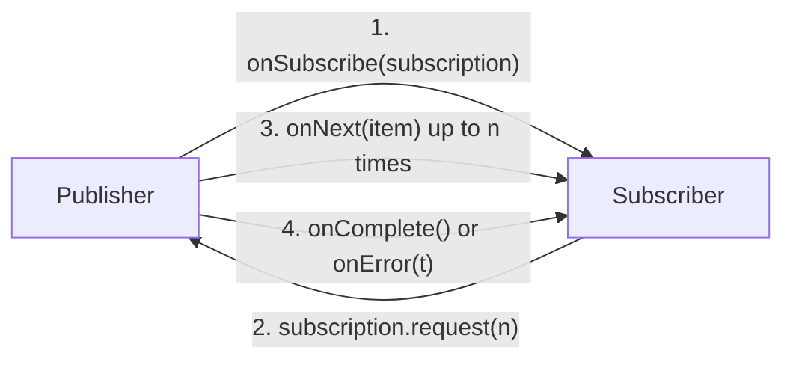
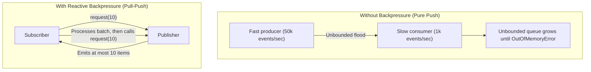
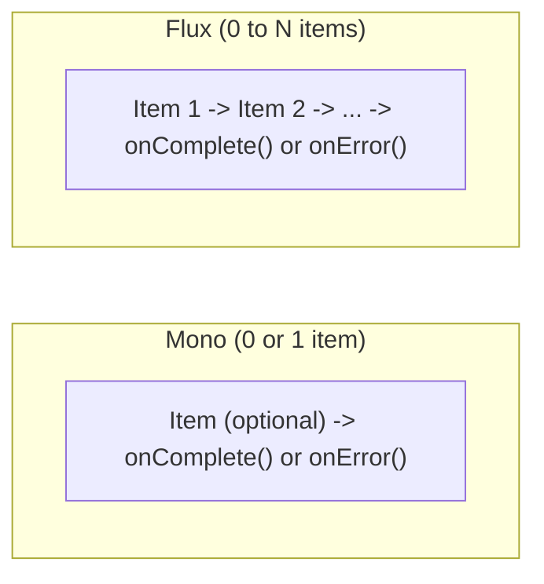

In a classic servlet server like Tomcat running Spring MVC, each incoming HTTP request claims an operating system thread from a fixed pool (often 200 threads by default). Whenever that request waits on a database query, a downstream REST call, or disk I/O, the thread sits blocked while still holding roughly 1 MB of stack memory. Under heavy I/O concurrency, those threads fill up quickly and incoming requests queue behind them.

Reactive programming emerged as one way to break that bottleneck: instead of parking a thread while waiting for I/O, a small pool of event-loop threads handles thousands of concurrent streams asynchronously, propagating data and flow-control signals as events arrive.

To understand reactive libraries like Project Reactor (the engine behind Spring WebFlux), it helps to start with the design pattern they evolved from: the **Observer pattern**.

## From the Observer Pattern to Reactive Streams

In the classic Gang of Four **Observer pattern**, a subject maintains a list of listeners and pushes updates to them whenever its state changes:

```java
import java.util.List;
import java.util.concurrent.CopyOnWriteArrayList;

public interface PriceObserver {
    void onPriceUpdate(String symbol, double price);
}

public class StockTicker {
    private final List<PriceObserver> observers = new CopyOnWriteArrayList<>();

    public void addObserver(PriceObserver observer) {
        observers.add(observer);
    }

    public void publishPrice(String symbol, double price) {
        for (PriceObserver observer : observers) {
            observer.onPriceUpdate(symbol, price);
        }
    }
}
```

The Observer pattern works well for simple in-process UI events or low-volume notifications, and it already decouples the producer from its consumers. However, once you try to use plain Observer for asynchronous network streams or high-throughput event pipelines, three structural gaps appear:

1. **No completion signal**: An observer receives `onPriceUpdate(...)` calls, but there is no standard way for the subject to say "this stream has finished normally, clean up your resources."
2. **No dedicated error channel**: If the upstream data source fails (say, a network socket drops), plain Observer has no standard `onError(Throwable)` callback to propagate that failure cleanly downstream.
3. **Unbounded pure push (no backpressure)**: The subject pushes events as fast as it produces them. If a producer emits 50,000 events per second and a slow consumer writes to disk at 1,000 events per second, either the producer blocks on the consumer's thread or an intermediate queue grows until the JVM hits `OutOfMemoryError`.

**Reactive Streams** builds directly on the Observer pattern and closes all three gaps. It adds explicit `onComplete()` and `onError(Throwable)` terminal signals, and introduces a `Subscription` control channel so the consumer can tell the producer how many items it is ready to accept.

| Capability | Classic Observer Pattern | Reactive Streams |
|---|---|---|
| Data delivery | `update(item)` | `onNext(item)` |
| Normal termination | None built in | `onComplete()` |
| Failure propagation | None built in | `onError(Throwable)` |
| Flow control | Pure push (producer sets pace) | Pull-push backpressure (`Subscription.request(n)`) |

## The Reactive Streams Specification and JDK `Flow` API

In 2015, engineers from Lightbend, Pivotal, Netflix, and other JVM teams standardized the **Reactive Streams Specification** (`org.reactivestreams.*`) so reactive libraries like Project Reactor, RxJava, and Akka/Pekko Streams could interoperate cleanly. Java 9 brought the exact same four interfaces into the standard library under `java.util.concurrent.Flow`:

```java
public interface Publisher<T> {
    void subscribe(Subscriber<? super T> subscriber);
}

public interface Subscriber<T> {
    void onSubscribe(Subscription subscription);
    void onNext(T item);
    void onError(Throwable throwable);
    void onComplete();
}

public interface Subscription {
    void request(long n);
    void cancel();
}

public interface Processor<T, R> extends Subscriber<T>, Publisher<R> {
}
```

Note a small ecosystem detail: Project Reactor implements `org.reactivestreams.Publisher` (for Java 8+ compatibility across the ecosystem), and Reactor provides `FlowAdapters` to convert directly between `org.reactivestreams.*` and JDK 9's `java.util.concurrent.Flow.*`.

### The Signal Protocol

Every Reactive Streams interaction follows a strict sequence:



1. The consumer calls `publisher.subscribe(subscriber)`.
2. The publisher passes a `Subscription` handle via `subscriber.onSubscribe(subscription)`.
3. Nothing is emitted until the subscriber requests demand by calling `subscription.request(n)`.
4. The publisher invokes `onNext(item)` at most `n` times, sequentially (never concurrently for the same subscriber).
5. The stream ends with either `onComplete()` or `onError(throwable)` (at most once; after a terminal signal, no more `onNext` calls may arrive), or the subscriber stops early via `subscription.cancel()`.

## Backpressure Handling

Backpressure is the mechanism that keeps a fast producer from overwhelming a slow consumer. Instead of pure push, Reactive Streams uses **dynamic pull-push**: the consumer pulls demand (`request(n)`), and the producer pushes up to `n` items as they become available.



### Requesting Batches with `BaseSubscriber`

When you call `flux.subscribe(System.out::println)` in Project Reactor, Reactor requests `Long.MAX_VALUE` (unbounded demand) under the hood. To control demand explicitly, extend `BaseSubscriber` (or use operators like `limitRate(n)`):

```java
import org.reactivestreams.Subscription;
import reactor.core.publisher.BaseSubscriber;
import reactor.core.publisher.Flux;

Flux<Integer> numbers = Flux.range(1, 100);

numbers.subscribe(new BaseSubscriber<Integer>() {
    private int processedInBatch = 0;
    private static final int BATCH_SIZE = 5;

    @Override
    protected void hookOnSubscribe(Subscription subscription) {
        request(BATCH_SIZE); // Ask for the first 5 items
    }

    @Override
    protected void hookOnNext(Integer value) {
        System.out.println("Processed: " + value);
        processedInBatch++;
        if (processedInBatch == BATCH_SIZE) {
            processedInBatch = 0;
            request(BATCH_SIZE); // Ready for the next 5
        }
    }
});
```

In production pipelines, you rarely write custom `BaseSubscriber` classes by hand. Instead, you use `.limitRate(32)` to prefetch in bounded batches automatically.

### Overflow Strategies When the Producer Cannot Slow Down

Some sources (such as a database cursor or a file reader) can pause easily when demand drops to zero. Other sources (such as live IoT sensor packets, mouse movements, or market price ticks) keep arriving regardless of downstream demand. For those "hot" sources, Project Reactor provides explicit backpressure overflow operators:

- **`onBackpressureBuffer(maxSize, overflowStrategy)`**: Buffers excess items up to a **bounded** capacity (avoid unbounded buffers in production, or you bring back the `OutOfMemoryError` risk).
- **`onBackpressureDrop(dropped -> ...)`**: Drops incoming items that exceed current demand and optionally notifies a callback so you can increment a metric.
- **`onBackpressureLatest()`**: Keeps only the single most recent item when the consumer falls behind, overwriting older unread values (well suited for live price tickers or telemetry gauges).
- **`onBackpressureError()`**: Fails the stream immediately with `Exceptions.overflowException()` (`OverflowException`, a subclass of `IllegalStateException`) if the producer emits without downstream demand.

```java
Flux<PriceTick> safeTicks = liveMarketFeed
        .onBackpressureLatest();

Flux<TelemetryEvent> boundedFeed = sensorStream
        .onBackpressureDrop(dropped -> metrics.incrementDropped(dropped.sensorId()));
```

## Project Reactor Basics: `Mono` and `Flux`

The JDK `Flow` API defines only the four low-level interfaces; it includes no operators like `map`, `filter`, or `flatMap`. In the Spring ecosystem, **Project Reactor** provides those operators through two core `Publisher` implementations:

- **`Mono<T>`**: Represents an asynchronous sequence of **0 or 1 item**, followed by `onComplete()` or `onError()`. It is the reactive counterpart to `Optional<T>` or `CompletableFuture<T>`, used for single HTTP responses, repository lookups by ID, or fire-and-complete actions (`Mono<Void>`).
- **`Flux<T>`**: Represents an asynchronous sequence of **0 to N items** (finite or infinite), followed optionally by `onComplete()` or `onError()`. It is used for streaming query results, WebSockets, Server-Sent Events (SSE), and Kafka consumer pipelines.



### Assembly vs. Execution: Nothing Happens Until You Subscribe

Like Java Streams, constructing a `Mono` or `Flux` pipeline does not execute any work. Calling `.filter()`, `.map()`, or `.flatMap()` only assembles a blueprint of operators. No query runs and no network request fires until a subscriber calls `.subscribe()` (or a framework like Spring WebFlux subscribes on behalf of an HTTP response):

```java
// Assembly phase: nothing executes yet
Flux<String> activeAdminEmails = Flux.just("alice@corp.com", "bob@corp.com", "carol@corp.com")
        .filter(email -> !email.startsWith("bob"))
        .map(String::toUpperCase);

// Execution phase: subscribe() triggers onSubscribe and demand
activeAdminEmails.subscribe(
        email -> System.out.println("Received: " + email),
        error -> System.err.println("Failed: " + error.getMessage()),
        () -> System.out.println("Done")
);
```

A very common beginner bug in WebFlux is calling a method that returns `Mono<Void>` (such as `auditRepository.save(event)`) without returning it or chaining it via `flatMap`. Because nobody subscribes to the orphaned `Mono`, the save never happens.

### Composing Async Operations and Handling Errors

Use `map()` for synchronous one-to-one transformations and `flatMap()` when each element triggers another asynchronous `Mono` or `Flux`:

```java
public Mono<OrderSummary> getOrderSummary(String orderId) {
    return orderClient.fetchOrder(orderId) // Mono<Order>
            .flatMap(order -> customerClient.fetchCustomer(order.customerId())
                    .map(customer -> new OrderSummary(order, customer)))
            .onErrorResume(TimeoutException.class,
                    ex -> Mono.just(OrderSummary.degraded(orderId)));
}
```

### Cold vs. Hot Publishers

Understanding whether a publisher is **cold** or **hot** prevents surprising duplicate calls:

- **Cold publishers (default)**: Start fresh for every subscriber. If two subscribers attach to a cold `Mono` backed by an HTTP call or R2DBC query, the call runs twice, once per subscriber. Examples: `Flux.just()`, `Flux.fromIterable()`, `Mono.defer()`, and reactive database queries.
- **Hot publishers**: Emit events independently of subscribers, like a live radio broadcast. Late subscribers only see events emitted after they join (unless replay buffering is explicitly configured with `Sinks.many().replay()`). Examples: `Sinks.Many`, Kafka streams, WebSocket feeds.

You can turn a cold publisher into a shared stream using `.share()` or `.cache()` when multiple subscribers should observe the same upstream execution.

## Schedulers and Threading Rules

Reactor itself is concurrency-agnostic: unless you specify a `Scheduler` (or an async non-blocking driver like Netty or R2DBC switches threads), operators run on the thread that called `subscribe()`.

In Spring WebFlux, requests arrive on **Netty's event-loop threads**, typically sized to the number of CPU cores (for example, 4 or 8 threads). Those threads must **never be blocked**. Calling `Thread.sleep()`, traditional blocking JDBC, or a synchronous HTTP client on an event-loop thread freezes every other request multiplexed onto that thread.

When you have to call legacy blocking code from a reactive pipeline, isolate it onto `Schedulers.boundedElastic()`:

```java
public Mono<UserProfile> loadFromLegacyDatabase(String userId) {
    return Mono.fromCallable(() -> legacyJdbcDao.findProfile(userId))
            .subscribeOn(Schedulers.boundedElastic())
            .map(this::toDto);
}
```

Know the difference between the two scheduling operators:

- **`subscribeOn(Scheduler)`**: Determines which thread runs the **subscription and source emission**, regardless of where in the chain you place it.
- **`publishOn(Scheduler)`**: Switches the execution thread for all **downstream operators** that appear after it in the chain.

The two main built-in pools are `Schedulers.parallel()` (fixed pool sized to CPU cores for non-blocking CPU work) and `Schedulers.boundedElastic()` (bounded pool intended for offloading legacy blocking calls).

## Project Reactor vs. Java 21+ Virtual Threads

Before Java 21, reactive programming was the main way to handle tens of thousands of concurrent I/O-bound connections on the JVM without exhausting OS threads. With **Virtual Threads** finalized in Java 21 (JEP 444), the architectural calculus has changed significantly.

Virtual threads are lightweight JVM-managed threads that unmount from their underlying OS carrier thread whenever they hit blocking I/O (sockets, JDBC drivers, `HttpClient`). That lets you write ordinary imperative code with standard `try/catch` blocks, straightforward debugging, and readable stack traces while still scaling to high I/O concurrency. (Note: in Java 21, blocking inside a `synchronized` block could pin a carrier thread; that limitation was resolved in Java 24 via JEP 491.)

| Dimension | Project Reactor (WebFlux) | Java 21+ Virtual Threads (Spring MVC) |
|---|---|---|
| Programming style | Declarative async pipelines (`Mono`, `Flux`, `flatMap`) | Imperative synchronous code (`try/catch`, loops) |
| Debugging and stack traces | Harder; traces cross async scheduler boundaries | Standard linear stack traces |
| Backpressure | First-class protocol (`request(n)`, overflow operators) | Not built in; must be built explicitly with queues or semaphores |
| Ecosystem compatibility | Requires non-blocking drivers end to end (R2DBC, WebClient) | Works with standard blocking JDBC, JPA, and `RestClient` |
| Best fit | Continuous streams (SSE, WebSockets, Kafka), complex fan-in/windowing, strict backpressure | High-concurrency request-response REST APIs and standard database services |

For new request-response microservices backed by relational databases, Spring MVC on Java 21+ Virtual Threads is usually simpler to write, debug, and maintain than WebFlux. Project Reactor remains a strong fit when your domain genuinely models **continuous event streams**, needs rich temporal operators (`bufferTimeout`, `window`, `zip`, `merge`), or requires explicit end-to-end backpressure across services.

## Interview Questions

### How does the Reactive Streams specification improve on the classic Observer pattern?

The classic Observer pattern only pushes data items to registered listeners. It lacks a standard completion signal, lacks an error channel, and has no flow-control mechanism, meaning a fast producer can flood a slow consumer's memory. Reactive Streams extends Observer with three additions: explicit `onComplete()` and `onError(Throwable)` terminal callbacks, and a `Subscription` object whose `request(long n)` method implements pull-push backpressure so consumers control how many items the producer is allowed to emit.

### Why does a Project Reactor pipeline sometimes appear to "do nothing" in code?

`Mono` and `Flux` pipelines are lazy. Calling operators like `filter`, `map`, and `flatMap` only constructs an operator chain; execution does not start until a terminal subscriber calls `.subscribe()` (or a framework such as Spring WebFlux subscribes to the returned `Publisher`). If a method creates a `Mono` (for example, an async database write) and neither subscribes to it nor chains it into the returned pipeline with `flatMap`/`then`, that operation never executes.

### What is the difference between `subscribeOn` and `publishOn` in Project Reactor?

`subscribeOn(Scheduler)` controls which thread executes the subscription and upstream source generation, no matter where it appears in the chain (if multiple `subscribeOn` calls exist, the one closest to the source wins). `publishOn(Scheduler)` changes the execution thread for all operators positioned **below** it in the chain, allowing you to switch threads mid-pipeline (for example, moving from `boundedElastic` after a blocking lookup back to `parallel` for downstream processing).

### With Java 21+ Virtual Threads available, when does Reactive Programming still make sense?

Virtual Threads remove the main reason teams previously adopted reactive frameworks for standard CRUD and REST services: you can now scale blocking I/O concurrency without sacrificing imperative control flow or readable stack traces. Reactive programming still shines when you are building continuous streaming systems (WebSockets, SSE, live telemetry, event-driven pipelines), composing multiple asynchronous streams with time-based operators (`window`, `bufferTimeout`, `zip`), or enforcing strict pull-push backpressure between producers and consumers of mismatched speeds.
