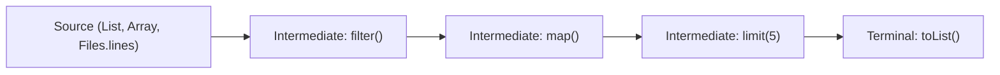
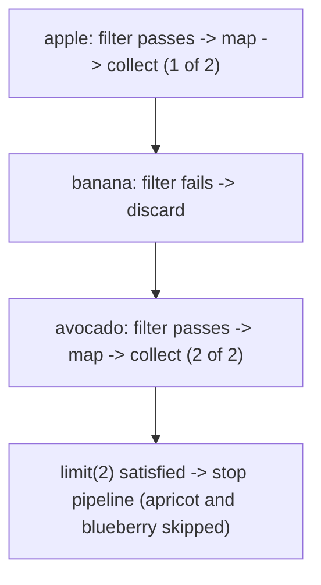
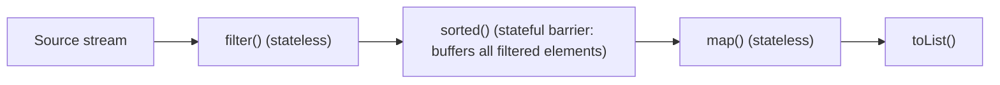
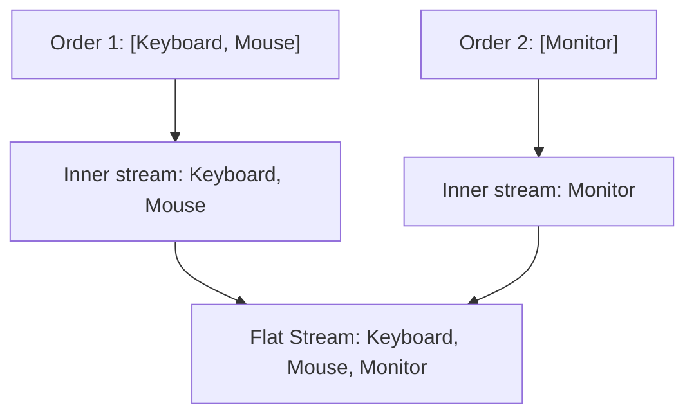

Suppose you have a list of orders and you want the uppercase IDs of the first five paid orders above a given amount. With a classic `for` loop, you allocate a result list, maintain a counter, branch on conditions, and break manually. The Java Streams API (`java.util.stream`), introduced in Java 8, lets you write that pipeline directly as a sequence of transformations:

```java
List<String> topOrderIds = orders.stream()
        .filter(Order::isPaid)
        .filter(order -> order.totalCents() >= 10_000L)
        .map(order -> order.id().toUpperCase(Locale.ROOT))
        .limit(5)
        .toList();
```

To use streams effectively, it helps to drop one common mental model right away: **a `Stream` is not a collection**. It stores no elements of its own. It is a lazy, single-use pipeline that pulls elements from a source (a collection, an array, a generator, or an I/O channel), transforms them on the fly, and produces a final result.

## Pipeline Anatomy: Source, Intermediate, and Terminal Operations

Every stream pipeline has three parts:

1. **A source** that supplies elements, such as `collection.stream()`, `Arrays.stream(arr)`, `Stream.of(...)`, `IntStream.range(0, 10)`, or `Files.lines(path)`.
2. **Zero or more intermediate operations** such as `filter`, `map`, `flatMap`, `sorted`, `distinct`, `skip`, `limit`, and `takeWhile`. Each intermediate operation returns a new `Stream` and does **no processing** when called; it only records another stage in the pipeline.
3. **One terminal operation** such as `toList()`, `collect(...)`, `count()`, `forEach(...)`, `findFirst()`, `anyMatch(...)`, or `reduce(...)`. Calling the terminal operation starts execution and produces a non-stream result (or a side effect).



### The Single-Use Constraint

A stream can only be consumed once. After a terminal operation runs, the stream is closed. Calling another operation on the same stream variable throws `IllegalStateException`:

```java
Stream<String> names = List.of("Alice", "Bob").stream();
long count = names.count();

// Throws IllegalStateException: stream has already been operated upon or closed
List<String> list = names.toList();
```

If you need multiple passes over the same data, create a new stream from the underlying collection (or wrap stream creation in a `Supplier<Stream<T>>`).

Also remember that streams backed by I/O resources, such as `Files.lines(Path)` or `Files.walk(Path)`, hold open file handles. Wrap them in a `try-with-resources` block because `Stream` implements `AutoCloseable`:

```java
try (Stream<String> lines = Files.lines(logFile)) {
    long errorCount = lines.filter(line -> line.contains("ERROR")).count();
    System.out.println("Errors: " + errorCount);
}
```

## Lazy Evaluation and Vertical Execution

When people first read a stream chain, they often picture it running **horizontally**, one full collection pass per step: filter every element into a temporary list, map every element into another temporary list, then take the first two.

Streams do the opposite. They execute **lazily and vertically** (sometimes called loop fusion). Each element travels down the full chain of stateless stages before the next element is pulled from the source.

Run this snippet to watch the execution order directly:

```java
List<String> result = List.of("apple", "banana", "avocado", "apricot", "blueberry")
        .stream()
        .filter(s -> {
            System.out.println("filter: " + s);
            return s.startsWith("a");
        })
        .map(s -> {
            System.out.println("map: " + s);
            return s.toUpperCase(Locale.ROOT);
        })
        .limit(2)
        .toList();
```

Output:

```text
filter: apple
map: apple
filter: banana
filter: avocado
map: avocado
```

Look closely at what happened:

- `"apple"` passed `filter` and immediately went into `map`.
- `"banana"` failed `filter` and never reached `map`.
- `"avocado"` passed `filter`, went into `map`, and satisfied `limit(2)`.
- `"apricot"` and `"blueberry"` were never touched at all.



Internally, the JDK links intermediate operations into a chain of `Sink` wrappers. When the terminal operation starts, elements flow straight through those sinks without allocating temporary lists between stages.

## Core Intermediate Operations: `filter`, `map`, `sorted`, `limit`

Here are the four intermediate operations you will reach for most often:

- **`filter(Predicate<T>)`**: Keeps only elements matching the predicate.
- **`map(Function<T, R>)`**: Transforms each element one-to-one into another value or type.
- **`sorted()` / `sorted(Comparator<T>)`**: Reorders elements according to natural order or a custom comparator.
- **`limit(long maxSize)`**: Truncates the stream after at most `maxSize` elements.

```java
record Product(String name, String category, long priceCents) {}

List<String> topThreeElectronics = products.stream()
        .filter(p -> "electronics".equals(p.category()))
        .sorted(Comparator.comparingLong(Product::priceCents).reversed())
        .limit(3)
        .map(Product::name)
        .toList();
```

Notice the ordering of stages in that snippet: `filter` runs **before** `sorted`, and `map` runs **after** `limit`. Filtering first shrinks the dataset before sorting pays the `O(n log n)` comparison cost, and mapping after `limit(3)` means `Product::name` only runs 3 times instead of once per product.

### Stateless vs. Stateful Intermediate Operations

Not all intermediate operations behave the same way inside a vertical pipeline:

| Category | Examples | Memory Behavior | Pipeline Impact |
|---|---|---|---|
| Stateless | `filter`, `map`, `flatMap`, `peek` | `O(1)` per stage | Elements flow one by one with no waiting. |
| Bounded stateful | `limit`, `skip`, `takeWhile`, `dropWhile` | `O(1)` in sequential streams (may buffer in ordered parallel streams) | Tracks a counter or flag; `limit` and `takeWhile` can stop early. |
| Unbounded stateful | `sorted`, `distinct` | Up to `O(n)` | `sorted` must buffer all upstream elements before emitting the first one; `distinct` remembers every seen element. |



> [!WARNING]
> Putting `sorted()` on an infinite stream (such as `Stream.iterate(0, n -> n + 1)`) without an upstream `limit()` will never finish and will eventually throw `OutOfMemoryError`, because `sorted()` has to read every element before it can emit the smallest one.

## Flattening Nested Structures with `flatMap`

Standard `map()` is strictly one-to-one: one input element produces one output element. When each element contains a collection (or another stream), `map()` gives you a nested structure like `Stream<List<OrderItem>>` or `Stream<Stream<OrderItem>>`.

`flatMap()` is one-to-many. You provide a function that maps each element to a `Stream<R>`, and `flatMap` concatenates all of those inner streams into a single flat `Stream<R>`.



```java
record OrderItem(String sku, long priceCents) {}
record CustomerOrder(String orderId, List<OrderItem> items) {}

public static long calculateTotalRevenueCents(List<CustomerOrder> orders) {
    return orders.stream()
            .flatMap(order -> order.items().stream())
            .mapToLong(OrderItem::priceCents)
            .sum();
}
```

Two details are worth noting in that example:

1. If an order has an empty `items` list, `order.items().stream()` produces an empty stream and contributes zero elements without needing a special `if` check.
2. `mapToLong` switches from `Stream<OrderItem>` to a primitive `LongStream`, which provides `sum()`, `average()`, `min()`, `max()`, and `summaryStatistics()` without boxing every number into a `Long`. (`IntStream` and `DoubleStream` offer the same methods.)

Another common use of `flatMap` is splitting text lines into unique words:

```java
List<String> uniqueWords = lines.stream()
        .flatMap(line -> Arrays.stream(line.split("\\s+")))
        .filter(word -> !word.isBlank())
        .map(word -> word.toLowerCase(Locale.ROOT))
        .distinct()
        .toList();
```

## Short-Circuiting Operations

Short-circuiting operations can produce a result without inspecting the rest of the stream. That makes them useful for stopping early on large collections and essential for working with infinite streams.

### Short-Circuiting Terminal Operations

- **`anyMatch(Predicate)`**: Returns `true` as soon as one element matches.
- **`allMatch(Predicate)`**: Returns `false` as soon as one element fails the predicate.
- **`noneMatch(Predicate)`**: Returns `false` as soon as one element matches the predicate.
- **`findFirst()`**: Returns an `Optional<T>` of the first element in encounter order.
- **`findAny()`**: Returns an `Optional<T>` of any matching element.

```java
boolean hasVip = users.stream().anyMatch(User::isVip);
boolean allVerified = users.stream().allMatch(User::isEmailVerified);
boolean noBannedUsers = users.stream().noneMatch(User::isBanned);

Optional<User> firstAdmin = users.stream()
        .filter(User::isAdmin)
        .findFirst();
```

Watch out for **empty streams** with `allMatch` and `noneMatch`: both return `true` on an empty stream (vacuous truth), while `anyMatch` returns `false`. That matches mathematical logic, but it can surprise you if you check `orders.stream().allMatch(Order::isShipped)` on a customer who has zero orders and assume that means something was shipped.

### `findFirst()` vs. `findAny()`

On a sequential stream, `findFirst()` and `findAny()` almost always return the same element. The difference shows up in **parallel streams**:

- `findFirst()` enforces strict encounter order, which requires extra coordination across worker threads.
- `findAny()` returns whichever matching element any worker thread finds first, avoiding that synchronization cost when you do not care which matching element you get.

### Short-Circuiting Intermediate Operations: `limit` and `takeWhile`

`limit(n)` stops after `n` elements regardless of their values. Java 9 added **`takeWhile(Predicate)`** (and its counterpart `dropWhile(Predicate)`), which stops as soon as the predicate becomes `false` for the first time.

The difference between `filter` and `takeWhile` is important:

```java
List<Integer> numbers = List.of(2, 4, 6, 7, 8, 10);

// filter checks EVERY element in the stream -> [2, 4, 6, 8, 10]
List<Integer> allEvens = numbers.stream()
        .filter(n -> n % 2 == 0)
        .toList();

// takeWhile stops at 7 and never looks at 8 or 10 -> [2, 4, 6]
List<Integer> leadingEvens = numbers.stream()
        .takeWhile(n -> n % 2 == 0)
        .toList();
```

`takeWhile` is most useful on **ordered** streams (such as sorted timestamps or pre-ordered log entries). On an unordered source like a `HashSet`, which subset gets taken is non-deterministic because encounter order is unspecified.

## Why `peek()` Should Not Hold Business Logic

`Stream.peek(Consumer<T>)` looks tempting when you want to log metrics or update a database as elements flow through a pipeline. Do not use it for side effects that your program depends on.

```java
// Bug: peek() may never run at all!
long total = orders.stream()
        .peek(order -> auditLog.record(order))
        .count();
```

The `Stream.peek` Javadoc explicitly states that `peek` exists mainly to support debugging and that an implementation is free to skip calling it if the terminal operation does not need to inspect elements. Starting in Java 9, `Stream.count()` takes advantage of that rule: when the pipeline has a known `SIZED` source and no operations that change the element count (like `filter`), `count()` reads the size directly from the source metadata and never traverses the elements. In the snippet above, `auditLog.record(order)` will not run at all.

For real side effects, use a terminal `forEach` or a regular `for` loop.

## When a Plain `for` Loop Is Clearer Than a Stream

Streams shine for linear transformations: filtering, mapping, flattening, searching, and aggregating. They are not automatically better than loops everywhere. Reach for a plain `for` loop when:

- **Your logic throws checked exceptions**: Trying to squeeze `IOException` or `SQLException` into lambdas quickly turns clean code into try/catch noise.
- **You need complex early exits or multi-variable state**: Updating two counters, tracking the previous element, or returning early from the enclosing method is much simpler with `if`, `break`, and `return`.
- **You need element indices**: Iterating with `for (int i = 0; i < items.size(); i++)` is clearer than reaching for `IntStream.range(0, items.size())` just to get an index.
- **You are debugging tricky step-by-step logic**: Stepping through a `for` loop in an IDE debugger shows local variables cleanly; stepping through five chained lambdas jumps in and out of internal `ReferencePipeline` frames.
- **You are in a tight, tiny hot loop**: For very small lists (say, 3 to 5 elements) inside performance-critical inner loops, a simple indexed loop avoids stream pipeline object allocation.

A good rule of thumb: if you have to pause and re-read a stream expression twice to understand what it does, a plain loop (or splitting the stream into well-named helper methods) will serve your team better.

## Interview Questions

### How does lazy vertical execution in Java Streams avoid creating intermediate collections?

Intermediate operations such as `filter` and `map` do not process elements when called. Instead, they construct a linked chain of pipeline stages (`Sink` objects). When a terminal operation is invoked, the stream pulls one element at a time from the source and pushes it vertically through every stage before moving to the next element. If `filter` rejects an element, downstream `map` stages never run for it, and if a short-circuiting operation like `limit(2)` finishes, the remaining source elements are never read. No temporary lists are allocated between stages.

### What is the difference between stateless and stateful intermediate operations, and why does `sorted()` behave differently from `limit()`?

A stateless operation like `filter` or `map` inspects each element independently using `O(1)` stage memory, so elements pass straight through. Stateful operations depend on previously seen elements. In a sequential stream, `limit(n)` only tracks a counter (`O(1)` memory) and short-circuits once `n` elements pass. By contrast, `sorted()` is an unbounded stateful barrier: it cannot emit the smallest element until it has buffered and sorted every upstream element (`O(n)` memory). Calling `sorted()` on an infinite stream without a preceding `limit()` consumes memory until the JVM throws `OutOfMemoryError`.

### What is the difference between `filter` and `takeWhile`, and what does `allMatch` return on an empty stream?

`filter` evaluates its predicate on every element in the stream and keeps all matching elements. `takeWhile` (Java 9+) emits elements only until the predicate returns `false` for the first time, then short-circuits and ignores the rest of the stream, making it useful for ordered data. For `allMatch` (and `noneMatch`), calling it on an empty stream returns `true` by vacuous truth because no element violated the predicate; `anyMatch` returns `false`.

### Why can `collection.stream().peek(action).count()` skip executing `action` in Java 9 and later?

The `Stream.peek` contract states that `peek` is intended for debugging and may be elided if the runtime can compute the terminal result without observing individual elements. In Java 9+, `Stream.count()` checks whether the stream pipeline preserves the `SIZED` characteristic from its source (for example, an `ArrayList` with no `filter` or `flatMap` in between). When the exact count is already known from metadata, `count()` returns it immediately without iterating, so `peek` is never called.
