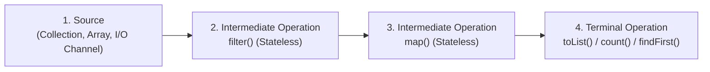
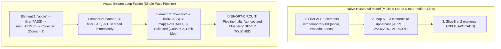
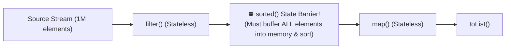
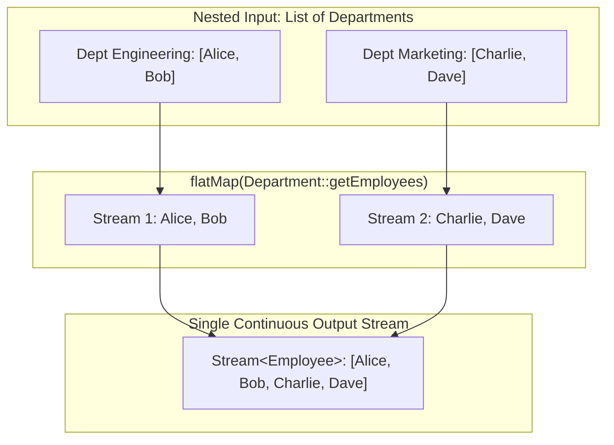
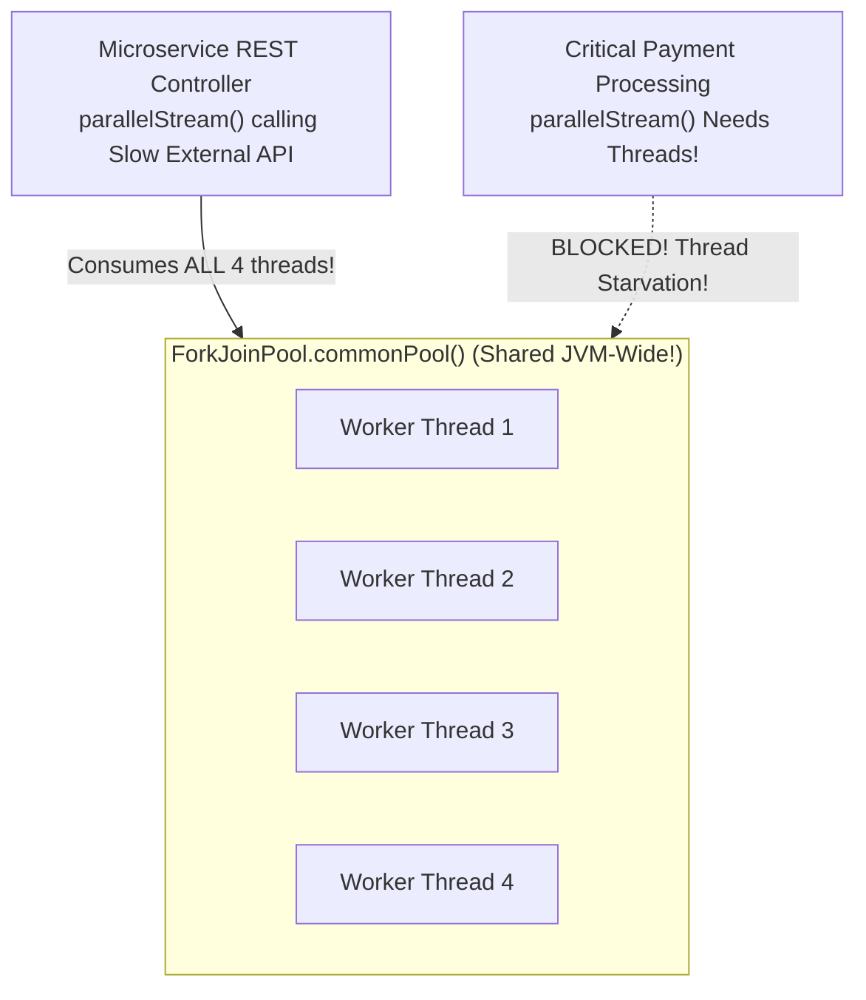

Before Java 8, performing data transformations on collections required writing repetitive imperative `for` loops, managing mutable accumulator variables, and allocating intermediate temporary collections at every step.

The **Java Streams API (`java.util.stream`)** transformed data processing into a declarative, functional pipeline. Instead of telling the computer *how* to iterate step-by-step (external iteration), you declare *what* transformations you want (internal iteration), allowing the JVM runtime to optimize execution behind the scenes.

However, treating a Stream like an "in-memory list with helper methods" is a dangerous misconception. A Stream is **not** a data structure; it stores zero data. It is a lazy computation graph executed via **Loop Fusion** and **Spliterators**.

To write high-performance stream code and avoid catastrophic production pitfalls—such as JVM-wide thread pool starvation—you must understand how the Streams pipeline actually executes under the hood.

---

## The Stream Pipeline: Source, Intermediate Stages, and Terminal Sink

A Stream pipeline consists of three distinct phases:



1. **Source:** Provides the sequence of elements (e.g. `Collection.stream()`, `Arrays.stream()`, `Files.lines()`, or `IntStream.range()`).
2. **Intermediate Operations (Lazy):** Transform the stream into another stream (`filter()`, `map()`, `sorted()`). Intermediate operations do **nothing** when invoked; they simply append a new stage to an internal linked list of pipeline operations.
3. **Terminal Operation (Eager):** Pulls data through the pipeline, producing a concrete result (e.g. `toList()`, `sum()`, `reduce()`) or a side effect (`forEach()`). **A terminal operation consumes the stream permanently.** Reusing a stream after a terminal call throws `IllegalStateException: stream has already been operated upon or closed`.

---

## How Streams Actually Execute: Loop Fusion and Vertical Processing

Consider this seemingly expensive pipeline:

```java
List<String> result = List.of("apple", "banana", "avocado", "apricot", "blueberry")
        .stream()
        .filter(s -> {
            System.out.println("Filter: " + s);
            return s.startsWith("a");
        })
        .map(s -> {
            System.out.println("Map: " + s);
            return s.toUpperCase();
        })
        .limit(2)
        .toList();
```

If you think of this imperatively, you might assume:
1. It filters all 5 elements into a temporary list of 3 items.
2. It maps all 3 items to uppercase in another temporary list.
3. It takes the first 2 items.

**That is NOT how Streams work!**

Streams use **Vertical Processing (Loop Fusion)**:



### The Output Proves Vertical Execution:
```text
Filter: apple
Map: apple
Filter: banana
Filter: avocado
Map: avocado
```

Notice that `"apricot"` and `"blueberry"` are **never evaluated at all**! 

The JVM fuses the intermediate operations into a single chained **`Sink`** object. Each element flows vertically through the entire pipeline until it reaches the terminal collector. Once the `limit(2)` condition is satisfied, the pipeline short-circuits instantly, achieving minimum CPU overhead and zero intermediate list allocations!

---

## Stateless vs. Stateful Intermediate Operations

Intermediate operations fall into two fundamentally different categories:

| Category | Operations | Memory Footprint | Impact on Loop Fusion |
|---|---|---|---|
| **Stateless** | `filter()`, `map()`, `flatMap()`, `peek()` | **`O(1)`** constant | Full vertical loop fusion; elements process one by one immediately. |
| **Stateful** | `sorted()`, `distinct()`, `skip()`, `limit()` | **`O(n)`** buffers | **Pipeline Barrier**: Must accumulate all preceding elements into memory before allowing any to proceed! |



> [!WARNING]
> Calling `.sorted()` on an infinite stream (e.g. `Stream.generate()`) causes an infinite loop and an immediate `OutOfMemoryError` because the stateful barrier must buffer the entire infinite source before emitting a single sorted element!

---

## Flattening Nested Structures with `flatMap`

When processing hierarchical or one-to-many relationships, standard `map()` produces nested streams: `Stream<List<Order>>` becomes `Stream<Stream<Order>>`.

**`flatMap()`** transforms each element into an independent stream and then flattens all inner streams into a single unified continuous stream:



```java
record OrderItem(String product, double price) {}
record CustomerOrder(String orderId, List<OrderItem> items) {}

public class OrderAnalytics {
    public static double calculateTotalRevenue(List<CustomerOrder> orders) {
        return orders.stream()
                // 1. Unrolls each order into a stream of OrderItem
                .flatMap(order -> order.items().stream())
                // 2. Maps to primitive double to avoid Double boxing
                .mapToDouble(OrderItem::price)
                // 3. Fast hardware sum
                .sum();
    }
}
```

---

## The Danger of `peek()` in Production

The Java Streams API includes `peek(Consumer<T>)`. Many developers use it to modify object states or perform production side effects.

**This is a dangerous anti-pattern**:

```java
// ❌ DANGEROUS ANTI-PATTERN: Relying on peek for production logic
long count = orders.stream()
        .peek(order -> database.audit(order)) // Might NEVER execute!
        .count();
```

According to the Java Virtual Machine Specification, `peek()` exists **strictly for debugging**. 

The JIT compiler and Streams implementation are permitted to optimize away intermediate stages if the terminal operation does not require element traversal. In Java 9+, `Stream.count()` inspects the Spliterator's `SIZED` flag and calculates the size directly from metadata, **completely skipping `peek()`!** The audit records in the example above would never be written to the database!

> [!IMPORTANT]
> If you need to perform actions with side effects, do so explicitly inside a `forEach()` terminal operation or a standard `for` loop. Never rely on `peek()`.

---

## Short-Circuiting Operations: Instant Evaluation

Short-circuiting operations terminate an infinite or massive pipeline the exact moment the terminal condition is satisfied:

```java
// 1. anyMatch: Halts on the FIRST matching element
boolean hasVip = users.stream().anyMatch(User::isVip);

// 2. allMatch: Halts on the FIRST failing element
boolean allVerified = users.stream().allMatch(User::isEmailVerified);

// 3. findFirst: Halts immediately upon finding the first valid element
Optional<User> firstAdmin = users.stream()
        .filter(User::isAdmin)
        .findFirst();
```

### `findFirst()` vs. `findAny()`
- **`findFirst()`**: Strictly enforces **Encounter Order**. In a parallel stream, it synchronizes worker threads to ensure it returns the element that appeared first in the original source.
- **`findAny()`**: Non-deterministic. Returns the first matching element found by **any** thread in a parallel stream, delivering significantly higher performance in multi-threaded pipelines where exact ordering doesn't matter.

---

## Parallel Streams and the `ForkJoinPool` Trap

Every Java developer discovers `.parallelStream()` and is tempted to add it everywhere to "make things faster."

In high-concurrency enterprise services, **naive use of `.parallelStream()` can crash your application**.



### The Common Pool Bottleneck
By default, all parallel streams across your entire JVM process share a single thread pool: **`ForkJoinPool.commonPool()`**.
- The number of worker threads is equal to `Runtime.getRuntime().availableProcessors() - 1`.
- On a 4-core container, the common pool has **only 3 worker threads**!

If one background task executes a blocking network call or database query inside a parallel stream:
```java
// ❌ DISASTER: Blocks the JVM-wide common pool threads!
files.parallelStream().forEach(file -> uploadToS3(file)); // HTTP blocking I/O!
```

Those 3 worker threads are parked waiting for network I/O. Any other part of your application that attempts to use parallel streams, CompletableFutures, or internal JDK tasks is **starved of threads and freezes completely**!

### The Golden Rules of Parallel Streams
1. **Never perform blocking I/O** (network, disk, JDBC) inside a parallel stream.
2. Only use parallel streams for **pure CPU-intensive calculations** (e.g. matrix math, cryptography, parsing massive in-memory datasets).
3. The dataset must be large enough (`N > 10,000`) to amortize the thread splitting and joining overhead.

---

## Summary & Mental Model Checkpoint

1. **Streams Are Not Data**: Streams store zero memory; they represent lazy computation graphs executed via Loop Fusion.
2. **Loop Fusion (Vertical Processing)**: Elements traverse the entire pipeline one-by-one; short-circuiting operations abort before processing subsequent elements.
3. **Stateless vs Stateful**: Stateless operations (`filter`, `map`) process elements immediately; Stateful operations (`sorted`, `distinct`) create memory barriers.
4. **`flatMap` Power**: Unrolls hierarchical collections (1-to-many) into a single continuous stream.
5. **Never Use `peek()` for Logic**: Compilers can optimize away intermediate stages if terminal operations (like `count()`) do not require element evaluation.
6. **`findFirst` vs `findAny`**: `findFirst` preserves strict encounter order; `findAny` maximizes parallel throughput.
7. **The `ForkJoinPool` Trap**: Parallel streams share `ForkJoinPool.commonPool()`. Never run blocking I/O in parallel streams!

---

## 🎯 Senior Engineer Interview Questions

### What is "Loop Fusion" in the Java Streams API, and how does it prevent intermediate collection allocations during execution?
> **Answer:** In traditional imperative programming, chaining operations like filtering, mapping, and limiting would require multiple passes over the dataset, allocating intermediate collections at each phase. Java Streams implement Loop Fusion via the internal `Sink` pipeline architecture. Intermediate operations (`filter`, `map`) do not execute eagerly when invoked; they build an internal linked list of chained `Sink` stages wrapping downstream consumers. When a terminal operation is called, the stream iterates through the source elements **vertically**: a single element is pulled from the source and pushed through all chained operations in a single pass before the next element is examined. If an intermediate operation rejects the element (like `filter`), the element is immediately abandoned without invoking subsequent stages. This eliminates all intermediate collection allocations and allows short-circuiting operations (like `limit` or `findFirst`) to halt execution as soon as the terminal criteria are met.

### What is the architectural difference between a stateless intermediate operation (e.g. `map`) and a stateful intermediate operation (e.g. `sorted`), and what risk do stateful operations pose to infinite streams?
> **Answer:** A **stateless** operation (such as `filter()` or `map()`) processes each element independently without retaining information about previously processed elements. Elements pass through vertically one at a time, maintaining constant memory overhead `O(1)`. A **stateful** operation (such as `sorted()`, `distinct()`, or `skip()`) requires knowledge of other elements in the sequence. In the case of `sorted()`, the JVM cannot determine which element is the smallest until it has inspected every single element from the upstream source. Therefore, stateful operations act as **pipeline barriers**: they must accumulate all upstream elements into an internal buffer (such as an array or tree) before sorting them and allowing any element to flow downstream. If a stateful operation like `sorted()` is attached to an infinite stream (e.g. `Stream.iterate()`), the buffer expands infinitely until the JVM exhausts available heap space, crashing with an `OutOfMemoryError`.

### Why should you avoid using `.parallelStream()` for tasks that involve blocking I/O (such as HTTP requests or database calls)?
> **Answer:** Parallel streams in Java execute on the shared, JVM-wide `ForkJoinPool.commonPool()` by default. The size of this pool is determined statically at startup based on available CPU cores (`Runtime.getRuntime().availableProcessors() - 1`). When you execute blocking I/O tasks within a parallel stream, the worker threads transition into a blocked operating system state waiting for network packets or disk responses. Because the common pool is globally shared across the entire JVM, consuming these worker threads leads to **thread pool starvation**. Other unrelated application components—including other parallel streams, default `CompletableFuture` asynchronous stages, and internal runtime tasks—are blocked from acquiring threads, causing widespread latency spikes and service outages. For blocking I/O, developers should use dedicated, bounded `ExecutorService` thread pools or Java 21 Virtual Threads.

### Why is `Stream.peek()` considered an anti-pattern for executing production side effects (such as logging to a database), and how did Java 9 change its behavior?
> **Answer:** `Stream.peek()` was explicitly designed solely as a non-mutating debugging tool to inspect elements as they flow through a pipeline (e.g. printing to stdout during unit testing). The Java Language Specification states that the stream implementation is permitted to skip intermediate operations if the required result can be computed without traversing the elements. In Java 9, the Streams implementation was optimized to inspect the `SIZED` characteristic of the underlying Spliterator. For example, in `stream.filter(...).peek(action).count()`, if the filter is absent or size can be inferred directly from metadata (such as `collection.stream().peek(action).count()`), the JVM computes the count directly without iterating through the elements, skipping `peek()` entirely. Relying on `peek()` to execute critical business logic (such as updating database entities or incrementing audit counters) causes silent failures when the JVM optimizes the execution graph. Side effects should strictly be performed in terminal operations (`forEach`) or standard imperative loops.