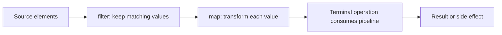

A collection describes stored data; a stream describes a computation over a sequence of values. The Streams API lets code express transformations such as “keep the active orders, convert each to its total, then sum them” without manually managing loop variables and intermediate collections.

This lesson uses Java 21's `java.util.stream` API, introduced in Java 8. Streams are not a replacement for every loop: use the clearest form for the operation and its side effects.

## A stream pipeline has a source, operations, and a terminal

A **source** supplies elements, for example a collection, array, generated sequence, or I/O resource. **Intermediate operations** such as `filter`, `map`, `sorted`, and `limit` describe transformations and return another stream. A **terminal operation** such as `toList`, `count`, `sum`, or `forEach` initiates the computation and produces a result or side effect.



Intermediate operations are generally lazy: they do not traverse the source until a terminal operation begins. A terminal operation consumes the stream; the same stream instance cannot be reused for another computation.

```java
import java.util.List;

public class StreamBasics {
    public static void main(String[] args) {
        List<String> names = List.of("Ada", "Grace", "Linus", "Alan");

        long longNames = names.stream()
                .filter(name -> name.length() >= 5)
                .count();

        int totalCharacters = names.stream()
                .mapToInt(String::length)
                .sum();

        System.out.println(longNames);
        System.out.println(totalCharacters);
    }
}
```

The two terminal operations create two pipelines from the collection. Trying to call another terminal operation on the same `Stream` object after it has already been consumed is invalid and typically throws `IllegalStateException`.

## Intermediate operations

### `filter`, `map`, and `flatMap`

- `filter` keeps elements for which a predicate returns `true`.
- `map` transforms each input element into one output element.
- `flatMap` transforms each input into a stream and combines those streams into one sequence.

Use `flatMap` when each element naturally expands to zero or more outputs, such as a list of words becoming a stream of tokens:

```java
import java.util.List;

public class FlattenExample {
    public static void main(String[] args) {
        List<List<String>> groups = List.of(
                List.of("map", "filter"),
                List.of("reduce"));

        List<String> operations = groups.stream()
                .flatMap(List::stream)
                .toList();

        System.out.println(operations);
    }
}
```

The resulting list is `[map, filter, reduce]`. A `map` over the nested lists would produce a stream of lists; `flatMap` both transforms and flattens one level.

### Ordering and stateful operations

Operations such as `sorted` may need to buffer elements before producing results. A stream operation does not guarantee that each element is processed immediately after the source yields it. `distinct` and sorting can also affect encounter order or require state.

Preserve the distinction between the pipeline's encounter order and the physical order in which work is performed. A sequential stream generally processes in encounter order when the operation requires it; parallel execution may process elements in different threads and at different times. Terminal operations such as `forEach` do not promise encounter order for parallel streams; `forEachOrdered` requests ordered actions when an encounter order exists, which can constrain parallelism.

## Short-circuiting

Some operations can stop before examining every source element:

- `anyMatch`, `allMatch`, and `noneMatch` may stop when the answer is known.
- `findFirst` and `findAny` can produce a value without consuming the entire source.
- `limit` bounds how many elements flow downstream.

```java
import java.util.List;

public class SearchExample {
    public static void main(String[] args) {
        boolean hasLongName = List.of("Ada", "Grace", "Linus").stream()
                .anyMatch(name -> name.length() > 5);

        System.out.println(hasLongName); // true
    }
}
```

Short-circuiting is important for infinite streams as well: an infinite source can produce a result when the pipeline contains an operation such as `limit` or a terminal that can finish after a finite prefix. Without a short-circuiting path, a terminal operation that requires all elements cannot complete on an infinite source.

## Primitive streams

`Stream<Integer>` stores boxed references at the API level; numeric processing can use `IntStream`, `LongStream`, or `DoubleStream` to avoid repeated boxing in many common operations:

```java
public class PrimitiveStreamExample {
    public static void main(String[] args) {
        int sumOfSquares = java.util.stream.IntStream.rangeClosed(1, 5)
                .map(value -> value * value)
                .sum();
        System.out.println(sumOfSquares);
    }
}
```

Primitive streams provide numeric terminals such as `sum`, `average`, `min`, and `max`, plus conversion methods such as `boxed()`. Choose them when they match the data and make the operation clearer, rather than assuming a measured speedup.

## Behavioral rules: do not interfere or depend on hidden state

Stream behavioral parameters should be **non-interfering** with the source and, in most cases, **stateless**. A predicate that mutates the same list being traversed can invalidate the traversal. A mapper whose result depends on mutable shared state can produce confusing results, especially when execution is parallel.

Avoid mutating a shared `ArrayList` from a callback such as
`names.parallelStream().forEach(results::add)`. The array list is not
thread-safe, and the callback races while changing shared state.

Use a terminal reduction or collector to accumulate values instead. Stream operations are permitted to optimize away stages that do not affect the required result; therefore side effects inside an intermediate operation are not a reliable way to force work to happen.

## Parallel streams: semantics before speed

Calling `parallelStream()` or `parallel()` requests parallel execution. It does not guarantee that parallelism improves performance. Costs include partitioning, scheduling, synchronization, combining results, and limited CPU availability. Small inputs and blocking I/O operations often do not benefit.

For reductions, operations should be associative and obey the collector's identity/combiner contract so regrouping does not change the result. Floating-point addition, for example, can produce slightly different rounding when grouped differently. Shared mutable state and order-dependent logic are common sources of parallel-stream bugs.

Use parallel streams only when the operation is naturally parallel, its behavioral parameters are safe, and measurements on representative workloads show a benefit. For explicit control over task execution, resource bounds, or failure handling, another concurrency API may be more appropriate.

## Resource-backed streams

A stream from a collection normally does not own an external resource. Some streams, including `Files.lines`, are backed by open I/O resources and implement `AutoCloseable`; close them with try-with-resources:

```java
import java.io.IOException;
import java.nio.charset.StandardCharsets;
import java.nio.file.Files;
import java.nio.file.Path;

public class LogSearch {
    public static long countErrors(Path path) throws IOException {
        try (var lines = Files.lines(path, StandardCharsets.UTF_8)) {
            return lines.filter(line -> line.contains("ERROR")).count();
        }
    }
}
```

Closing the stream closes the associated file resource. A terminal operation does not generally replace explicit resource closure for streams whose sources own resources.

## Practical rules

- Keep each stream pipeline single-use and derive a fresh stream from its source for a new terminal computation.
- Use `map` for one-to-one transformation and `flatMap` for zero-to-many expansion and flattening.
- Prefer short-circuiting operations when the task needs only a bounded answer.
- Keep behavioral parameters non-interfering and stateless unless the API contract explicitly allows controlled state.
- Close I/O-backed streams with try-with-resources.
- Avoid parallel execution until correctness, ordering, and workload measurements justify it.

## Further reading

- [Java 21 `java.util.stream` package](https://docs.oracle.com/en/java/javase/21/docs/api/java.base/java/util/stream/package-summary.html)
- [Java 21 `Stream`](https://docs.oracle.com/en/java/javase/21/docs/api/java.base/java/util/stream/Stream.html)
- [Java 21 `IntStream`](https://docs.oracle.com/en/java/javase/21/docs/api/java.base/java/util/stream/IntStream.html)
- [Java 21 `Files.lines`](https://docs.oracle.com/en/java/javase/21/docs/api/java.base/java/nio/file/Files.html#lines(java.nio.file.Path,java.nio.charset.Charset))
