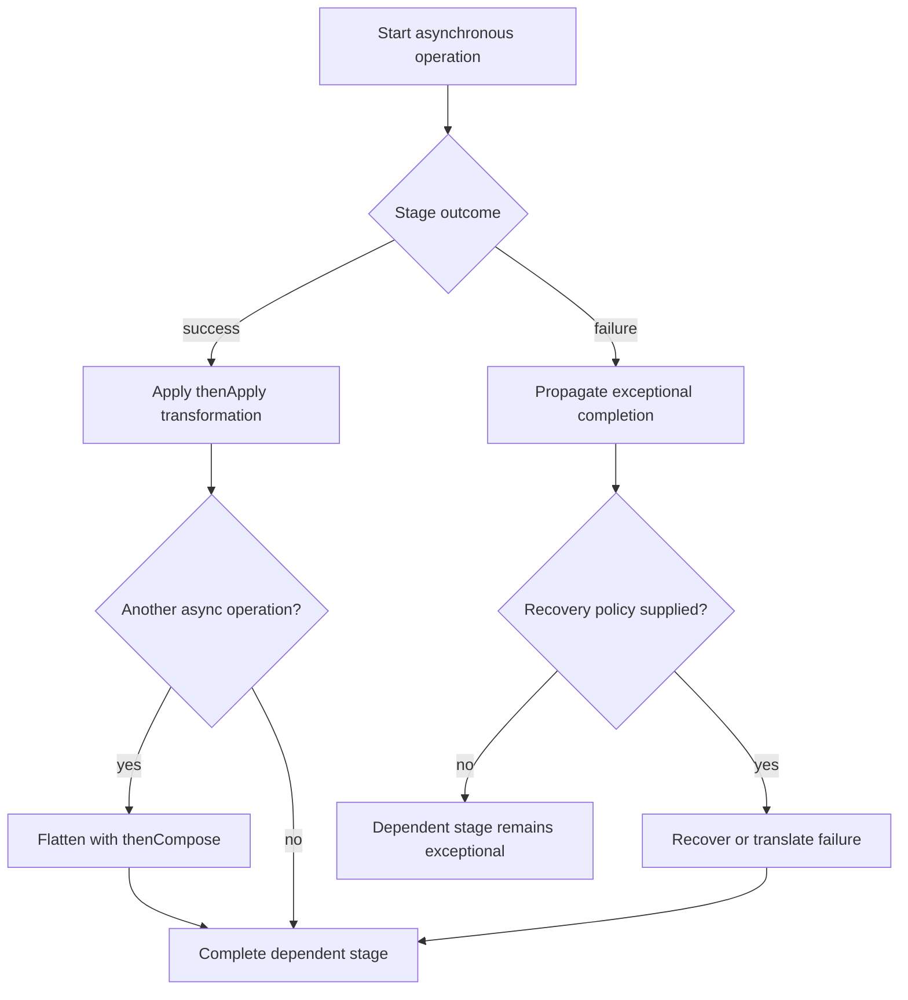

A synchronous method returns its result before the caller continues. Asynchronous programming lets a caller describe what should happen when a result becomes available, instead of blocking a thread at every step. Without composition, nested callbacks quickly become difficult to read, handle errors in, and test.

Java's `CompletableFuture<T>` implements both `Future<T>` and `CompletionStage<T>`. It represents a computation that can be completed and can trigger dependent stages. This lesson uses Java 21.

## Build a dependency chain

Each stage receives the previous stage's result and produces a new one. `thenApply` transforms a value; `thenCompose` chains a function that already returns another future:

```java
import java.util.concurrent.CompletableFuture;
import java.util.concurrent.ExecutorService;
import java.util.concurrent.Executors;

public class FutureChain {
    record Profile(String displayName) {}

    static CompletableFuture<Profile> loadProfile(
            String userId, ExecutorService executor) {
        return CompletableFuture.supplyAsync(
                () -> new Profile(userId.toUpperCase()), executor);
    }

    public static void main(String[] args) {
        try (ExecutorService executor = Executors.newFixedThreadPool(2)) {
            CompletableFuture<String> displayName =
                    CompletableFuture.supplyAsync(() -> "ada", executor)
                            .thenApply(String::trim)
                            .thenCompose(userId -> loadProfile(userId, executor))
                            .thenApply(Profile::displayName);

            System.out.println(displayName.join());
        }
    }
}
```

Without `thenCompose`, a function returning `CompletableFuture<Profile>` would create a nested `CompletableFuture<CompletableFuture<Profile>>`. `thenCompose` flattens that asynchronous dependency in the same way `flatMap` composes nested values.

## Choose execution behavior deliberately

The method name ending in `Async` requests asynchronous execution for that continuation. When an explicit `Executor` is supplied, the continuation uses it. Without one, `CompletableFuture` async methods use the common fork/join pool by default. A non-async continuation such as `thenApply` may run on the thread that completes the previous stage or another thread that calls a completion method.

Therefore:

- Do not assume every continuation runs on a dedicated background thread.
- Keep non-async continuations short and non-blocking.
- Provide an explicit executor when execution needs a particular capacity or isolation policy.
- Do not block a shared completion thread while waiting for another future that depends on that same constrained executor.

## Combine independent computations

`thenCombine` combines the successful results of two independent stages. `allOf` completes after every supplied future completes, but its result type is `CompletableFuture<Void>`; retrieve individual results from the futures after the aggregate completes:

```java
import java.util.concurrent.CompletableFuture;
import java.util.concurrent.ExecutorService;
import java.util.concurrent.Executors;

public class CombineFutures {
    public static void main(String[] args) {
        try (ExecutorService executor = Executors.newFixedThreadPool(3)) {
            CompletableFuture<Integer> price =
                    CompletableFuture.supplyAsync(() -> 25, executor);
            CompletableFuture<Integer> shipping =
                    CompletableFuture.supplyAsync(() -> 5, executor);

            CompletableFuture<Integer> total =
                    price.thenCombine(shipping, Integer::sum);

            CompletableFuture<Void> bothDone =
                    CompletableFuture.allOf(price, shipping);
            CompletableFuture<String> summary = bothDone.thenApply(ignored ->
                    "Price " + price.join() + ", shipping " + shipping.join());

            System.out.println("Total: " + total.join());
            System.out.println(summary.join());
        }
    }
}
```

`allOf` is a completion barrier, not a result collector. If any input completes exceptionally, the aggregate also completes exceptionally. `anyOf` completes when one of its inputs completes and exposes the result as `Object`; that first completion may be exceptional, and the other computations are not automatically cancelled. Select between them based on the actual requirement: “all operations must finish” and “use the first completion” are different policies.

## Handle failures as part of the pipeline

An exception in a stage completes that stage exceptionally and skips ordinary success-only continuations such as `thenApply`. `exceptionally` can recover with a value, `handle` can transform either outcome, and `whenComplete` is useful for observing completion without intending to replace the result:

```java
import java.util.concurrent.CompletableFuture;
import java.util.concurrent.ExecutorService;
import java.util.concurrent.Executors;

public class FutureErrors {
    public static void main(String[] args) {
        try (ExecutorService executor = Executors.newSingleThreadExecutor()) {
            CompletableFuture<Integer> recovered =
                    CompletableFuture.supplyAsync(
                                    () -> Integer.parseInt("not a number"),
                                    executor)
                            .exceptionally(error -> {
                                System.err.println("Conversion failed");
                                return -1;
                            });

            System.out.println(recovered.join());
        }
    }
}
```

Choose fallback values only when they have valid domain meaning. Otherwise preserve the failure or translate it into a meaningful exception. `join()` reports exceptional completion with an unchecked `CompletionException`; `get()` uses checked `ExecutionException` and can be interrupted. Handle errors at a boundary where the application can make a real decision instead of converting every failure to a success-shaped value.

## Completion and cancellation are not the same as task control

`CompletableFuture` can be completed directly with `complete` or `completeExceptionally`, which is useful when adapting callback-based APIs. If competing threads attempt to complete the same future, only one completion succeeds.

Cancellation also requires care. A `CompletableFuture` generally does not control the computation that will complete it; its `cancel` operation is treated as exceptional completion. Cancelling the future does not necessarily stop an external request, thread, or side effect. Use the cancellation mechanism provided by the underlying operation when actual work must be stopped.

Avoid calling `get()` or `join()` inside a continuation just to retrieve another future's result. Compose with `thenCompose`, combine with `thenCombine`, or aggregate with `allOf` so the dependency graph stays explicit and threads are not needlessly blocked.

## Seeing the completion graph

This diagram shows successful value flow and the exceptional path. A failure bypasses ordinary value transformations and needs an explicit recovery or propagation policy:



The diagram omits cancellation and races between independent stages; those must be handled according to the actual API being composed.

## Practical rules

- Use `thenApply` for synchronous transformations and `thenCompose` for functions that return another stage.
- Use `thenCombine` for two independent results and `allOf` when all supplied tasks must finish.
- Treat `anyOf` as a first-completion policy, not necessarily first-success and not automatic cancellation.
- Know which executor runs every continuation; pass an explicit executor when default scheduling is unsuitable.
- Keep completion callbacks short and avoid blocking calls inside constrained worker threads.
- Preserve meaningful failures; recover only when the fallback is correct for the domain.
- Do not assume cancelling a future stops the underlying computation.

## Further reading

- [Java 21 `CompletableFuture`](https://docs.oracle.com/en/java/javase/21/docs/api/java.base/java/util/concurrent/CompletableFuture.html)
- [Java 21 `CompletionStage`](https://docs.oracle.com/en/java/javase/21/docs/api/java.base/java/util/concurrent/CompletionStage.html)
- [Java 21 `Future`](https://docs.oracle.com/en/java/javase/21/docs/api/java.base/java/util/concurrent/Future.html)
