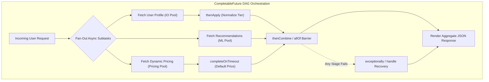
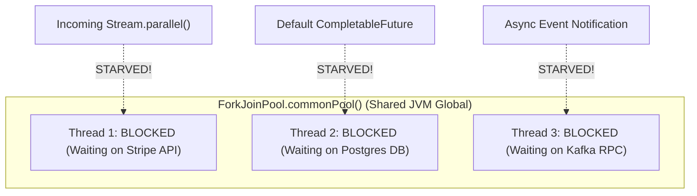
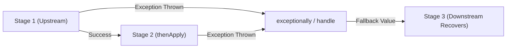

If you have ever built an application using raw `Future<T>`, you quickly encountered its fatal flaw: calling `future.get()` blocks the calling thread until the computation finishes. 

In a modern web architecture, blocking a thread is an expensive sin. If your API gateway needs to call a user profile service, a product recommendation engine, a credit scoring API, and an inventory database to assemble a single checkout screen, doing so synchronously multiplies your latency:

```
Total Latency = 150ms + 200ms + 300ms + 100ms = 750ms
```

To reduce latency, developers historically attempted manual callback chains. But nesting asynchronous callbacks inside callbacks creates "Callback Hell": stack traces disappear into the ether, catching exceptions becomes almost impossible, and thread synchronization spaghetti dominates your business logic.

Java 8 introduced `CompletableFuture<T>` (implementing `Future<T>` and `CompletionStage<T>`). It is a declarative, monadic railway for concurrent tasks. It allows you to model complex asynchronous Directed Acyclic Graphs (DAGs) that fan out across thread pools, compose intermediate values, handle timeouts, and recover from failures without ever blocking an operating system thread.



---

## Transforming and Chaining: thenApply vs thenCompose

The two most frequently confused methods in the `CompletionStage` API are `thenApply` and `thenCompose`. Understanding the distinction is the key to writing clean asynchronous pipelines.

### thenApply: Synchronous Value Transformation (Map)

`thenApply` accepts a `Function<T, R>`. It takes the completed value of the current stage, runs a synchronous transformation on it, and yields a `CompletableFuture<R>`. It is the direct equivalent of `Stream.map()` or `Optional.map()`:

```java
CompletableFuture<String> usernameFuture = CompletableFuture.supplyAsync(() -> "  alice_smith  ")
    .thenApply(String::trim)
    .thenApply(String::toUpperCase);

// Yields CompletableFuture<String> containing "ALICE_SMITH"
```

### thenCompose: Asynchronous Dependent Chaining (FlatMap)

What happens if the next step in your pipeline is *itself* an asynchronous method that returns another `CompletableFuture`?

If you use `thenApply`, you end up with a dreaded nested future: `CompletableFuture<CompletableFuture<UserDetails>>`. You would need to call `.join().join()` to extract the inner data!

`thenCompose` accepts a `Function<T, CompletionStage<R>>`. It takes the output of the first stage, feeds it into an asynchronous function, and automatically **flattens** the result into a single `CompletableFuture<R>`:

```java
import java.util.concurrent.CompletableFuture;
import java.util.concurrent.ExecutorService;
import java.util.concurrent.Executors;

public class UserPipeline {
    record UserProfile(String id, String email) {}
    record AccountCredit(String id, int score) {}

    private final ExecutorService ioPool = Executors.newFixedThreadPool(8);

    public CompletableFuture<UserProfile> fetchProfileAsync(String id) {
        return CompletableFuture.supplyAsync(() -> new UserProfile(id, "alice@example.com"), ioPool);
    }

    public CompletableFuture<AccountCredit> fetchCreditAsync(UserProfile profile) {
        return CompletableFuture.supplyAsync(() -> new AccountCredit(profile.id(), 780), ioPool);
    }

    public CompletableFuture<AccountCredit> getUserCreditScore(String userId) {
        // thenCompose prevents CompletableFuture<CompletableFuture<AccountCredit>>
        return fetchProfileAsync(userId)
            .thenCompose(this::fetchCreditAsync);
    }
}
```

---

## The CommonPool Disaster: The #1 Production Outage Pattern

If you take only one lesson away from this topic, let it be this: **never call `supplyAsync()` or `runAsync()` without passing an explicit `Executor` in a production application.**

```java
// PRODUCTION DISASTER WAITING TO HAPPEN:
CompletableFuture.supplyAsync(() -> {
    return querySlowMicroserviceOverHttp(); // Blocking network I/O!
});
```

### Why This Crashes JVMs

When you do not provide an executor, `CompletableFuture` delegates the task to the JVM's shared `ForkJoinPool.commonPool()`.

The size of `ForkJoinPool.commonPool()` is determined by the JVM at startup using the formula:
```
Default Pool Parallelism = Runtime.getRuntime().availableProcessors() - 1
```

If your microservice runs in a cloud container or Kubernetes pod with 2 or 4 allocated vCPUs, the shared `commonPool()` has only **1 to 3 worker threads**.

`ForkJoinPool` is strictly engineered for **CPU-bound, non-blocking divide-and-conquer computation**. The moment you submit a blocking HTTP call or JDBC query to `commonPool()`, that worker thread sleeps on network socket I/O. 

Within seconds of a traffic spike, all 3 worker threads in `commonPool()` are completely blocked. Because the pool is global to the entire JVM, **every other component in your application that relies on parallel streams or default async tasks freezes completely**.



> [!CAUTION]
> Always segregate your workloads into dedicated, bounded thread pools:
> - **CPU Pool**: Sized to `availableProcessors() + 1` for JSON parsing, cryptographic hashing, and data transformation.
> - **I/O Pool**: Sized according to Goetz's I/O formula for database calls and downstream REST APIs.
> - **Pass the pool explicitly**: `CompletableFuture.supplyAsync(task, dedicatedIoPool)`!

---

## Thread Execution Locality: Who Runs What?

One of the most nuanced questions in Java concurrency interviews is: **"Which thread executes the callback registered in `thenApply()`?"**

The answer surprises most engineers: **It depends on whether the previous stage has already finished when `thenApply` is invoked!**

1. **If the previous stage is STILL RUNNING**: The thread executing the upstream task will pick up the `thenApply` callback and run it immediately upon completing the first task.
2. **If the previous stage is ALREADY COMPLETE**: The thread calling `thenApply` (often your main thread or HTTP controller thread) will execute the callback synchronously right then and there!
3. **If you use `thenApplyAsync(fn, customExecutor)`**: The callback is always dispatched to the specified `customExecutor`, guaranteeing thread isolation regardless of completion timing.

```java
CompletableFuture<String> future = CompletableFuture.supplyAsync(() -> {
    System.out.println("Step 1 executed by: " + Thread.currentThread().getName());
    return "Data";
}, ioPool);

// If Step 1 is fast and finishes before this line executes:
// Step 2 might run on the MAIN thread!
future.thenApply(data -> {
    System.out.println("Step 2 executed by: " + Thread.currentThread().getName());
    return data.toUpperCase();
});

// Guaranteed to run on dedicated transform pool:
future.thenApplyAsync(data -> {
    System.out.println("Step 3 executed by: " + Thread.currentThread().getName());
    return data.toLowerCase();
}, computePool);
```

---

## Combining Multiple Futures: Fan-Out and Fan-In

Real-world architectures frequently require firing off multiple queries in parallel and merging their results.

### Combining Two Stages: thenCombine

When two independent asynchronous operations must both complete before computing a composite result, use `thenCombine`:

```java
CompletableFuture<Double> priceFuture = CompletableFuture.supplyAsync(() -> fetchItemPrice("SKU-99"), ioPool);
CompletableFuture<Double> shippingFuture = CompletableFuture.supplyAsync(() -> fetchShippingCost("ZIP-94107"), ioPool);

// Both run simultaneously; lambda executes when BOTH complete
CompletableFuture<Double> totalCostFuture = priceFuture.thenCombine(
    shippingFuture, 
    (price, shipping) -> price + shipping
);
```

### Combining Arbitrary N Stages: allOf Barrier

When aggregating data from an arbitrary list of microservices, use `CompletableFuture.allOf()`:

```java
import java.util.List;
import java.util.concurrent.CompletableFuture;
import java.util.concurrent.ExecutorService;
import java.util.concurrent.Executors;

public class ProductAggregator {
    private final ExecutorService ioPool = Executors.newFixedThreadPool(16);

    public CompletableFuture<List<String>> fetchAllCatalogs(List<String> vendorUrls) {
        // Step 1: Fan-out requests across all vendors
        List<CompletableFuture<String>> futures = vendorUrls.stream()
            .map(url -> CompletableFuture.supplyAsync(() -> queryVendor(url), ioPool))
            .toList();

        // Step 2: Create a completion barrier
        CompletableFuture<Void> allDoneBarrier = CompletableFuture.allOf(
            futures.toArray(new CompletableFuture[0])
        );

        // Step 3: Fan-in results once all futures finish
        return allDoneBarrier.thenApply(ignored -> 
            futures.stream()
                .map(CompletableFuture::join) // Non-blocking because all are complete!
                .toList()
        );
    }

    private String queryVendor(String url) {
        return "Data from " + url;
    }
}
```

> [!NOTE]
> `CompletableFuture.allOf()` returns `CompletableFuture<Void>`. It does not collect intermediate values for you. Calling `future.join()` inside the `thenApply` callback of `allOf` is completely non-blocking and safe because the barrier guarantees that every future has already finished.

---

## Resilient Exception Handling and Timeouts

In distributed systems, failures and network latency spikes are mathematical certainties. `CompletableFuture` provides functional recovery mechanisms that mirror railway-oriented programming.



### Recovery Strategies: exceptionally vs handle

- `exceptionally(Function<Throwable, T>)`: Invoked **only** if the pipeline encountered an unhandled exception upstream. It allows you to return a cached default value or graceful degradation.
- `handle(BiFunction<T, Throwable, R>)`: Always invoked, regardless of whether the stage succeeded or failed. Both the result and the exception are passed in (one of them will be `null`).

```java
CompletableFuture<String> resilientCall = CompletableFuture.supplyAsync(() -> {
    if (Math.random() < 0.5) throw new RuntimeException("Primary Service Down!");
    return "Live Data";
}, ioPool)
.handle((result, throwable) -> {
    if (throwable != null) {
        System.err.println("Primary service failed: " + throwable.getMessage() + ". Falling back to cache.");
        return "Cached Fallback Data";
    }
    return result;
});
```

### Enforcing Non-Blocking SLAs: orTimeout and completeOnTimeout

Before Java 9, enforcing a timeout on an async pipeline required scheduling a separate task on a `ScheduledExecutorService` to manually call `future.completeExceptionally()`.

Java 9 introduced built-in non-blocking timeout primitives:

```java
import java.util.concurrent.CompletableFuture;
import java.util.concurrent.TimeUnit;

public class SlaEnforcer {
    public static void main(String[] args) {
        // Enforce strict 500ms SLA: Fail exceptionally if exceeded
        CompletableFuture<String> strictSla = CompletableFuture.supplyAsync(() -> querySlowService())
            .orTimeout(500, TimeUnit.MILLISECONDS)
            .exceptionally(ex -> "Request Timed Out: " + ex.getMessage());

        // Enforce fallback default if exceeded: Never fails
        CompletableFuture<String> gracefulSla = CompletableFuture.supplyAsync(() -> querySlowService())
            .completeOnTimeout("DEFAULT_RECOMMENDATIONS", 300, TimeUnit.MILLISECONDS);

        System.out.println("Result: " + gracefulSla.join());
    }

    private static String querySlowService() {
        try {
            Thread.sleep(1000); // Exceeds timeout
        } catch (InterruptedException ignored) {}
        return "Live Microservice Response";
    }
}
```

---

## Senior Engineer Interview Crucible

### What is the exact difference between thenApply and thenCompose?
`thenApply` accepts a `Function<T, R>` and returns `CompletableFuture<R>`. It is used for synchronous transformations of the completed value, functioning like `Stream.map()`. 

`thenCompose` accepts a `Function<T, CompletionStage<R>>` and returns `CompletableFuture<R>`. It is used when the transformation itself is asynchronous and returns a future. `thenCompose` flattens the nested futures into a single stage, avoiding `CompletableFuture<CompletableFuture<R>>` and functioning like `Stream.flatMap()`.

### Why is calling supplyAsync() without an executor dangerous in enterprise applications?
`supplyAsync()` defaults to `ForkJoinPool.commonPool()`, which is a JVM-global shared pool sized to `availableProcessors - 1` (often only 1 to 3 threads in cloud container environments). Because `ForkJoinPool` is designed for compute-bound tasks, executing blocking I/O (such as HTTP requests or JDBC queries) will saturate and exhaust all worker threads. This halts not only your async tasks, but also all other components across the JVM relying on `commonPool()`, such as parallel streams.

### If one task in CompletableFuture.allOf() fails with an exception, how does allOf() behave, and how do you extract individual errors?
`CompletableFuture.allOf()` waits for **all** submitted futures to finish, even if one or more fail. However, if any sub-future fails, the resulting aggregate future completes exceptionally with a `CompletionException`. 

To inspect individual failures without losing error details, you should avoid immediately calling `.join()` on `allOf()`. Instead, attach `.handle()` or `.whenComplete()` to each individual child future before passing them into `allOf()`, or inspect each child future's `.isCompletedExceptionally()` status after `allOf()` completes.

### How does CompletableFuture.orTimeout() differ from Future.get(timeout, unit)?
`Future.get(timeout, unit)` is a **blocking** operation that halts the calling thread until the timeout expires or the computation finishes. If 1,000 threads call `get()`, 1,000 platform threads are kept dormant in memory.

In contrast, `CompletableFuture.orTimeout()` is completely **non-blocking**. It registers a lightweight timer inside an internal system `ScheduledExecutorService` (delivering a `TimeoutException` if the stage does not complete within the window). The calling thread is immediately freed to perform other work, maintaining high concurrency and low thread count.
