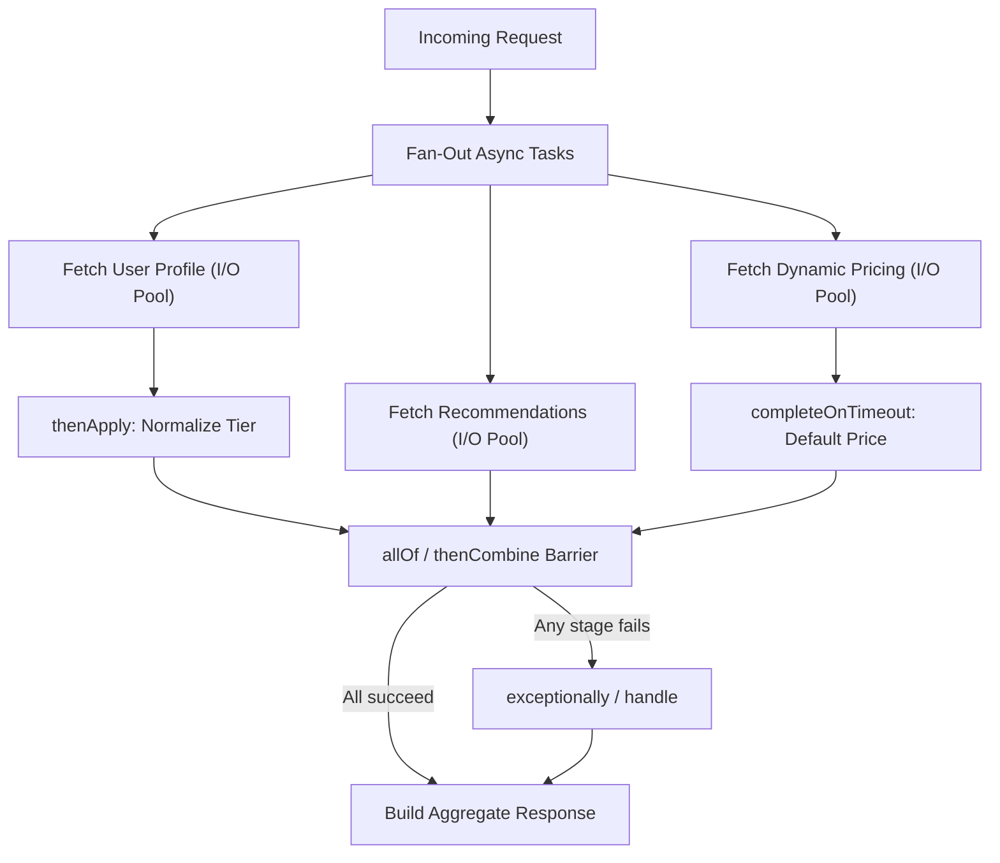
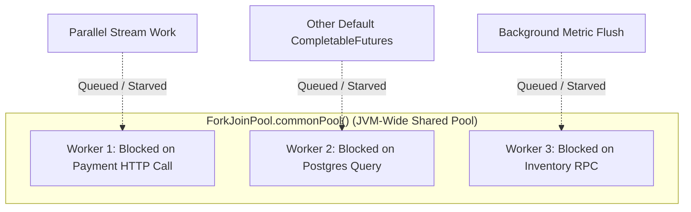
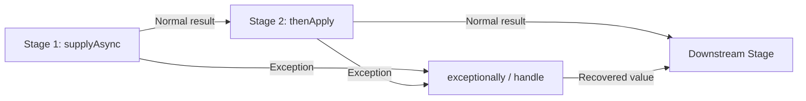

When a backend endpoint needs to gather data from three or four downstream services, running those calls one after another adds their latencies together. If a user profile lookup takes 150ms, recommendations take 200ms, pricing takes 300ms, and inventory takes 100ms, sequential execution takes 750ms before the server can even begin serializing a response.

Java 5 introduced `Future<T>` to run tasks concurrently on an `ExecutorService`, which helps with basic fan-out, but `Future` has a major limitation: there is no way to attach follow-up work to it without blocking. Calling `future.get()` parks the calling thread until the result arrives. You also cannot easily chain one asynchronous result into the next, combine multiple futures cleanly, or declare fallback logic without writing manual coordination code.

## The Callback Hell Problem

Before `CompletableFuture`, developers who wanted non-blocking pipelines often wrote callback-based APIs, passing a completion handler into each asynchronous call. That works for a single step, but once you need three dependent calls with error handling at each stage, the code turns sideways quickly:

```java
// Nested callbacks obscure control flow and scatter error handling
public void loadCheckoutSummary(String userId, Consumer<CheckoutSummary> onSuccess, Consumer<Throwable> onError) {
    userClient.fetchProfile(userId, profile -> {
        pricingClient.fetchTierPricing(profile.tier(), pricing -> {
            inventoryClient.checkStock(profile.region(), stock -> {
                try {
                    onSuccess.accept(new CheckoutSummary(profile, pricing, stock));
                } catch (RuntimeException ex) {
                    onError.accept(ex);
                }
            }, onError);
        }, onError);
    }, onError);
}
```

Nested callbacks create several practical problems in production code:

- **Control flow breaks apart.** Reading the happy path requires tracing deeper indentation levels, and adding a conditional branch or a parallel call in the middle makes the nesting worse.
- **Exception handling does not propagate naturally.** A `try-catch` block in the outer method cannot catch exceptions thrown later on a worker thread, so every callback has to remember to forward failures manually.
- **Combining parallel tasks requires shared mutable state.** Waiting for two independent callbacks to finish forces you to coordinate results with `AtomicReference`, `CountDownLatch`, or locks.
- **Debugging gets harder.** Stack traces start at the thread pool worker loop rather than the caller that initiated the request.

Java 8 introduced `CompletableFuture<T>`, which implements both `Future<T>` and `CompletionStage<T>`. Instead of nesting callbacks inside callbacks, you describe a pipeline of stages as a directed acyclic graph (DAG). Each stage registers what should happen when upstream stages finish, fail, or time out.



In this pipeline, independent network calls run in parallel, transformations attach declaratively to their inputs, and failure recovery sits at the end of the chain rather than inside every nested handler.

## The CompletableFuture API

You can create a `CompletableFuture` in three main ways: starting background work that returns a value, starting background work that returns nothing, or creating an already-completed (or manually completed) future.

```java
import java.util.concurrent.CompletableFuture;
import java.util.concurrent.ExecutorService;
import java.util.concurrent.Executors;

public class FutureCreationExamples {
    private final ExecutorService ioPool = Executors.newFixedThreadPool(8);

    public void demonstrateCreation() {
        // 1. Background task that produces a result
        CompletableFuture<String> profileFuture = CompletableFuture.supplyAsync(
            () -> fetchUserProfile("user-42"),
            ioPool
        );

        // 2. Background task with no return value (fire-and-forget or side effect)
        CompletableFuture<Void> auditFuture = CompletableFuture.runAsync(
            () -> writeAuditLog("user-42"),
            ioPool
        );

        // 3. Pre-completed future (useful for caches, mocks, and short-circuiting)
        CompletableFuture<String> cachedFuture = CompletableFuture.completedFuture("cached-value");

        // 4. Manually completed future (useful for bridging callback-based libraries)
        CompletableFuture<String> bridge = new CompletableFuture<>();
        bridge.complete("manual-result");
    }

    private String fetchUserProfile(String userId) {
        return "Profile(" + userId + ")";
    }

    private void writeAuditLog(String userId) {
        System.out.println("Logged access for " + userId);
    }
}
```

At the end of a pipeline, you also have terminal consumer methods:

- `thenAccept(Consumer<T>)` consumes the result and returns `CompletableFuture<Void>` (for example, sending a response or writing a log).
- `thenRun(Runnable)` runs an action after completion without receiving the result.
- `join()` and `get()` block the calling thread to extract the result. `get()` throws checked `InterruptedException` and `ExecutionException`, while `join()` throws an unchecked `CompletionException`, which makes `join()` easier to use inside streams and lambdas.

## Chaining Asynchronous Tasks: thenApply vs thenCompose

Once you have a `CompletableFuture<T>`, the next question is how to feed its result into another step. Choosing between `thenApply` and `thenCompose` depends on whether the next step is synchronous or returns another `CompletionStage`.

### Transforming Values with thenApply

`thenApply` takes a `Function<T, R>`. It transforms the completed value synchronously and wraps the return value in a `CompletableFuture<R>`. Think of it like `Stream.map()` or `Optional.map()`.

```java
CompletableFuture<String> normalizedName = CompletableFuture
    .supplyAsync(() -> "  alice_smith  ", ioPool)
    .thenApply(String::trim)
    .thenApply(String::toUpperCase);
```

### Chaining Dependent Async Calls with thenCompose

Now suppose step two is itself asynchronous and returns a `CompletableFuture`. If you pass that method to `thenApply`, the return type nests into `CompletableFuture<CompletableFuture<AccountCredit>>`. Extracting the inner result would force awkward double-unwrapping.

`thenCompose` takes a `Function<T, CompletionStage<R>>` and flattens the nested future into a single `CompletableFuture<R>`. It plays the same role as `Stream.flatMap()` or `Optional.flatMap()`.

```java
import java.util.concurrent.CompletableFuture;
import java.util.concurrent.ExecutorService;
import java.util.concurrent.Executors;

public class CreditPipeline {
    record UserProfile(String id, String email) {}
    record AccountCredit(String id, int score) {}

    private final ExecutorService ioPool = Executors.newFixedThreadPool(8);

    public CompletableFuture<UserProfile> fetchProfileAsync(String id) {
        return CompletableFuture.supplyAsync(() -> new UserProfile(id, "alice@example.com"), ioPool);
    }

    public CompletableFuture<AccountCredit> fetchCreditAsync(UserProfile profile) {
        return CompletableFuture.supplyAsync(() -> new AccountCredit(profile.id(), 780), ioPool);
    }

    public CompletableFuture<AccountCredit> getUserCreditScore(String userId) {
        // Produces CompletableFuture<AccountCredit>, not a nested future
        return fetchProfileAsync(userId)
            .thenCompose(this::fetchCreditAsync);
    }
}
```

Use `thenApply` when the function returns a plain value `R`. Use `thenCompose` when the function returns a `CompletionStage<R>`.

## Custom Executors vs ForkJoinPool.commonPool()

Every `supplyAsync`, `runAsync`, and `*Async` method on `CompletableFuture` has two overloads: one that accepts an `Executor`, and one that omits it. In production services, omitting the executor for I/O work is one of the most common sources of thread starvation.

```java
// Avoid this for blocking HTTP, RPC, or JDBC calls:
CompletableFuture<String> risky = CompletableFuture.supplyAsync(() -> queryPaymentGateway());
```

When you omit the `Executor`, `CompletableFuture` submits tasks to `ForkJoinPool.commonPool()`. By default, HotSpot sizes `commonPool()` to:

```text
parallelism = Runtime.getRuntime().availableProcessors() - 1   (minimum of 1)
```

In a container with 2 or 4 vCPUs, `commonPool()` starts with only 1 to 3 worker threads. `ForkJoinPool` is designed for CPU-bound, work-stealing tasks that stay active on the CPU. If you submit blocking network or database calls to `commonPool()`, those few worker threads sit idle waiting on sockets. Because `commonPool()` is shared across the entire JVM, blocking it can stall unrelated features such as parallel streams or library code that also defaults to `commonPool()`.



> [!WARNING]
> Always pass an explicit `Executor` when running blocking I/O inside `CompletableFuture`. Keep CPU-bound pools separate from I/O pools so slow downstream services cannot starve local computation.

A practical pool layout looks like this:

- **CPU-bound tasks** (parsing, compression, scoring): a bounded pool sized close to `Runtime.getRuntime().availableProcessors()`.
- **Blocking I/O on Java 17 or platform threads**: a dedicated bounded `ThreadPoolExecutor` sized based on downstream capacity and wait-to-compute ratio, with a bounded queue and explicit rejection policy.
- **Blocking I/O on Java 21+**: `Executors.newVirtualThreadPerTaskExecutor()` works well as the `Executor` passed to `CompletableFuture.supplyAsync(..., virtualExecutor)`, paired with a `Semaphore` if you need to cap concurrent calls to a downstream database or API.

### Which Thread Runs a Continuation Stage?

Developers are often surprised by which thread executes `thenApply` versus `thenApplyAsync`.

- **Non-async methods (`thenApply`, `thenCompose`, `thenAccept`)**:
  - If the upstream future is *still running* when you attach the stage, the thread that completes the upstream future executes the callback.
  - If the upstream future has *already finished* when you attach the stage, the calling thread (for example, your HTTP request thread or `main`) runs the callback immediately.
- **Async methods (`thenApplyAsync(fn, executor)`)**:
  - The callback is always scheduled onto the specified `executor`, regardless of whether the upstream stage has already completed. (Calling `thenApplyAsync(fn)` without an executor dispatches onto `ForkJoinPool.commonPool()`.)

```java
CompletableFuture<String> future = CompletableFuture.supplyAsync(() -> {
    System.out.println("Fetch: " + Thread.currentThread().getName());
    return "payload";
}, ioPool);

// Runs on either ioPool (if still running) or the caller thread (if already done)
CompletableFuture<String> inlineStage = future.thenApply(data -> {
    System.out.println("Inline transform: " + Thread.currentThread().getName());
    return data.toUpperCase();
});

// Always runs on computePool
CompletableFuture<String> isolatedStage = future.thenApplyAsync(data -> {
    System.out.println("Isolated transform: " + Thread.currentThread().getName());
    return data.toLowerCase();
}, computePool);
```

For tiny in-memory mappings like `String::trim`, non-async `thenApply` avoids an unnecessary context switch. When the next stage does heavy CPU work or must not run on an I/O thread, use the `*Async` variant with a dedicated executor.

## Combining Multiple Futures

Real services rarely stop at a single linear chain. More often, you launch several independent requests concurrently and wait for either all of them or the fastest one.

### Combining Two Independent Futures: thenCombine

When you have two independent futures that can run in parallel and you need both results to compute a combined value, use `thenCombine`:

```java
CompletableFuture<Double> itemPrice = CompletableFuture.supplyAsync(
    () -> fetchItemPrice("SKU-99"), ioPool
);
CompletableFuture<Double> shippingCost = CompletableFuture.supplyAsync(
    () -> fetchShippingCost("94107"), ioPool
);

// Runs the combiner once both itemPrice and shippingCost succeed
CompletableFuture<Double> totalCost = itemPrice.thenCombine(
    shippingCost,
    (price, shipping) -> price + shipping
);
```

Notice the difference from `thenCompose`: with `thenCompose`, step two cannot even start until step one finishes because it needs step one's output. With `thenCombine`, both tasks start right away and their results merge when both complete.

### Waiting for All Tasks: CompletableFuture.allOf

When you have a dynamic collection of futures (for example, calling N vendor endpoints), `thenCombine` becomes cumbersome. `CompletableFuture.allOf(CompletableFuture<?>... cfs)` creates a barrier that completes when every passed future has completed.

Because the inputs might have different types, `allOf` returns `CompletableFuture<Void>`. To collect typed results without blocking the calling thread, attach a `thenApply` stage to the barrier and call `join()` on each original future inside it:

```java
import java.util.List;
import java.util.concurrent.CompletableFuture;
import java.util.concurrent.ExecutorService;
import java.util.concurrent.Executors;

public class CatalogAggregator {
    private final ExecutorService ioPool = Executors.newFixedThreadPool(16);

    public CompletableFuture<List<String>> fetchAllCatalogs(List<String> vendorUrls) {
        // Fan out all requests concurrently
        List<CompletableFuture<String>> futures = vendorUrls.stream()
            .map(url -> CompletableFuture.supplyAsync(() -> queryVendor(url), ioPool))
            .toList();

        // Barrier completes only after every future finishes
        CompletableFuture<Void> allDone = CompletableFuture.allOf(
            futures.toArray(CompletableFuture[]::new)
        );

        // Fan in results; join() does not block here because all futures are already done
        return allDone.thenApply(ignored ->
            futures.stream()
                .map(CompletableFuture::join)
                .toList()
        );
    }

    private String queryVendor(String url) {
        return "Catalog from " + url;
    }
}
```

One important detail about `allOf`: it does **not** short-circuit on failure. If the first future throws an exception after 10ms and another future takes 2 seconds, `allOf` still waits the full 2 seconds for every future to complete, and then completes exceptionally with a `CompletionException`. If you want partial results rather than all-or-nothing behavior, attach `.exceptionally(...)` or `.handle(...)` to each individual child future before passing the list to `allOf`.

### Racing for the Fastest Result: CompletableFuture.anyOf

Sometimes you want the first response from multiple redundant providers, mirrors, or replicas (often called hedged requests). `CompletableFuture.anyOf(CompletableFuture<?>... cfs)` completes as soon as *any* of the input futures completes.

```java
import java.util.List;
import java.util.concurrent.CompletableFuture;
import java.util.concurrent.ExecutorService;
import java.util.concurrent.Executors;

public class HedgedQuoteClient {
    private final ExecutorService ioPool = Executors.newFixedThreadPool(12);

    public CompletableFuture<String> fetchFastestQuote(String symbol, List<String> providerUrls) {
        List<CompletableFuture<String>> requests = providerUrls.stream()
            .map(url -> CompletableFuture.supplyAsync(() -> queryProvider(url, symbol), ioPool))
            .toList();

        // anyOf returns CompletableFuture<Object> because inputs may have different types
        return CompletableFuture.anyOf(requests.toArray(CompletableFuture[]::new))
            .thenApply(result -> (String) result);
    }

    private String queryProvider(String url, String symbol) {
        return symbol + " quote from " + url;
    }
}
```

If you only have two futures of the same type `T`, `first.applyToEither(second, Function.identity())` gives you a typed `CompletableFuture<T>` without casting from `Object`.

Keep two subtle behaviors of `anyOf` in mind:

1. **The first completion wins, even if it is an exception.** If Provider A fails immediately with `ConnectException` in 5ms while Provider B would succeed in 40ms, `anyOf` completes exceptionally at 5ms. If you want the first *successful* result rather than the first *completed* result, `anyOf` alone is not enough. You either need to track remaining failures manually or use `StructuredTaskScope.ShutdownOnSuccess` on Java 21+.
2. **Slower futures are not cancelled automatically.** Once `anyOf` completes, the other in-flight tasks continue running on `ioPool` unless you explicitly track and cancel them (and even `cancel(true)` on a `CompletableFuture` does not interrupt the underlying worker thread, unlike `FutureTask`).

## Exception Handling and Timeouts

Exceptions thrown inside a `CompletableFuture` stage do not crash the worker thread silently. Instead, they transition the future into an exceptional state and skip downstream transformation stages (`thenApply`, `thenCompose`) until a recovery stage handles them.



### Choosing Between exceptionally, handle, and whenComplete

`CompletableFuture` offers three main hooks for errors, and each serves a different purpose:

- **`exceptionally(Function<Throwable, T>)`**: Runs *only* when an upstream stage failed. Returns a fallback value of the same type `T` to put the pipeline back on the normal path. (Java 12+ also added `exceptionallyCompose`, which lets your fallback itself be asynchronous.)
- **`handle(BiFunction<T, Throwable, R>)`**: Always runs, whether the upstream stage succeeded or failed. Exactly one of `result` or `throwable` is non-null (unless the result itself is `null`). You can recover from errors *and* transform the return type to `R`.
- **`whenComplete(BiConsumer<T, Throwable>)`**: Always runs, like `handle`, but it is a side-effect hook for logging, metrics, or cleanup. It cannot change the result or swallow an exception; the returned future retains the original result or exception.

```java
import java.util.concurrent.CompletableFuture;
import java.util.concurrent.CompletionException;
import java.util.concurrent.ExecutorService;
import java.util.concurrent.Executors;

public class ResilientProfileService {
    private final ExecutorService ioPool = Executors.newFixedThreadPool(8);

    public CompletableFuture<String> loadProfileWithFallback(String userId) {
        return CompletableFuture.supplyAsync(() -> callPrimaryService(userId), ioPool)
            .whenComplete((result, ex) -> {
                if (ex != null) {
                    Throwable rootCause = (ex instanceof CompletionException && ex.getCause() != null)
                        ? ex.getCause()
                        : ex;
                    System.err.println("Primary lookup failed for " + userId + ": " + rootCause.getMessage());
                } else {
                    System.out.println("Primary lookup succeeded for " + userId);
                }
            })
            .handle((result, ex) -> {
                if (ex != null) {
                    return "CachedProfile(" + userId + ")";
                }
                return result;
            });
    }

    private String callPrimaryService(String userId) {
        throw new IllegalStateException("Upstream 503 Service Unavailable");
    }
}
```

Notice the `CompletionException` unwrapping in `whenComplete`. When an exception occurs in an async stage, `CompletableFuture` usually wraps it in a `CompletionException`, so checking `ex.getCause()` avoids logging only the wrapper type.

### Non-Blocking Timeouts: orTimeout and completeOnTimeout

Before Java 9, enforcing a timeout without blocking meant wiring up a separate `ScheduledExecutorService` to call `completeExceptionally(new TimeoutException())`. Java 9 added two built-in methods backed by an internal shared scheduler:

- **`orTimeout(long timeout, TimeUnit unit)`**: Completes the future exceptionally with a `TimeoutException` if it has not finished within the deadline.
- **`completeOnTimeout(T value, long timeout, TimeUnit unit)`**: Completes the future normally with a default fallback value if it has not finished in time.

```java
import java.util.concurrent.CompletableFuture;
import java.util.concurrent.ExecutorService;
import java.util.concurrent.Executors;
import java.util.concurrent.TimeUnit;

public class TimeoutExamples {
    private final ExecutorService ioPool = Executors.newFixedThreadPool(4);

    public void runExamples() {
        // Strict SLA: fails with TimeoutException after 500ms, then recovers via exceptionally
        CompletableFuture<String> strictSla = CompletableFuture
            .supplyAsync(this::querySlowService, ioPool)
            .orTimeout(500, TimeUnit.MILLISECONDS)
            .exceptionally(ex -> "Fallback after timeout: " + ex.getClass().getSimpleName());

        // Degraded default: completes normally with a cached/default value after 300ms
        CompletableFuture<String> gracefulSla = CompletableFuture
            .supplyAsync(this::querySlowService, ioPool)
            .completeOnTimeout("DEFAULT_RECOMMENDATIONS", 300, TimeUnit.MILLISECONDS);

        System.out.println(strictSla.join());
        System.out.println(gracefulSla.join());
        ioPool.shutdown();
    }

    private String querySlowService() {
        try {
            Thread.sleep(1000);
        } catch (InterruptedException ex) {
            Thread.currentThread().interrupt();
        }
        return "Live Response";
    }
}
```

> [!NOTE]
> `orTimeout` and `completeOnTimeout` complete the *future*, not the underlying work. If `querySlowService()` is blocked on an HTTP client with no socket read timeout configured, that worker thread will stay occupied until the remote call finishes. Always pair `CompletableFuture` timeouts with client-level connect and read timeouts.

## Practical Questions

### What is the difference between thenApply, thenCompose, and thenCombine?

`thenApply` transforms a completed value synchronously (`T -> R`), similar to `Stream.map()`. `thenCompose` chains a dependent asynchronous operation (`T -> CompletionStage<R>`) and flattens the result so you avoid `CompletableFuture<CompletableFuture<R>>`, similar to `Stream.flatMap()`. `thenCombine` joins two *independent* futures that can run concurrently and combines their two results once both finish (`(T, U) -> R`).

### Why is omitting the Executor in supplyAsync() risky for I/O workloads?

Without an explicit `Executor`, `CompletableFuture` uses `ForkJoinPool.commonPool()`, whose default parallelism is `availableProcessors - 1`. In a small container with 2 to 4 vCPUs, that means only 1 to 3 worker threads. Running blocking HTTP or database calls on `commonPool()` quickly blocks every worker thread, stalling not only your own async tasks but also any parallel streams or libraries in the same JVM that rely on the common pool.

### What are the main gotchas with CompletableFuture.allOf() and CompletableFuture.anyOf()?

`allOf()` returns `CompletableFuture<Void>`, so you have to collect results from the original futures inside a follow-up `thenApply`. It also waits for every future to complete even if one fails early, and then completes exceptionally if any child failed. `anyOf()` returns `CompletableFuture<Object>`, does not cancel slower futures once a winner finishes, and completes immediately on the *first* completion, even if that first completion is an exception rather than a success.

### When should you choose whenComplete() over handle()?

Use `whenComplete()` for observation (logging, recording latency metrics, or decrementing a counter) because it preserves the original result or exception without altering the pipeline outcome. Use `handle()` when you want to recover from a failure with a fallback value or transform the stage's output into a different type.
