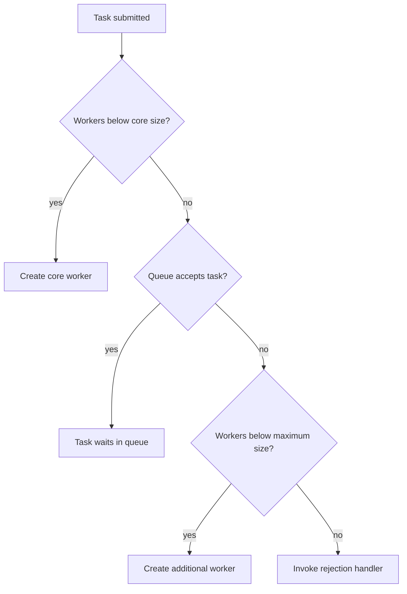

Creating a new `Thread` for every unit of work couples application logic to thread creation, makes resource use hard to bound, and scatters lifecycle management throughout the code. An **executor** separates task submission from the mechanism that runs the task.

An `Executor` accepts `Runnable` work. `ExecutorService` adds lifecycle management, bulk operations, and methods such as `submit` that return a `Future`. This lesson uses Java 21.

## Submit work and retrieve its result

Use `execute` when the task has no result to retrieve. Use `submit` when the caller needs a `Future` for completion, cancellation, or a return value:

```java
import java.util.concurrent.ExecutionException;
import java.util.concurrent.ExecutorService;
import java.util.concurrent.Executors;
import java.util.concurrent.Future;

public class SubmitTask {
    public static void main(String[] args)
            throws InterruptedException, ExecutionException {
        try (ExecutorService executor = Executors.newFixedThreadPool(2)) {
            Future<Integer> result = executor.submit(() -> 21 * 2);

            System.out.println("Working while task runs...");
            System.out.println("Result: " + result.get());
        }
    }
}
```

`Future.get()` waits if the task is not finished. A task failure is reported from `get()` as an `ExecutionException` whose cause is the original failure. `get(timeout, unit)` bounds how long the caller waits, but timing out does not automatically stop the task. `cancel(true)` requests cancellation and may interrupt a running task; the task must cooperate with interruption for prompt termination.

In Java 21, `ExecutorService` is `AutoCloseable`. Closing it initiates an orderly shutdown and waits for submitted tasks to finish. This makes try-with-resources convenient for a short-lived executor whose tasks should complete before the scope exits. Long-running services generally need explicit lifecycle handling so application shutdown can coordinate the pool with other resources.

## Choose a factory with known resource behavior

`Executors` offers common configurations, but their queue and thread-growth behavior matters:

| Factory | Typical use | Important behavior |
|---|---|---|
| `newFixedThreadPool(n)` | A stable number of workers | Uses a shared unbounded work queue. If producers outrun workers for long enough, queued tasks can consume unbounded memory. |
| `newSingleThreadExecutor()` | Sequential task execution | Uses one worker and an unbounded queue; tasks run one at a time, but backlog can still grow. |
| `newCachedThreadPool()` | Many short-lived tasks with brief idle gaps | Creates threads as needed and reuses idle ones; thread growth is not capped by a fixed pool size. |
| `newScheduledThreadPool(n)` | Delayed or periodic tasks | Schedules work using a fixed core pool; a periodic task that fails with an exception will not continue subsequent executions. |
| `newWorkStealingPool(n)` | Fork/join-style parallel tasks | Uses work-stealing queues and targets a parallelism level; it does not promise a particular execution order. |

Convenient factories do not all impose safe bounds on both threads and queued work. A fixed thread count with an unbounded queue limits active workers but not the amount of waiting work. Bound admission and queue capacity when overload is possible.

## Configure a bounded `ThreadPoolExecutor`

`ThreadPoolExecutor` exposes the main pool controls: core size, maximum size, keep-alive time, work queue, thread factory, and rejection handler. Its task-admission sequence explains why these settings must be considered together:

1. If fewer than `corePoolSize` workers are running, a new worker is created for the task.
2. Otherwise, the task is offered to the work queue.
3. If the queue is full, a worker is created up to `maximumPoolSize`.
4. If both the queue and worker capacity are exhausted, the rejection handler is invoked.



The queue check happens before growth beyond the core size, which is why an unbounded queue can keep a fixed pool from ever reaching its configured maximum.

```java
import java.util.concurrent.ArrayBlockingQueue;
import java.util.concurrent.ThreadPoolExecutor;
import java.util.concurrent.TimeUnit;

public class BoundedThreadPool {
    public static void main(String[] args) {
        ThreadPoolExecutor executor = new ThreadPoolExecutor(
                2,
                4,
                30,
                TimeUnit.SECONDS,
                new ArrayBlockingQueue<>(100),
                new ThreadPoolExecutor.AbortPolicy());

        try {
            executor.execute(() -> System.out.println("Task accepted"));
        } finally {
            executor.shutdown();
        }
    }
}
```

This pool starts with two core workers, can grow to four when its bounded queue fills, and rejects additional work when both are full. `AbortPolicy` throws `RejectedExecutionException`; other policies can run work on the submitting thread, discard work, or discard the oldest queued task. Choose rejection behavior deliberately: silent discard is only appropriate when loss is explicitly acceptable.

A bounded queue limits stored tasks, not every resource the tasks may use. A large queue can reduce thread creation but increase latency and memory use; a small queue can cause frequent rejection. CPU-bound and blocking tasks have different resource profiles, so measure the actual workload rather than applying one pool size formula universally.

### Shutdown is part of the design

- `shutdown()` rejects new work but allows already submitted tasks to run; it does not wait for them.
- `awaitTermination()` lets the caller wait for shutdown to finish, optionally with a timeout.
- `shutdownNow()` stops processing queued tasks and attempts to interrupt tasks that are running. It is a best-effort request, not a way to forcibly terminate arbitrary code.
- `close()` on Java 21 `ExecutorService` performs orderly shutdown and waits for termination.

For a service that must limit shutdown time, use a staged policy: request orderly shutdown, wait for a defined interval, then request interruption and wait again. Preserve the interrupt status if shutdown handling itself is interrupted. The `ExecutorService` Javadoc includes a complete two-phase shutdown example.

## Important task semantics

- `Runnable` represents work with no returned value; `Callable<V>` can return a value or throw a checked exception.
- `submit` returns a `Future`; exceptions from the task are stored and surfaced by `get()` rather than thrown synchronously to the submitting thread.
- `invokeAll` waits for a group of tasks and returns their futures; `invokeAny` returns one successful result and cancels unfinished work according to its contract.
- `Future.get()` is a blocking operation. Do not call it immediately if the design expects the caller to perform other work concurrently.
- Interruption is cooperative. Task code that catches and ignores `InterruptedException` can prevent cancellation and delay pool termination.
- Submission to an `ExecutorService` establishes a happens-before relationship from actions before submission to the task, and task actions to a corresponding `Future.get()`.

## Practical rules

- Reuse an executor instead of creating a new thread for every task.
- Understand the queue capacity and maximum thread behavior of each factory before using it under load.
- Use a bounded queue and an explicit rejection policy when work arrival can outpace service capacity.
- Retrieve task failures from futures and keep cancellation interruptible.
- Shut down executors when their owning component is finished; decide how long termination may take.
- Keep pool sizing tied to measured CPU, blocking, queueing, and latency behavior.

## Further reading

- [Java 21 `ExecutorService`](https://docs.oracle.com/en/java/javase/21/docs/api/java.base/java/util/concurrent/ExecutorService.html)
- [Java 21 `ThreadPoolExecutor`](https://docs.oracle.com/en/java/javase/21/docs/api/java.base/java/util/concurrent/ThreadPoolExecutor.html)
- [Java 21 `Executors`](https://docs.oracle.com/en/java/javase/21/docs/api/java.base/java/util/concurrent/Executors.html)
- [Java 21 `Future`](https://docs.oracle.com/en/java/javase/21/docs/api/java.base/java/util/concurrent/Future.html)
- [Java 21 `ScheduledExecutorService`](https://docs.oracle.com/en/java/javase/21/docs/api/java.base/java/util/concurrent/ScheduledExecutorService.html)
