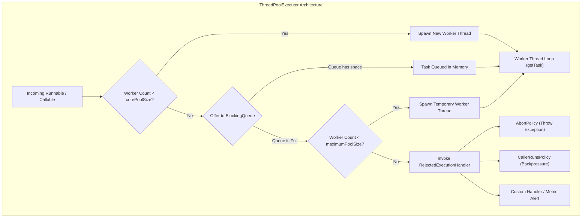
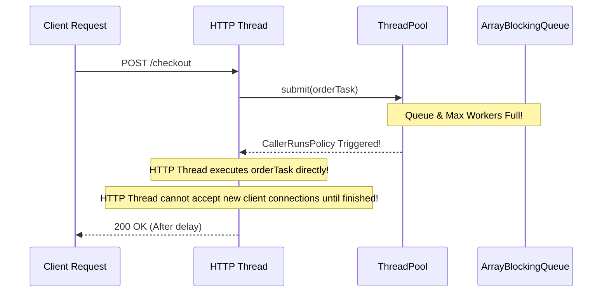
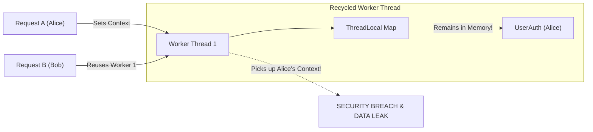

Every junior Java developer begins their multithreading journey by writing code that looks like this:

```java
new Thread(() -> {
    processIncomingPayment(order);
}).start();
```

In a local development environment running ten mock requests, this looks harmless. But deploy that code to an enterprise microservice during a Black Friday flash sale, and your service will crash within minutes. 

On standard 64-bit Linux JVMs, each platform thread allocates its own call stack off-heap, typically reserving 1MB of native RAM via the `-Xss` flag. When 10,000 simultaneous payment requests trigger 10,000 independent thread creations, your application attempts to claim 10GB of native memory purely for thread stacks. The operating system kernel denies the allocation, and the JVM crashes with the fatal error: `java.lang.OutOfMemoryError: unable to create new native thread`.

Threads are heavyweight operating system entities. Creating a thread requires an expensive kernel syscall, memory allocation, and OS scheduling registration. Tearing it down requires kernel cleanup. 

To build stable, high-throughput systems, you must decouple **task submission** from **thread execution**. That is the mission of the Java Executor framework.



---

## The ThreadPoolExecutor Admission Lifecycle

The central engine of the concurrency framework is `java.util.concurrent.ThreadPoolExecutor`. Many developers assume that a thread pool creates threads up to its maximum size and then begins queueing tasks. 

**This assumption is completely wrong**, and misunderstanding the admission algorithm causes catastrophic production outages.

When a task is submitted via `executor.execute(task)`, the pool follows this strict four-step decision tree:

1. **Core Allocation**: If the number of running worker threads is strictly less than `corePoolSize`, the pool immediately creates a new worker thread to run the task, even if existing core workers are currently idle.
2. **Queue Buffering**: If `corePoolSize` workers are running, the pool **does not** create additional threads. Instead, it attempts to insert the task into the configured `BlockingQueue`.
3. **Burst Capacity**: If and only if the `BlockingQueue` is completely full, the pool checks whether the current worker count is less than `maximumPoolSize`. If so, it spawns a temporary "burst" worker thread to run the task immediately.
4. **Rejection Trigger**: If the queue is full AND the active worker count has reached `maximumPoolSize`, the pool invokes the configured `RejectedExecutionHandler`.

```java
import java.util.concurrent.ArrayBlockingQueue;
import java.util.concurrent.ThreadPoolExecutor;
import java.util.concurrent.TimeUnit;

public class CustomProductionPool {
    public static ThreadPoolExecutor createPaymentPool() {
        int corePoolSize = 8;
        int maxPoolSize = 32;
        long keepAliveTime = 60L; // Idle burst threads terminated after 60s
        int queueCapacity = 500;

        return new ThreadPoolExecutor(
            corePoolSize,
            maxPoolSize,
            keepAliveTime,
            TimeUnit.SECONDS,
            new ArrayBlockingQueue<>(queueCapacity),
            new NamedThreadFactory("payment-worker"),
            new ThreadPoolExecutor.CallerRunsPolicy()
        );
    }
}
```

---

## Why the Executors Factory Methods Are Dangerous

The `java.util.concurrent.Executors` utility class provides convenient static factory methods. While fine for quick unit tests or command-line scripts, several of these factories are **production landmines** banned by senior platform engineering teams.

### The newFixedThreadPool Landmine

```java
// DANGEROUS IN PRODUCTION:
ExecutorService executor = Executors.newFixedThreadPool(16);
```

If you inspect the OpenJDK implementation of `newFixedThreadPool`, you find this:

```java
public static ExecutorService newFixedThreadPool(int nThreads) {
    return new ThreadPoolExecutor(nThreads, nThreads,
                                  0L, TimeUnit.MILLISECONDS,
                                  new LinkedBlockingQueue<Runnable>());
}
```

An unparameterized `LinkedBlockingQueue` has an integer capacity of `Integer.MAX_VALUE` (over 2.14 billion items). 

Under sustained downstream slowness (such as a database running a slow table lock), worker threads block. Incoming tasks continue piling up in the unbounded queue. Because the queue never fills, the pool never triggers rejection. The queue silently consumes heap space until the JVM collapses with `java.lang.OutOfMemoryError: Java heap space`.

### The newCachedThreadPool Landmine

```java
// DANGEROUS IN PRODUCTION:
ExecutorService executor = Executors.newCachedThreadPool();
```

Under the hood:

```java
public static ExecutorService newCachedThreadPool() {
    return new ThreadPoolExecutor(0, Integer.MAX_VALUE,
                                  60L, TimeUnit.SECONDS,
                                  new SynchronousQueue<Runnable>());
}
```

`SynchronousQueue` is a zero-capacity rendezvous handoff. Because the queue cannot hold items, every incoming task forces the pool to spawn a new worker thread if all existing workers are busy. Under a massive burst of incoming traffic, this factory will spawn thousands of operating system threads simultaneously, crashing your host with native thread exhaustion.

> [!IMPORTANT]
> In production enterprise systems, **never use `Executors.newFixedThreadPool` or `Executors.newCachedThreadPool`**. Always construct your own `ThreadPoolExecutor` with a bounded queue (`ArrayBlockingQueue`) and a deliberate rejection policy.

---

## The Thread Sizing Formula

How many threads should your pool have? Setting the pool size to 500 because "it feels fast" usually degrades performance due to excessive OS context switching.

Brian Goetz established the canonical formula for optimal thread sizing based on system architecture and workload type.

### For CPU-Bound Tasks (Mathematical computation, cryptographic hashing, image processing)

CPU-bound tasks demand continuous execution without waiting for external resources. Having more active threads than available CPU cores results in CPU cores thrashing between thread contexts:

```
Target Threads = Available CPU Cores + 1
```

The additional `+1` thread ensures that if a thread suffers a minor page fault or context preemption, an idle thread is instantly ready to saturate the core.

### For I/O-Bound Tasks (Database queries, HTTP calls, microservice RPCs, filesystem access)

I/O-bound tasks spend most of their time suspended, waiting for packets to travel across the network or disks to spin. During this wait time, CPU cores sit idle unless other threads are queued:

```
Target Threads = Available CPU Cores * Target CPU Utilization * (1 + (Wait Time / Compute Time))
```

Let's calculate an actual production scenario:
- **Server**: An AWS EC2 instance with 8 vCPUs (`Available CPU Cores = 8`).
- **Target Utilization**: We want the CPU running safely at 80% capacity (`Target CPU Utilization = 0.8`).
- **Telemetry Profile**: Profiling shows our microservice takes 100ms total to process a request:
  - 90ms waiting for the relational database network response (`Wait Time = 90ms`).
  - 10ms executing Java business logic and JSON serialization (`Compute Time = 10ms`).

Calculating the ratio:
- `Wait Time / Compute Time = 90 / 10 = 9`
- `Target Threads = 8 * 0.8 * (1 + 9) = 6.4 * 10 = 64 threads`

A pool of 64 threads will keep the 8-core CPU utilized at roughly 80% without introducing excessive kernel scheduling overhead.

---

## Rejection Policies: Handling Overload and Backpressure

When both the bounded queue and the maximum thread limit are saturated, what should the system do? The `RejectedExecutionHandler` interface dictates the survival strategy of your application.

| Policy | Behavior | Production Suitability |
| :--- | :--- | :--- |
| **`AbortPolicy`** (Default) | Throws `RejectedExecutionException`. | Excellent for failing fast and letting upstream API gateways return HTTP 503 or 429. |
| **`CallerRunsPolicy`** | The thread submitting the task executes it directly. | **The gold standard for backpressure**. Slows down the producer immediately. |
| **`DiscardPolicy`** | Silently swallows and drops the rejected task. | Extremely dangerous. Causes silent data loss; only suitable for non-critical telemetry. |
| **`DiscardOldestPolicy`** | Discards the oldest unhandled task from the queue head. | Suitable for real-time sensor streams where only the latest data point matters. |

### Why CallerRunsPolicy Provides Natural Backpressure

`CallerRunsPolicy` is one of the most elegant architectural patterns in concurrent programming. 

When your pool is overwhelmed, the thread submitting the task (such as an incoming HTTP Netty/Tomcat worker) executes the task logic itself inside the calling thread:



Because the calling thread is now occupied executing the heavy task, it cannot accept new incoming network requests or submit more work. The ingestion pipeline naturally throttles itself until the worker pool drains its backlog!

---

## Professional Thread Naming and Lifecycle Monitoring

When an outage strikes at 3:00 AM and you generate a thread dump using `jcmd <pid> Thread.print`, standard threads appear as `pool-1-thread-47`. This gives zero insight into which subsystem is stuck.

Always supply a custom `ThreadFactory` that names threads descriptively and installs an unhandled exception handler:

```java
import java.util.concurrent.ThreadFactory;
import java.util.concurrent.atomic.AtomicInteger;

public class NamedThreadFactory implements ThreadFactory {
    private final String prefix;
    private final AtomicInteger threadNumber = new AtomicInteger(1);
    private final ThreadGroup group;

    public NamedThreadFactory(String prefix) {
        this.prefix = prefix;
        this.group = Thread.currentThread().getThreadGroup();
    }

    @Override
    public Thread newThread(Runnable r) {
        String name = prefix + "-" + threadNumber.getAndIncrement();
        Thread thread = new Thread(group, r, name, 0);
        
        // Ensure worker threads do not inherit daemon status by accident
        if (thread.isDaemon()) {
            thread.setDaemon(false);
        }
        
        // Ensure normal priority
        if (thread.getPriority() != Thread.NORM_PRIORITY) {
            thread.setPriority(Thread.NORM_PRIORITY);
        }

        // Catch and log uncaught exceptions that would otherwise be silently lost
        thread.setUncaughtExceptionHandler((t, ex) -> {
            System.err.printf("[CRITICAL] Uncaught exception in thread %s: %s%n", 
                t.getName(), ex.getMessage());
        });

        return thread;
    }
}
```

---

## Graceful Two-Phase Shutdown

Terminating a thread pool abruptly leads to truncated database transactions, corrupted files, and lost messages. 

Java 21 implements `AutoCloseable` on `ExecutorService`, making try-with-resources clean for scoped execution. For long-running application services, Oracle recommends the canonical **Two-Phase Graceful Shutdown** pattern:

```java
import java.util.concurrent.ExecutorService;
import java.util.concurrent.TimeUnit;

public class PoolLifecycleManager {
    public static void gracefulShutdown(ExecutorService pool, long timeoutSeconds) {
        // Step 1: Reject new incoming tasks; allow pending tasks to complete
        pool.shutdown(); 
        
        try {
            // Step 2: Wait for existing tasks to finish executing
            if (!pool.awaitTermination(timeoutSeconds, TimeUnit.SECONDS)) {
                System.err.println("Pool failed to terminate gracefully within timeout. Forcing shutdown...");
                
                // Step 3: Send interruption signal to running tasks and drain waiting queue
                pool.shutdownNow(); 
                
                // Step 4: Wait briefly for interrupted tasks to respond and exit
                if (!pool.awaitTermination(timeoutSeconds / 2, TimeUnit.SECONDS)) {
                    System.err.println("Pool did not terminate after shutdownNow.");
                }
            }
        } catch (InterruptedException ie) {
            // Re-cancel if current thread was interrupted while waiting
            pool.shutdownNow();
            Thread.currentThread().interrupt(); // Restore interrupted status
        }
    }
}
```

---

## Production War Story: The ThreadLocal Memory Leak

One of the most insidious production bugs in pooled systems is the **ThreadLocal leak**.

Because threads in a pool are recycled indefinitely rather than terminated, any data attached to a thread's `ThreadLocal` storage persists across different tasks:

```java
public class SecurityContextHolder {
    private static final ThreadLocal<UserAuth> userContext = new ThreadLocal<>();

    public static void set(UserAuth auth) { userContext.set(auth); }
    public static UserAuth get() { return userContext.get(); }
    public static void clear() { userContext.remove(); }
}
```

### The Bug Scenario
1. Thread `worker-1` picks up Request A from User Alice. The application sets Alice's credentials in `SecurityContextHolder`.
2. Request A finishes successfully, but the developer forgets to call `SecurityContextHolder.clear()`.
3. Thread `worker-1` returns to the pool and is recycled.
4. Five seconds later, Thread `worker-1` picks up Request B from User Bob.
5. If Request B fails to authenticate or queries `SecurityContextHolder.get()` before setting its own identity, **Bob executes the request under Alice's security credentials**.



> [!CAUTION]
> Always clean up `ThreadLocal` variables inside a `finally` block before returning control to the thread pool:
> ```java
> try {
>     SecurityContextHolder.set(currentUser);
>     processRequest();
> } finally {
>     SecurityContextHolder.clear(); // Mandatory protection!
> }
> ```

---

## Senior Engineer Interview Crucible

### Why does Executors.newFixedThreadPool lead to OutOfMemoryError under high load, and how do you configure a safe production pool?
`Executors.newFixedThreadPool` uses an unparameterized `LinkedBlockingQueue`, which defaults to `Integer.MAX_VALUE` capacity. When worker threads cannot keep up with incoming task submissions, tasks queue infinitely in JVM heap memory. The pool never reaches capacity, so it never spawns burst threads or triggers rejection, eventually crashing the JVM with `OutOfMemoryError: Java heap space`.

A production-ready pool must use `ThreadPoolExecutor` with a bounded queue such as `ArrayBlockingQueue(N)`, an appropriate rejection handler like `CallerRunsPolicy` to enforce backpressure, and a `NamedThreadFactory` for thread dump observability.

### Explain the behavior of CallerRunsPolicy and why it is the premier choice for backpressure.
`CallerRunsPolicy` delegates execution of a rejected task to the thread that invoked `execute()`. When the pool's queue and workers are saturated, the upstream thread submitting the task is forced to execute the task logic itself. While doing so, the submitting thread is blocked from accepting new work or submitting additional tasks. This naturally propagates backpressure upstream to the network transport layer, throttling incoming traffic without losing data.

### Walk through the exact decision tree of ThreadPoolExecutor.execute() when a new task arrives.
When a task arrives:
1. If the current worker thread count is less than `corePoolSize`, a new core worker thread is created to execute the task immediately.
2. If `corePoolSize` workers are running, the task is offered to the internal `BlockingQueue`.
3. If the queue accepts the task, it waits in line for an available worker.
4. If the queue is full, the executor checks if active workers are less than `maximumPoolSize`. If yes, it creates a temporary burst worker to run the task.
5. If the queue is full and worker count equals `maximumPoolSize`, the task is handed to the configured `RejectedExecutionHandler`.

### Why is failing to clean up a ThreadLocal in a thread pool both a severe memory leak and a critical security hazard?
Threads in a pool are persistent workers that live for hours or days. A `ThreadLocal` variable is stored directly inside the thread's `threadLocals` map. If not cleared, the referenced object cannot be garbage collected, creating a long-term memory leak. 

From a security standpoint, if a worker thread handles requests for multiple users sequentially, uncleared state from User 1 (such as tenant IDs, authorization tokens, or security contexts) will bleed into the execution of User 2, allowing unauthorized data access and session cross-contamination.
