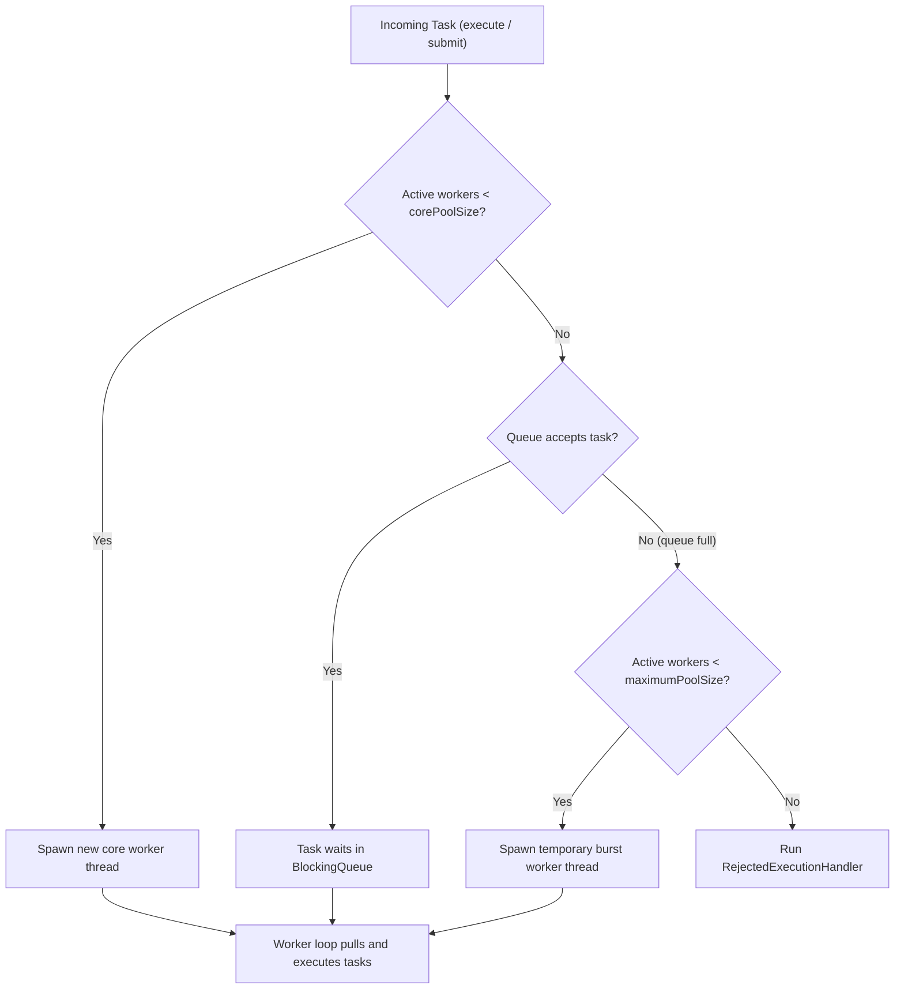

Starting a brand-new platform thread for every incoming task (`new Thread(task).start()`) works in a toy example, but breaks down quickly in a real service. Each platform thread maps to an OS thread and reserves native stack memory off-heap (commonly 1 MB per thread on 64-bit Linux, controlled by `-Xss`). Spawning thousands of platform threads during a traffic spike burns gigabytes of native memory, creates heavy OS context-switching overhead, and eventually crashes the JVM with `OutOfMemoryError: unable to create new native thread`.

The `Executor` framework in `java.util.concurrent` solves this by separating **task submission** from **thread lifecycle management**. Your code submits `Runnable` or `Callable` tasks to an `ExecutorService`, and a managed pool of worker threads executes them, enforces concurrency bounds, and cleans up gracefully on shutdown.

---

## The `ExecutorService` Framework and `ThreadPoolExecutor`

The core hierarchy is small and easy to remember:

- `Executor`: A single method, `execute(Runnable)`, for fire-and-forget submission.
- `ExecutorService`: Extends `Executor` with lifecycle management (`shutdown`, `shutdownNow`, `awaitTermination`), result-bearing submission (`submit(Callable)`), and batch execution (`invokeAll`, `invokeAny`). Since Java 19 (and in Java 21 LTS), `ExecutorService` also implements `AutoCloseable`, allowing scoped use in a `try`-with-resources block.
- `ScheduledExecutorService`: Extends `ExecutorService` with delayed and periodic task scheduling.

Most standard thread pools are backed by `ThreadPoolExecutor`. Understanding its exact task-admission algorithm is essential, because it often surprises developers who assume a pool grows to `maximumPoolSize` before queueing tasks.



When a task arrives, `ThreadPoolExecutor` follows four strict steps:

1. If the current worker count is less than `corePoolSize`, it creates a new core worker thread immediately (even if other core threads are idle).
2. Once `corePoolSize` workers exist, new tasks are offered to the `BlockingQueue`. No extra threads are created yet.
3. Only when the queue is **full** does the pool check whether the worker count is less than `maximumPoolSize`. If so, it spawns a temporary burst worker thread (which terminates after sitting idle for `keepAliveTime`).
4. If the queue is full **and** `maximumPoolSize` workers are already running, the pool hands the task to its `RejectedExecutionHandler`.

Notice the consequence of step 2: **if you pass an unbounded queue to `ThreadPoolExecutor`, `maximumPoolSize` is ignored**, because the queue never fills up.

### Configuring a Production `ThreadPoolExecutor`

For backend services, construct `ThreadPoolExecutor` explicitly so you control the queue bound, thread naming, and overload behavior:

```java
import java.util.concurrent.ArrayBlockingQueue;
import java.util.concurrent.ThreadFactory;
import java.util.concurrent.ThreadPoolExecutor;
import java.util.concurrent.TimeUnit;
import java.util.concurrent.atomic.AtomicInteger;

public class PaymentPoolFactory {
    public static ThreadPoolExecutor createPaymentPool() {
        int corePoolSize = 8;
        int maxPoolSize = 24;
        long keepAliveSeconds = 60L;
        int queueCapacity = 200;

        return new ThreadPoolExecutor(
                corePoolSize,
                maxPoolSize,
                keepAliveSeconds,
                TimeUnit.SECONDS,
                new ArrayBlockingQueue<>(queueCapacity),
                namedThreadFactory("payment-worker"),
                new ThreadPoolExecutor.CallerRunsPolicy()
        );
    }

    private static ThreadFactory namedThreadFactory(String prefix) {
        AtomicInteger counter = new AtomicInteger(1);
        return runnable -> {
            Thread thread = new Thread(runnable, prefix + "-" + counter.getAndIncrement());
            thread.setDaemon(false);
            thread.setUncaughtExceptionHandler((t, ex) ->
                    System.err.printf("Uncaught exception in %s: %s%n", t.getName(), ex));
            return thread;
        };
    }
}
```

Naming threads with a prefix like `payment-worker-` pays off immediately when inspecting thread dumps (`jcmd <pid> Thread.print`) during an incident. Default names like `pool-3-thread-14` tell you nothing about which subsystem owns the blocked thread.

### Rejection Policies and Backpressure

When the bounded queue and `maximumPoolSize` are both saturated, `RejectedExecutionHandler` determines how the service degrades:

| Policy | Behavior | When to Use |
| :--- | :--- | :--- |
| `AbortPolicy` (default) | Throws `RejectedExecutionException`. | Fail fast so an API layer can return HTTP 503 or 429 cleanly. |
| `CallerRunsPolicy` | Runs the task on the submitting thread itself. | Natural backpressure: slows down the caller until the pool catches up. |
| `DiscardPolicy` | Silently drops the rejected task. | Non-critical metrics or best-effort logging where drops are acceptable. |
| `DiscardOldestPolicy` | Drops the oldest queued task and retries submission. | Real-time feeds (quotes, sensor readings) where fresher data supersedes older items. |

`CallerRunsPolicy` is popular for internal pipelines because it throttles the producer automatically without losing work. Just be careful when using it from an event-loop thread (such as Netty I/O threads): blocking the event loop on a slow task can stall unrelated network connections, in which case failing fast with `AbortPolicy` is safer.

---

## Standard Thread Pool Types

The `Executors` utility class provides factory methods for four common pool shapes. Knowing what each one builds internally helps you decide when to use it and when to configure a custom `ThreadPoolExecutor` instead.

### Fixed Thread Pool (`newFixedThreadPool(n)`)
Creates a pool where `corePoolSize == maximumPoolSize == n` backed by an **unbounded** `LinkedBlockingQueue`. It keeps a steady number of threads alive, which is convenient for controlled batch jobs or bounded workloads. The risk in long-running servers is the unbounded queue: if a downstream database slows down while requests keep arriving, tasks pile up on the heap until the JVM hits `OutOfMemoryError: Java heap space`.

### Cached Thread Pool (`newCachedThreadPool()`)
Creates a pool with `corePoolSize = 0`, `maximumPoolSize = Integer.MAX_VALUE`, a 60-second `keepAliveTime`, and a zero-capacity `SynchronousQueue`. Idle threads are reused when available, and new threads are created on demand if all existing ones are busy. This works well for short-lived asynchronous tasks in bounded internal tools, but under an unbounded traffic burst it can spawn thousands of OS threads and exhaust native memory.

### Single Thread Executor (`newSingleThreadExecutor()`)
Uses a single worker thread with an unbounded `LinkedBlockingQueue`. Tasks execute strictly sequentially in FIFO submission order, and each task happens-before the next one in the JMM, so tasks can share mutable state safely without extra locking. If the worker thread dies due to an unhandled exception, the executor automatically replaces it with a fresh thread for subsequent tasks.

### Scheduled Thread Pool (`newScheduledThreadPool(n)`)
Returns a `ScheduledExecutorService` backed by `ScheduledThreadPoolExecutor` (which uses a delayed work queue). Use it for delayed one-shot jobs or recurring maintenance tasks instead of the legacy `java.util.Timer` class, which runs everything on a single thread and dies permanently if any task throws an uncaught exception.

Pay close attention to the difference between `scheduleAtFixedRate` and `scheduleWithFixedDelay`:

```java
import java.util.concurrent.Executors;
import java.util.concurrent.ScheduledExecutorService;
import java.util.concurrent.TimeUnit;

public class MaintenanceScheduler {
    public static void main(String[] args) throws InterruptedException {
        ScheduledExecutorService scheduler = Executors.newScheduledThreadPool(2);

        // One-shot delayed task
        scheduler.schedule(
                () -> System.out.println("Warm-up check complete"),
                1, TimeUnit.SECONDS
        );

        // Fixed rate: aims to start every 5s (measured start-to-start).
        // If a run takes 7s, the next run starts immediately afterward (never overlaps).
        scheduler.scheduleAtFixedRate(() -> {
            try {
                System.out.println("Refreshing metrics cache...");
            } catch (Exception e) {
                // Always catch exceptions inside scheduled tasks!
                System.err.println("Metrics refresh failed: " + e.getMessage());
            }
        }, 0, 5, TimeUnit.SECONDS);

        // Fixed delay: waits 5s AFTER the previous run finishes (end-to-start).
        scheduler.scheduleWithFixedDelay(() -> {
            try {
                System.out.println("Polling external queue...");
            } catch (Exception e) {
                System.err.println("Poll failed: " + e.getMessage());
            }
        }, 0, 5, TimeUnit.SECONDS);

        Thread.sleep(12_000);
        scheduler.shutdown();
    }
}
```

> [!WARNING]
> If a periodic task submitted to `scheduleAtFixedRate` or `scheduleWithFixedDelay` throws an uncaught exception, the scheduler **silently suppresses all future executions** of that task. Always wrap the task body in a `try/catch` block that logs failures.

---

## `Callable` and `Future`

`Runnable` has two major limitations: its `run()` method returns `void`, and it cannot throw checked exceptions. When an asynchronous task needs to return a result or propagate an exception back to the caller, use `Callable<V>` and `Future<V>`.

```java
@FunctionalInterface
public interface Callable<V> {
    V call() throws Exception;
}
```

Submitting a `Callable<V>` to an `ExecutorService` returns a `Future<V>` immediately. The `Future` is a handle representing the pending result of the computation. You can check whether it is done (`isDone()`), block until it finishes (`get()` or `get(timeout, unit)`), or request cancellation (`cancel(mayInterruptIfRunning)`).

Here is a realistic example that calls two downstream services concurrently, enforces a deadline, unwraps failures properly, and cancels slow tasks:

```java
import java.util.concurrent.Callable;
import java.util.concurrent.CancellationException;
import java.util.concurrent.ExecutionException;
import java.util.concurrent.ExecutorService;
import java.util.concurrent.Executors;
import java.util.concurrent.Future;
import java.util.concurrent.TimeUnit;
import java.util.concurrent.TimeoutException;

public class OrderSummaryService {
    record PricingQuote(double total) {}
    record InventoryStatus(boolean inStock) {}

    public static void main(String[] args) {
        // Java 19+/21: ExecutorService implements AutoCloseable
        try (ExecutorService executor = Executors.newFixedThreadPool(2)) {
            Callable<PricingQuote> pricingTask = () -> {
                Thread.sleep(150); // Simulate network call
                return new PricingQuote(149.99);
            };

            Callable<InventoryStatus> inventoryTask = () -> {
                Thread.sleep(2_000); // Simulate slow downstream service
                return new InventoryStatus(true);
            };

            Future<PricingQuote> pricingFuture = executor.submit(pricingTask);
            Future<InventoryStatus> inventoryFuture = executor.submit(inventoryTask);

            try {
                PricingQuote quote = pricingFuture.get(500, TimeUnit.MILLISECONDS);
                System.out.println("Quote received: " + quote.total());

                // Enforce a strict 500ms budget on inventory check
                InventoryStatus stock = inventoryFuture.get(500, TimeUnit.MILLISECONDS);
                System.out.println("Inventory in stock: " + stock.inStock());
            } catch (TimeoutException e) {
                System.err.println("Inventory lookup timed out; cancelling task.");
                // true sends Thread.interrupt() to the running worker thread
                inventoryFuture.cancel(true);
            } catch (ExecutionException e) {
                // Any exception thrown inside call() is wrapped in ExecutionException
                Throwable cause = e.getCause();
                System.err.println("Task failed with cause: " + cause);
            } catch (CancellationException e) {
                System.err.println("Task was cancelled before producing a result.");
            } catch (InterruptedException e) {
                Thread.currentThread().interrupt(); // Restore interrupt status
                System.err.println("Caller thread was interrupted while waiting.");
            }
        }
    }
}
```

A few practical details trip developers up with `Future`:

- **Exceptions disappear if you ignore the `Future`:** When you use `submit(...)` instead of `execute(...)`, an uncaught exception thrown inside the task is captured inside the `Future` rather than sent to the thread's `UncaughtExceptionHandler`. If nobody calls `future.get()`, that exception is never logged or observed.
- **Always prefer `get(timeout, unit)` over bare `get()`:** An untimed `get()` can block a request thread indefinitely if a downstream dependency hangs.
- **`cancel(true)` is cooperative:** Passing `true` interrupts the worker thread running the task, which wakes up blocking calls like `Thread.sleep`, `BlockingQueue.take`, or interruptible I/O. If the task is running a tight CPU loop that never checks `Thread.currentThread().isInterrupted()`, `cancel(true)` marks the `Future` cancelled, but the underlying worker thread keeps running until the loop finishes.
- **Batch helpers:** `executor.invokeAll(tasks, timeout, unit)` submits a collection of `Callable`s and waits until all complete or the timeout expires (cancelling unfinished tasks automatically). `executor.invokeAny(tasks)` returns the result of the first task to complete normally and cancels the rest, which is useful for hedged reads across replicas.

When you need non-blocking composition (chaining stages, combining multiple futures without blocking threads), move up to `CompletableFuture`, covered in the next roadmap level.

---

## Tuning Thread Pool Sizes: CPU-Bound vs. I/O-Bound Workloads

Choosing an arbitrary pool size like 200 threads rarely helps. Too few threads leave CPU cores underutilized; too many threads waste memory and cause OS context-switching overhead, increasing tail latency.

Start by classifying the workload:

### CPU-Bound Workloads
Tasks that spend almost all their time computing (compression, encryption, parsing, image encoding, mathematical modeling) keep a core busy continuously. Adding more runnable threads than CPU cores only forces the OS to time-slice between them and thrash CPU caches.

A solid starting point is:

```text
Target Threads = Available CPU Cores   (or Available CPU Cores + 1)
```

In Java, query available cores with `Runtime.getRuntime().availableProcessors()`. In containerized environments (Docker/Kubernetes), modern JVMs (Java 11+ and Java 21) automatically respect container CPU quotas when reporting `availableProcessors()`.

### I/O-Bound Workloads
Tasks that wait on databases, REST APIs, message brokers, or disk spend most of their wall-clock time blocked. While one thread waits for a network response, the CPU core is free to run another thread.

Brian Goetz's sizing formula from *Java Concurrency in Practice* gives a practical first estimate:

```text
Target Threads = N_cpu * U_cpu * (1 + (Wait Time / Compute Time))
```

Where:
- `N_cpu` is the number of available CPU cores.
- `U_cpu` is target CPU utilization (between `0` and `1`, for example `0.8` to leave headroom for GC and OS work).
- `Wait Time / Compute Time` is the ratio of time a task spends waiting on I/O versus actively running on the CPU.

**Worked example:** Suppose an API service runs on 8 vCPUs (`N_cpu = 8`), targets 80% CPU utilization (`U_cpu = 0.8`), and profiling shows each request takes 100 ms total: 90 ms waiting on a database and HTTP calls (`Wait Time = 90`), and 10 ms running Java logic and JSON serialization (`Compute Time = 10`).

- `Wait Time / Compute Time = 90 / 10 = 9`
- `Target Threads = 8 * 0.8 * (1 + 9) = 64 threads`

Treat this formula as a starting hypothesis, not a law. Real services also face downstream bottlenecks: if your PostgreSQL connection pool only has 20 connections, sizing your worker pool to 64 threads will just queue 44 threads waiting on HikariCP. Always verify pool sizing with load tests and latency percentiles (p95/p99).

### How Java 21 Virtual Threads Change the Calculus

Java 21 finalized **Virtual Threads** (JEP 444), which dramatically changes how you handle I/O-bound concurrency. A virtual thread is a lightweight JVM-managed thread mounted onto a small carrier pool of platform threads. When a virtual thread performs blocking I/O (such as a socket read or JDBC call), the JVM unmounts it from the carrier thread and mounts another runnable virtual thread without blocking an OS thread.

For blocking I/O workloads on Java 21+, you generally **do not size or pool virtual threads**. Instead, create one per task with `Executors.newVirtualThreadPerTaskExecutor()`:

```java
try (ExecutorService executor = Executors.newVirtualThreadPerTaskExecutor()) {
    Future<String> user = executor.submit(() -> fetchUserProfile(userId));
    Future<String> orders = executor.submit(() -> fetchRecentOrders(userId));
    // ...
}
```

Two important caveats remain:
1. **Virtual threads do not speed up CPU-bound work.** For CPU-heavy computation, stick with a bounded platform thread pool sized near `availableProcessors()`.
2. **Replace thread-pool sizing with explicit resource limits.** Because virtual threads let you run tens of thousands of concurrent tasks easily, use a `Semaphore` (or a bounded database connection pool) to prevent overwhelming downstream services.

---

## Graceful Two-Phase Shutdown

Shutting down a JVM without draining its thread pools cuts off in-flight database transactions, drops queued messages, and leaves partial files on disk.

The standard `ExecutorService` shutdown pattern uses two phases: first stop accepting new tasks and wait for queued work to finish; only if the timeout expires, interrupt running workers with `shutdownNow()`.

```java
import java.util.List;
import java.util.concurrent.ExecutorService;
import java.util.concurrent.TimeUnit;

public class PoolShutdownHelper {
    public static void shutdownGracefully(ExecutorService pool, long timeoutSeconds) {
        // Phase 1: Stop accepting new tasks; let submitted tasks complete
        pool.shutdown();
        try {
            if (!pool.awaitTermination(timeoutSeconds, TimeUnit.SECONDS)) {
                // Phase 2: Timeout elapsed; interrupt running tasks and drain queue
                List<Runnable> droppedTasks = pool.shutdownNow();
                System.err.println("Forced shutdown. Unstarted tasks dropped: " + droppedTasks.size());

                if (!pool.awaitTermination(timeoutSeconds / 2, TimeUnit.SECONDS)) {
                    System.err.println("Executor did not terminate cleanly after shutdownNow().");
                }
            }
        } catch (InterruptedException e) {
            pool.shutdownNow();
            Thread.currentThread().interrupt();
        }
    }
}
```

In Java 21, using `ExecutorService` inside a `try`-with-resources block calls `ExecutorService.close()`, which runs `shutdown()`, waits indefinitely for termination, and calls `shutdownNow()` if the waiting thread is interrupted. That is great for short-lived scoped batches, while long-running servers still benefit from the timed two-phase shutdown above during application stop hooks.

---

## Avoiding `ThreadLocal` Leaks in Pooled Threads

Because platform threads in a pool are reused across thousands of tasks, any value placed in a `ThreadLocal` remains attached to that worker thread until it is explicitly removed.

Forgetting to call `remove()` causes two serious production issues:

1. **Memory leaks:** Pooled threads live for the entire uptime of the service, so objects pinned in their `ThreadLocalMap` cannot be garbage collected.
2. **Cross-request data leaks:** If Request A stores Alice's tenant ID or authentication context in a `ThreadLocal` and exits without clearing it, the next task on that worker thread can accidentally read Alice's context while serving Bob.

Always clear `ThreadLocal` values in a `finally` block:

```java
public class TenantContext {
    private static final ThreadLocal<String> CURRENT_TENANT = new ThreadLocal<>();

    public static void runWithTenant(String tenantId, Runnable action) {
        CURRENT_TENANT.set(tenantId);
        try {
            action.run();
        } finally {
            CURRENT_TENANT.remove(); // Mandatory when running on pooled threads
        }
    }

    public static String currentTenant() {
        return CURRENT_TENANT.get();
    }
}
```

(In newer Java versions, **Scoped Values**, previewed in Java 21–24 and finalized in Java 25 via JEP 506, provide a safer, automatically bounded replacement for `ThreadLocal` when sharing immutable per-request context.)

---

## Recap

- `ThreadPoolExecutor` admits work in a strict order: core threads first, then the `BlockingQueue`, then burst threads up to `maximumPoolSize`, and finally the `RejectedExecutionHandler`.
- Avoid `Executors.newFixedThreadPool` and `Executors.newCachedThreadPool` for untrusted high-load server traffic because their unbounded queues or unbounded thread limits can trigger heap or native OOM errors.
- Use `Callable<V>` and `Future<V>` when tasks return values or throw checked exceptions; always use timed `get()`, unwrap `ExecutionException`, and cancel slow tasks cleanly with `cancel(true)`.
- Size CPU-bound pools near `availableProcessors()` and I/O-bound platform pools using measured wait-to-compute ratios plus load testing. On Java 21+, prefer `Executors.newVirtualThreadPerTaskExecutor()` paired with `Semaphore` limits for blocking I/O workloads.
- Always shut pools down in two phases (`shutdown()` -> `awaitTermination()` -> `shutdownNow()`) and clean up `ThreadLocal` values in `finally` blocks.

---

## Practical Questions

### Walk through what `ThreadPoolExecutor` does when you configure `corePoolSize = 4`, `maximumPoolSize = 16`, and a `LinkedBlockingQueue` with no capacity argument.
The pool will never grow beyond 4 threads. After the first 4 tasks start core workers, every subsequent task is offered to the `LinkedBlockingQueue`. Because an unparameterized `LinkedBlockingQueue` has a capacity of `Integer.MAX_VALUE`, the queue effectively never fills up, so step 3 (spawning burst workers up to `maximumPoolSize`) and step 4 (rejection) are never reached. Under sustained overload, the queue consumes heap memory until the JVM runs out of memory.

### What happens if a `Callable` submitted via `executor.submit()` throws a `RuntimeException`, and the caller never calls `future.get()`?
The exception is caught internally by `FutureTask` and stored inside the returned `Future`. It is **not** passed to the worker thread's `UncaughtExceptionHandler` and is not printed to stderr. Unless someone calls `future.get()` (which rethrows it wrapped in `ExecutionException`) or logs it inside the task itself, the failure disappears silently.

### What is the difference between `scheduleAtFixedRate` and `scheduleWithFixedDelay` when a task runs longer than its interval?
Suppose the interval is 5 seconds and a single execution takes 7 seconds. With `scheduleAtFixedRate`, the scheduler measures from the start of the previous execution; seeing that the next scheduled start time has already passed, it starts the next run immediately after the slow run finishes (it still never runs two instances of the same task concurrently). With `scheduleWithFixedDelay`, the scheduler waits a full 5 seconds *after* the 7-second run completes before starting the next run.

### Why shouldn't you pool Java 21 virtual threads inside a `ThreadPoolExecutor`?
Platform threads are pooled because they are expensive OS resources to create and hold in memory. Virtual threads are cheap JVM objects designed to represent a single task and be garbage collected once it finishes. Pooling virtual threads defeats their model and invites `ThreadLocal` pollution. If you need to limit concurrency to a downstream dependency while using virtual threads, create a fresh virtual thread per task and guard the downstream call with a `Semaphore`.
