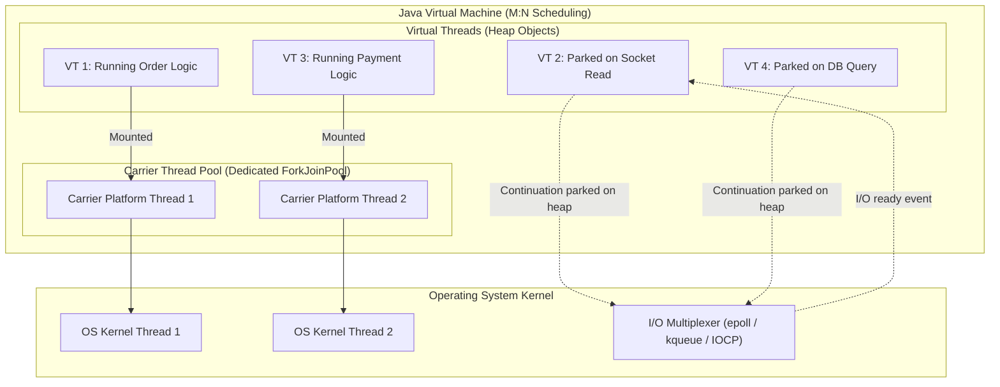
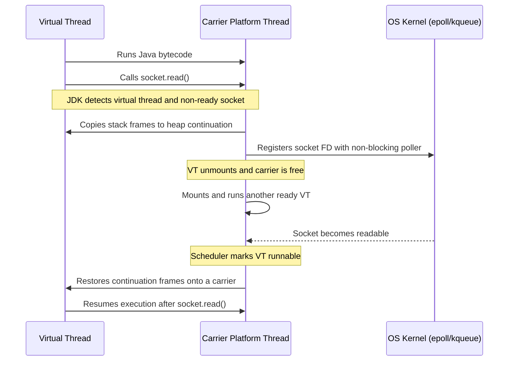

For decades, scaling a Java backend under high I/O concurrency meant picking between two awkward trade-offs.

With the classic **thread-per-request** model, each incoming HTTP request runs on its own Java platform thread. The code is straightforward to write and debug: loops, `try-catch` blocks, and stack traces all behave the way you expect. The catch is that each platform thread wraps a dedicated operating system (OS) kernel thread. Because OS threads are limited and typically reserve around 1 MB of native stack space (configurable via `-Xss`), a server runs out of memory or stalls on context-switching overhead once concurrent blocking requests climb into the thousands.

The alternative was the **reactive / asynchronous** model (Netty, Project Reactor, WebFlux, RxJava). Non-blocking event loops can serve tens or hundreds of thousands of open sockets using only a handful of OS threads, but you pay for it in complexity. Standard control flow turns into operator chains, stack traces lose their call context, debugging takes more effort, and any accidental blocking call (such as a traditional JDBC driver) can stall an entire event-loop thread.

Project Loom addresses this trade-off directly inside the JVM. Its headline feature, **Virtual Threads**, was finalized in **Java 21 (JEP 444)**. Virtual threads let you write sequential, blocking thread-per-request code while allowing the JVM to multiplex huge numbers of waiting tasks onto a small pool of OS threads.

## Platform Threads vs OS Threads vs Virtual Threads

Before looking at scheduling internals, it helps to separate the three kinds of threads involved when a Java program runs:

| Characteristic | OS Kernel Thread | Java Platform Thread | Java Virtual Thread |
| :--- | :--- | :--- | :--- |
| **Managed by** | Operating system kernel | JVM (1:1 wrapper around an OS thread) | JVM user-mode scheduler (M:N over carrier threads) |
| **Stack memory** | Fixed native stack (often ~1 MB) | Mirrors OS thread native stack (`-Xss`) | Grows/shrinks dynamically as chunks on the Java heap |
| **Creation cost** | High (kernel syscall + stack allocation) | High (allocates an OS thread) | Low (ordinary heap object allocation) |
| **Typical concurrent scale** | Hundreds to a few thousand | Hundreds to a few thousand | Tens of thousands to millions (memory permitting) |
| **Blocking I/O impact** | Kernel parks the OS thread | Blocks the underlying OS thread | Unmounts from carrier; OS thread runs another virtual thread |
| **Daemon / Priority** | OS-controlled | Configurable daemon flag and priority | Always daemon; fixed `Thread.NORM_PRIORITY` |

Virtual threads are still regular instances of `java.lang.Thread`. Existing libraries, debuggers, profilers, and stack traces continue to work with them, and you can check whether a thread is virtual via `Thread.currentThread().isVirtual()`.



## How the JVM Parks and Unparks Virtual Threads

Virtual threads are scheduled by the JVM rather than the operating system kernel. In HotSpot (OpenJDK's JVM), the runtime maintains a dedicated internal `ForkJoinPool` running in FIFO mode to supply **carrier threads** (regular platform threads that execute virtual thread bytecode). Note that this carrier pool is separate from `ForkJoinPool.commonPool()`.

By default, the carrier pool's parallelism equals `Runtime.getRuntime().availableProcessors()`, and it can be tuned if needed via system properties such as `jdk.virtualThreadScheduler.parallelism` and `jdk.virtualThreadScheduler.maxPoolSize`.

### Continuations and Carrier Mounting

When a virtual thread is runnable, the JVM **mounts** it onto an available carrier platform thread. While mounted, the virtual thread's stack frames execute on the carrier thread just like normal Java code.

The key mechanism underneath is an internal JVM primitive called a **continuation** (currently an internal JDK implementation detail, not a public API). Unlike a platform thread's contiguous native stack, a virtual thread's paused call stack is stored as compact stack chunk objects on the garbage-collected Java heap. A freshly created or lightly stacked virtual thread uses only a few hundred bytes to a few kilobytes of heap memory, growing only as deep as its actual call stack requires.

### What Happens During Blocking I/O

Almost every blocking operation in the standard JDK (`java.net`, `java.io`, `java.nio`, `Thread.sleep`, `LockSupport.park`, `ReentrantLock`, `Semaphore`, `BlockingQueue`) was updated for Project Loom so it cooperates with the virtual thread scheduler.



Step by step:

1. **Interception**: Your code calls a standard blocking method like `socket.getInputStream().read()`. Inside the JDK implementation, the socket is configured non-blocking under the hood.
2. **Park and unmount**: If no bytes are ready yet, the JDK registers the file descriptor with the OS event poller (`epoll` on Linux, `kqueue` on macOS, or `IOCP` / `WEPoll` on Windows) and parks the virtual thread. The JVM copies the active stack frames into the virtual thread's heap continuation and **unmounts** it from the carrier thread.
3. **Carrier reuse**: The carrier platform thread never enters a kernel wait state. It returns to the carrier `ForkJoinPool` and immediately mounts another runnable virtual thread.
4. **Unpark and remount**: When the OS reports that data has arrived on the socket, an internal poller thread unparks the virtual thread and places it back onto the scheduler's runnable queue. The next available carrier thread (not necessarily the same one) mounts the continuation and resumes execution right after the `read()` call.

From your application's perspective, you wrote plain synchronous code. At the OS level, the JVM executed non-blocking multiplexed I/O.

## Creating and Running Virtual Threads

Java 21 provides both direct `Thread` builders and an `ExecutorService` factory tailored for virtual threads:

```java
import java.time.Duration;
import java.util.concurrent.ExecutorService;
import java.util.concurrent.Executors;

public class VirtualThreadBasics {
    public static void main(String[] args) throws InterruptedException {
        // 1. Quickest way to launch a single virtual thread
        Thread quick = Thread.startVirtualThread(() ->
            System.out.println("Quick task on: " + Thread.currentThread())
        );
        quick.join();

        // 2. Named virtual thread via builder
        Thread named = Thread.ofVirtual()
            .name("order-worker-", 1)
            .start(() -> System.out.println("Named task on: " + Thread.currentThread()));
        named.join();

        // 3. Recommended pattern for concurrent tasks: one virtual thread per task
        try (ExecutorService executor = Executors.newVirtualThreadPerTaskExecutor()) {
            for (int i = 0; i < 50_000; i++) {
                final int taskId = i;
                executor.submit(() -> {
                    Thread.sleep(Duration.ofMillis(100));
                    return "Completed task " + taskId;
                });
            }
        } // ExecutorService is AutoCloseable since Java 19; waits for all submitted tasks

        System.out.println("All 50,000 tasks finished.");
    }
}
```

Attempting to spawn 50,000 platform threads on a typical workstation or container would exhaust OS thread limits or memory almost immediately. With `newVirtualThreadPerTaskExecutor()`, the JVM handles all 50,000 sleeping tasks using only a handful of carrier threads and modest heap usage.

> [!NOTE]
> Virtual threads improve **throughput for I/O-bound workloads** where threads spend most of their lifetime waiting on networks, databases, or locks. They do not speed up CPU-bound computation. If 1,000 virtual threads are all crunching numbers on an 8-core machine, only 8 can run at once, and a bounded platform thread pool sized to core count remains appropriate for pure CPU work.

## Thread Pinning in Java 21 (and How Java 24 Changes It)

Virtual threads rely on being able to unmount from their carrier thread whenever they block. **Thread pinning** happens when a virtual thread is blocked *and* the JVM cannot unmount it from its carrier. While pinned, the underlying OS carrier thread sits blocked as well. If enough carriers are pinned simultaneously, the carrier pool starves and other virtual threads stall waiting for a carrier.

In **Java 21 LTS**, a virtual thread is pinned to its carrier in two situations:

1. It blocks while inside a `synchronized` block or `synchronized` method.
2. It executes native code via JNI or the Foreign Function & Memory (FFM) API.

Short, in-memory `synchronized` blocks (like updating a counter or a small cache map) are rarely an issue because they hold the monitor for nanoseconds and do not block on I/O. The real hazard in Java 21 is performing network I/O, disk I/O, or waiting on a lock inside a `synchronized` block:

```java
// Pinning hazard on Java 21: blocking HTTP call inside synchronized
public class LegacyPaymentClient {
    private final Object lock = new Object();

    public String charge(String orderId) {
        synchronized (lock) {
            return callRemotePaymentApi(orderId); // Pins carrier thread on Java 21!
        }
    }

    private String callRemotePaymentApi(String orderId) {
        return "charged-" + orderId;
    }
}
```

### Avoiding Pinning on Java 21 with ReentrantLock

On Java 21, replace `synchronized` around blocking operations with `java.util.concurrent.locks.ReentrantLock`. Because `ReentrantLock` parks via `LockSupport`, the virtual thread unmounts cleanly both while waiting to acquire the lock and while running blocking I/O inside the critical section:

```java
import java.util.concurrent.locks.Lock;
import java.util.concurrent.locks.ReentrantLock;

public class VirtualFriendlyPaymentClient {
    private final Lock lock = new ReentrantLock();

    public String charge(String orderId) {
        lock.lock();
        try {
            return callRemotePaymentApi(orderId); // Carrier remains free to unmount
        } finally {
            lock.unlock();
        }
    }

    private String callRemotePaymentApi(String orderId) {
        return "charged-" + orderId;
    }
}
```

### Detecting Pinning

On Java 21, you have two ways to spot pinning:

- **Java Flight Recorder (preferred in production)**: Monitor the `jdk.VirtualThreadPinned` JFR event (by default recorded when a thread stays pinned longer than 20ms). It captures the stack trace with minimal overhead.
- **JVM trace flag (useful in local or staging tests)**: Pass `-Djdk.tracePinnedThreads=full` (or `short`) to print stack traces to standard output whenever a virtual thread blocks while pinned.

### What Changed in Java 24 (JEP 491)

**Java 24 delivered JEP 491 ("Synchronize Virtual Threads without Pinning")**, which redesigned JVM object monitors so virtual threads can acquire, hold, and release `synchronized` monitors independently of their carrier platform threads. Starting in Java 24, blocking inside a `synchronized` block or calling `Object.wait()` no longer pins the carrier thread. Native frames (JNI/FFM) can still pin, and if your production services run on Java 21 LTS, avoiding blocking I/O inside `synchronized` (and keeping JDBC drivers updated to Loom-friendly versions) remains important.

## Never Pool Virtual Threads

Platform threads were pooled because creating an OS thread was expensive. With virtual threads, that assumption no longer holds.

```java
// Antipattern: wrapping virtual threads in a fixed-size thread pool
ExecutorService badPool = Executors.newFixedThreadPool(100, Thread.ofVirtual().factory());
```

Pooling virtual threads adds queue contention, encourages stale `ThreadLocal` state to linger across unrelated tasks, and caps concurrency to the pool size without saving meaningful memory or CPU. Treat a virtual thread like a short-lived task: create one per concurrent unit of work via `Executors.newVirtualThreadPerTaskExecutor()`, let it finish, and let the garbage collector reclaim it.

### Limiting Concurrency with a Semaphore

Engineers often used a fixed thread pool of size 20 for a second, implicit reason: to prevent a service from opening 10,000 simultaneous connections to a database or rate-limited API.

With virtual threads, separate **thread creation** from **concurrency limiting**. Use a `Semaphore` (or an existing resource pool such as HikariCP for JDBC connections) to cap how many virtual threads access a scarce resource at the same time:

```java
import java.util.concurrent.Semaphore;

public class RateLimitedRepository {
    // Allow at most 20 concurrent database queries
    private final Semaphore permits = new Semaphore(20);

    public String findCustomer(String customerId) throws InterruptedException {
        permits.acquire(); // Waiting virtual threads unmount cleanly
        try {
            return runJdbcQuery(customerId);
        } finally {
            permits.release();
        }
    }

    private String runJdbcQuery(String customerId) {
        return "Customer(" + customerId + ")";
    }
}
```

When all 20 permits are in use, the 21st virtual thread parks on `permits.acquire()`, unmounts from its carrier, and consumes only a small amount of heap memory until a permit is released.

## Structured Concurrency API (Preview in Java 21)

When spawning threads becomes nearly free, applications naturally fan out far more concurrent subtasks. Without guardrails, fan-out creates a subtle operational problem: if a parent request fails or times out, child tasks submitted to an ordinary `ExecutorService` keep running in the background as orphan threads, burning CPU and holding database connections.

Project Loom addresses this with **Structured Concurrency** (`java.util.concurrent.StructuredTaskScope`), introduced as a **preview feature in Java 21 (JEP 453)**. To compile and run preview APIs on Java 21, pass `--enable-preview` to `javac` and `java`.

`StructuredTaskScope` ties the lifetime of forked child virtual threads to a `try`-with-resources block. In Java 21, two built-in policies cover the most common fan-out patterns:

- `ShutdownOnFailure`: If any subtask throws an exception, the scope cancels all remaining sibling subtasks via thread interruption.
- `ShutdownOnSuccess`: As soon as the first subtask succeeds, the scope captures that result and cancels the slower siblings.

```java
import java.util.concurrent.StructuredTaskScope;
import java.util.concurrent.StructuredTaskScope.Subtask;

public class OrderLoader {
    record OrderSummary(String user, String inventory) {}

    // Java 21 preview API (compile and run with --enable-preview)
    public OrderSummary loadOrder(String orderId) throws Exception {
        try (var scope = new StructuredTaskScope.ShutdownOnFailure()) {
            Subtask<String> userTask = scope.fork(() -> fetchUser(orderId));
            Subtask<String> stockTask = scope.fork(() -> fetchInventory(orderId));

            scope.join();          // Wait for both tasks, or until one fails
            scope.throwIfFailed(); // Propagate the first failure if any occurred

            return new OrderSummary(userTask.get(), stockTask.get());
        } // Guaranteed: no forked subtask outlives this try block
    }

    private String fetchUser(String id) { return "Alice"; }
    private String fetchInventory(String id) { return "InStock"; }
}
```

*(Note: Structured Concurrency continued evolving across Java 22 to 25 previews; in Java 25 JEP 505, the API moved toward static `StructuredTaskScope.open(...)` factory methods and `Joiner` policies. The next lesson covers Structured Concurrency and its lifecycle in depth.)*

## Scoped Values: The Modern Alternative to ThreadLocal (Preview in Java 21)

`ThreadLocal` was designed when JVMs ran a few hundred pooled platform threads. With virtual threads, `ThreadLocal` introduces two practical problems:

1. **Memory footprint at scale**: If you create 500,000 virtual threads and each caches heavy objects (or copies a `ThreadLocalMap` via `InheritableThreadLocal`), heap usage climbs rapidly.
2. **Mutability and leaks**: Any method down the call stack can call `set()` unexpectedly, and forgetting `remove()` on long-lived threads leaks references across requests.

**Scoped Values** (`java.lang.ScopedValue`), introduced as a **preview feature in Java 21 (JEP 446)** and **finalized in Java 25 (JEP 506)**, provide an immutable, lexically bounded way to share context down a call stack and across structured child virtual threads:

```java
import java.lang.ScopedValue;

public class TenantContext {
    public static final ScopedValue<String> CURRENT_TENANT = ScopedValue.newInstance();

    public void handleRequest(String tenantId) {
        // Bound only while this lambda executes
        ScopedValue.where(CURRENT_TENANT, tenantId).run(() -> {
            runBusinessLogic();
        });
        // Automatically unbound here; no remove() call required
    }

    private void runBusinessLogic() {
        String tenant = CURRENT_TENANT.get();
        System.out.println("Processing request for tenant: " + tenant);
    }
}
```

Because a `ScopedValue` binding is immutable and strictly tied to the execution of the `run()` or `call()` lambda, child virtual threads forked inside a `StructuredTaskScope` can share the parent's binding directly without copying a per-thread map.

## Practical Questions

### How does a virtual thread handle blocking socket I/O without blocking an OS thread?

When a virtual thread invokes a refactored JDK blocking call such as `socket.read()` and data is not immediately ready, the JDK registers the socket with the OS non-blocking I/O poller (`epoll`, `kqueue`, or Windows `IOCP`) and parks the virtual thread. The JVM copies the virtual thread's stack frames into a heap-allocated continuation and unmounts it from its carrier platform thread. The carrier thread immediately picks up another runnable virtual thread. When the OS signals that bytes are ready, the scheduler marks the virtual thread runnable and mounts its continuation back onto an available carrier thread.

### What causes virtual thread pinning in Java 21, and what changed in Java 24?

In Java 21, a virtual thread is pinned to its carrier platform thread when it blocks inside a `synchronized` block or method, or while native JNI/FFM frames are on the stack. Pinning prevents unmounting, which forces the carrier OS thread to block too. On Java 21, you mitigate this by replacing `synchronized` around blocking I/O with `ReentrantLock` and monitoring pinning via JFR's `jdk.VirtualThreadPinned` event or `-Djdk.tracePinnedThreads=full`. In Java 24, JEP 491 reimplemented JVM object monitors so virtual threads can unmount inside `synchronized` blocks and `Object.wait()`, eliminating `synchronized` pinning (though native frames still pin).

### Why should you avoid pooling virtual threads, and how do you throttle downstream calls instead?

Pooling exists to amortize the cost of scarce, expensive objects like OS threads. Virtual threads are cheap heap objects meant to be created per task via `Executors.newVirtualThreadPerTaskExecutor()` and discarded when done. Pooling them adds synchronization overhead and risk of leaking thread-local state. To protect scarce downstream resources like a database or rate-limited API, decouple concurrency limits from thread counts by using a `Semaphore` or a dedicated connection pool.

### When are virtual threads not the right tool?

Virtual threads do not accelerate CPU-bound workloads (video encoding, cryptographic hashing, heavy matrix math) because they still execute on the same finite number of CPU cores and carrier threads. For purely compute-bound work, a bounded platform thread pool sized close to the available CPU core count avoids unnecessary scheduling overhead and remains the better fit.
