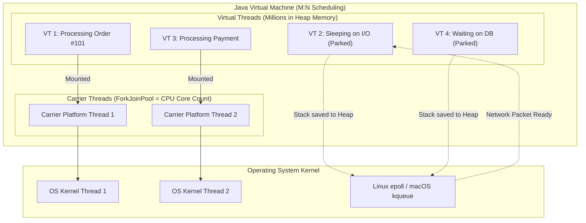
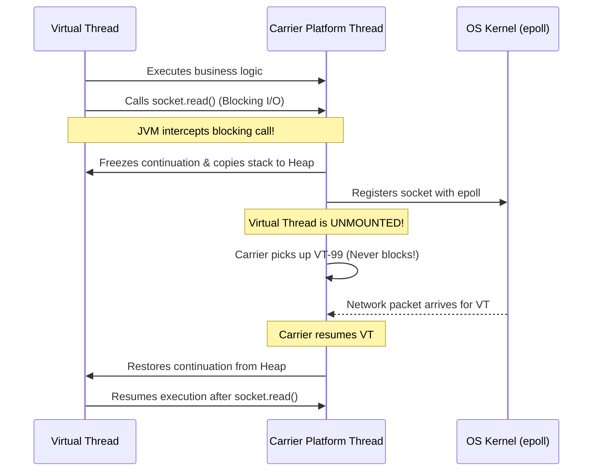
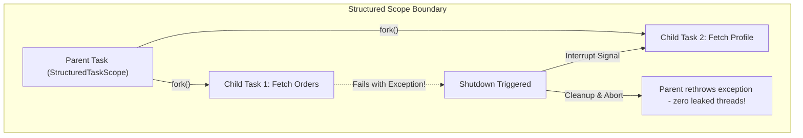

For more than twenty-five years, Java developers were caught in an architectural dilemma:

1. **The Thread-per-Request Model**: Each incoming HTTP request is assigned to a dedicated Java platform thread. This model is intuitive, sequential, and easy to debug. Your stack traces accurately tell you where an error occurred, and your local variables retain state naturally. However, because each platform thread maps 1:1 to an operating system kernel thread (consuming ~1MB of off-heap stack memory), a server collapses under OS thread exhaustion when concurrent connections exceed a few thousand.
2. **The Reactive / Asynchronous Model**: Frameworks like Netty, WebFlux, and RxJava solved the scalability problem by running non-blocking event loops. They can easily handle 500,000 concurrent socket connections on a handful of OS threads. But the price was brutal: you were forced to abandon standard control flow (`for` loops, `try-catch`, sequential logic) and rewrite your application into complex callback pipelines. Stack traces became incomprehensible, debugging in an IDE became painful, and every existing blocking library (including traditional JDBC drivers) threatened to stall the event loop.

Project Loom, delivered as a production-ready feature in **Java 21 (JEP 444)**, shattered this dilemma.

Virtual threads restore the simplicity of the sequential thread-per-request model while delivering the extreme throughput of reactive event loops.



---

## How Virtual Threads Work: Continuations and Carrier Mounting

To master virtual threads, you must understand how the JVM schedules them onto hardware.

A platform thread is an expensive 1:1 wrapper around an operating system thread. In contrast, a virtual thread is a lightweight user-mode entity managed entirely by the JVM runtime using an **M:N scheduling model**: millions of virtual threads (M) are multiplexed over a tiny pool of platform threads (N).

### The Carrier Thread Pool

Under the hood, the JVM maintains a dedicated `ForkJoinPool` as its **carrier thread pool**. The number of carrier threads defaults to `Runtime.getRuntime().availableProcessors()`. 

When a virtual thread executes CPU instructions, the JVM scheduler **mounts** it onto an available carrier platform thread. To the CPU and the OS kernel, the carrier thread is just running ordinary Java bytecode.

### Stack Frames on the Heap (Continuations)

In a traditional platform thread, the call stack is a contiguous block of native memory (typically 1MB) allocated by the OS kernel. 

A virtual thread does not have a fixed native call stack. Instead, its execution state is managed as a **Continuation** object stored on the JVM heap:
- When a virtual thread starts, its stack begins tiny—only a few hundred bytes.
- As methods call deeper methods, the JVM allocates continuation frames dynamically on the garbage-collected heap.
- When stack frames return, memory is reclaimed immediately.

### The Mount / Unmount Lifecycle

What happens when a virtual thread encounters a blocking operation (such as `Socket.read()`, `Thread.sleep()`, or acquiring a `ReentrantLock`)?



1. **Interception**: In Java 21, almost every blocking I/O operation in the JDK (`java.net`, `java.io`, `java.nio.channels`, `LockSupport`) was refactored. When a blocking call is made, the JVM catches it at the runtime boundary.
2. **Unmounting (Yield)**: The JVM saves the virtual thread's current stack frames into its heap continuation object and **unmounts** the virtual thread from the carrier thread.
3. **OS Handoff**: The JVM registers the underlying network file descriptor with the operating system's non-blocking I/O multiplexer (such as `epoll` on Linux or `kqueue` on macOS).
4. **Carrier Freedom**: The carrier platform thread does not sleep! It immediately picks up another ready virtual thread from its queue and executes it.
5. **Wakeup and Remount**: When the OS kernel signals that data has arrived on the socket, the virtual thread transitions back to the runnable queue. An available carrier thread picks it up, reloads its stack frames from the heap, and execution resumes seamlessly right after the blocking call.

To your Java application code, `socket.read()` looked like a simple, blocking, synchronous method call. But underneath, the JVM executed a fully non-blocking, asynchronous event-driven I/O routine!

---

## Creating and Running Virtual Threads

Java 21 makes launching virtual threads trivial:

```java
import java.util.concurrent.ExecutorService;
import java.util.concurrent.Executors;

public class VirtualThreadBasics {
    public static void main(String[] args) throws Exception {
        // Pattern 1: Create an ad-hoc unstarted virtual thread builder
        Thread vt1 = Thread.ofVirtual()
            .name("order-worker-", 1)
            .start(() -> {
                System.out.println("Running on: " + Thread.currentThread());
            });
        vt1.join();

        // Pattern 2: The canonical ExecutorService pattern (AutoCloseable!)
        try (ExecutorService executor = Executors.newVirtualThreadPerTaskExecutor()) {
            for (int i = 0; i < 100_000; i++) {
                final int taskId = i;
                executor.submit(() -> {
                    // Simulates 100ms network round-trip to database
                    Thread.sleep(100); 
                    return "Task " + taskId + " completed";
                });
            }
        } // try-with-resources automatically waits for all 100,000 tasks to finish!
        
        System.out.println("All 100,000 virtual threads executed successfully.");
    }
}
```

Running the code above with 100,000 platform threads would instantly crash any standard machine with out-of-memory errors. With virtual threads, it runs smoothly in a few seconds while using a negligible footprint of system memory.

---

## The Thread Pinning Trap

Virtual threads are not magic; they are subject to strict runtime constraints. The most critical hazard in Java 21 is **Thread Pinning**.

When a virtual thread is pinned to its carrier thread, it **cannot be unmounted**. If a pinned virtual thread blocks on I/O or sleep, the underlying carrier platform thread is forced to block along with it.

If all carrier platform threads become pinned simultaneously, your carrier pool is exhausted, and **no other virtual thread in the entire JVM can make progress**.

### What Causes Pinning in Java 21?

In Java 21 LTS, a virtual thread is pinned to its carrier in two specific scenarios:
1. When it executes a blocking operation inside a `synchronized` block or method.
2. When it executes native code via JNI or the Foreign Function & Memory (FFM) API.

```java
// PINNING HAZARD IN JAVA 21:
public class LegacyPaymentGateway {
    private final Object lock = new Object();

    public void processPayment() {
        synchronized (lock) { // Intrinsic monitor causes PINNING!
            // If this socket call blocks for 500ms, the CARRIER thread is trapped!
            callExternalPaymentApiOverHttp(); 
        }
    }
}
```

### The Remediation: ReentrantLock

To prevent thread pinning around blocking I/O, replace intrinsic `synchronized` blocks with `java.util.concurrent.locks.ReentrantLock`. 

`ReentrantLock` uses `LockSupport.park()` internally, which the JVM virtual thread scheduler can unmount without pinning the carrier:

```java
import java.util.concurrent.locks.Lock;
import java.util.concurrent.locks.ReentrantLock;

public class NonPinnedPaymentGateway {
    private final Lock lock = new ReentrantLock();

    public void processPayment() {
        lock.lock(); // Virtual thread safely unmounts if forced to wait!
        try {
            callExternalPaymentApiOverHttp(); // Carrier thread remains unpinned
        } finally {
            lock.unlock();
        }
    }

    private void callExternalPaymentApiOverHttp() {
        // Network I/O
    }
}
```

> [!TIP]
> **How to Detect Pinning in Production**:
> Run your application with the JVM diagnostic flag:
> `-Djdk.tracePinnedThreads=full`
> Whenever a virtual thread blocks while pinned, the JVM will print a complete stack trace highlighting the exact `synchronized` block responsible.

*(Note: In Java 24+, JEP 491 redesigns object monitors to eliminate pinning for `synchronized` blocks. However, for all systems running on Java 21 LTS, avoiding `synchronized` around blocking operations remains an essential architectural rule).*

---

## Never Pool Virtual Threads

A common mistake made by senior engineers transitioning to Java 21 is attempting to pool virtual threads:

```java
// HORRIBLE ANTIPATTERN:
ExecutorService badPool = new ThreadPoolExecutor(
    100, 100, 0L, TimeUnit.MILLISECONDS,
    new LinkedBlockingQueue<>(),
    Thread.ofVirtual().factory()
);
```

**Never pool virtual threads.**

We pooled platform threads because creating an OS thread took 1MB of memory and milliseconds of CPU kernel time. Virtual threads, however, cost less than 1KB and take nanoseconds to construct. 

Pooling virtual threads introduces lock contention inside the thread pool queue, adds management overhead, and defeats the entire purpose of Project Loom. Create a new virtual thread for every distinct task, run the task, and let the thread be garbage collected when it finishes.

### How to Protect Scarce Downstream Resources

"If we don't pool threads, won't 100,000 virtual threads overwhelm our Postgres database connection pool?"

Yes! If 100,000 virtual threads attempt to query Postgres simultaneously, they will crush the database. 

In the past, developers used platform thread pools as an accidental **bulkhead** (e.g., setting the pool size to 20 so only 20 queries could run at once). With virtual threads, you decouple concurrency control from thread creation using a `Semaphore`:

```java
import java.util.concurrent.Semaphore;

public class DatabaseThrottler {
    // Only permit 20 concurrent queries to protect our HikariCP connection pool
    private final Semaphore dbSemaphore = new Semaphore(20);

    public String queryCustomer(String id) throws InterruptedException {
        dbSemaphore.acquire(); // Virtual thread safely unmounts if all 20 permits are taken!
        try {
            return executeJdbcQuery(id);
        } finally {
            dbSemaphore.release();
        }
    }

    private String executeJdbcQuery(String id) {
        return "Customer-" + id;
    }
}
```

---

## Structured Concurrency (Preview in Java 21)

Unstructured concurrency with raw threads or `CompletableFuture` frequently causes **thread leaks** and **orphaned tasks**.

Consider this scenario: Task A forks Task B (fetching user details) and Task C (fetching user credit). If Task B throws an exception, Task C continues running in the background, wasting CPU, memory, and database sockets.

Java 21 introduces `StructuredTaskScope` (Preview JEP 453) to enforce **Structured Concurrency**. It ensures that subtasks are lexically bounded to their parent scope:



### ShutdownOnFailure: All Subtasks Must Succeed

```java
import java.util.concurrent.StructuredTaskScope;
import java.util.concurrent.StructuredTaskScope.Subtask;

public class OrderService {
    record OrderSummary(String user, String inventory) {}

    public OrderSummary loadOrderDetails(String orderId) throws Exception {
        try (var scope = new StructuredTaskScope.ShutdownOnFailure()) {
            // Fork child tasks as virtual threads inside the lexical scope
            Subtask<String> userTask = scope.fork(() -> fetchUser(orderId));
            Subtask<String> inventoryTask = scope.fork(() -> fetchInventory(orderId));

            // Wait for all subtasks to complete OR the first failure
            scope.join();
            scope.throwIfFailed(); // If either task failed, rethrows the failure

            // Both guaranteed to be complete and successful here
            return new OrderSummary(userTask.get(), inventoryTask.get());
        } // The closing brace guarantees all child tasks are completed or cancelled!
    }

    private String fetchUser(String id) { return "User-Alice"; }
    private String fetchInventory(String id) { return "In-Stock"; }
}
```

### ShutdownOnSuccess: First Successful Result Wins

When querying redundant mirrors or racing across multiple replicas, use `ShutdownOnSuccess`:

```java
import java.util.concurrent.StructuredTaskScope;

public class QuorumFetcher {
    public String fetchFromFastestServer(String query) throws Exception {
        try (var scope = new StructuredTaskScope.ShutdownOnSuccess<String>()) {
            scope.fork(() -> queryServer("https://replica-1.internal", query));
            scope.fork(() -> queryServer("https://replica-2.internal", query));
            scope.fork(() -> queryServer("https://replica-3.internal", query));

            scope.join(); // Waits until the FIRST subtask finishes successfully!
            
            // Returns the fastest result; cancels all other redundant requests automatically!
            return scope.result();
        }
    }

    private String queryServer(String host, String q) {
        return "Response from " + host;
    }
}
```

---

## Scoped Values: Replacing ThreadLocal (Preview in Java 21)

While `ThreadLocal` works with virtual threads, running 1,000,000 virtual threads each holding a `ThreadLocal` map can cause severe memory bloat and retention leaks. Furthermore, `ThreadLocal` values are mutable and can be modified unexpectedly by deep library code.

Java 21 introduces `ScopedValue` (Preview JEP 446) as a modern, lightweight alternative:

```java
import java.lang.ScopedValue;

public class SecurityContextPipeline {
    // Immutable scoped value
    public static final ScopedValue<String> CURRENT_TENANT = ScopedValue.newInstance();

    public void handleRequest(String tenantId) {
        // Bind the tenant ID strictly for the duration of this execution block
        ScopedValue.where(CURRENT_TENANT, tenantId).run(() -> {
            executeDatabaseOperation();
        });
        
        // Outside the lambda, CURRENT_TENANT is completely unbound; zero memory leak!
    }

    private void executeDatabaseOperation() {
        // Read context safely
        String tenant = CURRENT_TENANT.get();
        System.out.println("Executing query for tenant: " + tenant);
    }
}
```

- **Immutability**: Once bound via `where()`, a `ScopedValue` cannot be modified.
- **Bounded Lifetime**: The binding is strictly bound to the execution scope of the lambda. When the block exits, the binding ceases to exist. There is no risk of context bleeding into recycled threads.
- **Zero Memory Overhead**: Scoped values are automatically inherited by child virtual threads spawned inside a `StructuredTaskScope` without allocating individual `ThreadLocal` map entries.

---

## Senior Engineer Interview Crucible

### How does the JVM park a virtual thread during blocking socket I/O without blocking the underlying OS thread?
In Java 21, JDK network socket classes were rewritten to interface with the virtual thread scheduler. When a virtual thread calls `socket.read()`, the JVM intercepts the call. If data is not immediately available, the JVM saves the virtual thread's stack frames into its heap-allocated Continuation object and unmounts it from the carrier platform thread. 

The JVM registers the socket's file descriptor with the operating system's non-blocking I/O notification system (`epoll` on Linux, `kqueue` on macOS). The carrier platform thread is immediately freed to execute other virtual threads. When the OS signals that data has arrived, an available carrier thread is assigned to restore the continuation frames from the heap and resume the virtual thread.

### What is thread pinning in Java 21, what causes it, and how do you remediate it?
Thread pinning occurs when a virtual thread cannot be unmounted from its carrier platform thread. If a pinned virtual thread blocks on I/O or sleep, the underlying carrier thread is forced to block as well, starving the carrier pool.

In Java 21 LTS, pinning is triggered when a virtual thread blocks inside a `synchronized` block/method or while executing native code (JNI / FFM). 

To remediate pinning, replace `synchronized` blocks around blocking calls with `java.util.concurrent.locks.ReentrantLock`, which uses `LockSupport.park()` and allows clean unmounting. Pinning can be diagnosed using the `-Djdk.tracePinnedThreads=full` JVM argument.

### Why should you never pool virtual threads, and how do you implement rate limiting without thread pools?
Platform threads were pooled because creating OS threads carries heavy overhead (~1MB native stack memory and kernel context allocation). In contrast, virtual threads are lightweight heap objects that cost less than 1KB and take nanoseconds to instantiate. Pooling virtual threads reintroduces queue contention and state leakage without providing any resource savings.

To throttle access to scarce downstream resources (such as a database connection pool or an external rate-limited API), you should decouple concurrency limits from thread counts by using a `Semaphore`. Virtual threads waiting for a semaphore permit will safely unmount without consuming CPU or carrier threads.

### How does Structured Concurrency solve the orphaned thread problem inherent in standard thread pools and CompletableFuture?
In unstructured concurrency (e.g., submitting tasks to an `ExecutorService` or chaining `CompletableFuture`), subtasks have no defined relationship with the caller's lexical scope. If a parent operation fails or times out, running subtasks continue executing in background threads indefinitely, leaking memory, CPU, and connections.

Structured Concurrency via `StructuredTaskScope` enforces that the lifetimes of concurrent subtasks are strictly bounded to the parent code block. Using policies like `ShutdownOnFailure`, if any child task fails, the scope automatically triggers cancellation and sends interruption signals to all sibling tasks before the scope exits, guaranteeing that zero orphaned threads escape into the system.
