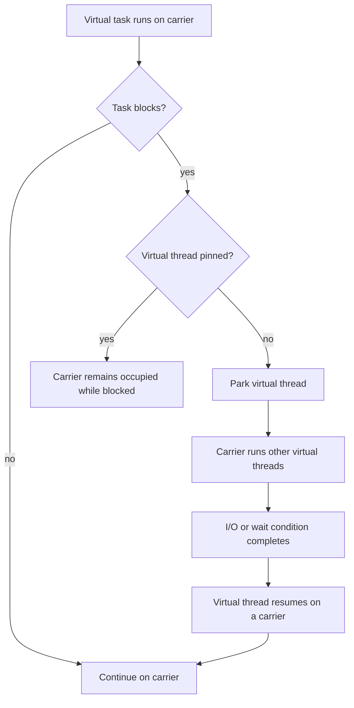

Traditional Java code often dedicates one platform thread to a request. This is straightforward, but platform threads are wrappers around operating-system threads and are a limited resource. When many requests spend most of their time waiting for I/O, the number of platform threads can become a scalability constraint.

Project Loom introduced **virtual threads** so Java can support a thread-per-task style with many more concurrent tasks. Virtual threads are still instances of `Thread`; the runtime schedules them over a smaller number of platform threads. This lesson targets Java 21, where virtual threads are final, while Structured Concurrency and Scoped Values are preview APIs.

## Platform threads and virtual threads

A platform thread is backed by an operating-system thread for its lifetime. A virtual thread is not permanently tied to one OS thread. In the JDK implementation, the virtual-thread scheduler mounts a virtual thread on a platform-thread carrier to run it; when supported blocking operations wait, the runtime can park the virtual thread and free the carrier to run another virtual thread.



Mounting and unmounting are runtime implementation mechanisms, not application-level thread identity. Code running in a virtual thread still observes that virtual thread through `Thread.currentThread()`.

## When virtual threads help

Virtual threads are useful when an application has many concurrent tasks that spend substantial time waiting, especially when existing code uses blocking APIs. They can improve throughput and reduce the cost of representing concurrent tasks without requiring every operation to be rewritten as callbacks.

They are **not faster threads** and do not make CPU-bound work execute faster. If tasks are continuously using CPU, adding more threads than the available processor capacity does not create more processing power. Virtual threads primarily help scalability for high-concurrency, waiting-heavy workloads; they do not automatically reduce the latency of an individual operation.

## Create one virtual thread per task

Java 21 supports creating a virtual thread directly or using an executor that creates a virtual thread for each submitted task:

```java
import java.util.concurrent.ExecutorService;
import java.util.concurrent.Executors;
import java.util.concurrent.Future;

public class VirtualThreadTasks {
    public static void main(String[] args) throws Exception {
        try (ExecutorService executor =
                     Executors.newVirtualThreadPerTaskExecutor()) {
            Future<String> first = executor.submit(
                    () -> readRemoteValue("service-a"));
            Future<String> second = executor.submit(
                    () -> readRemoteValue("service-b"));

            System.out.println(first.get());
            System.out.println(second.get());
        }
    }

    private static String readRemoteValue(String service) throws InterruptedException {
        Thread.sleep(10); // Stand-in for a blocking operation
        return "Response from " + service;
    }
}
```

The executor improves the scalability of the blocking style; it does not limit the number of tasks to the number of carriers. Virtual threads are inexpensive enough that they generally should not be pooled. If a database, remote service, or other resource has a concurrency limit, enforce that limit with a permit mechanism such as a `Semaphore` rather than using a platform-thread pool as an accidental bulkhead.

Virtual threads do not remove the need to bound incoming work, connections, request sizes, or downstream concurrency. Creating many waiting tasks is cheaper than creating many platform threads, but those tasks still retain application state and may hold other resources.

## Blocking operations and pinning in Java 21

Many JDK blocking operations can park a virtual thread without blocking its carrier. However, in Java 21 a virtual thread is **pinned** to its carrier while executing inside a `synchronized` block or method, or while executing native/foreign-function code. If it blocks while pinned, the carrier cannot run another virtual thread until the pinned operation completes.

Pinning does not make code incorrect, and ordinary short synchronized sections remain useful. Avoid holding a monitor across long blocking I/O when that pattern is a measured scalability bottleneck. Java 21 can report long pinning events with Java Flight Recorder's `jdk.VirtualThreadPinned` event; use measurement rather than replacing every `synchronized` block speculatively.

This behavior is version-sensitive: JDK 21's pinning rules should not be generalized to later JDK releases, which may change the implementation and the conditions that pin a virtual thread.

## Structured concurrency in Java 21 (preview)

`StructuredTaskScope` treats related subtasks as one unit whose lifetime is bounded by a lexical scope. In the example below, two independent lookups run concurrently. The owner joins the scope, propagates a subtask failure, then reads both successful results:

```java
import java.util.List;
import java.util.concurrent.ExecutionException;
import java.util.concurrent.StructuredTaskScope;

public class StructuredLookup {
    record Dashboard(String user, List<String> orders) {}

    static Dashboard loadDashboard(String id)
            throws InterruptedException, ExecutionException {
        try (var scope = new StructuredTaskScope.ShutdownOnFailure()) {
            var user = scope.fork(() -> lookupUser(id));
            var orders = scope.fork(() -> lookupOrders(id));

            scope.join().throwIfFailed();
            return new Dashboard(user.get(), orders.get());
        }
    }

    private static String lookupUser(String id) {
        return "user-" + id;
    }

    private static List<String> lookupOrders(String id) {
        return List.of("order-1", "order-2");
    }
}
```

In Java 21, the no-argument `ShutdownOnFailure` scope creates virtual threads. If a subtask fails, the policy shuts down the scope and interrupts unfinished subtasks; the owner then receives the failure from `throwIfFailed()`. Closing the scope keeps child task lifetimes within the owning block. Tasks should still respond correctly to interruption.

This API is **preview** in Java 21: it requires preview features to be enabled at compile time and run time, and its shape may change in a later release. The concrete subclass expresses a policy: use `ShutdownOnFailure` when all results are needed, or `ShutdownOnSuccess` when the first successful result is sufficient.

## Scoped Values in Java 21 (preview)

A `ThreadLocal` associates mutable state with a thread and can retain that state for the lifetime of a pooled thread unless it is cleared. A Java 21 `ScopedValue` preview provides a bounded, one-way way to make context available to methods called within a dynamic scope:

```java
import java.lang.ScopedValue;

public class ScopedRequestContext {
    private static final ScopedValue<String> REQUEST_ID =
            ScopedValue.newInstance();

    static void handle(String requestId) {
        ScopedValue.runWhere(REQUEST_ID, requestId,
                ScopedRequestContext::process);
    }

    private static void process() {
        System.out.println("Handling request " + REQUEST_ID.get());
    }
}
```

The binding is active during the call to `runWhere` and reverts when that call returns or throws. In Java 21, bindings can be inherited by threads forked in a `StructuredTaskScope`. The value itself should be immutable or separately synchronized if shared across threads; a scoped binding does not make a mutable object thread-safe.

Scoped Values are also a Java 21 preview API, not a universal replacement for `ThreadLocal`. They are intended for one-way context transmission with bounded lifetime, not arbitrary mutable per-thread state.

## Practical rules

- Use virtual threads for many concurrent tasks that spend time waiting; measure the workload.
- Do not expect CPU-bound tasks to become faster, and do not pool virtual threads to conserve thread resources.
- Limit access to constrained downstream resources independently of the number of virtual threads.
- In Java 21, be aware of pinning during blocking inside `synchronized` regions or native/foreign calls.
- Use Structured Concurrency to express parent-child task lifetime and failure policy when its preview status is acceptable.
- Use Scoped Values for bounded context propagation only when their preview status and immutability expectations fit.
- Treat preview APIs as version-specific; re-check the target JDK's documentation before upgrading.

## Further reading

- [JEP 444: Virtual Threads](https://openjdk.org/jeps/444)
- [Java 21 Virtual Threads Guide](https://docs.oracle.com/en/java/javase/21/core/virtual-threads.html)
- [JEP 453: Structured Concurrency (Preview)](https://openjdk.org/jeps/453)
- [Java 21 `StructuredTaskScope` (Preview)](https://docs.oracle.com/en/java/javase/21/docs/api/java.base/java/util/concurrent/StructuredTaskScope.html)
- [JEP 446: Scoped Values (Preview)](https://openjdk.org/jeps/446)
- [Java 21 `ScopedValue` (Preview)](https://docs.oracle.com/en/java/javase/21/docs/api/java.base/java/lang/ScopedValue.html)
