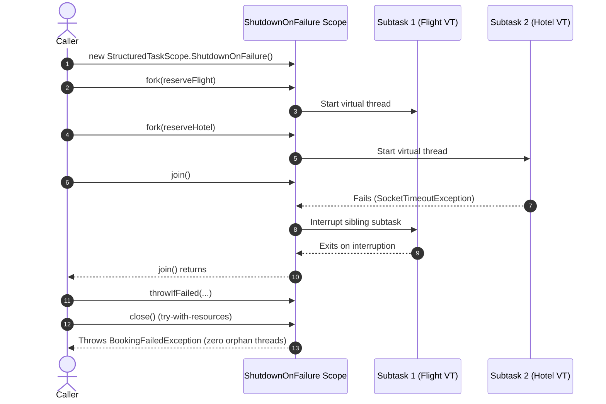
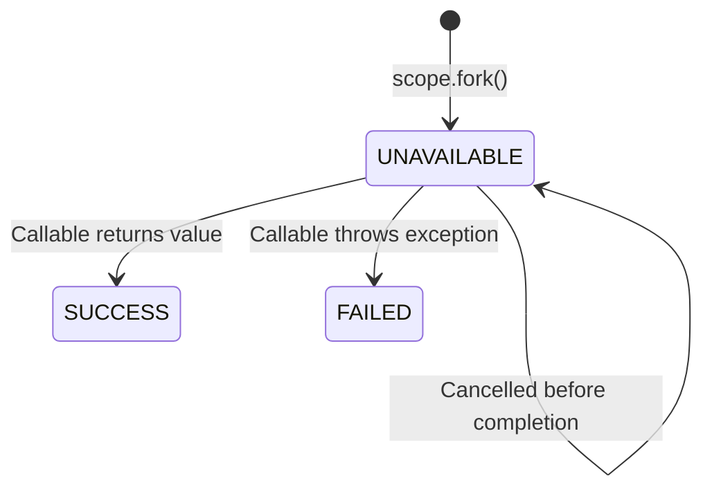

When Java introduced `ExecutorService` and `Future` in Java 5, it made running work on background thread pools far easier than managing raw `Thread` objects. What it did not provide was a structural relationship between a parent task and the subtasks it spawns.

In ordinary single-threaded code, control flow is structured: an `if` block, a `for` loop, or a method call has a single entry point and exits cleanly when finished. With `ExecutorService.submit()` or `CompletableFuture`, concurrent subtasks do not obey that rule. A method can submit two background tasks, encounter an error, and return to its caller while one or both subtasks keep running on worker threads.

Java 21 introduced two preview APIs under Project Loom to solve this problem and the related context-passing problem at virtual-thread scale: **Structured Concurrency (JEP 453)** and **Scoped Values (JEP 446)**.

> [!NOTE]
> **Java Version and Preview Status**: Both `StructuredTaskScope` (JEP 453) and `ScopedValue` (JEP 446) are **preview features in Java 21 LTS**. To compile and run the Java 21 examples in this lesson, pass `--enable-preview`:
> `javac --release 21 --enable-preview App.java` and `java --enable-preview App`.
>
> Both APIs evolved across Java 22 through Java 25: **`ScopedValue` was finalized in Java 25 (JEP 506)**, while **`StructuredTaskScope` remained in preview through Java 25 (JEP 505)**, where its API shifted from constructors like `new StructuredTaskScope.ShutdownOnFailure()` to static factories such as `StructuredTaskScope.open(...)` with `Joiner` policies. The examples below use the Java 21 LTS preview API, with a short note showing the Java 25 preview syntax.

## The Flaws of Unstructured Concurrency

To see why unstructured concurrency causes subtle bugs in production, consider a travel booking method that calls a flight service and a hotel service in parallel using a standard `ExecutorService`:

```java
import java.util.concurrent.ExecutionException;
import java.util.concurrent.ExecutorService;
import java.util.concurrent.Future;

public class LegacyTravelService {
    private final ExecutorService executor;
    private final FlightService flightService;
    private final HotelService hotelService;

    public LegacyTravelService(
        ExecutorService executor,
        FlightService flightService,
        HotelService hotelService
    ) {
        this.executor = executor;
        this.flightService = flightService;
        this.hotelService = hotelService;
    }

    public TravelPackage bookTrip(String userId, String destination)
            throws InterruptedException, BookingFailedException {
        Future<FlightQuote> flightFuture = executor.submit(
            () -> flightService.reserveFlight(userId, destination)
        );
        Future<HotelQuote> hotelFuture = executor.submit(
            () -> hotelService.reserveHotel(userId, destination)
        );

        try {
            FlightQuote flight = flightFuture.get(); // Blocks until flight completes
            HotelQuote hotel = hotelFuture.get();    // Only checked after flight finishes
            return new TravelPackage(flight, hotel);
        } catch (ExecutionException ex) {
            throw new BookingFailedException("Failed to reserve travel package", ex.getCause());
        }
    }
}
```

Trace three realistic failure modes in this code:

1. **Delayed failure detection**: Suppose `hotelService.reserveHotel()` fails after 20ms, while `flightService.reserveFlight()` takes 3 seconds. Because the parent thread is blocked on `flightFuture.get()`, it waits the entire 3 seconds before ever discovering that the hotel call already failed.
2. **Orphan threads**: Suppose `flightService` fails after 50ms. `flightFuture.get()` throws `ExecutionException`, and `bookTrip()` throws `BookingFailedException` back to the caller. Nobody called `hotelFuture.cancel(true)`. The hotel reservation task continues running in the background as an **orphan thread**, holding an HTTP connection, writing to a downstream service, and possibly booking a room for a trip the customer was told failed.
3. **Broken interrupt propagation**: If the parent thread is interrupted (for instance, because an HTTP gateway timed out the request), `flightFuture.get()` throws `InterruptedException` and exits, but neither `flightFuture` nor `hotelFuture` is interrupted.

You can patch these issues manually with `try/finally` cancellation blocks and helper threads, or try to coordinate them with `CompletableFuture`, but the coordination logic quickly becomes noisy and easy to get wrong.

## StructuredTaskScope: ShutdownOnFailure and ShutdownOnSuccess

Structured concurrency applies the rule of structured control flow to concurrent subtasks: **if a task splits into concurrent subtasks, they must all finish before the enclosing code block exits.** The lexical scope in source code matches the runtime lifetime of the subtasks.

In Java 21 (JEP 453), `StructuredTaskScope` implements `AutoCloseable`, so you always open it in a `try`-with-resources block. When you call `scope.fork(Callable<T>)`, the scope starts a new virtual thread (by default) to run the subtask. Two built-in subclasses cover the most common coordination policies:

- **`StructuredTaskScope.ShutdownOnFailure`**: All subtasks must succeed. If any subtask throws an exception, the scope shuts down and interrupts all remaining subtasks.
- **`StructuredTaskScope.ShutdownOnSuccess<T>`**: First successful result wins. As soon as one subtask completes normally, the scope shuts down and interrupts the slower siblings.



### All-or-Nothing Execution with ShutdownOnFailure

Here is the travel booking service rewritten with `ShutdownOnFailure`:

```java
import java.util.concurrent.StructuredTaskScope;
import java.util.concurrent.StructuredTaskScope.Subtask;

public class StructuredTravelService {
    private final FlightService flightService;
    private final HotelService hotelService;

    public StructuredTravelService(FlightService flightService, HotelService hotelService) {
        this.flightService = flightService;
        this.hotelService = hotelService;
    }

    public TravelPackage bookTrip(String userId, String destination)
            throws InterruptedException, BookingFailedException {
        try (var scope = new StructuredTaskScope.ShutdownOnFailure()) {
            Subtask<FlightQuote> flightTask = scope.fork(
                () -> flightService.reserveFlight(userId, destination)
            );
            Subtask<HotelQuote> hotelTask = scope.fork(
                () -> hotelService.reserveHotel(userId, destination)
            );

            // Blocks until both succeed OR either one fails
            scope.join();

            // Propagates the first failure wrapped in our domain exception
            scope.throwIfFailed(cause -> new BookingFailedException("Booking aborted", cause));

            // Both subtasks are guaranteed to be in State.SUCCESS here
            return new TravelPackage(flightTask.get(), hotelTask.get());
        } // scope.close() guarantees every forked subtask has terminated
    }
}
```

If `hotelService` throws after 20ms, `scope` immediately interrupts `flightTask`, `scope.join()` unblocks once `flightTask` stops, and `scope.throwIfFailed(...)` throws `BookingFailedException`. Even if an unexpected exception occurs before `join()`, `scope.close()` shuts down the scope and waits for every forked thread to terminate before control leaves the `try` block.

### Racing Redundant Providers with ShutdownOnSuccess

When querying redundant replicas or pricing feeds where any single healthy answer is sufficient, `ShutdownOnSuccess` stops the slower calls automatically:

```java
import java.util.concurrent.ExecutionException;
import java.util.concurrent.StructuredTaskScope;

public class ExchangeRateService {
    private final RateClient bloomberg;
    private final RateClient reuters;
    private final RateClient fixer;

    public ExchangeRateService(RateClient bloomberg, RateClient reuters, RateClient fixer) {
        this.bloomberg = bloomberg;
        this.reuters = reuters;
        this.fixer = fixer;
    }

    public ExchangeRate getFastestRate(String currencyPair)
            throws InterruptedException, ExecutionException {
        try (var scope = new StructuredTaskScope.ShutdownOnSuccess<ExchangeRate>()) {
            scope.fork(() -> bloomberg.fetchRate(currencyPair));
            scope.fork(() -> reuters.fetchRate(currencyPair));
            scope.fork(() -> fixer.fetchRate(currencyPair));

            // Unblocks as soon as ONE subtask succeeds (or all fail)
            scope.join();

            // Returns the winning result; slower providers were already interrupted
            return scope.result();
        }
    }
}
```

Unlike `CompletableFuture.anyOf()`, `ShutdownOnSuccess` ignores early failures as long as another subtask can still succeed. If Bloomberg fails with a connection error at 5ms and Reuters succeeds at 40ms, `scope.result()` returns the Reuters rate and cancels Fixer. Only if all three providers fail does `scope.result()` throw `ExecutionException`.

### Preview Evolution in Java 25 (JEP 505)

If you read Java 25 documentation, you will notice that JEP 505 (Fifth Preview) replaced `new StructuredTaskScope.ShutdownOnFailure()` with `StructuredTaskScope.open()` and a `Joiner` strategy:

```java
// Java 25 preview syntax (JEP 505) for comparison:
// try (var scope = StructuredTaskScope.open()) {
//     var flight = scope.fork(() -> flightService.reserveFlight(userId, destination));
//     var hotel = scope.fork(() -> hotelService.reserveHotel(userId, destination));
//     scope.join(); // Default joiner cancels siblings on first failure and throws FailedException
//     return new TravelPackage(flight.get(), hotel.get());
// }
```

The underlying guarantees (lexical containment, automatic sibling cancellation, and joining before exit) remain the same.

## Subtask Lifecycle and Cancellation Cascades

A `Subtask<T>` returned by `scope.fork(...)` is not a `Future<T>`, and it intentionally omits a blocking `get()` method. Instead, it exposes a three-state lifecycle via `Subtask.State`:

- **`UNAVAILABLE`**: The subtask has not completed yet, or it was cancelled before finishing.
- **`SUCCESS`**: The subtask completed normally; `subtask.get()` returns its result immediately without blocking.
- **`FAILED`**: The subtask threw an exception; `subtask.exception()` returns that `Throwable`.

Calling `subtask.get()` before `scope.join()` (or when the subtask is `UNAVAILABLE` or `FAILED`) throws `IllegalStateException`. This forces a clean separation between coordination (`scope.join()`) and reading results (`subtask.get()`).



### Enforcing Deadlines with joinUntil

Real services should rarely wait forever. `StructuredTaskScope` provides `scope.joinUntil(Instant deadline)`, which throws `TimeoutException` if the scope does not finish by the deadline. When `TimeoutException` leaves the `try` block, `scope.close()` automatically shuts down the scope and interrupts every remaining subtask:

```java
import java.time.Instant;
import java.util.concurrent.StructuredTaskScope;
import java.util.concurrent.TimeoutException;

public TravelPackage bookTripWithDeadline(String userId, String destination)
        throws InterruptedException, TimeoutException, BookingFailedException {
    Instant deadline = Instant.now().plusSeconds(2);

    try (var scope = new StructuredTaskScope.ShutdownOnFailure()) {
        var flightTask = scope.fork(() -> flightService.reserveFlight(userId, destination));
        var hotelTask = scope.fork(() -> hotelService.reserveHotel(userId, destination));

        scope.joinUntil(deadline);
        scope.throwIfFailed(cause -> new BookingFailedException("Booking aborted", cause));

        return new TravelPackage(flightTask.get(), hotelTask.get());
    } // On TimeoutException, close() cancels both flightTask and hotelTask
}
```

### Cancellation Cascades and Cooperative Interruption

Scopes can be nested. If an outer `StructuredTaskScope` forks a task that opens its own inner `StructuredTaskScope`, cancelling the outer scope interrupts the child task, which wakes its inner `scope.join()` with `InterruptedException`, triggering the inner `scope.close()` to interrupt all grandchild subtasks. Cancellation cascades cleanly down the entire task tree.

However, cancellation in Java is **cooperative**. `StructuredTaskScope` cancels subtasks by calling `Thread.interrupt()`. That works reliably with JDK blocking I/O, `Thread.sleep()`, `ReentrantLock.lockInterruptibly()`, and `java.net.http.HttpClient`, but it breaks if subtask code swallows `InterruptedException`:

```java
// Broken: swallowing InterruptedException prevents cancellation from working
try {
    Thread.sleep(5_000);
} catch (InterruptedException ignored) {
    // Scope cancellation is lost; close() will stall waiting for this task
}

// Correct: restore the interrupt flag or propagate InterruptedException
try {
    Thread.sleep(5_000);
} catch (InterruptedException ex) {
    Thread.currentThread().interrupt();
    throw ex;
}
```

If a subtask ignores interrupts inside a tight loop or uninterruptible call, `scope.close()` must wait for that subtask to finish before exiting, stalling the parent thread.

## ScopedValue vs ThreadLocal

Passing cross-cutting context such as an authenticated user, tenant ID, or distributed trace ID through every method signature clutters business logic. For twenty years, Java frameworks solved this with `ThreadLocal<T>`.

`ThreadLocal` has three design properties that become painful in the virtual thread era:

1. **Unbounded lifetime and memory leaks**: A value set with `threadLocal.set(x)` stays attached to the thread until someone remembers to call `threadLocal.remove()` (or the thread dies). In pooled platform threads, forgetting `remove()` leaks user context into the next request and pins objects in memory.
2. **Unconstrained mutability**: Any callee deep in the stack can call `set()` or `remove()`, making context state hard to reason about.
3. **Expensive inheritance**: When using `InheritableThreadLocal`, every child thread copies the parent's entire `ThreadLocalMap`. Spawning hundreds of thousands of virtual threads multiplies those map allocations across the heap.

**`ScopedValue<T>`** (Preview in Java 21 via JEP 446; **finalized in Java 25 via JEP 506**) replaces `ThreadLocal` for one-way, downward context sharing.

| Feature | `ThreadLocal<T>` | `ScopedValue<T>` |
| :--- | :--- | :--- |
| **Mutability** | Mutable via `set()` / `remove()` anywhere | Immutable once bound for a scope |
| **Lifetime** | Thread lifetime until explicit `remove()` | Strictly bounded to `run()` or `call()` execution |
| **Leak risk** | High if `remove()` is missed on pooled threads | None; automatically unbound when scope exits |
| **Child inheritance** | `InheritableThreadLocal` copies the map | Zero-copy sharing with `StructuredTaskScope` subtasks |

### Binding, Reading, and Rebinding Scoped Values

A `ScopedValue` has no `set()` method. You declare it as a `public static final` constant and bind it to a dynamic execution scope using `ScopedValue.where(...)`:

```java
import java.lang.ScopedValue;

public class RequestContext {
    public static final ScopedValue<String> CURRENT_USER = ScopedValue.newInstance();
    public static final ScopedValue<String> TRACE_ID = ScopedValue.newInstance();

    public void handleRequest(String user, String traceId) {
        // Chain multiple bindings in a single scope
        ScopedValue.where(CURRENT_USER, user)
            .where(TRACE_ID, traceId)
            .run(() -> {
                processOrder("ORD-1001");
            });

        // Outside the lambda, both CURRENT_USER and TRACE_ID are unbound
    }

    private void processOrder(String orderId) {
        if (CURRENT_USER.isBound()) {
            System.out.println(
                "[" + TRACE_ID.orElse("no-trace") + "] Order " + orderId + " by " + CURRENT_USER.get()
            );
        }

        // Rebinding (shadowing) for a nested call without mutating the outer scope
        ScopedValue.where(CURRENT_USER, "system-auditor").run(this::writeAuditRecord);

        // Here CURRENT_USER is automatically back to the original user
        System.out.println("Back to user: " + CURRENT_USER.get());
    }

    private void writeAuditRecord() {
        System.out.println("Audit entry recorded as: " + CURRENT_USER.get());
    }
}
```

If you need a return value from the scoped block, use `.call(() -> ...)` instead of `.run(() -> ...)`. Calling `get()` on an unbound `ScopedValue` throws `NoSuchElementException`, so use `isBound()` or `orElse(defaultValue)` when a binding is optional.

## Unifying Virtual Threads with Structured Task Hierarchies

Virtual threads, `StructuredTaskScope`, and `ScopedValue` are designed to work together as a single model:

1. **Cheap task decomposition**: Because `StructuredTaskScope.fork()` spawns a new virtual thread per subtask by default, you can split even modest I/O operations into parallel subtasks without worrying about thread pool exhaustion.
2. **Automatic, zero-copy context inheritance**: Any `ScopedValue` bound before opening a `StructuredTaskScope` is automatically visible inside every subtask forked in that scope (and in nested scopes). Because scoped values are immutable, child virtual threads read the parent's immutable binding frame directly rather than copying a per-thread hash map.

```java
import java.lang.ScopedValue;
import java.util.concurrent.StructuredTaskScope;

public class CheckoutOrchestrator {
    public static final ScopedValue<String> TRACE_ID = ScopedValue.newInstance();

    public String runCheckout(String traceId) throws Exception {
        return ScopedValue.where(TRACE_ID, traceId).call(() -> {
            try (var scope = new StructuredTaskScope.ShutdownOnFailure()) {
                var payment = scope.fork(this::chargeCard);
                var receipt = scope.fork(this::generateReceipt);

                scope.join();
                scope.throwIfFailed();

                return payment.get() + " | " + receipt.get();
            }
        });
    }

    private String chargeCard() {
        // Automatically sees the parent's TRACE_ID binding
        return "Charged (" + TRACE_ID.get() + ")";
    }

    private String generateReceipt() {
        return "Receipt (" + TRACE_ID.get() + ")";
    }
}
```

> [!IMPORTANT]
> `ScopedValue` bindings are inherited automatically by child tasks forked inside a `StructuredTaskScope`, because the runtime knows the child task cannot outlive the parent's scope. They are **not** automatically inherited by unstructured threads created via `Thread.ofVirtual().start(...)` or submitted to an `ExecutorService`.

3. **Observable task trees in thread dumps**: When you run `jcmd <pid> Thread.dump_to_file -format=json dump.json`, the JVM groups virtual threads by their `StructuredTaskScope` hierarchy instead of dumping a flat list of unrelated threads. When debugging a stuck request in production, you can trace which parent request spawned which waiting subtasks.

## Practical Questions

### Why does CompletableFuture not solve the orphan thread problem?

`CompletableFuture` composes asynchronous stages (`thenCompose`, `thenCombine`, `allOf`), but it does not enforce lexical containment. If two independent futures run in parallel and one throws an exception, downstream stages fail, yet the sibling future keeps running unless you explicitly wire up cancellation logic, and `CompletableFuture.cancel(true)` does not interrupt a task already executing on a worker thread. `StructuredTaskScope` binds child tasks to a `try`-with-resources block, interrupts siblings automatically on failure or timeout, and waits for them to terminate before leaving the block.

### Why is ScopedValue safer and more memory-efficient than ThreadLocal with virtual threads?

`ThreadLocal` stores mutable entries in a per-thread `ThreadLocalMap`, and `InheritableThreadLocal` copies that map into every child thread. With hundreds of thousands of virtual threads, copying maps wastes heap memory, and missing a `remove()` call on reused threads causes memory leaks and cross-request data bleed. `ScopedValue` is immutable and lexically bound to a `run()` or `call()` block, so it automatically unbinds on exit and can be shared across `StructuredTaskScope` virtual threads without copying per-thread maps.

### What happens if a subtask inside a StructuredTaskScope swallows InterruptedException?

`StructuredTaskScope` cancels sibling subtasks by interrupting their threads. If a subtask catches `InterruptedException` and ignores it without restoring the interrupt flag or exiting, the subtask keeps running even after the scope shuts down. Because `scope.close()` guarantees that all child tasks have terminated before exiting the `try` block, the parent thread remains blocked until that uncooperative subtask finishes.

### Can StructuredTaskScope and ScopedValue be used with platform threads?

Yes. Neither API requires virtual threads. `ScopedValue` works on any platform or virtual thread, and `StructuredTaskScope` accepts a custom `ThreadFactory` if you want to back it with platform threads. In practice, virtual threads are the default for `StructuredTaskScope` because structured concurrency encourages breaking requests into many fine-grained concurrent subtasks, which would quickly exhaust OS thread limits if backed by platform threads.
