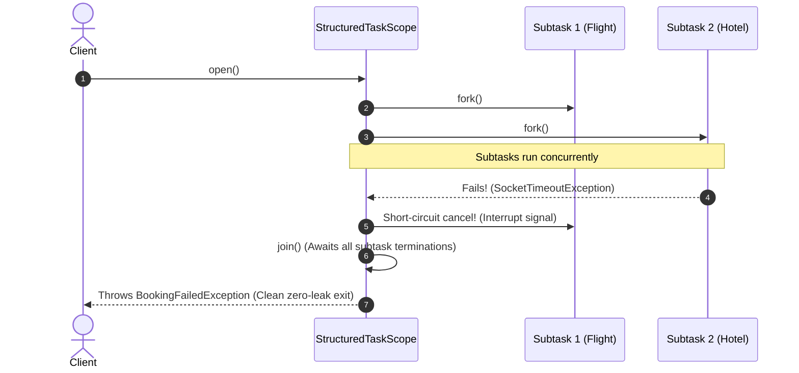

When Java introduced `ExecutorService` and `Future` in Java 5, it revolutionized multithreaded programming by decoupling task submission from execution. However, despite decades of refinements—from thread pools to `CompletableFuture`—Java concurrency remained fundamentally **unstructured**.

What does "unstructured" mean? Consider classic structured control flow: an `if-else` block or a `for` loop has a clear entry point and a clear exit point. When execution exits the block, all local variables and execution paths are guaranteed to terminate. In contrast, with `ExecutorService.submit()`, a parent thread initiates subtasks that execute asynchronously on background threads. If the parent thread crashes, times out, or throws an exception, those subtasks keep running indefinitely on worker threads. They become **orphan threads**, leaking CPU cycles, holding database connections, and mutating shared state long after the client has disconnected.

Java 21 introduced **Structured Concurrency (JEP 453)** and **Scoped Values (JEP 446)** to eliminate this chaos. Together with Virtual Threads, they represent the most radical evolution of concurrent programming in the history of the Java Virtual Machine.

---

### The Catastrophe of Unstructured Concurrency: The Orphan Thread Outage

To understand the urgent necessity of Structured Concurrency, consider how a typical travel aggregation service fetches prices:

```java
// Legacy Unstructured Concurrency
public TravelPackage bookTrip(String userId, String destination) throws ExecutionException, InterruptedException {
    ExecutorService executor = Executors.newFixedThreadPool(4);

    Future<FlightQuote> flightFuture = executor.submit(() -> flightService.reserveFlight(userId, destination));
    Future<HotelQuote> hotelFuture = executor.submit(() -> hotelService.reserveHotel(userId, destination));

    try {
        FlightQuote flight = flightFuture.get(); // Blocks
        HotelQuote hotel = hotelFuture.get();   // Blocks if flight succeeded
        return new TravelPackage(flight, hotel);
    } catch (Exception ex) {
        // Disaster happens here!
        throw new BookingFailedException("Failed to reserve travel package", ex);
    }
}
```

Now, trace what occurs during a partial failure:
1. `flightService.reserveFlight()` takes 500ms and succeeds, charging the airline API.
2. Meanwhile, `hotelService.reserveHotel()` encounters a network timeout and throws a `SocketTimeoutException`.
3. In the parent thread, `flightFuture.get()` completes, but then `hotelFuture.get()` throws an `ExecutionException`.
4. The parent thread catches the exception and immediately throws `BookingFailedException` back to the HTTP layer.

**What happens to the flight reservation?**
It was submitted to an independent thread pool. Nobody called `flightFuture.cancel(true)`. Even if `hotelFuture` had failed first, `flightFuture` would have continued executing in the background, reserving the flight seat and charging the customer's card. The customer receives a "Booking Failed" error on their screen, but their bank account was charged, leaving the database in an inconsistent state.

Furthermore, if the parent thread is interrupted, neither `flightFuture` nor `hotelFuture` are automatically cancelled. They become orphan threads, silently exhausting connection pools.

---

### The Core Principle of Structured Concurrency

Structured Concurrency applies the philosophy of structured programming to concurrent tasks:

> **If a task splits into multiple concurrent subtasks, they must all return to the same place. The syntactic lifetime of a concurrent code block must match its runtime execution lifetime.**



In structured concurrency:
1. Subtasks are scoped within a lexical block.
2. If any subtask fails, sibling subtasks are **automatically cancelled**.
3. The parent thread cannot exit the scope block until all child subtasks have fully terminated (either by completing, failing, or responding to cancellation).

---

### StructuredTaskScope in Practice

The primary abstraction in modern Java is `StructuredTaskScope`. It manages the coordinated execution, joining, and cancellation of concurrent subtasks.

`StructuredTaskScope` provides two built-in policy implementations:
1. `ShutdownOnFailure`: Implements the "all-or-nothing" pattern. If any subtask throws an exception, all other running subtasks are immediately cancelled.
2. `ShutdownOnSuccess`: Implements the "speculative execution" or "first-result-wins" pattern. As soon as the first subtask succeeds, all other running subtasks are cancelled.

#### All-or-Nothing Execution with ShutdownOnFailure

Here is our travel booking service refactored using `StructuredTaskScope.ShutdownOnFailure`:

```java
public TravelPackage bookTrip(String userId, String destination) throws FailedException {
    // StructuredTaskScope implements AutoCloseable!
    try (var scope = new StructuredTaskScope.ShutdownOnFailure()) {
        
        // Fork subtasks onto lightweight Virtual Threads
        Subtask<FlightQuote> flightSubtask = scope.fork(() -> flightService.reserveFlight(userId, destination));
        Subtask<HotelQuote> hotelSubtask = scope.fork(() -> hotelService.reserveHotel(userId, destination));

        // Wait until all subtasks complete OR until any subtask fails
        scope.join(); 
        
        // Propagate failure if any subtask failed (automatically rethrows original cause)
        scope.throwIfFailed(ex -> new BookingFailedException("Package reservation aborted", ex));

        // Both subtasks guaranteed successful here!
        return new TravelPackage(flightSubtask.get(), hotelSubtask.get());
        
    } // scope.close() is called automatically here!
}
```

Notice the architectural elegance:
- **Zero Orphan Threads**: When `hotelService` throws an exception, `scope` detects the failure, flips its internal shutdown latch, and sends an `interrupt()` signal to `flightSubtask`.
- **Deterministic Cleanup**: The closing curly brace calls `scope.close()`. The thread **cannot** escape the `try` block until every forked virtual thread has completely stopped.

#### Speculative Execution with ShutdownOnSuccess

Suppose you need to resolve currency exchange rates from three redundant pricing providers (Bloomberg, Reuters, and Fixer). You want the fastest successful response:

```java
public ExchangeRate getFastestRate(String currencyPair) throws Exception {
    try (var scope = new StructuredTaskScope.ShutdownOnSuccess<ExchangeRate>()) {
        
        scope.fork(() -> bloombergClient.fetchRate(currencyPair));
        scope.fork(() -> reutersClient.fetchRate(currencyPair));
        scope.fork(() -> fixerClient.fetchRate(currencyPair));

        // Block until the FIRST subtask completes successfully
        scope.join();

        // Automatically cancels the remaining 2 slower providers!
        return scope.result(); // Returns value from fastest completed subtask
    }
}
```

As soon as Reuters responds in 40ms, `scope.join()` unblocks, the requests to Bloomberg and Fixer are immediately cancelled via thread interruption, and zero wasted network bandwidth is consumed.

---

### The Crisis of ThreadLocal in the Virtual Thread Era

For twenty years, `ThreadLocal<T>` was the standard Java mechanism for passing implicit contextual data—such as SecurityContext, Transaction IDs, and Trace IDs—down deep call stacks without cluttering method parameters.

With the advent of Project Loom and Virtual Threads, `ThreadLocal` has become a severe liability:

1. **Unbounded Heap Footprint:** In traditional Java, you might run 200 platform threads. Allocating a `ThreadLocalMap` per thread cost minimal memory. In modern Java, you can easily run **1,000,000 Virtual Threads**. If each virtual thread inherits a `ThreadLocalMap` containing security credentials and trace metadata, your JVM heap explodes into multiple gigabytes of redundant context objects.
2. **Dangerous Mutability:** Any downstream method can invoke `threadLocal.set(newValue)` or `threadLocal.remove()`, causing hidden side-effects that pollute upstream callers.
3. **Severe Memory Leaks:** If developers forget to call `threadLocal.remove()` in long-lived thread pool environments, classloaders and domain entities are pinned in heap memory, triggering out-of-memory errors (`OutOfMemoryError: Metaspace`).

---

### Enter Scoped Values (JEP 446 / JEP 429)

**Scoped Values** (`java.lang.ScopedValue<T>`) replace `ThreadLocal` with an immutable, lightweight, and strictly bounded context-passing mechanism.

```
ThreadLocal:  Mutable, unbounded lifecycle, expensive inheritance (deep copy)
ScopedValue:  Immutable, strictly bounded to execution scope, zero-copy sharing
```

```java
public class SecurityContextHolder {
    // 1. Declare ScopedValue as public static final constant
    public static final ScopedValue<UserPrincipal> CURRENT_USER = ScopedValue.newInstance();
}
```

#### Binding and Executing within a Scope

A `ScopedValue` has no `set()` method. Instead, you bind a value to a dynamic lexical scope using `ScopedValue.where()`:

```java
public class WebRequestHandler {

    public void handleRequest(HttpRequest request) {
        UserPrincipal user = authenticate(request);

        // Bind the user for the duration of the lambda
        ScopedValue.where(SecurityContextHolder.CURRENT_USER, user).run(() -> {
            // Anywhere inside this execution stack, CURRENT_USER is available
            orderService.placeOrder(request.getOrderId());
        });

        // Outside this block, CURRENT_USER is completely unbound!
        // No risk of thread-pollution or memory leaks!
    }
}
```

Inside `orderService.placeOrder()` or any method downstream:

```java
public void placeOrder(String orderId) {
    if (SecurityContextHolder.CURRENT_USER.isBound()) {
        UserPrincipal user = SecurityContextHolder.CURRENT_USER.get();
        log.info("Processing order {} for authenticated user: {}", orderId, user.username());
    }
}
```

#### Seamless Inheritance across StructuredTaskScope

When you fork child subtasks inside a `StructuredTaskScope`, the subtasks **automatically inherit all bound Scoped Values** from the parent thread with zero memory copying!

```java
ScopedValue.where(TRACE_ID, "trace-abc-123").run(() -> {
    try (var scope = new StructuredTaskScope.ShutdownOnFailure()) {
        
        // Both virtual threads inherit TRACE_ID without allocating a new ThreadLocalMap!
        scope.fork(() -> serviceA.call());
        scope.fork(() -> serviceB.call());

        scope.join();
    }
});
```

Because `ScopedValue` is strictly immutable, millions of virtual threads can point directly to the same shared context instance in memory without locks or synchronization.

---

## Senior Engineer Interview Crucible

### Why does `CompletableFuture` fail to solve the orphan thread problem that Structured Concurrency eliminates?
**Answer:** While `CompletableFuture` provides non-blocking composition (`thenCombine`, `allOff`), it operates without structural containment. Once a `CompletableFuture` pipeline is spawned, its stages execute independently across worker threads (often on the default `ForkJoinPool.commonPool()`). 

If one pipeline stage throws an exception, downstream dependent stages are marked exceptionally, but **independent upstream or sibling branches continue executing uninterrupted**. `CompletableFuture` does not possess an automatic cancellation cascade: if Stage A and Stage B are running concurrently and Stage B crashes, Stage A is not cancelled unless the developer manually implements error handlers that call `stageA.cancel(true)`. 

In contrast, `StructuredTaskScope` binds subtask lifecycles directly to the enclosing lexical block. Under `ShutdownOnFailure`, a failure in any subtask triggers an immediate cancellation interrupt across all active siblings, and the scope guarantees that the caller cannot exit until all child threads have terminated.

### How does `ScopedValue` achieve superior memory and performance characteristics compared to `ThreadLocal` when scaling to millions of Virtual Threads?
**Answer:** `ThreadLocal` relies on a mutable `ThreadLocalMap` stored as an instance field on every `Thread` object. When child threads are spawned with `InheritableThreadLocal`, the entire map must be deeply copied, allocating new entries and hash tables for every thread. If one million virtual threads are launched, this creates massive heap allocation overhead and GC pressure.

`ScopedValue` solves this through **immutability and tree-based lexical scoping**. A `ScopedValue` cannot be mutated; it is bound strictly to a dynamic execution scope. Internally, the JVM represents scoped value bindings as a lightweight, singly-linked list of scope descriptors. When a parent thread forks virtual threads inside a `StructuredTaskScope`, the child threads simply retain a pointer to the parent's existing scope descriptor. No map allocation, hash collisions, or deep memory copies occur, making context inheritance virtually free across millions of concurrent tasks.

### What happens if code inside a `StructuredTaskScope` swallows an `InterruptedException`?
**Answer:** If code running inside a subtask swallows `InterruptedException` (e.g., via an empty `catch (InterruptedException e) {}` block) without resetting the thread's interrupt flag (`Thread.currentThread().interrupt()`), the cancellation mechanism of `StructuredTaskScope` breaks.

When a sibling subtask fails, `StructuredTaskScope` invokes `interrupt()` on all remaining running subtasks to abort them. If a subtask ignores this interrupt signal and continues executing a blocking I/O loop or CPU-heavy operation, `scope.join()` and `scope.close()` will remain blocked, waiting indefinitely for the rogue subtask to terminate. This violates the core guarantee of structured concurrency, freezing the parent thread and leaking resources.

### Can `StructuredTaskScope` and `ScopedValue` be used with traditional Platform Threads, or are they exclusive to Virtual Threads?
**Answer:** Both `StructuredTaskScope` and `ScopedValue` work perfectly with traditional OS Platform Threads. They are independent JVM language and runtime features introduced in Project Loom.

However, using `StructuredTaskScope` with Platform Threads limits your concurrency scalability. Because `StructuredTaskScope` encourages fine-grained concurrency—splitting even trivial sequential I/O operations into parallel subtasks—running hundreds of subtasks on heavy platform threads (where each thread consumes 1MB of stack memory) will quickly trigger OS thread limits and out-of-memory errors. The true enterprise power of Structured Concurrency is realized when combined with Virtual Threads, where millions of concurrent subtasks can be forked and destroyed with microsecond latency and minimal heap overhead.
