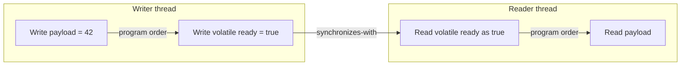

When one thread writes a field and another thread reads it, source-code order alone does not always determine what the reader may observe. The Java Memory Model (JMM) defines the behaviors that Java programs are allowed to exhibit when threads share memory.

The JMM is a language and JVM contract, not a diagram of physical RAM, CPU caches, or Java heap regions. Compilers, JITs, processors, and memory hierarchies may optimize execution as long as the resulting behavior remains permitted by the model. Correct Java code should reason about synchronization and **happens-before**, not guess which cache needs to be flushed.

This lesson uses Java 21's memory-model rules in the Java Language Specification (JLS), Chapter 17.

## Visibility and ordering are separate from source order

Within one thread, the Java language defines a program order. Across threads, an ordinary field read is not automatically ordered after an ordinary field write just because the writer's source code appears first. Without a synchronization relationship, a reader may observe an older value, and optimizations can make an unsynchronized polling loop behave unexpectedly.

The JMM specifies legal observations; it does not prescribe one physical implementation. A stale read is not necessarily evidence of a particular CPU cache problem, and inserting arbitrary delays does not create a visibility guarantee.

## Happens-before

The **happens-before** relation gives a partial order over actions. If action `A` happens-before action `B`, writes visible to `A` are visible to `B` according to the JMM rules. The relation is built from program-order and synchronization edges, then made transitive:

- Within a thread, an earlier action happens-before a later action in that thread's program order.
- Unlocking a monitor happens-before a subsequent lock of that same monitor.
- A write to a `volatile` variable happens-before subsequent reads of that same variable.
- Calling `Thread.start()` happens-before actions in the started thread.
- Actions in a thread happen-before another thread successfully detects its termination, such as by returning from `join()`.
- If `A` happens-before `B`, and `B` happens-before `C`, then `A` happens-before `C`.

The graph below shows safe publication through a volatile flag. It assumes the reader's volatile read observes the writer's `true` write:



By transitivity, the payload write happens-before the payload read. A volatile flag can therefore publish preceding ordinary writes when the reader observes the corresponding volatile write.

## Publishing data with `volatile`

The `volatile` modifier gives reads and writes of that field synchronization semantics. A volatile write and a subsequent volatile read of the same field establish a happens-before edge. This makes volatile useful for simple state publication and flags:

```java
public class VolatilePublication {
    private static int payload;
    private static volatile boolean ready;

    public static void main(String[] args) throws InterruptedException {
        Thread reader = new Thread(() -> {
            while (!ready) {
                Thread.onSpinWait();
            }
            System.out.println(payload);
        });

        reader.start();
        payload = 42;
        ready = true;
        reader.join();
    }
}
```

The reader does not access `payload` until it observes `ready` as `true`. The write to `payload` is before the volatile write in the writer's program order; the volatile write synchronizes-with the reader's volatile read; and that read is before `payload` is read in the reader's program order. The transitive happens-before chain makes `42` visible.

This example demonstrates visibility and ordering, not a general-purpose way to wait. A busy loop consumes CPU while it waits; use appropriate blocking or signaling mechanisms when waiting is part of the application design.

## Visibility does not make compound updates atomic

`volatile` is not a mutual-exclusion lock, and it does not turn a sequence of operations into one indivisible operation. For example, `count++` consists conceptually of reading `count`, adding one, and writing the result:

```java
public class VolatileCounter {
    private static volatile int count;

    static void increment() {
        count++;
    }
}
```

Two threads can both read the same old value and then write the same incremented value, losing one update. The volatile reads and writes are visible, but the read-modify-write as a whole is not atomic. Use an atomic variable such as `AtomicInteger` for independent atomic increments, or protect a multi-step invariant with a lock. Those coordination APIs are covered in [The `java.util.concurrent` Package](./the-javautilconcurrent-package).

## Data races and sequential consistency

Two accesses conflict when they access the same variable and at least one is a write. If conflicting accesses are not ordered by happens-before, the program has a **data race**. A race can produce stale observations or other surprising behavior; it is not limited to two threads writing at precisely the same instant.

The JLS provides a powerful guarantee: if a program has no data races, its executions appear sequentially consistent. Informally, sequential consistency means the execution can be understood as a single order that respects each thread's program order. This does not make compound operations atomic: a program can be race-free and still have a logical check-then-act bug if it does not protect the group of operations that must be indivisible.

The JMM does not promise that a racy program will fail consistently or that a compiler will diagnose it. Code that seems to work in a local test may still lack the ordering required by the specification.

## Hardware and the JMM

Modern processors may use caches, store buffers, and other mechanisms that affect when memory operations become observable. The JMM abstracts over those implementation details and defines which observations Java code may rely on.

Consequently:

- Do not assume one thread's ordinary write is immediately visible to another thread.
- Do not treat `volatile` as “flush every cache”; its contract is defined in terms of ordering and visibility.
- Do not rely on source-code order across threads without a happens-before edge.
- Do not use sleeps, repeated reads of ordinary fields, or test timing as substitutes for synchronization.

## Practical rules

- Identify shared mutable state and every thread that reads or writes it.
- Establish a happens-before edge using a documented synchronization mechanism.
- Use `volatile` for simple visibility/publication requirements, not for compound state transitions.
- Use atomic classes or locks when the operation must be indivisible.
- Keep the difference clear between visibility, ordering, and atomicity.
- Treat the JMM as the contract; do not make correctness depend on a particular CPU or JIT optimization.

## Further reading

- [Java Language Specification, Java SE 21, Chapter 17: Threads and Locks](https://docs.oracle.com/javase/specs/jls/se21/html/jls-17.html)
- [JLS Section 17.4.5: Happens-before Order](https://docs.oracle.com/javase/specs/jls/se21/html/jls-17.html#jls-17.4.5)
- [JLS Section 17.4.3: Programs and Program Order](https://docs.oracle.com/javase/specs/jls/se21/html/jls-17.html#jls-17.4.3)
- [JLS Section 8.3.1.4: `volatile` Fields](https://docs.oracle.com/javase/specs/jls/se21/html/jls-8.html#jls-8.3.1.4)
