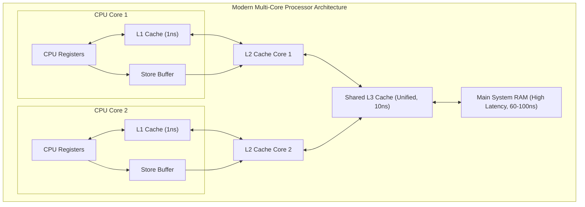
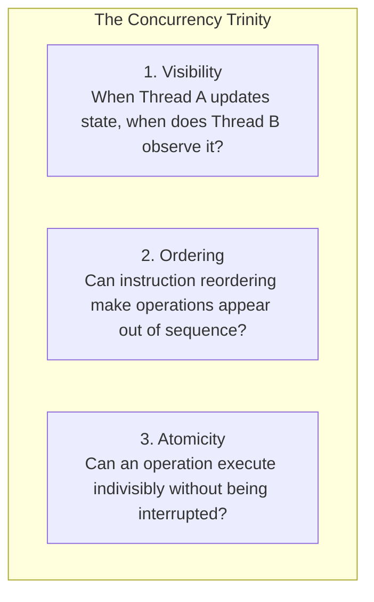
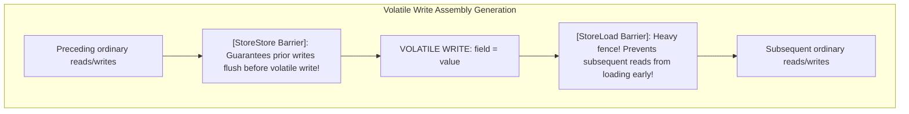
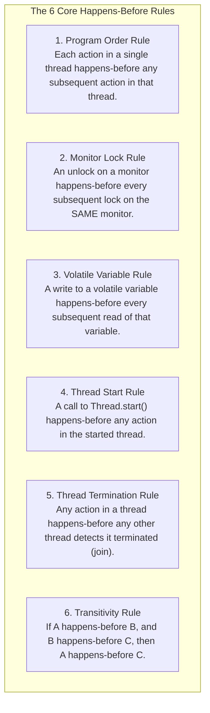
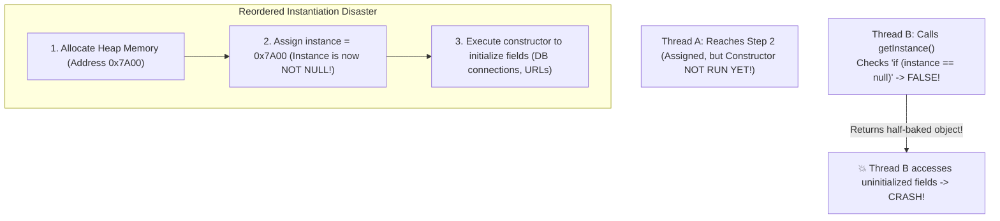

Writing single-threaded Java code is intuitive: statements execute one after another in the exact sequence you wrote them. 

The moment you spawn a second thread, however, **your intuitive mental model of how computers execute software completely shatters**.

Variables updated by one thread can remain invisible to other threads indefinitely. The CPU and JIT compiler can secretly rearrange your instructions in reverse order. On modern ARM chips (like AWS Graviton or Apple Silicon), a multi-threaded program that ran fine on your x86 laptop can suddenly crash or read corrupted data.

To bring order to this chaos, the Java Virtual Machine Specification defines **The Java Memory Model (JMM)** (formalized in JSR-133). 

The JMM is not a physical diagram of RAM; it is a **strict legal contract** specifying the exact conditions under which a write by one thread is guaranteed to be visible to a read by another thread through the **Happens-Before** relationship.

---

## The Physical Hardware Reality: Why the JMM Exists

To understand why Java needs a memory model, we must understand the physical constraints of modern CPU hardware.

A modern CPU core executes instructions in sub-nanosecond intervals. Accessing main RAM, however, takes 50 to 100 nanoseconds—an eternity! If CPUs waited for RAM on every memory read and write, multi-gigahertz processors would spend 99% of their clock cycles stalled.

To overcome this, hardware architects introduced multi-tiered **L1, L2, and L3 CPU Caches**, along with asynchronous **Store Buffers**:



### The Two Hardware Illusions
1. **Cache Coherency & Visibility Delay:** When Core 1 writes to variable `x = 42`, the write is buffered in Core 1's local Store Buffer. Core 2, executing on its own hardware cache, continues reading its stale cached value of `x = 0` until Core 1's buffer eventually flushes to shared memory!
2. **Out-of-Order Instruction Reordering:** Modern superscalar CPUs and JIT compilers actively reorder instructions to keep execution pipelines saturated. If two independent variables are written:
   ```java
   a = 1;
   b = 2;
   ```
   The CPU or compiler is legally permitted to execute `b = 2` **before** `a = 1`, as long as the reordering does not alter the observable behavior of that single thread!

### The Architectures: x86 vs. ARM / PowerPC
- **x86 / x64 (Intel & AMD):** Has a **Strongly Ordered** hardware memory model (Total Store Order - TSO). Stores are rarely reordered with other stores, masking sloppy concurrency bugs.
- **ARM64 (Apple M-series, AWS Graviton, mobile):** Has a **Weakly Ordered** hardware memory model. The CPU aggressively reorders reads and writes. Multi-threaded code that lacks proper JMM synchronization might run fine on Intel servers for months, but fails catastrophically the day you deploy to ARM cloud instances!

The JMM provides a universal abstraction layer that guarantees deterministic concurrency semantics regardless of whether your code runs on x86, ARM, or RISC-V.

---

## The Three Pillars of Concurrency: Visibility, Ordering, and Atomicity

Every multi-threaded bug boils down to a failure in one of these three invariants:



### Visibility: The Infinite Loop Trap
Look at this classic server shutdown loop:

```java
public class ServerWorker implements Runnable {
    private boolean running = true; // ❌ Flaw: Ordinary non-volatile field

    public void stop() {
        this.running = false;
    }

    @Override
    public void run() {
        while (running) {
            // Processing tasks...
        }
        System.out.println("Worker safely stopped.");
    }
}
```

What happens when the main thread calls `worker.stop()`?

In production under the C2 JIT compiler, **this program loops forever!**

Because `running` is a non-volatile field, the JIT compiler observes that `running` is never modified inside the loop on the worker thread. It applies a loop optimization known as **Hoisting**:

```java
// What the JIT actually compiles your loop into:
if (running) {
    while (true) {
        // Processing tasks... (Infinite loop! running is never re-read from memory!)
    }
}
```

The worker thread caches `running` in a CPU register and never reads the updated `false` value from shared RAM!

### Ordering: Instruction Reordering Trap

```java
public class ReorderingPuzzle {
    int x = 0, y = 0;
    int a = 0, b = 0;

    // Executed on Thread 1:
    public void thread1() {
        a = 1;
        x = b;
    }

    // Executed on Thread 2:
    public void thread2() {
        b = 1;
        y = a;
    }
}
```

Can this code finish with `x == 0` and `y == 0`?

Intuition says no: either `a = 1` or `b = 1` must happen first. But according to the JMM, **`x == 0 && y == 0` is completely legal!** 

Both the compiler and CPU are allowed to reorder `x = b` before `a = 1` in Thread 1, and `y = a` before `b = 1` in Thread 2, leading both threads to read `0` before either assignment executes.

### Atomicity: The Compound Operation Myth

```java
private volatile int counter = 0;

public void increment() {
    counter++; // ❌ NOT ATOMIC!
}
```

Even though `counter` is marked `volatile` (guaranteeing visibility), running `increment()` across 10 threads 10,000 times will result in a count far lower than 100,000!

Why? Because `counter++` is not a single CPU instruction; it is three separate bytecode operations:
1. `GETFIELD`: Read `counter` value from memory.
2. `IADD`: Add 1 to the value on the operand stack.
3. `PUTFIELD`: Write updated value back to memory.

If two threads read `counter = 5` simultaneously, both calculate `6` and write `6` back, silently dropping one increment. `volatile` guarantees visibility, but provides **zero atomicity**.

---

## The `volatile` Keyword Under the Hood

Declaring a field as **`volatile`** instructs both the `javac` compiler and the CPU:
1. **Guaranteed Visibility:** Reads are never cached in CPU registers; they must always read from the latest value in shared memory. Writes must flush immediately to shared memory.
2. **Instruction Barrier (Prevents Reordering):** The compiler and CPU are forbidden from reordering reads and writes across a volatile boundary.
3. **Atomic 64-bit Writes:** In 32-bit JVMs, ordinary 64-bit `long` and `double` writes are performed as two separate 32-bit operations (high word and low word), which can result in **word tearing** (reading high 32 bits from one write and low 32 bits from another!). Marking a `long` as `volatile` guarantees atomic 64-bit reads and writes.

### How `volatile` Emits Hardware Memory Barriers
At the machine code level, the JIT compiler enforces `volatile` semantics by injecting hardware **Memory Barriers (Fences)**:



- **`StoreStore` Barrier**: Inserted before a volatile write. Ensures all preceding ordinary writes are committed to cache before the volatile write occurs.
- **`StoreLoad` Barrier**: Inserted after a volatile write. The heaviest barrier: forces the CPU store buffer to completely flush before any subsequent read can execute.
- **`LoadLoad` & `LoadStore` Barriers**: Inserted after a volatile read. Ensures the volatile read occurs before any subsequent reads or writes can access data.

---

## The Six Sacred Happens-Before Rules

The foundation of the JMM is the **Happens-Before (`hb(A, B)`)** relationship.

If action `A` happens-before action `B`, then the memory changes made by `A` are **guaranteed to be fully visible** to action `B`, and the JVM guarantees that `A` will appear to have executed before `B`.

The JMM defines six essential rules that establish a happens-before edge:



### The Transitive Power of Happens-Before (Piggybacking)
Notice how Rule 6 (Transitivity) allows ordinary non-volatile fields to be safely published through a volatile variable:

```java
public class SafePublisher {
    private int data = 0;             // Ordinary field
    private volatile boolean ready = false; // Volatile flag

    public void writer() {
        data = 42;    // Action A (Ordinary write)
        ready = true; // Action B (Volatile write)
    }

    public void reader() {
        if (ready) {  // Action C (Volatile read)
            System.out.println(data); // Action D (Ordinary read) -> GUARANTEED to print 42!
        }
    }
}
```

Let's trace the formal logical proof:
1. `A -> B` by the **Program Order Rule** (within the writer thread).
2. `B -> C` by the **Volatile Variable Rule** (volatile write synchronizes with volatile read).
3. `C -> D` by the **Program Order Rule** (within the reader thread).
4. By the **Transitivity Rule**: `A -> B -> C -> D => A -> D`.

Because `A` happens-before `D`, the write `data = 42` is **100% guaranteed to be visible to the reader**, even though `data` was never marked `volatile`!

---

## The Broken Double-Checked Locking (DCL) Trap

One of the most famous real-world concurrency disasters in Java history is the **Double-Checked Locking (DCL)** pattern for lazy singleton initialization:

```java
// ❌ BROKEN CONCURRENCY: Flawed Double-Checked Locking!
public class DatabasePool {
    private static DatabasePool instance; // ⚠️ Missing volatile!

    private DatabasePool() {
        // Expensive connection initialization
    }

    public static DatabasePool getInstance() {
        if (instance == null) { // First check (no lock)
            synchronized (DatabasePool.class) {
                if (instance == null) { // Second check (with lock)
                    instance = new DatabasePool(); // 💥 DISASTER HAPPENS HERE!
                }
            }
        }
        return instance;
    }
}
```

### Why Unsynchronized DCL Crashing Production Systems
Look closely at `instance = new DatabasePool();`. 

In bytecode, instantiating an object is **not atomic**; it consists of three steps:
1. `allocate`: Allocate heap memory space for `DatabasePool`.
2. `ctor`: Invoke constructor to initialize fields.
3. `assign`: Assign the allocated memory address to the `instance` static pointer.

Because there is no data dependency between step 2 and step 3 within that single thread, the JIT compiler and CPU are permitted to reorder them:
1. `allocate`: Allocate memory.
2. `assign`: Set `instance` reference (Now `instance` is non-null in RAM!).
3. `ctor`: Run constructor fields.



If Thread A executes steps 1 and 2, and context switches right before step 3:
- Thread B arrives at `getInstance()`.
- Thread B checks `if (instance == null)`. It sees `instance != null` (because memory was assigned in step 2!).
- Thread B returns the `instance` without acquiring the lock!
- Thread B attempts to use the connection pool, but its internal fields are still `null` or uninitialized! The application crashes with an unexplainable `NullPointerException`.

### The Fix: Add `volatile`
```java
// ✅ THREAD-SAFE: volatile prevents instruction reordering between step 2 and 3!
private static volatile DatabasePool instance;
```
Adding `volatile` injects a `StoreStore` barrier, forcing the constructor (step 2) to complete before the reference assignment (step 3) can become visible to other threads.

---

## Summary & Mental Model Checkpoint

1. **Hardware vs JMM**: CPUs have multi-level caches and store buffers. The JMM is the formal contract guaranteeing when writes become visible across threads.
2. **Weak vs Strong Ordering**: x86 is strongly ordered (TSO); ARM/Graviton is weakly ordered and aggressively reorders instructions.
3. **The Concurrency Trinity**: Visibility (cached reads), Ordering (instruction swapping), and Atomicity (compound operations).
4. **`volatile` Powers**: Guarantees visibility, prevents instruction reordering via memory barriers, and ensures atomic 64-bit writes.
5. **No Atomicity in `volatile`**: `volatile` does not make compound operations like `count++` atomic.
6. **Happens-Before Rules**: Program order, Monitor lock, Volatile variable, Thread start, Thread termination, and Transitivity.
7. **Double-Checked Locking**: Always mark the static singleton field `volatile` to prevent returning a partially-constructed object.

---

## 🎯 Senior Engineer Interview Questions

### What physical hardware features (CPU caches, store buffers, superscalar execution) make the Java Memory Model necessary?
> **Answer:** Modern multi-core CPUs operate at gigahertz frequencies, while main memory (DRAM) takes dozens of nanoseconds to respond. To prevent CPU stall cycles, processors employ multi-tiered caches (L1/L2/L3) and asynchronous Store Buffers. When a CPU writes a value, it buffers the write locally rather than waiting for RAM, causing other cores reading from their own local L1 caches to observe stale values (the **Visibility problem**). Furthermore, out-of-order execution engines and optimizing compilers dynamically reorder instructions to maximize CPU pipeline utilization, provided single-threaded program semantics are preserved (the **Ordering problem**). Different architectures enforce different memory models (e.g. x86 is strongly ordered via TSO, while ARM64 is weakly ordered). The JMM provides a formal platform-independent specification that defines exactly when CPU memory barriers must be inserted to guarantee predictable visibility and ordering across threads.

### Explain the Double-Checked Locking (DCL) singleton antipattern in Java. Why does omitting the `volatile` modifier result in threads observing partially-constructed objects?
> **Answer:** In Java, initializing an object via `instance = new Singleton()` is not an atomic operation. Bytecode decomposes it into three distinct steps: (1) allocate memory space on the heap, (2) execute the constructor to initialize instance fields, and (3) assign the memory address to the `instance` reference. Because step 2 and step 3 have no data dependency within the creating thread, optimizing compilers and CPUs can reorder them: allocating memory (1), publishing the memory address to `instance` (3), and only then invoking the constructor (2). If Thread A executes steps 1 and 3 and is interrupted before step 2, Thread B enters `getInstance()`. Thread B evaluates `if (instance == null)`, observes that `instance` is non-null, and returns the reference immediately without entering the `synchronized` block. Thread B then accesses fields on this object that have not yet had their constructors executed, resulting in data corruption or runtime exceptions. Marking `instance` as `volatile` generates a memory barrier (`StoreStore`) that forbids reordering step 3 before step 2, ensuring that the constructor fully executes before the object reference becomes visible to other threads.

### What is the "Happens-Before" relationship in the JMM, and how does the Transitivity rule allow "piggybacking" non-volatile writes onto a volatile variable?
> **Answer:** The Happens-Before relationship is a formal partial ordering over memory actions defined in JSR-133. If action `A` happens-before action `B`, the memory updates produced by `A` are guaranteed to be visible to `B`, and `A` is ordered before `B`. The Transitivity rule states that if `A -> B` and `B -> C`, then `A -> C`. This enables "piggybacking": if Thread 1 writes to several ordinary non-volatile fields (Action `A`) and then writes to a `volatile` variable (Action `B`), `A -> B` by the Program Order Rule. When Thread 2 reads that same `volatile` variable (Action `C`) and observes Thread 1's write, `B -> C` by the Volatile Variable Rule. If Thread 2 then reads the ordinary fields (Action `D`), `C -> D` by Program Order. By Transitivity (`A -> B -> C -> D`), the ordinary writes in Action `A` are guaranteed to be fully visible to Thread 2 in Action `D`, allowing developers to synchronize multiple shared variables through a single volatile write without synchronizing every field.

### Why is the `volatile` keyword insufficient for making compound operations like `count++` or "check-then-act" state transitions thread-safe?
> **Answer:** The `volatile` modifier provides visibility (preventing stale cached reads) and ordering (preventing instruction reordering via memory barriers), but it provides zero atomicity. A compound operation like `count++` consists of three separate machine operations: reading the current value (`GETFIELD`), incrementing the value in a register (`IADD`), and writing the updated value back (`PUTFIELD`). If two threads execute `count++` concurrently, both threads can read the exact same volatile value simultaneously. Both threads calculate the incremented value in their local CPU registers, and both write back the identical number, resulting in a lost update. For compound operations or state transitions (like check-then-act), atomicity requires either explicit locking (`synchronized`, `ReentrantLock`) to enforce mutual exclusion, or lock-free atomic primitives (`AtomicInteger.incrementAndGet()`) that utilize hardware-level Compare-And-Swap (CAS) instructions.