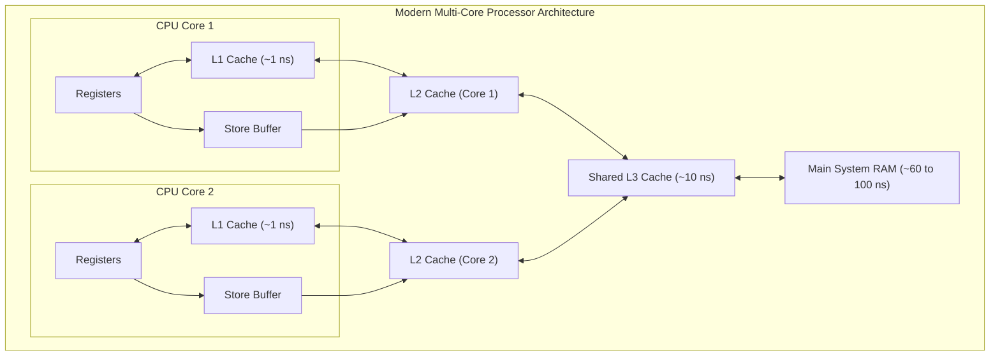
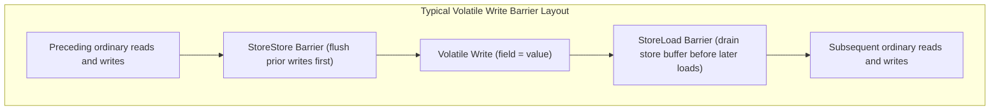
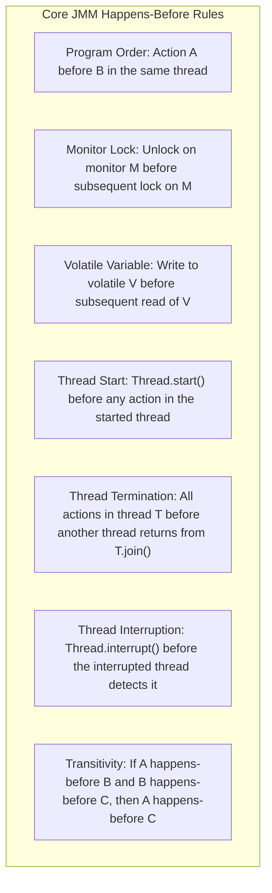
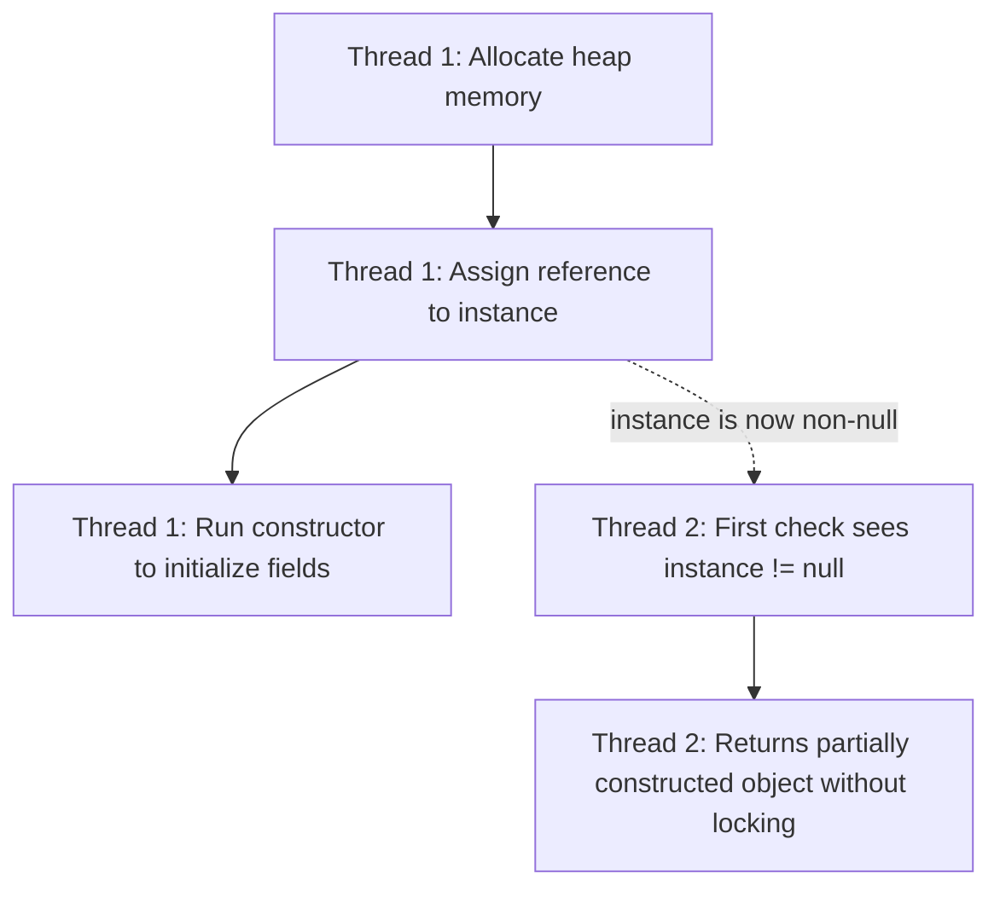

In a single-threaded Java program, statements behave as if they run strictly in the order you wrote them. The compiler and CPU are free to reorder operations behind the scenes, as long as the single thread observes the exact same result.

Once two threads share mutable data, that illusion breaks down. A write performed by one thread may not be visible to another thread right away, or at all. Two independent writes can appear out of order to a reader on another core. Even worse, a multithreaded bug that never reproduces on an x86 developer laptop can start failing in production on ARM64 servers such as AWS Graviton or Apple Silicon.

The **Java Memory Model (JMM)**, defined in Chapter 17 of the Java Language Specification (revised in JSR-133 for Java 5), specifies the exact rules governing how threads interact through memory. It is not a diagram of physical hardware. It is a contract between your Java code and the JVM: if you follow the JMM's synchronization rules, your program will observe consistent memory behavior across every compliant JVM and CPU architecture.

---

## Hardware Memory Architecture vs. the JMM

To see why a formal memory model is necessary, it helps to look at how modern multi-core processors handle memory access.

A CPU core executes instructions in fractions of a nanosecond, while reading from main RAM takes roughly 50 to 100 nanoseconds. If a core had to pause and wait for main memory on every read or write, it would spend almost all of its time idle. Hardware designers bridge that gap with layers of private and shared caches, registers, and store buffers.



Two hardware and compiler behaviors cause most cross-thread surprises:

1. **Buffered writes and local caches:** When Core 1 writes a new value to a field, that write often sits in Core 1's store buffer or L1 cache before cache coherency protocols propagate it to other cores. Meanwhile, Core 2 can keep reading an older value from its own cache or register.
2. **Instruction reordering:** Both `javac` (rarely), the JIT compiler (aggressively), and the CPU itself reorder instructions that have no data dependency within a single thread. If a thread executes `a = 1; b = 2;`, another core may observe `b == 2` while `a` is still `0`.

CPU architectures also differ in how much reordering they permit:

- **x86-64 (Intel and AMD)** uses a relatively strong model called Total Store Order (TSO). Stores are not reordered with other stores, and loads are not reordered with other loads, though a store followed by a load to a different address can still be reordered because of store buffers.
- **ARM64 (Apple Silicon, AWS Graviton, mobile chips)** uses a weakly ordered model. Both loads and stores can be reordered aggressively unless explicit fence or acquire/release instructions are emitted.

The JMM abstracts over all of these hardware differences. Instead of reasoning about x86 store buffers or ARM64 cache lines directly, you write against the JMM's rules, and the JVM emits whatever fences or atomic instructions the target CPU requires.

---

## Visibility Problems and Caching

When developers talk about concurrency bugs, they usually think of race conditions on a shared counter. Visibility bugs are quieter and often harder to reproduce locally because they depend on JIT compilation and CPU scheduling.

Consider a background worker that polls a boolean flag until another thread asks it to stop:

```java
public class StoppableWorker {
    private boolean stopRequested = false; // Not volatile, not synchronized

    public void requestStop() {
        this.stopRequested = true;
    }

    public void runWorkLoop() {
        long iterations = 0;
        while (!stopRequested) {
            iterations++;
        }
        System.out.println("Worker stopped after " + iterations + " iterations.");
    }

    public static void main(String[] args) throws InterruptedException {
        StoppableWorker worker = new StoppableWorker();
        Thread t = new Thread(worker::runWorkLoop, "worker-thread");
        t.start();

        Thread.sleep(100);
        worker.requestStop();
        System.out.println("Stop requested from main thread.");
    }
}
```

If you run this program on a standard HotSpot JVM, it will often print `"Stop requested from main thread."` and then hang forever.

Two things can cause the worker thread to miss the update:

1. **JIT loop hoisting (HotSpot C2 optimization):** Because `stopRequested` is an ordinary field and nothing inside the `while` loop writes to it, the JMM allows the JIT compiler to assume no other thread is updating it without synchronization. After a few thousand iterations, HotSpot compiles the loop and hoists the read outside the loop:

```java
// Effective compiled logic after JIT hoisting
if (!stopRequested) {
    while (true) {
        iterations++;
    }
}
```

2. **CPU register and cache visibility:** Even without hoisting, keeping `stopRequested` in a CPU register or reading a stale cache line while the main thread's write sits in another core's store buffer means the worker has no guarantee of seeing `true`.

> [!NOTE]
> Adding `System.out.println(...)` inside the loop often makes this bug disappear during debugging. That is not because printing fixes your code; `PrintStream.println` is `synchronized`, which introduces memory visibility side effects and prevents the JIT from hoisting the loop condition. Remove the log line and the hang comes right back.

### Reordering Without Synchronization

Visibility is not the only hazard. Look at this small two-thread example:

```java
public class ReorderingExample {
    int a = 0;
    int b = 0;
    int r1 = 0;
    int r2 = 0;

    // Run on Thread 1
    public void thread1() {
        a = 1;
        r1 = b;
    }

    // Run on Thread 2
    public void thread2() {
        b = 1;
        r2 = a;
    }
}
```

Intuitively, either `a = 1` or `b = 1` happens first, so at least one of `r1` or `r2` should be `1`. In practice, finishing with `r1 == 0 && r2 == 0` is legal under the JMM and actually occurs on real hardware, including x86-64.

Because `a = 1` sits in Core 1's store buffer while Core 1 reads `b` from cache, and `b = 1` sits in Core 2's store buffer while Core 2 reads `a` from cache, both reads can observe `0`. The compiler is also permitted to swap the two lines in each method since they touch independent variables.

---

## The `volatile` Keyword

Marking a field `volatile` tells the JVM and compiler that multiple threads read and write it without a lock. A `volatile` declaration provides three specific guarantees under the JMM:

1. **Cross-thread visibility:** A write to a `volatile` field is made visible to subsequent reads of that same field by other threads. The JIT cannot hoist a `volatile` read out of a loop or cache it in a register across iterations.
2. **Ordering constraints:** Operations before a `volatile` write cannot be reordered after it, and operations after a `volatile` read cannot be reordered before it.
3. **Atomic 64-bit reads and writes:** Per JLS 17.7, reads and writes of ordinary non-volatile `long` and `double` fields are not guaranteed to be atomic on 32-bit JVMs (they may be split into two 32-bit operations, causing word tearing). Marking a `long` or `double` as `volatile` guarantees atomic reads and writes on all JVMs. (On 64-bit JVMs, 64-bit aligned reads and writes are typically atomic in hardware, though you still need `volatile` for visibility and ordering.)

Fixing `StoppableWorker` only requires adding `volatile`:

```java
private volatile boolean stopRequested = false;
```

### How HotSpot Enforces `volatile` Under the Hood

The JLS defines `volatile` strictly in terms of Happens-Before rules (covered in the next section). On actual CPUs, HotSpot implements those guarantees by emitting memory barriers (also called fences) or acquire/release instructions around volatile accesses.



- Before a volatile write, HotSpot prevents earlier writes from moving past it (`StoreStore` barrier on architectures that require it).
- After a volatile write, HotSpot prevents later reads from moving ahead of it (`StoreLoad` barrier, implemented on x86-64 via a locked instruction such as `lock addl $0, (%rsp)` or `mfence`, and on ARM64 via `stlr` / `dmb` instructions).
- After a volatile read, HotSpot prevents later reads and writes from moving before it (`LoadLoad` and `LoadStore` barriers, or an ARM64 `ldar` load-acquire instruction).

### Why `volatile` Does Not Make `count++` Atomic

One of the most common mistakes with `volatile` is using it for a shared counter:

```java
public class BrokenCounter {
    private volatile int count = 0;

    public void increment() {
        count++; // Not atomic, even though count is volatile
    }

    public int getCount() {
        return count;
    }
}
```

If ten threads each call `increment()` 10,000 times, the final result is almost always less than 100,000.

The reason is that `count++` is a compound read-modify-write operation, not a single indivisible action. In bytecode, it breaks down into three steps:

1. `getfield`: read the current value of `count`.
2. `iadd`: add `1` to that value on the thread's operand stack.
3. `putfield`: write the incremented value back to `count`.

If Thread 1 and Thread 2 both execute step 1 when `count` is `5`, both read `5` (visibility worked fine!), both compute `6`, and both write `6`. One increment is silently lost.

Use `volatile` when a field's new value does not depend on its previous value (for example, a boolean shutdown flag or replacing an immutable configuration reference) and only one thread writes to it, or when writes are independent. For counters and check-then-act updates, use `AtomicInteger`, `LongAdder`, or locking (`synchronized` / `ReentrantLock`).

---

## Happens-Before Relationships

Rather than talking about caches or CPU instructions, the JMM defines correctness using a partial ordering called **Happens-Before**.

If action `A` *happens-before* action `B`, the JMM guarantees that all memory writes performed by `A` (and anything that happened before `A`) are visible to `B`. Note that "happens-before" is a visibility and ordering guarantee, not necessarily wall-clock time: two actions without a happens-before relationship can appear in different orders to different threads even if one ran a millisecond earlier on the clock.

Here are the core Happens-Before rules defined in JLS 17.4.5 and 17.5:



### Program Order Rule
Within a single thread, each action happens-before every subsequent action in program order. The compiler and CPU can still reorder instructions inside that thread, provided the thread itself cannot tell the difference (as-if-serial semantics).

### Monitor Lock Rule
An unlock on a monitor (exiting a `synchronized` block or method) happens-before every subsequent lock on that **same** monitor. Anything Thread 1 wrote before releasing the lock is guaranteed to be visible to Thread 2 after Thread 2 acquires that same lock. Explicit locks in `java.util.concurrent.locks` provide the same memory semantics as intrinsic monitors.

### Volatile Variable Rule
A write to a `volatile` field happens-before every subsequent read of that same `volatile` field.

### Thread Start Rule
A call to `thread.start()` on a `Thread` object happens-before any action inside the newly started thread. If the parent thread initializes fields before calling `t.start()`, the new thread is guaranteed to see those writes.

### Thread Termination (Join) Rule
Every action in a thread happens-before any other thread successfully returns from `t.join()` on that thread (or sees `t.isAlive()` return `false`). That means once `join()` returns, all results written by the worker thread are safely visible to the joining thread without extra synchronization.

### Thread Interruption Rule
A thread calling `target.interrupt()` happens-before the target thread detects the interrupt (either by catching `InterruptedException` or by observing `Thread.isInterrupted()` or `Thread.interrupted()` return `true`).

### Transitivity and Safe Piggybacking
If `A` happens-before `B`, and `B` happens-before `C`, then `A` happens-before `C`.

Transitivity is what makes `volatile` much more useful than a simple flag. It allows ordinary, non-volatile writes to "piggyback" on a single volatile write-read pair:

```java
public class ConfigPublisher {
    private String endpoint;          // Ordinary non-volatile field
    private int timeoutMillis;        // Ordinary non-volatile field
    private volatile boolean ready;   // Volatile publication flag

    public void publish(String endpoint, int timeoutMillis) {
        this.endpoint = endpoint;             // Action 1 (ordinary write)
        this.timeoutMillis = timeoutMillis;   // Action 2 (ordinary write)
        this.ready = true;                    // Action 3 (volatile write)
    }

    public void handleRequest() {
        if (ready) {                          // Action 4 (volatile read sees true)
            // Actions 1 and 2 are guaranteed visible here
            System.out.println("Calling " + endpoint + " with timeout " + timeoutMillis);
        }
    }
}
```

Trace the happens-before chain when `handleRequest()` sees `ready == true`:

1. Actions 1 and 2 happen-before Action 3 (Program Order Rule in the writer thread).
2. Action 3 happens-before Action 4 (Volatile Variable Rule).
3. Action 4 happens-before reading `endpoint` and `timeoutMillis` (Program Order Rule in the reader thread).
4. By Transitivity, Actions 1 and 2 happen-before the reads in `handleRequest()`.

Even though `endpoint` and `timeoutMillis` are not `volatile`, the reader is guaranteed to see their updated values as long as it checks `ready` first and observes `true`.

### Final Field Guarantees
The JMM also grants special initialization safety to `final` fields (JLS 17.5). When a constructor finishes normally, the JVM performs a "freeze" on all `final` fields initialized inside that constructor.

Any thread that subsequently receives a reference to that object is guaranteed to see the initialized values of its `final` fields (and anything reachable solely through them, such as the contents of a `final` array or `final` immutable object created in the constructor), even if the object reference was published without `volatile` or `synchronized`.

There is one strict condition: **the `this` reference must not escape during construction**. Do not start a thread from a constructor, register `this` as a listener, or store `this` in a shared field before the constructor finishes. If another thread sees `this` before the constructor returns, the freeze has not happened yet and it can observe default zero or `null` values in `final` fields.

```java
public final class ImmutableConfig {
    private final String host;
    private final int port;

    public ImmutableConfig(String host, int port) {
        this.host = host;
        this.port = port;
        // Do NOT pass 'this' to another thread or registry here
    }

    public String host() { return host; }
    public int port() { return port; }
}
```

Java `record` classes (finalized in Java 16) compile their components into `private final` fields, so records whose fields are themselves immutable automatically inherit this initialization safety as long as their compact constructor does not leak `this`.

---

## Double-Checked Locking and Safe Publication

Double-Checked Locking (DCL) is a classic example of how missing a single `volatile` keyword breaks a seemingly careful design. Developers introduced DCL to lazily initialize a singleton without paying the cost of acquiring a lock on every `getInstance()` call:

```java
// Broken: missing volatile on instance (non-final fields may be seen uninitialized)
public class BrokenDatabasePool {
    private static BrokenDatabasePool instance;
    private String url;
    private int maxConnections;

    private BrokenDatabasePool() {
        this.url = "jdbc:postgresql://localhost:5432/app";
        this.maxConnections = 20;
    }

    public static BrokenDatabasePool getInstance() {
        if (instance == null) {                  // First check (no lock)
            synchronized (BrokenDatabasePool.class) {
                if (instance == null) {          // Second check (under lock)
                    instance = new BrokenDatabasePool(); // Unsafe publication
                }
            }
        }
        return instance;
    }
}
```

Why is this broken if `instance` is not `volatile` (especially for classes that have non-final fields initialized in the constructor)?

Creating an object with `instance = new BrokenDatabasePool()` is not a single atomic step. Conceptually, the JVM must:

1. Allocate memory on the heap for the new object.
2. Run the constructor to initialize the object's fields.
3. Assign the reference to the static field `instance`.

Without `volatile` (and for non-final fields), the JIT compiler or CPU is permitted to reorder step 3 ahead of step 2, because the creating thread itself cannot tell the difference inside the synchronized block.



If Thread 2 calls `getInstance()` after step 3 has written the reference but before step 2 has finished initializing all fields, Thread 2 sees `instance != null`, skips the `synchronized` block, and returns an object whose non-final fields may still hold default values (`null`, `0`, `false`).

### Fixing Double-Checked Locking

Adding `volatile` to `instance` establishes a happens-before edge between the write to `instance` (and all constructor writes before it) and any thread's read of `instance`:

```java
public class SafeDatabasePool {
    private static volatile SafeDatabasePool instance;
    private String url;

    private SafeDatabasePool() {
        this.url = "jdbc:postgresql://localhost:5432/app";
    }

    public static SafeDatabasePool getInstance() {
        SafeDatabasePool localRef = instance; // Single volatile read on fast path
        if (localRef == null) {
            synchronized (SafeDatabasePool.class) {
                localRef = instance;
                if (localRef == null) {
                    localRef = new SafeDatabasePool();
                    instance = localRef;
                }
            }
        }
        return localRef;
    }
}
```

Assigning `instance` to a local variable (`localRef`) is a small, well-known optimization: on the common already-initialized fast path, it performs only one `volatile` read instead of two.

### Simpler Alternative: Initialization-on-Demand Holder

If your singleton does not require runtime parameters, you do not need DCL at all. The JVM specification guarantees that class initialization runs lazily on first use and is automatically synchronized by the classloader:

```java
public class DatabasePool {
    private DatabasePool() {
        // Initialize connections
    }

    private static final class Holder {
        private static final DatabasePool INSTANCE = new DatabasePool();
    }

    public static DatabasePool getInstance() {
        return Holder.INSTANCE;
    }
}
```

The `Holder` class is not loaded or initialized until `getInstance()` is called for the first time, and every thread that reads `Holder.INSTANCE` gets safe publication with zero lock overhead after initialization.

---

## Recap

- Hardware CPUs rely on registers, private L1/L2 caches, store buffers, and out-of-order execution. The JMM provides a portable specification so you do not have to write architecture-specific concurrency code for x86 vs. ARM64.
- Without synchronization or `volatile`, a thread can miss updates indefinitely due to CPU caching or JIT loop hoisting.
- `volatile` guarantees cross-thread visibility, prevents reordering across the volatile access, and ensures atomic 64-bit `long`/`double` reads and writes. It does **not** make compound operations like `count++` atomic.
- Happens-Before rules (program order, monitor lock/unlock, volatile write/read, thread start/join/interrupt, transitivity, and final field freeze) define the exact conditions under which writes in one thread are guaranteed visible in another.
- If you use Double-Checked Locking, mark the instance field `volatile`; if you do not need runtime arguments, prefer the Initialization-on-Demand Holder idiom or an `enum` singleton.

---

## Practical Questions

### Why can a non-volatile boolean stop flag cause a worker thread to loop forever in production, even when it works during local debugging?
Under the JMM, an ordinary non-volatile field read inside a loop does not require the JVM to re-read from main memory on every iteration. Once the loop becomes hot, HotSpot's C2 JIT compiler sees that the worker thread never modifies the flag and hoists the check outside the loop, turning `while (!stopRequested)` into an infinite loop. Local debugging often masks this because debug stepping, slower uncompiled execution, or temporary `System.out.println` statements (which synchronize internally) prevent hoisting or force cache visibility. Marking the flag `volatile` fixes both the JIT optimization and hardware visibility.

### Why is `volatile` not enough for `count++` or a check-then-act operation?
`volatile` guarantees that each individual read sees the latest write and that each individual write becomes visible to other threads. However, `count++` is three separate steps: read `count`, add `1`, and write the result back. Two threads can both read `5` simultaneously, compute `6`, and both write `6`, losing an update. Compound operations require atomicity through `AtomicInteger`, `LongAdder`, or mutual exclusion (`synchronized` or `ReentrantLock`).

### How does the Transitivity rule allow safely publishing non-volatile fields through a single `volatile` variable?
Suppose Thread 1 writes several ordinary fields (`A`) and then writes `ready = true` to a `volatile` field (`B`). By the Program Order Rule, `A` happens-before `B`. When Thread 2 reads `ready` (`C`) and sees `true`, `B` happens-before `C` by the Volatile Variable Rule. When Thread 2 then reads the ordinary fields (`D`), `C` happens-before `D` by Program Order. By Transitivity, `A` happens-before `D`, so Thread 2 is guaranteed to observe every write Thread 1 performed before setting `ready = true`.

### Why do `final` fields still need care during object construction?
The JMM guarantees that once a constructor completes normally, `final` fields are frozen and safely visible to other threads even without external synchronization. That guarantee only holds if the object reference does not escape before the constructor returns. If a constructor starts a thread that accesses `this` or registers `this` into a shared collection, another thread can read the object before the freeze completes and see uninitialized default values in `final` fields.
