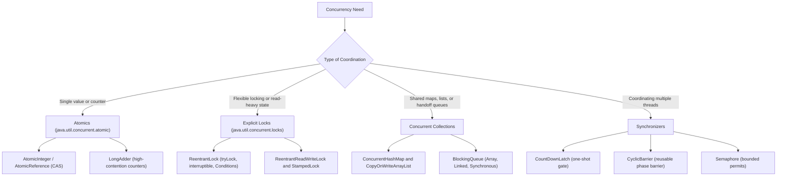
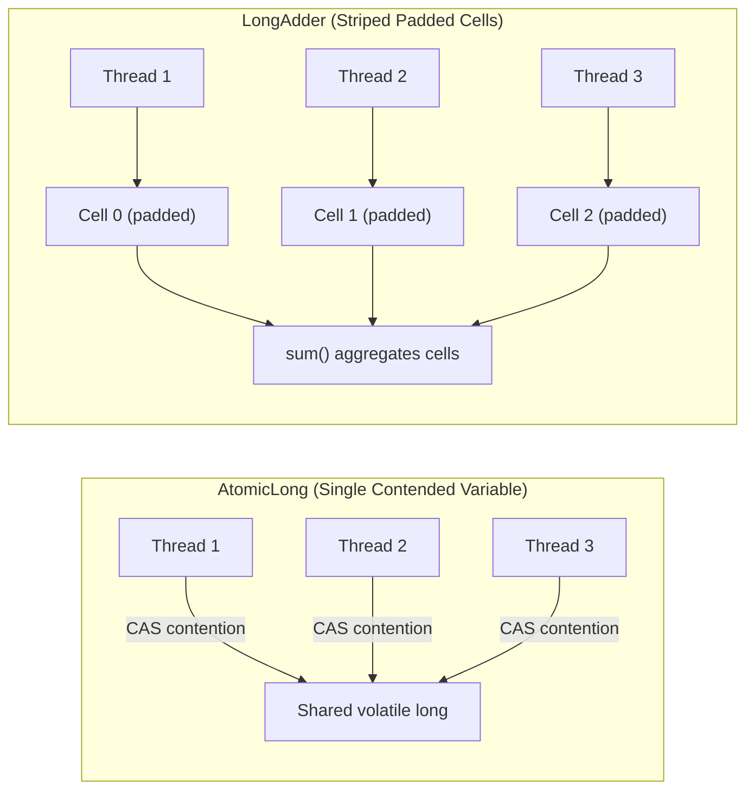
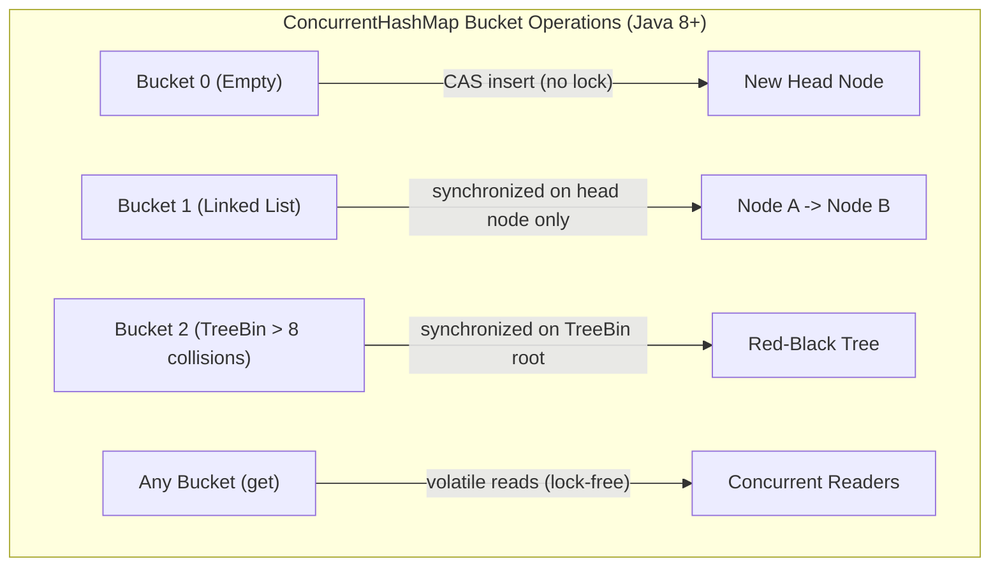

Before Java 5 introduced `java.util.concurrent` (designed largely by Doug Lea under JSR-166), concurrent Java code depended almost entirely on `synchronized`, `wait()`, and `notify()`. Those primitives work for simple critical sections, but they have real limits: you cannot put a timeout on acquiring a `synchronized` lock, you cannot interrupt a thread blocked on `monitorenter`, and every intrinsic monitor shares a single wait set.

The `java.util.concurrent` package gives you higher-level, well-tested building blocks for four everyday concurrency needs: explicit locks, lock-free atomic variables, concurrent collections, and thread synchronizers. Choosing the right one starts with knowing what kind of state you are protecting and how threads contend for it.



---

## Explicit Locks: `ReentrantLock`, `ReadWriteLock`, and `StampedLock`

Intrinsic `synchronized` blocks are concise and release locks automatically, so they remain a good default for simple, uncontended critical sections. Reach for explicit locks in `java.util.concurrent.locks` when you need:

- Timed lock attempts (`tryLock(timeout, unit)`) to avoid hanging indefinitely.
- Interruptible lock acquisition (`lockInterruptibly()`) so threads respond cleanly to shutdown.
- Separate wait queues (`Condition` objects) on the same lock.
- Separate read and write access for read-heavy shared state.
- Optional fairness policies.

### `ReentrantLock` and Multiple `Condition` Queues

With `ReentrantLock`, you must **always** release the lock inside a `finally` block. Unlike `synchronized`, the compiler will not unlock it for you if an exception is thrown.

One major advantage of `ReentrantLock` is calling `lock.newCondition()` multiple times to separate producer and consumer wait queues. When a producer inserts an item, it signals only `notEmpty`, rather than waking other producers as `notifyAll()` would:

```java
import java.util.concurrent.TimeUnit;
import java.util.concurrent.locks.Condition;
import java.util.concurrent.locks.ReentrantLock;

public class BoundedTaskBuffer<T> {
    private final Object[] items;
    private int putIndex;
    private int takeIndex;
    private int count;

    // Non-fair by default for higher throughput under normal load
    private final ReentrantLock lock = new ReentrantLock();
    private final Condition notFull = lock.newCondition();
    private final Condition notEmpty = lock.newCondition();

    public BoundedTaskBuffer(int capacity) {
        if (capacity <= 0) {
            throw new IllegalArgumentException("Capacity must be positive");
        }
        this.items = new Object[capacity];
    }

    public boolean offer(T item, long timeout, TimeUnit unit) throws InterruptedException {
        long nanos = unit.toNanos(timeout);
        lock.lockInterruptibly();
        try {
            while (count == items.length) {
                if (nanos <= 0L) {
                    return false; // Timed out without blocking forever
                }
                nanos = notFull.awaitNanos(nanos);
            }
            items[putIndex] = item;
            if (++putIndex == items.length) {
                putIndex = 0;
            }
            count++;
            notEmpty.signal(); // Wake one waiting consumer
            return true;
        } finally {
            lock.unlock();
        }
    }

    @SuppressWarnings("unchecked")
    public T take() throws InterruptedException {
        lock.lockInterruptibly();
        try {
            while (count == 0) {
                notEmpty.await();
            }
            T item = (T) items[takeIndex];
            items[takeIndex] = null; // Avoid retaining stale references
            if (++takeIndex == items.length) {
                takeIndex = 0;
            }
            count--;
            notFull.signal(); // Wake one waiting producer
            return item;
        } finally {
            lock.unlock();
        }
    }
}
```

`new ReentrantLock(true)` enables **fairness**, granting the lock roughly in FIFO arrival order. Fair locks prevent thread starvation, but they reduce throughput under contention because the JVM must wake a parked thread instead of letting an already-running thread grab the lock right away. Use the default non-fair lock unless profiling shows genuine starvation.

### `ReadWriteLock` (`ReentrantReadWriteLock`)

When shared state is read frequently and updated rarely, exclusive locking forces readers to wait behind other readers even though concurrent reads cannot corrupt data. `ReadWriteLock` splits access into two paired locks:

- Multiple threads can hold the **read lock** simultaneously as long as no thread holds the write lock.
- Only one thread can hold the **write lock**, and it excludes all other readers and writers.

```java
import java.util.HashMap;
import java.util.Map;
import java.util.Optional;
import java.util.concurrent.locks.Lock;
import java.util.concurrent.locks.ReadWriteLock;
import java.util.concurrent.locks.ReentrantReadWriteLock;

public class FeatureFlagStore {
    private final Map<String, Boolean> flags = new HashMap<>();
    private final ReadWriteLock rwLock = new ReentrantReadWriteLock();
    private final Lock readLock = rwLock.readLock();
    private final Lock writeLock = rwLock.writeLock();

    public Optional<Boolean> isEnabled(String flagName) {
        readLock.lock();
        try {
            return Optional.ofNullable(flags.get(flagName));
        } finally {
            readLock.unlock();
        }
    }

    public void updateAll(Map<String, Boolean> newFlags) {
        writeLock.lock();
        try {
            flags.clear();
            flags.putAll(newFlags);
        } finally {
            writeLock.unlock();
        }
    }
}
```

Two important rules for `ReentrantReadWriteLock`:

1. **Downgrading is allowed; upgrading deadlocks.** A thread holding the write lock can acquire the read lock and then release the write lock (downgrading). However, a thread holding the read lock that tries to acquire the write lock will deadlock itself because the write lock waits for all readers, including itself, to exit.
2. **Reads still write to shared state internally.** Even acquiring a read lock updates an atomic reader count inside the lock, so on very short read sections under heavy multi-core load, readers still contend on the same cache line.

### `StampedLock` for Optimistic Reads

Java 8 added `StampedLock` for short, read-dominated critical sections where even read-lock bookkeeping becomes a bottleneck. In addition to regular read and write locks, `StampedLock` supports **optimistic reads** that acquire no lock at all. Instead, you grab a numeric version stamp, read the fields into local variables, and call `validate(stamp)` to verify that no writer modified the state while you were reading:

```java
import java.util.concurrent.locks.StampedLock;

public class Coordinates {
    private double x;
    private double y;
    private final StampedLock lock = new StampedLock();

    public void move(double deltaX, double deltaY) {
        long stamp = lock.writeLock();
        try {
            x += deltaX;
            y += deltaY;
        } finally {
            lock.unlockWrite(stamp);
        }
    }

    public double distanceFromOrigin() {
        long stamp = lock.tryOptimisticRead(); // No lock acquired
        double currentX = x;
        double currentY = y;

        if (!lock.validate(stamp)) {
            // A writer intervened; fall back to a regular read lock
            stamp = lock.readLock();
            try {
                currentX = x;
                currentY = y;
            } finally {
                lock.unlockRead(stamp);
            }
        }
        return Math.hypot(currentX, currentY);
    }
}
```

> [!WARNING]
> `StampedLock` is **not reentrant**. Calling `writeLock()` again on a thread that already holds it causes an immediate self-deadlock. It also does not support `Condition` objects, and in Java versions prior to JDK 8u131/9, calling `interrupt()` on a thread waiting in `readLock()` or `writeLock()` caused CPU spikes (always use `readLockInterruptibly()` or `writeLockInterruptibly()` when interruptibility matters).

---

## Atomic Variables and Compare-And-Swap (CAS)

Locking is pessimistic: it blocks other threads on the assumption that they might conflict. For simple single-variable updates like counters, sequence generators, or state flags, `java.util.concurrent.atomic` uses an optimistic, lock-free technique built on hardware **Compare-And-Swap (CAS)** instructions (such as `LOCK CMPXCHG` on x86-64 or LL/SC and LSE atomics on ARM64).

A CAS operation takes three inputs: a memory address, an expected old value, and a new value. In one indivisible hardware step, the CPU checks whether the memory location still holds the expected value. If it does, the CPU writes the new value and reports success; if another core changed it first, the CPU leaves memory untouched and reports failure so the caller can retry with the fresh value.

### `AtomicInteger` and Lock-Free State Updates

Classes like `AtomicInteger`, `AtomicLong`, `AtomicBoolean`, and `AtomicReference` wrap CAS loops behind clean methods:

```java
import java.util.concurrent.atomic.AtomicInteger;

public class RetryBudget {
    private final AtomicInteger remainingPermits;

    public RetryBudget(int maxRetries) {
        this.remainingPermits = new AtomicInteger(maxRetries);
    }

    public boolean tryConsumeRetry() {
        while (true) {
            int current = remainingPermits.get();
            if (current <= 0) {
                return false;
            }
            if (remainingPermits.compareAndSet(current, current - 1)) {
                return true;
            }
            // Another thread updated remainingPermits first; loop and re-check
        }
    }

    public int available() {
        return remainingPermits.get();
    }
}
```

For many common transformations, you can also use `updateAndGet` or `accumulateAndGet` (for example, `maxLatency.accumulateAndGet(observedMs, Math::max)`), which runs the exact same CAS retry loop internally. Just make sure the lambda passed to `updateAndGet` is pure and free of side effects, because it may run more than once when threads collide.

### `LongAdder` Under Heavy Write Contention

`AtomicLong` works well under light or moderate contention. Under heavy concurrent writes across many CPU cores (such as incrementing a global HTTP request counter on a 32-core server), every core hammers the same memory address. Each successful CAS invalidates the cache line on every other core, causing **cache-line bouncing** and wasted retry spins.

`LongAdder` (introduced in Java 8) trades extra memory for much higher write throughput under contention. Instead of one shared variable, it maintains a base value plus a striped array of padded `Cell` objects (using internal `@Contended` padding so adjacent cells do not share a 64-byte hardware cache line and trigger false sharing). Contending threads hash to separate cells and update them independently. Calling `sum()` adds the base and all cells together.



```java
import java.util.concurrent.atomic.LongAdder;

public class RequestMetrics {
    private final LongAdder totalRequests = new LongAdder();
    private final LongAdder failedRequests = new LongAdder();

    public void recordSuccess() {
        totalRequests.increment();
    }

    public void recordFailure() {
        totalRequests.increment();
        failedRequests.increment();
    }

    public long getTotalRequests() {
        return totalRequests.sum(); // Weakly consistent snapshot under active writes
    }
}
```

Use `LongAdder` for counters, metrics, and statistics where writes are frequent and reads are periodic. Keep `AtomicLong` when you need exact sequence numbers (`incrementAndGet()`) or conditional CAS checks, because `LongAdder.sum()` is not an atomic point-in-time snapshot while writes are still in flight.

### The ABA Problem and `AtomicStampedReference`

Because CAS only checks whether a value equals what the thread previously saw, lock-free algorithms can hit the **ABA problem**:

1. Thread 1 reads a reference pointing to `A`.
2. Thread 1 is paused by the OS scheduler.
3. Thread 2 changes the reference from `A` to `B`, modifies or recycles `A`, and changes the reference back to `A`.
4. Thread 1 resumes and calls `compareAndSet(A, C)`. Because the reference equals `A` again, CAS succeeds even though the underlying state changed in the meantime.

In garbage-collected Java code, ABA rarely affects immutable objects, but it matters in lock-free stacks, queues, or pooled state machines that reuse nodes or states. `AtomicStampedReference<V>` prevents ABA by pairing the reference with an integer version stamp that increments on every update:

```java
import java.util.concurrent.atomic.AtomicStampedReference;

public class VersionedState {
    private final AtomicStampedReference<String> state =
            new AtomicStampedReference<>("IDLE", 0);

    public boolean transition(String expectedState, String nextState) {
        int[] stampHolder = new int[1];
        String current = state.get(stampHolder);
        int currentStamp = stampHolder[0];

        if (!current.equals(expectedState)) {
            return false;
        }
        // Fails if either the state OR the version stamp changed
        return state.compareAndSet(current, nextState, currentStamp, currentStamp + 1);
    }

    public int currentVersion() {
        return state.getStamp();
    }
}
```

---

## Concurrent Collections

Wrapping a standard collection with `Collections.synchronizedMap(...)` or `Collections.synchronizedList(...)` places a single coarse lock around every operation, serializing even concurrent reads, and still requires manual external locking whenever you iterate. The collections in `java.util.concurrent` are designed from the ground up for multi-core scalability and safe iteration.

### `ConcurrentHashMap`

Since Java 8, `ConcurrentHashMap` uses a lock-free table of hash buckets rather than Java 7's fixed 16-segment array:

- **Reads (`get`) are lock-free:** Node values and `next` pointers are `volatile`, so reader threads traverse buckets without blocking writers or each other.
- **Empty bucket inserts use CAS:** Inserting the first node into an empty bucket takes a single CAS with no lock.
- **Colliding writes lock only one bucket head:** When a bucket already holds entries, `ConcurrentHashMap` synchronizes on just the head node of that bucket. Other buckets remain open to concurrent threads.
- **Long chains convert to trees:** When a bucket accumulates more than 8 entries (and the table length is at least 64), the linked list converts to a balanced red-black tree (`TreeBin`) to keep lookup time `O(log n)`.



`ConcurrentHashMap` deliberately forbids `null` keys and `null` values. In a single-threaded `HashMap`, if `get(k)` returns `null`, you can call `containsKey(k)` to tell whether the key is missing or mapped to `null`. In a concurrent map, another thread could insert or delete the key between those two calls, making `null` ambiguous.

#### Avoiding Check-Then-Act Bugs with Atomic Map Methods

A common mistake is combining two thread-safe `ConcurrentHashMap` calls and assuming the combination is atomic:

```java
import java.util.concurrent.ConcurrentHashMap;

public class SessionRegistry {
    private final ConcurrentHashMap<String, String> activeSessions = new ConcurrentHashMap<>();

    // Buggy: two threads for the same userId can both see containsKey == false
    public String getOrCreateUnsafe(String userId) {
        if (!activeSessions.containsKey(userId)) {
            activeSessions.put(userId, allocateToken(userId));
        }
        return activeSessions.get(userId);
    }

    // Safe: check and insertion execute atomically per key
    public String getOrCreateSafe(String userId) {
        return activeSessions.computeIfAbsent(userId, this::allocateToken);
    }

    private String allocateToken(String userId) {
        return "tok-" + userId + "-" + System.nanoTime();
    }
}
```

> [!CAUTION]
> Keep the mapping function passed to `computeIfAbsent`, `compute`, or `merge` fast, and never modify the same `ConcurrentHashMap` inside that callback. Recursive updates can deadlock on the bucket lock or throw `IllegalStateException` in modern JDKs.

### `CopyOnWriteArrayList`

`CopyOnWriteArrayList` is built for lists that are read constantly and mutated rarely, such as event listener registries or middleware chains. On every `add`, `set`, or `remove`, it acquires an internal lock, copies the entire backing array into a new array with the edit applied, and swaps a `volatile` array reference.

Iterators traverse the immutable array snapshot that existed when the iterator was created. They never throw `ConcurrentModificationException` and require zero locking during traversal:

```java
import java.util.List;
import java.util.concurrent.CopyOnWriteArrayList;
import java.util.function.Consumer;

public class AuditEventBus {
    private final List<Consumer<String>> listeners = new CopyOnWriteArrayList<>();

    public void subscribe(Consumer<String> listener) {
        listeners.add(listener); // Copies backing array; fine for infrequent registrations
    }

    public void publish(String event) {
        // Lock-free snapshot traversal; safe even if another thread subscribes concurrently
        for (Consumer<String> listener : listeners) {
            listener.accept(event);
        }
    }
}
```

Do not use `CopyOnWriteArrayList` for large lists or write-heavy workloads. Copying a 50,000-element array on every insert creates severe allocation pressure and GC overhead.

### `BlockingQueue`

`BlockingQueue` is the standard foundation for producer-consumer pipelines. Instead of writing `wait()` and `notifyAll()` loops yourself, producers put work into a queue and consumers take work out; the queue handles locking, condition waiting, and backpressure automatically.

`BlockingQueue` provides four families of methods depending on how you want to handle a full or empty queue:

| Behavior | Insert | Remove | Examine |
| :--- | :--- | :--- | :--- |
| Throws exception immediately | `add(e)` | `remove()` | `element()` |
| Returns special value (`false` / `null`) | `offer(e)` | `poll()` | `peek()` |
| Blocks until ready | `put(e)` | `take()` | N/A |
| Blocks up to a timeout | `offer(e, time, unit)` | `poll(time, unit)` | N/A |

Common implementations include:

- **`ArrayBlockingQueue`**: Bounded array-backed queue. Good default when you want strict memory limits and predictable backpressure.
- **`LinkedBlockingQueue`**: Optionally bounded (defaults to `Integer.MAX_VALUE` if you omit capacity, so always pass an explicit bound in production). Uses separate put and take locks for higher concurrent throughput.
- **`SynchronousQueue`**: Zero capacity; every `put` waits directly for a matching `take` handoff.
- **`PriorityBlockingQueue`**: Unbounded heap-ordered queue based on element priority.

```java
import java.util.concurrent.ArrayBlockingQueue;
import java.util.concurrent.BlockingQueue;
import java.util.concurrent.TimeUnit;

public class OrderIngestionPipeline {
    record OrderEvent(long orderId, String sku) {}

    private final BlockingQueue<OrderEvent> queue = new ArrayBlockingQueue<>(1_000);

    public boolean enqueueOrder(OrderEvent event) throws InterruptedException {
        // Apply backpressure for up to 200ms rather than blocking forever or growing unboundedly
        return queue.offer(event, 200, TimeUnit.MILLISECONDS);
    }

    public void consumeLoop() {
        while (!Thread.currentThread().isInterrupted()) {
            try {
                OrderEvent event = queue.take(); // Blocks efficiently until an order arrives
                processOrder(event);
            } catch (InterruptedException e) {
                Thread.currentThread().interrupt();
                break;
            }
        }
    }

    private void processOrder(OrderEvent event) {
        System.out.println("Processed order " + event.orderId() + " (" + event.sku() + ")");
    }
}
```

---

## Synchronizers: `CountDownLatch`, `CyclicBarrier`, and `Semaphore`

Synchronizers coordinate the timing and concurrency limits of multiple threads without forcing you to manage raw monitors.

| Synchronizer | Reusable? | Typical Use Case |
| :--- | :--- | :--- |
| `CountDownLatch` | No (one-shot) | Waiting for N startup services or batch tasks to finish before proceeding. |
| `CyclicBarrier` | Yes (auto-resets) | Multi-phase parallel algorithms where N workers must meet at each checkpoint. |
| `Semaphore` | Yes (permits acquired/released) | Limiting concurrent access to scarce resources (connections, external API calls). |

### `CountDownLatch`

A `CountDownLatch` starts with a positive count `N`. One or more threads call `await()` and block until other threads invoke `countDown()` `N` times. Once the count reaches zero, the latch stays open permanently and cannot be reset.

```java
import java.util.List;
import java.util.concurrent.CountDownLatch;
import java.util.concurrent.TimeUnit;

public class ServiceStartupGate {
    public static void main(String[] args) throws InterruptedException {
        List<String> subsystems = List.of("DatabasePool", "CacheClient", "MessageBroker");
        CountDownLatch readyLatch = new CountDownLatch(subsystems.size());

        for (String subsystem : subsystems) {
            Thread.ofPlatform().name("init-" + subsystem).start(() -> {
                try {
                    initializeSubsystem(subsystem);
                } finally {
                    // Always call countDown() in finally so a failure cannot hang await() forever
                    readyLatch.countDown();
                }
            });
        }

        boolean allReady = readyLatch.await(10, TimeUnit.SECONDS);
        if (allReady) {
            System.out.println("All subsystems ready. Opening HTTP server.");
        } else {
            System.err.println("Startup timed out waiting for subsystems.");
        }
    }

    private static void initializeSubsystem(String name) {
        try {
            Thread.sleep(300);
            System.out.println(name + " initialized.");
        } catch (InterruptedException e) {
            Thread.currentThread().interrupt();
        }
    }
}
```

### `CyclicBarrier`

A `CyclicBarrier` coordinates a fixed group of `N` peer threads that need to wait for each other at repeated checkpoints. Each thread calls `barrier.await()`. When the `N`-th thread arrives, the barrier optionally runs a barrier action (on that last arriving thread), releases all `N` threads, and automatically resets for the next cycle:

```java
import java.util.concurrent.BrokenBarrierException;
import java.util.concurrent.CyclicBarrier;

public class PhasedBatchProcessor {
    public static void main(String[] args) {
        int workerCount = 3;
        CyclicBarrier barrier = new CyclicBarrier(workerCount, () ->
                System.out.println("--- Phase checkpoint complete; advancing ---"));

        for (int i = 0; i < workerCount; i++) {
            int workerId = i;
            Thread.ofPlatform().name("worker-" + workerId).start(() -> {
                try {
                    System.out.println("Worker " + workerId + " loading shard");
                    barrier.await(); // End of Phase 1

                    System.out.println("Worker " + workerId + " aggregating results");
                    barrier.await(); // End of Phase 2 (same barrier reused)
                } catch (InterruptedException e) {
                    Thread.currentThread().interrupt();
                } catch (BrokenBarrierException e) {
                    System.err.println("Worker " + workerId + " aborting: barrier was broken.");
                }
            });
        }
    }
}
```

If any thread waiting at a `CyclicBarrier` is interrupted or times out, the barrier enters a **broken** state and immediately throws `BrokenBarrierException` to every other waiting thread so they do not hang waiting for a dead peer. (If you need dynamic thread registration across phases, look at `java.util.concurrent.Phaser`.)

### `Semaphore`

A `Semaphore` manages a fixed pool of permits. A thread calls `acquire()` (or `tryAcquire(timeout, unit)`) before using a limited resource, and `release()` in a `finally` block when done. Unlike a mutex lock, a `Semaphore` does not enforce thread ownership: any thread can call `release()`, and multiple threads can hold permits simultaneously (up to the configured limit).

This makes `Semaphore` especially useful for capping concurrent outbound HTTP calls or limiting access to a shared dependency, including with Java 21 virtual threads where you want thousands of virtual threads active overall but at most 20 hitting a downstream database at once:

```java
import java.util.concurrent.Semaphore;
import java.util.concurrent.TimeUnit;

public class RateLimitedGatewayClient {
    private final Semaphore concurrencyLimit;

    public RateLimitedGatewayClient(int maxConcurrentCalls) {
        // Fair semaphore prevents callers from waiting indefinitely under steady load
        this.concurrencyLimit = new Semaphore(maxConcurrentCalls, true);
    }

    public String callPartnerApi(String payload) throws InterruptedException {
        if (!concurrencyLimit.tryAcquire(2, TimeUnit.SECONDS)) {
            throw new IllegalStateException("Partner API concurrency limit reached");
        }
        try {
            // Execute outbound HTTP request here
            return "OK:" + payload;
        } finally {
            concurrencyLimit.release();
        }
    }
}
```

---

## Recap

- Use **`ReentrantLock`** when you need timed locks, interruptible acquisition, fairness, or multiple `Condition` queues. Always pair `lock()` with `unlock()` in a `finally` block.
- Use **`ReentrantReadWriteLock`** for read-heavy shared structures where writers are infrequent, and consider **`StampedLock`** optimistic reads only for short, non-reentrant critical sections where read-lock contention has been measured.
- Use **`Atomic*`** classes for lock-free single-variable CAS updates, **`AtomicStampedReference`** when ABA matters, and **`LongAdder`** for high-contention counters and metrics.
- Use **`ConcurrentHashMap`** (with atomic composite methods like `computeIfAbsent`), **`CopyOnWriteArrayList`** (for rare-write, read-heavy listener lists), and bounded **`BlockingQueue`** implementations for producer-consumer pipelines.
- Use **`CountDownLatch`** for one-shot completion gates, **`CyclicBarrier`** for reusable multi-phase checkpoints, and **`Semaphore`** to bound concurrent access to limited resources.

---

## Practical Questions

### When should you choose `LongAdder` over `AtomicLong`, and what is the trade-off?
Choose `LongAdder` when many threads frequently increment or add to a counter while reads happen less often (for example, throughput counters or error metrics). `LongAdder` avoids CPU cache-line bouncing by spreading updates across padded cells, whereas `AtomicLong` forces all cores to contend on one memory address. The trade-offs are higher memory usage for the cell array and weaker read consistency: `LongAdder.sum()` aggregates cells sequentially without locking, so it is not an exact atomic snapshot during concurrent writes and is unsuitable for generating unique IDs.

### Why is `ConcurrentHashMap.containsKey()` followed by `put()` still a race condition?
Each individual method on `ConcurrentHashMap` is thread-safe, but no lock is held between the two calls. Two threads checking `containsKey(k)` at the same moment can both observe `false`, both construct a value, and one will silently overwrite the other. Use atomic compound operations like `putIfAbsent`, `computeIfAbsent`, `compute`, or `merge` so the check and mutation occur atomically for that key.

### What is the difference between `CountDownLatch` and `CyclicBarrier`?
A `CountDownLatch` is one-shot and separates waiting threads from signaling threads: one or more threads call `await()`, while other threads call `countDown()` (a single thread can even call `countDown()` multiple times). Once the count hits zero, it stays open forever. A `CyclicBarrier` is reusable and coordinates peer threads: every participating thread calls `await()` and blocks until all `N` threads arrive, after which an optional barrier action runs, all threads proceed, and the barrier resets automatically for the next phase.

### Why can calling `writeLock()` while holding `readLock()` on a `ReentrantReadWriteLock` deadlock?
`ReentrantReadWriteLock` does not support lock upgrading. To grant the write lock, the lock must wait until every active reader releases its read lock. Because the calling thread itself still holds a read lock and is now blocked waiting for the write lock, it waits on itself forever. Release the read lock first, acquire the write lock, and re-verify your condition before mutating state.
