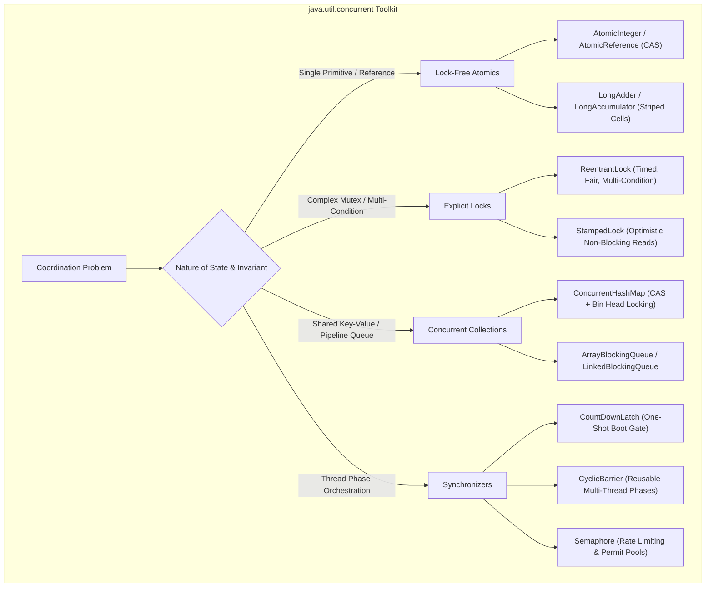
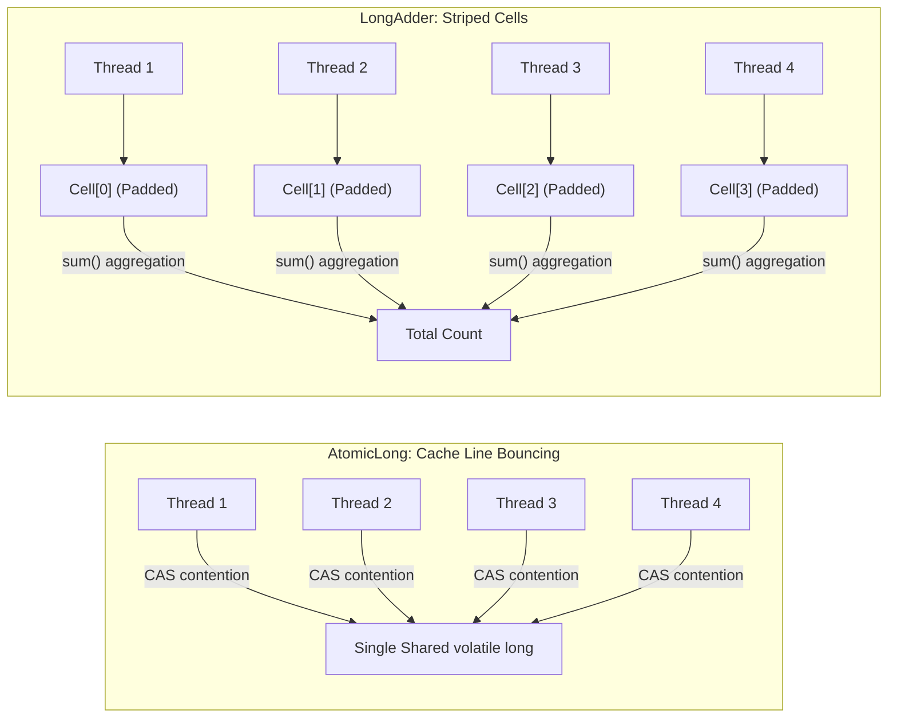
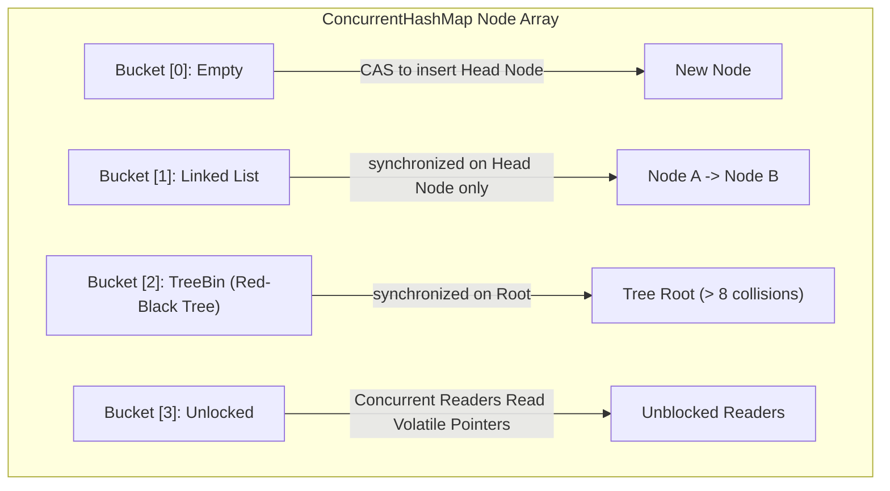

Before Java 5, writing concurrent Java felt like playing Russian roulette with your server's memory. Developers were forced to coordinate threads using raw `synchronized` blocks, fragile `wait()`/`notify()` handoffs, and error-prone homemade polling loops. If two threads needed to acquire locks in a flexible order, or if you needed a timeout on a lock acquisition to prevent a permanent system freeze, you were completely out of luck.

In 2004, Java 5 introduced JSR-166, authored predominantly by concurrency pioneer Doug Lea. This brought the `java.util.concurrent` (often abbreviated `j.u.c`) package into the standard library. JSR-166 fundamentally transformed Java from a language that merely supported threads into an industrial-grade platform capable of running high-throughput financial exchanges, massive message brokers, and enterprise web servers handling millions of concurrent operations.

To write high-performance distributed systems today, you must look beneath the high-level syntax of `j.u.c` and understand how it coordinates with OS primitives, CPU caches, and hardware-level atomic instructions.



---

## Lock-Free Atomics and the Hardware CAS Primitive

Traditional locking is pessimistic: it assumes that another thread will constantly try to corrupt state, so it forces threads to acquire exclusive monitor locks. If a thread is suspended by the operating system while holding a lock, every other thread waiting for that lock is blocked and descheduled, inducing massive kernel context-switch overhead (often taking 1,000 to 5,000 CPU cycles per switch).

Lock-free programming in `java.util.concurrent.atomic` adopts an **optimistic** strategy using hardware-supported **Compare-And-Swap (CAS)** operations.

### How Hardware CAS Works

At the machine level, modern x86 processors provide the `CMPXCHG` instruction (often paired with the `LOCK` bus/cache prefix). Instead of asking the OS kernel to stop other threads, the CPU performs an atomic comparison and conditional write directly in the L1/L2 cache line:

1. **Read Current Value**: The thread reads value `V` from shared memory (e.g., `value = 42`).
2. **Compute New Value**: The thread calculates the updated value locally (e.g., `newValue = 43`).
3. **Hardware Verification & Swap**: The CPU executes an atomic primitive: "If the value in memory is still `42`, overwrite it with `43` and return `true`. If another core changed the memory to anything other than `42`, do not modify memory, and return `false`."

If the swap fails because another thread won the race, the losing thread does not block or sleep. It simply loops around, reads the fresh value, recalculates, and tries the CAS operation again.

```java
import java.lang.invoke.MethodHandles;
import java.lang.invoke.VarHandle;

public class SimulatedAtomicCounter {
    private volatile int value = 0;
    private static final VarHandle VALUE_HANDLE;

    static {
        try {
            VALUE_HANDLE = MethodHandles.lookup()
                .findVarHandle(SimulatedAtomicCounter.class, "value", int.class);
        } catch (ReflectiveOperationException e) {
            throw new ExceptionInInitializerError(e);
        }
    }

    public int incrementAndGet() {
        int current;
        int next;
        do {
            current = value;
            next = current + 1;
            // Atomic CAS in hardware: updates only if memory still holds 'current'
        } while (!VALUE_HANDLE.compareAndSet(this, current, next));
        
        return next;
    }

    public int get() {
        return value;
    }
}
```

### The ABA Problem and Versioned References

A subtle trap in lock-free algorithms is the **ABA Problem**:
1. Thread 1 reads a reference pointing to node `A`.
2. Thread 1 is preempted by the OS scheduler.
3. Thread 2 runs, modifies the pointer from `A` to `B`, and then modifies it back from `B` to `A` (perhaps recycling node `A` from an object pool).
4. Thread 1 wakes up and executes `compareAndSet(A, C)`.
5. The CPU observes that the pointer still equals `A` and happily swaps in `C`.

While the reference appeared unchanged to Thread 1, the internal state or data structure invariants were violated during the intermediate transition to `B`.

To eliminate this bug, Java provides `AtomicStampedReference`. It binds an integer "stamp" (version counter or transaction ID) to the object reference. Both the reference and the integer stamp must match simultaneously for the hardware CAS to succeed:

```java
import java.util.concurrent.atomic.AtomicStampedReference;

public class VersionedAccountState {
    private final String state;
    private final int version;

    public VersionedAccountState(String state, int version) {
        this.state = state;
        this.version = version;
    }

    public static void main(String[] args) {
        String initialRef = "INITIAL_STATE";
        int initialStamp = 1;
        
        AtomicStampedReference<String> versionedRef = 
            new AtomicStampedReference<>(initialRef, initialStamp);

        int[] holder = new int[1];
        String currentRef = versionedRef.get(holder);
        int currentStamp = holder[0];

        // Only updates if BOTH reference and stamp match
        boolean updated = versionedRef.compareAndSet(
            currentRef, 
            "UPDATED_STATE", 
            currentStamp, 
            currentStamp + 1
        );

        System.out.println("Update successful? " + updated + " (Stamp: " + versionedRef.getStamp() + ")");
    }
}
```

### Contention Storms: Why LongAdder Beats AtomicLong

Under mild contention, `AtomicLong` is blazingly fast. But under extreme write contention (such as 128 threads simultaneously incrementing a global request counter in an API gateway), `AtomicLong` becomes a massive bottleneck.

Every failed CAS loop forces threads to spin. Even worse, every successful write triggers CPU cache coherence protocols (such as MESI/MOESI), invalidating the L1 cache lines of every other core across the CPU interconnect bus. This phenomenon is known as **cache line bouncing**.

Java 8 introduced `LongAdder` to solve this exact problem:



Instead of forcing all threads to hammer a single memory location, `LongAdder` maintains a striped array of independent `Cell` objects:
- When contention is detected, threads are dynamically hashed to different `Cell` slots in an internal table.
- Each `Cell` is padded to 64 bytes using the `@jdk.internal.vm.annotation.Contended` annotation. This guarantees that adjacent cells never occupy the same hardware cache line, completely eradicating **false sharing**.
- When you need the final total, `adder.sum()` iterates through all cells and adds their values together.

> [!TIP]
> If multiple threads frequently update a counter but you only read it occasionally (e.g., metrics gathering, request counting, throughput stats), **always use `LongAdder` instead of `AtomicLong`**. Only use `AtomicLong` when you strictly require atomic read-and-modify sequences such as `compareAndSet()` or sequence number generators.

---

## Explicit Locks: ReentrantLock and StampedLock

While the `synchronized` keyword is simple and clean, it has strict operational limitations:
- **No Timed Lock Acquisition**: If a thread calls `synchronized`, it blocks indefinitely until the monitor is acquired. If the lock holder hangs or deadlocks, your thread is trapped forever.
- **No Interruptibility**: A thread blocked waiting to enter a `synchronized` block cannot be interrupted via `thread.interrupt()`.
- **Single Wait-Set**: Every intrinsic lock has exactly one wait-set (`wait()`, `notify()`). You cannot separate "queue empty" conditions from "queue full" conditions on the same object.

### ReentrantLock and Multiple Conditions

`ReentrantLock` implements the `Lock` interface, providing explicit acquire and release mechanics, timeouts, interruptibility, and fairness policies.

Here is an industrial-strength bounded buffer demonstrating how `ReentrantLock` uses two separate `Condition` instances (`notFull` and `notEmpty`) to wake up only the exact threads capable of making progress:

```java
import java.util.concurrent.locks.Condition;
import java.util.concurrent.locks.Lock;
import java.util.concurrent.locks.ReentrantLock;

public class HighThroughputBoundedQueue<T> {
    private final Object[] items;
    private int putIndex = 0;
    private int takeIndex = 0;
    private int count = 0;

    // Non-fair lock provides 10x higher throughput by allowing barging
    private final Lock lock = new ReentrantLock(false);
    private final Condition notFull = lock.newCondition();
    private final Condition notEmpty = lock.newCondition();

    @SuppressWarnings("unchecked")
    public HighThroughputBoundedQueue(int capacity) {
        if (capacity <= 0) throw new IllegalArgumentException("Capacity must be positive");
        this.items = new Object[capacity];
    }

    public void put(T x) throws InterruptedException {
        lock.lockInterruptibly(); // Allows the thread to wake up on shutdown
        try {
            while (count == items.length) {
                notFull.await(); // Releases lock and sleeps until a slot opens
            }
            items[putIndex] = x;
            if (++putIndex == items.length) putIndex = 0;
            count++;

            // Crucial: Only wakes up consumer threads waiting for items!
            notEmpty.signal();
        } finally {
            lock.unlock(); // MUST be in finally block to avoid permanent lock leaks
        }
    }

    @SuppressWarnings("unchecked")
    public T take() throws InterruptedException {
        lock.lockInterruptibly();
        try {
            while (count == 0) {
                notEmpty.await(); // Releases lock and sleeps until data arrives
            }
            T x = (T) items[takeIndex];
            items[takeIndex] = null; // Prevent memory leak / loitering
            if (++takeIndex == items.length) takeIndex = 0;
            count--;

            // Crucial: Only wakes up producer threads waiting for space!
            notFull.signal();
            return x;
        } finally {
            lock.unlock();
        }
    }
}
```

### Fairness: Fair vs Non-Fair Locks

When you construct `new ReentrantLock(true)`, the lock enforces strict FIFO arrival ordering. If Thread A requested the lock before Thread B, Thread A will always get it first.

While FIFO fairness sounds appealing, **fair locks in practice can reduce system throughput by an order of magnitude (often 10x to 20x slower)**. Why? Because when the active thread releases a fair lock, the next thread in line is usually sleeping in an OS queue. The CPU must wait for the kernel to wake up the sleeping thread before any work can proceed.

In contrast, a **non-fair lock** allows a currently running thread (which is already hot in CPU cache and actively executing) to "barge" in and acquire the lock immediately if it is available. The sleeping threads continue to wake up in queue order, but the CPU cores never sit idle waiting for thread state transitions.

### StampedLock: The High-Speed Read Machine

In read-heavy applications, `ReentrantReadWriteLock` was historically the default choice. However, it suffers from two major drawbacks:
1. **Writer Starvation**: If you have a constant stream of reader threads holding read locks, writer threads will starve and stall indefinitely.
2. **Synchronization Overhead**: Even acquiring a read lock requires an atomic update to the internal synchronization state, meaning readers still contend with each other on the CPU bus.

Java 8 introduced `StampedLock`, which supports **Optimistic Reading**. In an optimistic read, the thread does **not** acquire a lock at all. It simply receives a numeric validation "stamp":

```java
import java.util.concurrent.locks.StampedLock;

public class Point {
    private double x;
    private double y;
    private final StampedLock sl = new StampedLock();

    public void move(double deltaX, double deltaY) {
        // Exclusive write lock
        long stamp = sl.writeLock();
        try {
            x += deltaX;
            y += deltaY;
        } finally {
            sl.unlockWrite(stamp);
        }
    }

    public double distanceFromOrigin() {
        // Step 1: Attempt an optimistic read (Zero synchronization overhead!)
        long stamp = sl.tryOptimisticRead();
        double currentX = x;
        double currentY = y;

        // Step 2: Validate if a writer intervened while we read the coordinates
        if (!sl.validate(stamp)) {
            // Step 3: Writer intervened! Fall back to a standard pessimistic read lock
            stamp = sl.readLock();
            try {
                currentX = x;
                currentY = y;
            } finally {
                sl.unlockRead(stamp);
            }
        }

        return Math.sqrt(currentX * currentX + currentY * currentY);
    }
}
```

> [!WARNING]
> `StampedLock` is **not reentrant**! If a thread holding a write lock attempts to acquire the write lock again, it will immediately deadlock with itself. Furthermore, `StampedLock` does not support `Condition` objects.

---

## High-Performance Concurrent Collections

Standard collections wrapped with `Collections.synchronizedMap(map)` synchronize the entire collection behind a single coarse-grained mutex. If Thread 1 is reading from key "A", Thread 2 cannot even read from key "Z".

The collections in `java.util.concurrent` are engineered specifically to maximize concurrent read and write operations across multiple CPU cores.

### ConcurrentHashMap Internals (Java 8+)

In Java 7, `ConcurrentHashMap` used an array of 16 independent `Segment` locks (lock striping). In Java 8 and beyond, Doug Lea completely redesigned `ConcurrentHashMap` to use lock-free CAS operations and fine-grained node synchronization:



Here is how `ConcurrentHashMap` executes mutations:
1. **Empty Bucket Insertion**: When inserting into an empty bucket, it uses a single lock-free `compareAndSet` to place the initial node. Zero locks are acquired.
2. **Colliding Bucket Insertion**: If the bucket already contains items, it locks **only the head node** of that specific bucket using an intrinsic `synchronized` lock. All other buckets remain completely unlocked and open for concurrent reads and writes.
3. **TreeBin Conversion**: When the number of collisions in a bucket exceeds 8 (and the map array length is at least 64), the linked list converts into a balanced Red-Black Tree (`TreeBin`), guaranteeing `O(log N)` search time under worst-case hash clustering attacks.
4. **Volatile Memory Visibility**: Node values and `next` pointers are declared `volatile`. Reads (`get()`) never acquire locks, allowing hundreds of reader threads to traverse the map without stalling writers.

### The Null-Key Controversy in Concurrent Collections

Why does `HashMap` allow `null` keys and values, while `ConcurrentHashMap` throws `NullPointerException`?

Doug Lea intentionally barred nulls to eliminate concurrency ambiguity. In a single-threaded `HashMap`, if `map.get(key)` returns `null`, you can call `map.containsKey(key)` to verify whether the key was absent or mapped to a `null` value.

In a multithreaded system, this contract collapses. Between your call to `get(key)` and `containsKey(key)`, another thread could have inserted, removed, or updated that key. A `null` return value would leave your code in an indeterminate state that cannot be resolved safely without global locking.

### CopyOnWriteArrayList: The Read-Heavy Gold Standard

`CopyOnWriteArrayList` guarantees that an iterator will never throw a `ConcurrentModificationException` and never needs external synchronization during traversal:

```java
import java.util.List;
import java.util.concurrent.CopyOnWriteArrayList;

public class SecurityEventListenerRegistry {
    // 99.99% reads during request authentication, rare writes on service startup
    private final List<AuthenticationListener> listeners = new CopyOnWriteArrayList<>();

    public void register(AuthenticationListener listener) {
        listeners.add(listener); // Allocates a brand-new underlying array
    }

    public void notifyAllSuccess(String user) {
        // Iterator traverses a static snapshot; no lock held, completely thread-safe
        for (AuthenticationListener listener : listeners) {
            listener.onSuccess(user);
        }
    }
}

interface AuthenticationListener {
    void onSuccess(String user);
}
```

Every time `add()` or `remove()` is called, the entire backing array is cloned into a new array with the modification applied, and the internal volatile array reference is swapped.
- **Ideal Use Case**: Event listener lists, routing tables, security interceptors where reads occur millions of times per second and modifications occur rarely.
- **Antipattern**: High-frequency mutation queues or batch inserts. Cloning a 100,000-element array on every `add()` will cause catastrophic memory churn and trigger violent GC pauses.

---

## Thread Synchronizers: Orchestrating Fleets

Beyond locks and collections, `j.u.c` provides higher-level coordination primitives that allow groups of threads to synchronize their progress.

| Synchronizer | Reset Capability | Primary Use Case |
| :--- | :--- | :--- |
| **`CountDownLatch`** | **One-Shot** (Cannot be reset) | Waiting for initialization tasks, services, or batch workers to finish. |
| **`CyclicBarrier`** | **Reusable** (Resets automatically) | Multi-phase algorithms where all threads must reach a checkpoint before advancing. |
| **`Semaphore`** | **Dynamic Permits** (`acquire` / `release`) | Throttling access to scarce physical resources (DB connections, rate limits). |
| **`Phaser`** | **Flexible** (Dynamic registration) | Complex multi-phase workflows where thread counts vary between phases. |

### CountDownLatch: Service Bootstrapping

A `CountDownLatch` initializes with a fixed count `N`. Threads call `await()` to block until the count reaches zero. Worker threads perform their tasks and invoke `countDown()`.

```java
import java.util.concurrent.CountDownLatch;
import java.util.concurrent.TimeUnit;

public class MicroserviceBootstrapper {
    public static void main(String[] args) throws InterruptedException {
        int dependencyCount = 3;
        CountDownLatch servicesReadyLatch = new CountDownLatch(dependencyCount);

        // Spawn async service initializers
        new Thread(new DependencyInitTask("DatabasePool", servicesReadyLatch)).start();
        new Thread(new DependencyInitTask("KafkaConsumerGroup", servicesReadyLatch)).start();
        new Thread(new DependencyInitTask("RedisCacheWarmup", servicesReadyLatch)).start();

        System.out.println("Main Gateway: Waiting for dependencies to initialize...");
        
        // Wait with a safety timeout to prevent permanent hang
        boolean allReady = servicesReadyLatch.await(10, TimeUnit.SECONDS);

        if (allReady) {
            System.out.println("Main Gateway: All systems operational. Opening HTTP listener on port 8080.");
        } else {
            System.err.println("Main Gateway: Boot timeout! Terminating process.");
            System.exit(1);
        }
    }

    record DependencyInitTask(String name, CountDownLatch latch) implements Runnable {
        @Override
        public void run() {
            try {
                System.out.println("Starting " + name + " initialization...");
                Thread.sleep((long) (Math.random() * 2000)); // Simulate startup work
                System.out.println(name + " initialized successfully.");
            } catch (InterruptedException e) {
                Thread.currentThread().interrupt();
            } finally {
                latch.countDown(); // Must always execute in finally
            }
        }
    }
}
```

### CyclicBarrier: Phased Parallel Computation

Unlike a latch, a `CyclicBarrier` is reusable. When `N` threads call `barrier.await()`, they all suspend until the final thread arrives. The barrier then optionally runs a barrier action and trips open, releasing all threads to begin the next phase simultaneously.

```java
import java.util.concurrent.BrokenBarrierException;
import java.util.concurrent.CyclicBarrier;

public class ParallelDataPipeline {
    public static void main(String[] args) {
        int workers = 4;
        
        // Barrier action runs on the last thread that arrives at the barrier
        CyclicBarrier barrier = new CyclicBarrier(workers, () -> {
            System.out.println(">>> All workers reached checkpoint. Merging partial matrix solutions... <<<");
        });

        for (int i = 0; i < workers; i++) {
            final int workerId = i;
            new Thread(() -> {
                try {
                    // Phase 1
                    System.out.println("Worker " + workerId + " computing Phase 1...");
                    Thread.sleep((long) (Math.random() * 1000));
                    barrier.await(); // Wait for all workers to complete Phase 1

                    // Phase 2
                    System.out.println("Worker " + workerId + " computing Phase 2...");
                    Thread.sleep((long) (Math.random() * 1000));
                    barrier.await(); // Wait for all workers to complete Phase 2

                    System.out.println("Worker " + workerId + " done.");
                } catch (InterruptedException | BrokenBarrierException e) {
                    System.err.println("Worker " + workerId + " interrupted or barrier broken!");
                }
            }).start();
        }
    }
}
```

---

## Production Antipattern: The Atomicity Illusion

A widespread bug in production microservices is the **Atomicity Illusion**: assuming that combining two individually thread-safe calls produces a thread-safe composite operation.

```java
// BUGGY PRODUCTION CODE:
public class SessionCache {
    private final ConcurrentHashMap<String, UserSession> sessions = new ConcurrentHashMap<>();

    public UserSession getOrCreateSession(String userId) {
        // Individual call is thread-safe:
        if (!sessions.containsKey(userId)) {
            // RACE CONDITION WINDOW: Another thread can insert a session here!
            UserSession newSession = createExpensiveSession(userId);
            sessions.put(userId, newSession);
            return newSession;
        }
        return sessions.get(userId);
    }

    private UserSession createExpensiveSession(String id) {
        return new UserSession(id);
    }
}
```

Even though `containsKey()` and `put()` are individually synchronized, the time-of-check to time-of-use (TOCTOU) gap between them is not protected. Two threads handling simultaneous requests for the same user can both pass the `if (!sessions.containsKey(userId))` check, creating two duplicate sessions and overwriting each other.

### The Remedy: Atomic Composite Methods

Always use atomic composite methods like `computeIfAbsent()`:

```java
public class SecureSessionCache {
    private final ConcurrentHashMap<String, UserSession> sessions = new ConcurrentHashMap<>();

    public UserSession getOrCreateSession(String userId) {
        // Entire check-and-insert computation is atomic per bucket
        return sessions.computeIfAbsent(userId, this::createExpensiveSession);
    }

    private UserSession createExpensiveSession(String id) {
        return new UserSession(id);
    }
}
```

> [!CAUTION]
> The mapping function supplied to `computeIfAbsent()` should be short, fast, and must **never** attempt to update the same `ConcurrentHashMap` recursively. Doing so can cause a recursive update deadlock inside that hash bucket.

---

## Senior Engineer Interview Crucible

### Why does LongAdder outperform AtomicLong under heavy contention, and what is the trade-off?
Under high thread contention, `AtomicLong` causes CPU cache-line bouncing: every thread spins on a single volatile variable, saturating the cache coherency bus with invalidation signals. `LongAdder` distributes contention across an internal array of 64-byte padded `Cell` structures, where each thread updates its own cell without cache interference. 

The trade-off is twofold:
1. `LongAdder` consumes more memory due to cell array allocations and `@Contended` cache-line padding.
2. Obtaining the total count via `sum()` is not an atomic point-in-time snapshot if concurrent writes are ongoing. It should be used for statistics and metrics, not for exact business limits or sequence generation.

### How does StampedLock achieve optimistic reads without acquiring a lock, and why is it not reentrant?
`StampedLock` provides `tryOptimisticRead()`, which returns a numeric version stamp without executing any memory fence, write barrier, or CAS lock instruction. The reader reads the shared fields into local variables and then calls `validate(stamp)`. If no writer intervened, the stamp is valid, and the read is complete with zero synchronization overhead. If a write occurred, `validate()` returns `false`, signaling the reader to fall back to a pessimistic read lock (`readLock()`).

It is not reentrant because stamps represent exact point-in-time lock states. Allowing reentrancy would introduce ambiguity when releasing nested locks and would complicate lock upgrades and downgrades, leading to potential self-deadlocks.

### Why do ConcurrentHashMap and other concurrent collections forbid null keys and null values?
In single-threaded collections like `HashMap`, a `null` return from `get(key)` can be disambiguated by calling `containsKey(key)` to determine if the key was absent or mapped to `null`. In a multithreaded environment, state can change between the two method invocations, making disambiguation impossible without acquiring an exclusive lock across the entire map. To prevent subtle race conditions, Doug Lea banned `null` keys and values outright.

### What happens when a thread is interrupted while waiting at a CyclicBarrier?
When any waiting thread is interrupted or experiences a timeout at a `CyclicBarrier`, the barrier is considered **broken**. The barrier trips, its internal state transitions to broken, and all other threads currently waiting at the barrier are immediately awakened with a `BrokenBarrierException`. This design prevents thread leaks where a failure in one worker thread leaves all other workers hanging indefinitely at the checkpoint. To reuse a broken barrier, you must explicitly call `barrier.reset()`.
