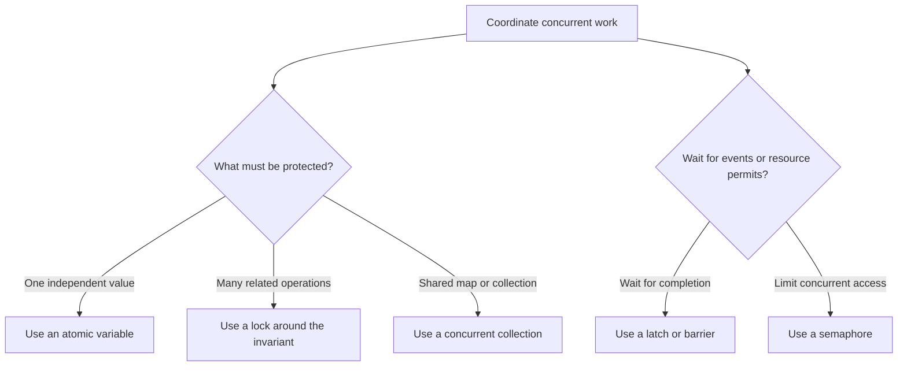

Intrinsic locks are not the only tools for coordinating threads. The `java.util.concurrent` package provides higher-level primitives for atomic updates, explicit lock policies, concurrent data structures, and coordination between tasks.

Choose a primitive based on the invariant and access pattern. Replacing every synchronized block with a concurrent collection or an atomic variable does not automatically make a design simpler or faster.

## Choosing a coordination tool



The primitive should match the logical unit of work. For example, an atomic increment protects a counter update, but it does not make “check inventory, then reserve inventory” atomic as a pair.

## Explicit locks

`Lock` implementations offer options that intrinsic monitors do not expose directly, including interruptible acquisition, timed attempts, and non-blocking `tryLock`. The extra flexibility also means the lock is not automatically released at the end of a block. Use `try`/`finally` so exceptions cannot leave it held:

```java
import java.util.concurrent.locks.Lock;
import java.util.concurrent.locks.ReentrantLock;

public class ExplicitLockCounter {
    private final Lock lock = new ReentrantLock();
    private int count;

    public void increment() {
        lock.lock();
        try {
            count++;
        } finally {
            lock.unlock();
        }
    }

    public int value() {
        lock.lock();
        try {
            return count;
        } finally {
            lock.unlock();
        }
    }
}
```

For code that should respond to interruption while waiting for a lock, `lockInterruptibly()` is an option; for a deadline, `tryLock(timeout, unit)` can fail instead of waiting indefinitely. Check interruption and timeout results as part of the method's contract. A lock's fairness and other policy details depend on the implementation and constructor options.

### Read-write locks

A `ReadWriteLock` provides a shared read lock and an exclusive write lock. Multiple readers can hold the read lock concurrently, while a writer requires exclusive access. This can suit data that is read frequently and updated infrequently, but its additional coordination has a cost; profile before choosing it over a simpler lock.

```java
import java.util.HashMap;
import java.util.Map;
import java.util.concurrent.locks.ReadWriteLock;
import java.util.concurrent.locks.ReentrantReadWriteLock;

public class LockedCatalog {
    private final ReadWriteLock lock = new ReentrantReadWriteLock();
    private final Map<String, String> entries = new HashMap<>();

    public String find(String key) {
        lock.readLock().lock();
        try {
            return entries.get(key);
        } finally {
            lock.readLock().unlock();
        }
    }

    public void put(String key, String value) {
        lock.writeLock().lock();
        try {
            entries.put(key, value);
        } finally {
            lock.writeLock().unlock();
        }
    }
}
```

The lock protects the backing `HashMap`; returning an immutable `String` avoids leaking mutable state after the read lock is released. If a method returns a mutable object, the caller would need its own safe-access contract.

## Atomic variables and compare-and-set

Atomic classes perform individual updates atomically. They are useful for independent counters, flags, and references when a lock around a larger invariant is unnecessary:

```java
import java.util.concurrent.atomic.AtomicInteger;

public class AtomicCounter {
    private final AtomicInteger count = new AtomicInteger();

    int nextSequence() {
        return count.incrementAndGet();
    }
}
```

Compare-and-set (CAS) conditionally replaces a value only if it still equals an expected value. This lets a thread detect that another update won the race and retry an operation. Higher-level methods such as `updateAndGet` encapsulate common CAS loops:

```java
import java.util.concurrent.atomic.AtomicInteger;

public class AtomicLimit {
    private final AtomicInteger used = new AtomicInteger();
    private final int limit = 100;

    boolean tryReserveOne() {
        return used.updateAndGet(current ->
                current < limit ? current + 1 : current) > 0;
    }
}
```

That example has a logical flaw: when the limit is already reached, it returns `true` if `used` is already positive. An atomic operation does not guarantee that the chosen return value correctly represents the business rule. Use a CAS loop when the result depends on whether this call performed the transition:

```java
import java.util.concurrent.atomic.AtomicInteger;

public class CorrectAtomicLimit {
    private final AtomicInteger used = new AtomicInteger();
    private final int limit = 100;

    boolean tryReserveOne() {
        while (true) {
            int current = used.get();
            if (current >= limit) {
                return false;
            }
            if (used.compareAndSet(current, current + 1)) {
                return true;
            }
        }
    }
}
```

CAS can fail when another thread changes the value between `get` and `compareAndSet`, so the loop re-reads current state. Keep update functions passed to atomic update methods free of side effects: contention may cause the function to be evaluated again. CAS also has an **ABA** edge case: a value can change from A to B and back to A, making a comparison see A without revealing the intermediate change. Versioned references such as `AtomicStampedReference` can help when that history matters.

Atomic classes do not automatically make multi-field invariants atomic. When several updates must succeed or fail together, use a lock or redesign the state as one immutable value updated atomically.

## Concurrent collections

Concurrent collections provide thread-safe operations without requiring callers to synchronize the whole collection around each operation:

- `ConcurrentHashMap` supports concurrent retrievals and updates. It does not allow null keys or values. Iterators are weakly consistent rather than snapshots, so they can reflect some concurrent updates without throwing `ConcurrentModificationException`.
- `CopyOnWriteArrayList` gives iterators a snapshot of the array at iterator creation. It is useful when traversal is frequent and mutation is rare, because each mutation copies the backing array.
- Blocking queues combine a collection with producer-consumer coordination; they are covered alongside executors and task processing in later topics.

For a concurrent frequency map, `ConcurrentHashMap` can coordinate creation of a counter for each key, while `LongAdder` handles contended increments:

```java
import java.util.concurrent.ConcurrentHashMap;
import java.util.concurrent.atomic.LongAdder;

public class WordFrequency {
    private final ConcurrentHashMap<String, LongAdder> counts =
            new ConcurrentHashMap<>();

    void record(String word) {
        counts.computeIfAbsent(word, ignored -> new LongAdder())
                .increment();
    }

    long count(String word) {
        LongAdder adder = counts.get(word);
        return adder == null ? 0L : adder.sum();
    }
}
```

`LongAdder.sum()` is useful for statistics but is not an atomic snapshot while updates continue. Do not use it to enforce an exact limit. `ConcurrentHashMap` bulk results and aggregate status can likewise reflect transient state during concurrent updates; use them for suitable monitoring or aggregation, not as a substitute for one atomic transaction across the entire map.

## Synchronizers

Synchronizers coordinate phases or access to limited resources:

- `CountDownLatch` lets threads wait until a count reaches zero. It is one-shot and cannot be reset.
- `CyclicBarrier` lets a fixed group of threads wait for one another at a shared phase boundary. It can be reused after the group passes the barrier.
- `Semaphore` manages a number of permits. It can limit concurrent access to a resource, including resources that allow more than one caller at a time.

A completion latch can make the relationship between worker completion and a coordinating thread explicit:

```java
import java.util.concurrent.CountDownLatch;

public class CompletionLatch {
    private static void processPart(int part) {
        System.out.println("Processed part " + part);
    }

    public static void main(String[] args) throws InterruptedException {
        int parts = 3;
        CountDownLatch finished = new CountDownLatch(parts);

        for (int part = 0; part < parts; part++) {
            int currentPart = part;
            new Thread(() -> {
                try {
                    processPart(currentPart);
                } finally {
                    finished.countDown();
                }
            }).start();
        }

        finished.await();
        System.out.println("All parts finished");
    }
}
```

The `finally` block ensures each worker decrements the latch even if its processing exits exceptionally. In production, also define how worker failures are reported to the coordinating thread; a latch communicates completion, not a result or exception.

## Practical rules

- Use atomics for independent state transitions, not as a blanket replacement for locks.
- Use explicit locks when their timed, interruptible, or multi-condition behavior is needed, and always unlock in `finally`.
- Consider a read-write lock only when the workload and measurements justify it.
- Choose concurrent collections based on iteration and update semantics, not just their names.
- Use latches for one-shot completion, barriers for repeated group phases, and semaphores for permit limits.
- Bound retries, buffers, and contention-sensitive work; concurrency primitives do not remove resource limits.

## Further reading

- [Java 21 `Lock`](https://docs.oracle.com/en/java/javase/21/docs/api/java.base/java/util/concurrent/locks/Lock.html)
- [Java 21 `ReadWriteLock`](https://docs.oracle.com/en/java/javase/21/docs/api/java.base/java/util/concurrent/locks/ReadWriteLock.html)
- [Java 21 `AtomicInteger`](https://docs.oracle.com/en/java/javase/21/docs/api/java.base/java/util/concurrent/atomic/AtomicInteger.html)
- [Java 21 `ConcurrentHashMap`](https://docs.oracle.com/en/java/javase/21/docs/api/java.base/java/util/concurrent/ConcurrentHashMap.html)
- [Java 21 `CopyOnWriteArrayList`](https://docs.oracle.com/en/java/javase/21/docs/api/java.base/java/util/concurrent/CopyOnWriteArrayList.html)
- [Java 21 `CountDownLatch`](https://docs.oracle.com/en/java/javase/21/docs/api/java.base/java/util/concurrent/CountDownLatch.html)
- [Java 21 `CyclicBarrier`](https://docs.oracle.com/en/java/javase/21/docs/api/java.base/java/util/concurrent/CyclicBarrier.html)
- [Java 21 `Semaphore`](https://docs.oracle.com/en/java/javase/21/docs/api/java.base/java/util/concurrent/Semaphore.html)
- [Java 21 `LongAdder`](https://docs.oracle.com/en/java/javase/21/docs/api/java.base/java/util/concurrent/atomic/LongAdder.html)
