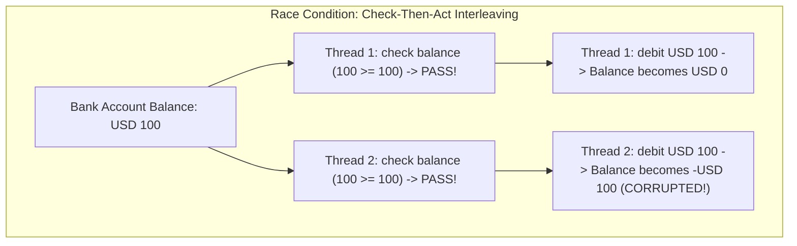
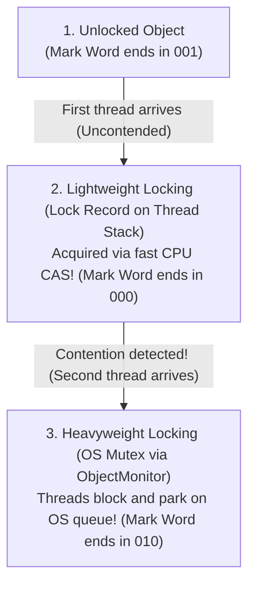
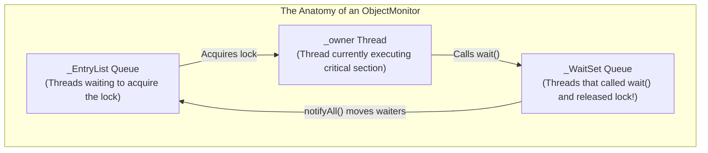
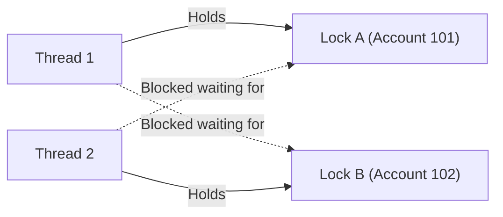

When multiple threads execute concurrently, the primary hazard to your application is **Data Incoherence**: two or more threads accessing mutable state simultaneously, leaving shared invariants corrupted.

To prevent this, Java provides **Mutual Exclusion (Mutex)** through the **`synchronized`** keyword and intrinsic object monitors.

However, treating `synchronized` as a magic spell to sprinkle over methods is a recipe for catastrophic performance bottlenecks, thread contention pauses, and fatal **Deadlocks**.

To engineer high-concurrency systems, you must understand what happens inside the JVM when a thread locks an object: **how the Mark Word in the Object Header inflates from lightweight CAS spins to heavyweight OS mutexes**, **why `wait()` releases locks while `sleep()` does not**, and **how to break Coffman's deadlock conditions**.

---

## What Does "Thread Safety" Actually Mean?

A class or method is not "thread-safe" simply because it has synchronized keywords.

According to Brian Goetz in *Java Concurrency in Practice*:
> *"A class is thread-safe if it behaves correctly when accessed from multiple threads, regardless of the scheduling or interleaving of the execution of those threads by the runtime environment, and with no additional synchronization or other coordination on the part of the calling code."*

### Critical Sections and Invariants
An **Invariant** is a condition that must always remain true for your domain model to be valid. For example:
- *"A bank account balance can never drop below zero."*
- *"The sum of accounts A and B must remain constant during a transfer."*

A **Critical Section** is the block of code that inspects and mutates this invariant. If two threads interleave execution inside a critical section, a **Race Condition** occurs.



To protect the invariant, the check and the mutation must be executed as an **indivisible atomic unit** using a mutual exclusion lock.

---

## How `synchronized` Works at the Bytecode Level

Every single Java object on the Heap can act as an intrinsic lock (a **Monitor**). 

Java supports two syntactic forms of synchronization, and `javac` compiles them into completely different bytecode structures:

### Synchronized Statements (Blocks)
When you synchronize on an explicit object reference:

```java
public void process(Object lock) {
    synchronized (lock) {
        doCriticalWork();
    }
}
```

The compiler emits explicit **`monitorenter`** and **`monitorexit`** opcodes:

```text
 0: aload_1         // Load lock reference onto stack
 1: dup
 2: astore_2
 3: monitorenter    // ACQUIRE MONITOR LOCK
 4: aload_0
 5: invokevirtual   // Method doCriticalWork()
 8: aload_2
 9: monitorexit     // RELEASE MONITOR LOCK (Normal path)
10: goto          18
13: astore_3        // Exception Handler Table catches Throwable!
14: aload_2
15: monitorexit     // RELEASE MONITOR LOCK (Exceptional path!)
16: aload_3
17: athrow
18: return
```

> [!IMPORTANT]
> Notice lines 13-17 in the bytecode! The compiler generates a synthetic exception handler table that wraps your entire critical section. This **guarantees that `monitorexit` is executed even if a RuntimeException or Error is thrown**, preventing permanent lock leaks!

### Synchronized Methods
When you mark a method `public synchronized void doWork()`:
- The compiler does **NOT** emit `monitorenter` or `monitorexit` instructions!
- Instead, it sets the **`ACC_SYNCHRONIZED`** flag in the method's access flags table.
- When the JVM invokes the method, it inspects this flag. If set, the calling thread automatically acquires the object monitor (`this` for instance methods, `MyClass.class` for static methods) before executing the first instruction, and automatically releases it upon method return.

---

## Lock Inflation: How HotSpot Optimizes Monitors

Historically, Java 1.0 acquired a heavy native operating system kernel lock (`pthread_mutex` on Linux) on every synchronized call. This required crossing user-to-kernel space boundaries, costing hundreds of nanoseconds.

Modern HotSpot JVMs optimize monitors by dynamically **inflating locks** through the **Mark Word** in the 64-bit Object Header:



### Lightweight Locking (Zero Kernel Overhead)
When a thread attempts to acquire an uncontended lock:
1. The JVM pushes a **Lock Record** onto the current thread's execution stack.
2. It executes a single CPU atomic **Compare-And-Swap (CAS)** instruction to swap the object's Mark Word with a pointer to that thread's stack Lock Record.
3. If the CAS succeeds, the lock is held! **Zero kernel context-switching occurs.** The operation completes in 2 to 5 nanoseconds.

### Heavyweight Locking (ObjectMonitor Inflation)
If a second thread attempts to acquire the lock while the first thread is still holding it:
- The lightweight CAS fails.
- The JVM initiates **Lock Inflation**: it allocates an internal C++ **`ObjectMonitor`** structure in native memory.
- The Object's Mark Word is updated to point directly to this native `ObjectMonitor`.
- Competing threads are suspended (parked) using OS kernel mutex primitives, waiting on the monitor's `_EntryList` queue.

### Compiler Optimizations: Lock Coarsening & Lock Elimination
The JIT compiler analyzes lock behavior using Escape Analysis:
- **Lock Elimination:** If the JIT proves an object never escapes the declaring method (e.g. `synchronized (new Object())`), it **completely removes the lock opcodes** from compiled machine code!
- **Lock Coarsening:** If a loop repeatedly acquires and releases the same lock (e.g. `for (...) { synchronized(lock) { ... } }`), the JIT expands the lock boundary outside the loop, acquiring it once to eliminate synchronization churn.

---

## Reentrancy: Why Java Locks Don't Deadlock Themselves

Java intrinsic locks are **Reentrant**.

If a thread already holds a lock on an object, it can acquire the same lock again without blocking itself:

```java
public class ReentrantDemo {
    public synchronized void outer() {
        // Thread acquires lock on 'this' (recursions = 1)
        inner();
    }

    public synchronized void inner() {
        // Thread already owns 'this' lock! Reentrancy counter increments: recursions = 2
        System.out.println("Executing inner method safely!");
    }
}
```

### How Reentrancy Works Under the Hood
Inside the native `ObjectMonitor`, HotSpot tracks two critical fields:
1. `_owner`: A pointer to the thread currently holding the monitor.
2. `_recursions`: An integer counter.

When a thread enters a synchronized block:
- If `_owner == currentThread`, the JVM simply increments `_recursions++`.
- Upon `monitorexit`, it decrements `_recursions--`.
- The lock is released to other threads **only when `_recursions` reaches zero**!

Without reentrancy, subclassing would be impossible: a subclass overriding a synchronized method and calling `super.method()` would instantly deadlock itself!

---

## Coordination: `wait()`, `notify()`, and `notifyAll()`

Synchronization provides mutual exclusion, but threads frequently need to coordinate: *"Thread B must pause until Thread A produces a message."*

This is accomplished via `wait()` and `notify()`.



### The Three Golden Rules of Condition Waiting

#### Always Wait Inside a while Loop, Never an if Statement

```java
// ❌ DANGEROUS BUG: Using 'if'
synchronized (lock) {
    if (!condition) {
        lock.wait(); // Vulnerable to spurious wakeups and race conditions!
    }
    consumeData();
}

// ✅ THREAD-SAFE: Always loop until condition is verified!
synchronized (lock) {
    while (!condition) {
        lock.wait();
    }
    consumeData();
}
```

Why is the `while` loop mandatory?
- **Spurious Wakeups:** The operating system and JVM specification permit threads to wake up from `wait()` without any `notify()` call having been issued!
- **State Theft:** If Thread A calls `notifyAll()`, waking up Thread B and Thread C, Thread B might win the lock first and consume the data. When Thread C finally acquires the lock, the condition is false again! The `while` loop forces Thread C to re-verify the condition and go back to sleep.

#### wait() Releases the Lock; sleep() Does Not
- **`Thread.sleep(ms)`**: Puts the calling thread to sleep, but **maintains ownership of all acquired locks**. Other threads remain blocked!
- **`object.wait()`**: Atomically releases the monitor lock on `object` and suspends the thread, allowing other threads to enter the synchronized critical section!

#### Prefer notifyAll() Over notify()
- `notify()` wakes up **one arbitrary thread** from the `_WaitSet`. If that thread cannot proceed because its specific condition isn't met, it goes back to sleep, and the notification is lost forever!
- `notifyAll()` wakes up **all threads** in the `_WaitSet`, ensuring any thread whose condition has been satisfied has an opportunity to execute.

---

## Deadlocks: The Coffman Conditions and Prevention

A **Deadlock** occurs when two or more threads are permanently blocked, each holding a lock that the other needs:



```java
// ❌ DEADLOCK TRAP: Inconsistent Lock Ordering
public void transferMoney(Account from, Account to, double amount) {
    synchronized (from) {
        synchronized (to) {
            from.debit(amount);
            to.credit(amount);
        }
    }
}

// What happens in production:
// Thread 1: transferMoney(accA, accB, 50) -> Locks accA, waits for accB
// Thread 2: transferMoney(accB, accA, 25) -> Locks accB, waits for accA
// DEADLOCK! Server threads freeze forever!
```

### The 4 Coffman Conditions for Deadlock
For a deadlock to occur, all four conditions must be present simultaneously:
1. **Mutual Exclusion:** Resources cannot be shared; only one thread holds a lock at a time.
2. **Hold and Wait:** A thread holding at least one resource is waiting to acquire additional resources held by other threads.
3. **No Preemption:** Resources cannot be forcibly confiscated from a thread holding them.
4. **Circular Wait:** A closed chain of threads exists, each waiting for a resource held by the next thread.

### The Cure: Strict Global Lock Ordering
You cannot eliminate Mutual Exclusion, but you can **shatter the Circular Wait condition** by enforcing a strict global lock hierarchy:

```java
// ✅ DEADLOCK-PROOF: Global Lock Ordering via Identity HashCode
public void safeTransfer(Account from, Account to, double amount) {
    int fromHash = System.identityHashCode(from);
    int toHash = System.identityHashCode(to);

    Account firstLock = fromHash < toHash ? from : to;
    Account secondLock = fromHash < toHash ? to : from;

    // Both threads are forced to acquire locks in the exact same physical order!
    synchronized (firstLock) {
        synchronized (secondLock) {
            from.debit(amount);
            to.credit(amount);
        }
    }
}
```

---

## Summary & Mental Model Checkpoint

1. **Thread Safety**: Guarantees invariant correctness under arbitrary thread scheduling without external caller synchronization.
2. **`monitorenter` Bytecode**: Synchronized blocks emit `monitorenter` and `monitorexit` opcodes with an automatic compiler exception table to prevent lock leaks.
3. **Lock Inflation**: Uncontended locks use lightweight stack CAS records; contested locks inflate to heavyweight OS `ObjectMonitor` mutexes.
4. **Reentrancy Counter**: Intrinsic locks allow recursive acquisitions by the owning thread via the `_recursions` counter.
5. **Always `while (condition)` for `wait()`**: Defends against spurious wakeups and state theft by competitor threads.
6. **`wait()` vs `sleep()`**: `wait()` releases the monitor lock; `sleep()` retains all held locks.
7. **Deadlock Elimination**: Break the Circular Wait condition by enforcing strict global lock ordering using tie-breakers like `System.identityHashCode()`.

---

## 🎯 Senior Engineer Interview Questions

### What happens inside the JVM Object Header Mark Word when a lock progresses from unlocked to lightweight locking, and finally inflates to heavyweight locking?
> **Answer:** In HotSpot 64-bit architectures, the Object Header contains a 64-bit Mark Word whose lowest bits represent the lock state. When an object is **unlocked**, the lowest 3 bits are `001`. When Thread A attempts to synchronize on this uncontended object, the JVM uses **Lightweight Locking**: it pushes a `BasicObjectLock` record onto Thread A's execution stack and executes an atomic CPU Compare-And-Swap (CAS) to update the object's Mark Word to point directly to Thread A's stack address, changing the tag bits to `000`. If Thread B arrives while Thread A still holds the lock, Thread B's CAS fails. HotSpot detects contention and triggers **Lock Inflation**: it allocates a native C++ `ObjectMonitor` structure in C-heap memory, sets its `_owner` to Thread A, links Thread B to the `_EntryList` wait queue, updates the object's Mark Word to point to the `ObjectMonitor`, and sets the state bits to `010` (**Heavyweight Lock**). Thread B is then suspended using operating system kernel primitives (`pthread_mutex`/`park`), incurring context-switching overhead.

### Why must `Object.wait()` always be invoked inside a `while` loop rather than an `if` block, and what causes a thread to resume execution when no `notify()` was called?
> **Answer:** Invoking `wait()` inside an `if` block is a severe concurrency defect because of two distinct realities: (1) **Spurious Wakeups:** Under both POSIX threads and the JVM specification, a waiting thread can wake up from the wait set without receiving any explicit `notify()` or `notifyAll()` signal due to OS kernel interrupts or signal deliveries. (2) **State Invalidation (State Theft):** Even when awakened by an intentional `notifyAll()` signal, the awakened thread does not instantly acquire the lock; it transitions to the monitor's entry queue to compete with other threads. By the time the thread finally reacquires the lock, a competitor thread may have acquired the lock first and mutated the shared state back to an invalid condition. Evaluating `wait()` inside a `while (!condition)` loop guarantees that upon awakening, the thread is forced to re-evaluate the invariant predicate before executing downstream logic, returning to the wait state if the condition is not met.

### What is the architectural difference between a synchronized block and a synchronized method at the compiled bytecode level?
> **Answer:** A `synchronized` block explicitly targets an object reference and compiles into explicit **`monitorenter`** and **`monitorexit`** bytecode opcodes. To guarantee that the acquired monitor is released under all circumstances, `javac` automatically synthesizes an internal exception handler table in the class file that catches `any` `Throwable`, invokes `monitorexit`, and re-throws the exception, preventing lock abandonment. In contrast, a `synchronized` method emits neither `monitorenter` nor `monitorexit` instructions. Instead, the compiler tags the method descriptor in the constant pool with the **`ACC_SYNCHRONIZED`** access flag. When the JVM's execution engine invokes the method, it inspects this flag: if present, the runtime automatically acquires the monitor (`this` for instance methods, or the `Class<?>` mirror for static methods) prior to entering the frame, and automatically releases it when the method frame pops via return or an unhandled exception.

### How do you diagnose and identify a thread deadlock in a production Java application without attaching an interactive debugger?
> **Answer:** In production environments where attaching an interactive debugger would freeze live traffic, thread deadlocks can be identified non-invasively through several JVM diagnostic tools: (1) **`jcmd <pid> Thread.print`** or **`jstack <pid>`**: Generates a complete thread dump of all active threads. HotSpot includes an internal deadlock detection algorithm that scans object monitors and `Lock` synchronizers. If a deadlock exists, the bottom of the thread dump outputs a dedicated section explicitly titled `Found one Java-level deadlock:`, detailing the exact thread names, their stack traces, and the hexadecimal memory addresses of the conflicting locks. (2) **Java Flight Recorder (JFR) & JDK Mission Control**: Emits `jdk.JavaMonitorBlocked` and lock contention events, visualizing lock wait relationships without runtime overhead. (3) **Programmatically via JMX**: Invoking `ManagementFactory.getThreadMXBean().findDeadlockedThreads()` periodically inside a health-check probe returns an array of deadlocked thread IDs for automated alerting.