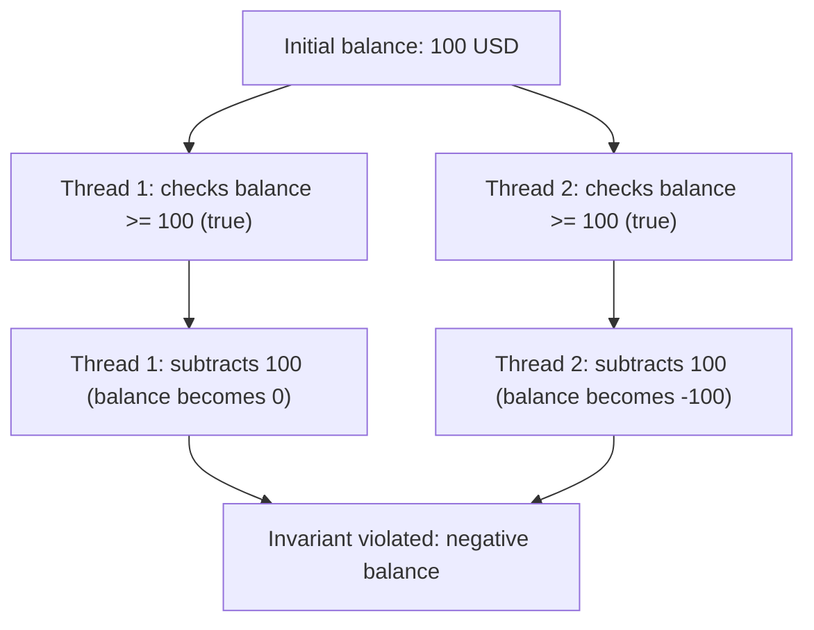
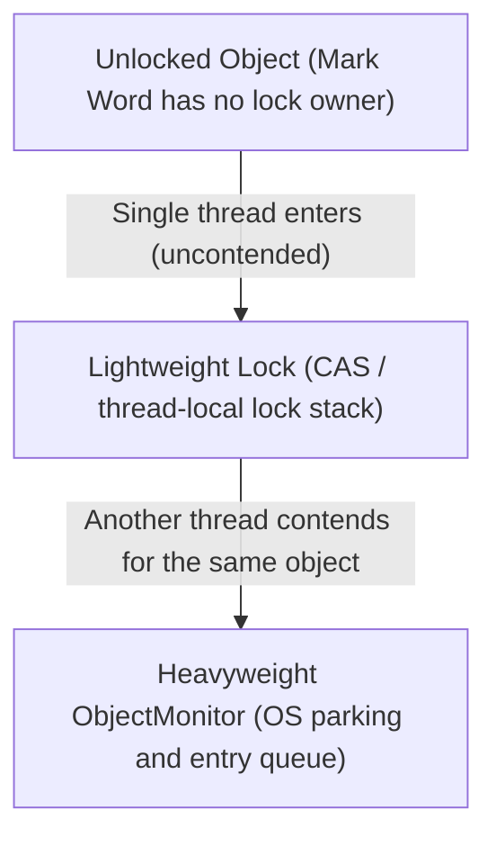
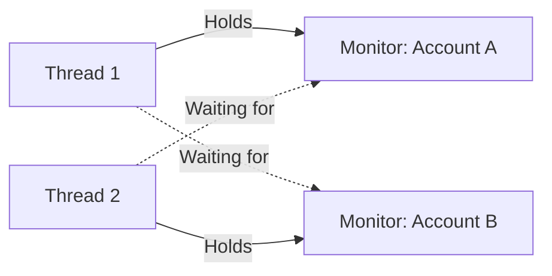
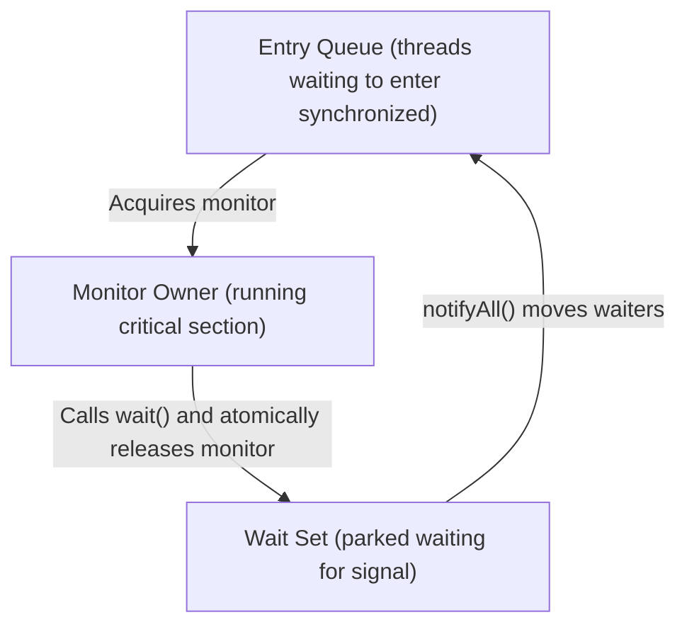

When multiple threads read and write the same mutable object without coordination, the program's result depends on how the OS scheduler happens to interleave their instructions. Code that passes every single-threaded unit test can silently drop updates, violate business rules, or hang under real load.

Java's built-in tool for controlling concurrent access to shared state is the `synchronized` keyword, backed by intrinsic object monitors and the `wait()`/`notifyAll()` signaling methods on `Object`. Used carefully, intrinsic locks keep shared invariants intact. Used carelessly, they introduce lock contention, deadlocks, livelocks, or thread starvation.

---

## Race Conditions and Critical Sections

In *Java Concurrency in Practice*, Brian Goetz defines thread safety directly: a class is thread-safe if it behaves correctly when accessed from multiple threads, regardless of how the runtime schedules or interleaves those threads, and without requiring callers to add extra synchronization.

Correctness is defined by **invariants**, the rules that must hold true for your data to remain valid. For a bank account, two common invariants are:

- A checking account balance must never drop below zero.
- During a transfer between Account A and Account B, the combined sum of both accounts must remain unchanged.

A **critical section** is any block of code that reads or updates shared state governed by an invariant. When two threads enter a critical section at the same time and interleave their steps, a **race condition** occurs.

The most common form is **check-then-act**:

```java
public class UnsafeAccount {
    private long balanceCents;

    public UnsafeAccount(long initialCents) {
        this.balanceCents = initialCents;
    }

    public boolean withdraw(long amountCents) {
        if (balanceCents >= amountCents) {   // Check
            // Another thread can pass this same check before we subtract
            balanceCents -= amountCents;     // Act
            return true;
        }
        return false;
    }

    public long getBalanceCents() {
        return balanceCents;
    }
}
```



Both threads pass the `if` check while the balance is `100`, and both subtract `100`. To preserve the invariant, the check and the deduction must execute as a single atomic unit under mutual exclusion.

---

## Intrinsic Locks (`synchronized`)

Every Java object has an associated intrinsic lock (also called a **monitor**). Only one thread can hold a given monitor at a time. When another thread tries to enter a `synchronized` block or method guarded by that same monitor, it blocks until the owning thread releases it.

Importantly, `synchronized` provides **both** mutual exclusion and JMM memory visibility: releasing a monitor happens-before any subsequent acquisition of that same monitor, so every write made inside the critical section is visible to the next thread that acquires the lock.

### Synchronized Blocks vs. Synchronized Methods

You can apply `synchronized` to an entire method or to a narrower block on an explicit lock object:

```java
public class SafeAccount {
    private final Object lock = new Object();
    private long balanceCents;

    public SafeAccount(long initialCents) {
        this.balanceCents = initialCents;
    }

    public boolean withdraw(long amountCents) {
        synchronized (lock) {
            if (balanceCents >= amountCents) {
                balanceCents -= amountCents;
                return true;
            }
            return false;
        }
    }

    public long getBalanceCents() {
        synchronized (lock) {
            return balanceCents;
        }
    }
}
```

Notice that `getBalanceCents()` also synchronizes on `lock`. Skipping synchronization on getters is a frequent mistake: without it, a reader thread might observe a stale value or a partially updated multi-field invariant.

Prefer a `private final Object lock = new Object();` over synchronizing on `this` in public classes. When you synchronize on `this`, external callers can accidentally acquire the same monitor from outside your class, creating surprise lock contention or deadlocks. Never synchronize on `String` literals, boxed primitives (`Integer`, `Boolean`), or cached objects, because the JVM pools and shares those references across unrelated code.

### What `javac` Generates in Bytecode

Synchronized blocks and synchronized methods compile differently:

- A **`synchronized` block** compiles to explicit `monitorenter` and `monitorexit` bytecode instructions. `javac` also emits a synthetic exception table covering the block so that even if an exception or `Error` is thrown inside the critical section, `monitorexit` still runs before the frame unwinds. You cannot leak an intrinsic lock via an uncaught exception.

```text
 3: monitorenter    // Acquire monitor
 4: aload_0
 5: invokevirtual   // Run critical section
 8: aload_2
 9: monitorexit     // Release on normal return
10: goto          18
13: astore_3        // Exception handler catches Throwable
14: aload_2
15: monitorexit     // Release on exceptional exit
16: aload_3
17: athrow
```

- A **`synchronized` method** does not emit `monitorenter` or `monitorexit`. Instead, `javac` sets the `ACC_SYNCHRONIZED` flag in the method's metadata. When the JVM invokes the method, it acquires the monitor (`this` for instance methods, `ClassName.class` for static methods) automatically on entry and releases it on normal or exceptional exit.

### Reentrancy

Java's intrinsic locks are **reentrant**: a thread that already holds a monitor can re-enter any other `synchronized` block or method guarded by that same monitor without deadlocking itself.

```java
public class ReentrantAccount {
    private long balanceCents;

    public synchronized void applyFeeAndLog(long feeCents) {
        balanceCents -= feeCents;
        logBalance(); // Re-enters monitor on 'this' safely
    }

    public synchronized void logBalance() {
        System.out.println("Current balance (cents): " + balanceCents);
    }
}
```

Inside the JVM, each monitor tracks its owning thread and an acquisition count (recursion depth). Entering an already-owned monitor increments the counter; exiting decrements it. The lock is released to waiting threads only when the counter reaches zero. Without reentrancy, overriding a `synchronized` method and calling `super.method()` would deadlock immediately.

### How HotSpot Optimizes Intrinsic Locks

In early JVMs, entering a `synchronized` block always invoked an OS mutex, which made uncontended locking expensive. Modern HotSpot JVMs use several layers of optimization (note that these are HotSpot implementation details, not JLS requirements, and their internal bit layouts evolve across JDK releases):



- **Lightweight locking:** When a lock is uncontended, HotSpot acquires it in user space using an atomic Compare-And-Swap (CAS) on the object header's Mark Word (avoiding OS kernel calls). Note that older HotSpot documentation often describes "Biased Locking" as a tier before lightweight locking; HotSpot deprecated biased locking in Java 15 and disabled it by default because the safepoint cost of revoking biases outweighed its benefits on modern hardware.
- **Heavyweight inflation:** When two or more threads actually contend for the same monitor, HotSpot inflates the lock into a native `ObjectMonitor` structure with entry queues and parks blocked threads through the OS scheduler.
- **Lock elimination and coarsening:** Using escape analysis, the JIT compiler removes locks entirely if it can prove an object never escapes a single thread (such as a local `StringBuffer`). If a loop acquires and releases the exact same lock on every iteration, the JIT can also coarsen the lock by merging adjacent lock regions.

---

## Deadlocks, Livelocks, and Starvation

Mutual exclusion protects data integrity (safety), but locks introduce a second category of bugs called **liveness failures**, where threads stop making progress. The three main liveness failures are deadlocks, livelocks, and starvation.

### Deadlocks

A **deadlock** occurs when two or more threads are permanently blocked, each holding a lock that another thread in the cycle needs.

```java
// Deadlock risk: lock order depends on caller argument order
public static void unsafeTransfer(SafeAccount from, SafeAccount to, long amount) {
    synchronized (from) {
        synchronized (to) {
            if (from.withdraw(amount)) {
                to.deposit(amount);
            }
        }
    }
}
```

If Thread 1 calls `unsafeTransfer(accountA, accountB, 500)` at the same time Thread 2 calls `unsafeTransfer(accountB, accountA, 250)`, Thread 1 locks `accountA` and waits for `accountB`, while Thread 2 locks `accountB` and waits for `accountA`. Neither can ever proceed.



For a deadlock to occur, all four **Coffman conditions** must hold simultaneously:

1. **Mutual exclusion:** A resource can be held by only one thread at a time.
2. **Hold and wait:** A thread holds at least one lock while waiting to acquire another.
3. **No preemption:** Locks cannot be forcibly taken away from a thread; the thread must release them voluntarily.
4. **Circular wait:** A closed chain of threads exists where each thread waits for a lock held by the next thread in the chain.

The most reliable fix is to break **Circular Wait** by enforcing a strict global lock ordering. If your domain objects have a unique ID (such as a database primary key or account ID), always lock the lower ID first:

```java
public class BankAccount {
    private final long id;
    private long balanceCents;

    public BankAccount(long id, long initialCents) {
        this.id = id;
        this.balanceCents = initialCents;
    }

    public long getId() {
        return id;
    }

    public boolean withdraw(long amountCents) {
        if (balanceCents >= amountCents) {
            balanceCents -= amountCents;
            return true;
        }
        return false;
    }

    public void deposit(long amountCents) {
        balanceCents += amountCents;
    }

    public static void safeTransfer(BankAccount from, BankAccount to, long amount) {
        if (from.getId() == to.getId()) {
            return; // Self-transfer is a no-op
        }

        BankAccount first = from.getId() < to.getId() ? from : to;
        BankAccount second = from.getId() < to.getId() ? to : from;

        synchronized (first) {
            synchronized (second) {
                if (from.withdraw(amount)) {
                    to.deposit(amount);
                }
            }
        }
    }
}
```

If your objects do not have a natural unique ID, you can order them using `System.identityHashCode(obj)`, with one important caveat: two distinct objects can occasionally share the same identity hash code. When `fromHash == toHash`, acquire a single shared tie-breaker lock before acquiring both object locks so two threads cannot acquire them in opposite orders during a hash collision:

```java
private static final Object TIE_LOCK = new Object();

public static void safeTransferByHash(BankAccount from, BankAccount to, long amount) {
    int fromHash = System.identityHashCode(from);
    int toHash = System.identityHashCode(to);

    if (fromHash < toHash) {
        synchronized (from) {
            synchronized (to) {
                executeTransfer(from, to, amount);
            }
        }
    } else if (toHash < fromHash) {
        synchronized (to) {
            synchronized (from) {
                executeTransfer(from, to, amount);
            }
        }
    } else {
        // Rare hash collision: serialize acquisition with a tie-breaker lock
        synchronized (TIE_LOCK) {
            synchronized (from) {
                synchronized (to) {
                    executeTransfer(from, to, amount);
                }
            }
        }
    }
}
```

### Livelocks

A **livelock** is harder to spot in thread dumps than a deadlock because the threads are not blocked. They remain `RUNNABLE`, actively burning CPU cycles, yet they keep reacting to each other in lockstep and make zero forward progress.

Livelocks commonly happen when developers try to avoid deadlocks with overly polite retry loops, such as releasing a lock whenever a second lock cannot be acquired immediately:

```java
import java.util.concurrent.locks.Lock;
import java.util.concurrent.locks.ReentrantLock;

public class LivelockExample {
    private final Lock lockA = new ReentrantLock();
    private final Lock lockB = new ReentrantLock();

    // Risky: if Thread 1 acquires A and Thread 2 acquires B simultaneously,
    // both back off, release, and immediately collide again in lockstep.
    public void politeRetry(Lock first, Lock second, String worker) {
        while (true) {
            if (first.tryLock()) {
                try {
                    if (second.tryLock()) {
                        try {
                            System.out.println(worker + " completed work.");
                            return;
                        } finally {
                            second.unlock();
                        }
                    }
                } finally {
                    first.unlock(); // Politely release and immediately retry
                }
            }
            // No randomized delay here -> threads can repeat this cycle indefinitely
        }
    }
}
```

Think of two people meeting in a narrow hallway: both step left at the same time, then both step right at the same time, repeating endlessly.

**How to fix livelocks:** Break the symmetry. Either enforce a fixed global lock ordering (which avoids the retry loop altogether), or add **randomized exponential backoff** before retrying so one thread backs off longer and lets the other complete:

```java
import java.util.concurrent.ThreadLocalRandom;
import java.util.concurrent.TimeUnit;
import java.util.concurrent.locks.Lock;

public void retryWithJitter(Lock first, Lock second) throws InterruptedException {
    int backoffMillis = 1;
    while (true) {
        if (first.tryLock(50, TimeUnit.MILLISECONDS)) {
            try {
                if (second.tryLock(50, TimeUnit.MILLISECONDS)) {
                    try {
                        // Do critical work
                        return;
                    } finally {
                        second.unlock();
                    }
                }
            } finally {
                first.unlock();
            }
        }
        // Randomized backoff breaks lockstep contention
        long sleepMillis = ThreadLocalRandom.current().nextInt(1, backoffMillis + 1);
        Thread.sleep(sleepMillis);
        backoffMillis = Math.min(backoffMillis * 2, 100);
    }
}
```

### Starvation

**Starvation** occurs when a thread is ready to run and keeps waiting for a lock or CPU time, but other threads repeatedly jump ahead of it so it waits indefinitely (or for unacceptably long periods).

Common causes of starvation in Java applications include:

- **Unfair lock barging under heavy contention:** Both `synchronized` and default `new ReentrantLock(false)` are non-fair. When a thread releases a lock and immediately tries to reacquire it in a tight loop, it is already hot on the CPU and can barge ahead of threads that were parked in the wait queue.
- **Holding locks during slow operations:** If a thread performs network I/O, disk reads, or long computations inside a `synchronized` block, other threads waiting for the same monitor starve.
- **Thread priority abuse:** Setting `Thread.setPriority(Thread.MAX_PRIORITY)` on greedy threads can starve lower-priority threads on OS schedulers that honor Java thread priorities. In practice, leaving thread priorities at `Thread.NORM_PRIORITY` is almost always safer.

**The fairness trade-off:** You can reduce lock starvation by switching from `synchronized` to a fair `new ReentrantLock(true)`, which grants the lock in approximate FIFO arrival order. Keep the cost in mind: fair locks lower overall throughput under contention because the CPU must wake up the next parked thread in line rather than letting an already-running thread grab the lock immediately. In most codebases, keeping critical sections tiny and avoiding I/O under locks solves starvation without paying the throughput penalty of a fair lock.

---

## Thread Signaling with `wait()`, `notify()`, and `notifyAll()`

Locks keep threads from colliding, but threads also need to wait for a condition to become true: a consumer needs to wait until a queue has an item, and a producer needs to wait until a bounded queue has free space.

Busy-spinning in a loop (`while (queue.isEmpty()) {}`) wastes an entire CPU core. Instead, Java monitors provide `wait()`, `notify()`, and `notifyAll()` on `java.lang.Object`.



To call `wait()`, `notify()`, or `notifyAll()` on an object, the current thread **must already hold that object's monitor** inside a `synchronized` block; otherwise the JVM throws `IllegalMonitorStateException`.

Here is a complete bounded buffer using `wait()` and `notifyAll()`:

```java
import java.util.ArrayDeque;
import java.util.Queue;

public class BoundedMessageBuffer<T> {
    private final Queue<T> queue = new ArrayDeque<>();
    private final int capacity;

    public BoundedMessageBuffer(int capacity) {
        if (capacity <= 0) {
            throw new IllegalArgumentException("Capacity must be positive");
        }
        this.capacity = capacity;
    }

    public synchronized void put(T item) throws InterruptedException {
        while (queue.size() == capacity) {
            wait(); // Releases monitor on 'this' and suspends thread
        }
        queue.add(item);
        notifyAll(); // Wake waiting consumers (and any other waiters)
    }

    public synchronized T take() throws InterruptedException {
        while (queue.isEmpty()) {
            wait(); // Releases monitor on 'this' and suspends thread
        }
        T item = queue.remove();
        notifyAll(); // Wake waiting producers
        return item;
    }
}
```

Three rules prevent almost every `wait()`/`notify()` bug:

### Always Guard `wait()` with a `while` Loop, Never an `if`
Never write `if (queue.isEmpty()) { wait(); }`. Always re-check the condition in a `while` loop after `wait()` returns, for two reasons:

1. **Spurious wakeups:** Both the JVM specification and underlying OS threading APIs (such as POSIX `pthread_cond_wait`) allow a thread to wake up from `wait()` even when nobody called `notify()` or `notifyAll()`.
2. **Stolen conditions:** Suppose a producer adds one item and calls `notifyAll()`, waking Consumer A and Consumer B. Consumer A reacquires the monitor first and removes the item. When Consumer B later acquires the monitor, the queue is empty again. With a `while` loop, Consumer B sees `queue.isEmpty() == true` and cleanly goes back to waiting. With an `if`, it crashes or reads invalid state.

### `wait()` Releases the Monitor; `Thread.sleep()` Does Not
Calling `lock.wait()` atomically releases the monitor on `lock` and suspends the thread, allowing another thread to enter the `synchronized` block and change the condition. Calling `Thread.sleep(ms)` pauses the thread **while keeping every lock it currently holds**. Never call `Thread.sleep()` inside a `synchronized` block expecting another thread to enter and update shared state.

### Prefer `notifyAll()` Over `notify()`
`notify()` wakes a single arbitrary thread from the monitor's wait set. In `BoundedMessageBuffer` above, both producers (waiting for space) and consumers (waiting for items) share the same wait set on `this`. If a consumer removes an item and calls `notify()`, the JVM might wake *another consumer* instead of a waiting producer. That consumer sees the queue is still empty, goes back to sleep, and the signal is lost, leaving every thread stuck permanently.

Using `notifyAll()` wakes all waiting threads so every eligible thread gets a chance to re-check its `while` condition. You should only use `notify()` when every waiting thread is waiting for the exact same predicate and only one thread can benefit from a single notification. Better yet, in production Java code, prefer `java.util.concurrent.BlockingQueue` or `ReentrantLock` with separate `Condition` objects (`notEmpty` and `notFull`) rather than hand-rolling `wait()`/`notifyAll()`.

---

## Recap

- A **race condition** happens when multiple threads interleave inside a critical section and violate a shared invariant (such as check-then-act on an account balance).
- `synchronized` provides both mutual exclusion and JMM visibility. Synchronized blocks compile to `monitorenter`/`monitorexit` with an automatic exception table; synchronized methods use the `ACC_SYNCHRONIZED` flag.
- Intrinsic locks are **reentrant** and optimized by HotSpot with lightweight CAS locking before inflating to OS-backed `ObjectMonitor` structures under contention.
- **Deadlocks** block threads permanently in a circular wait; fix them with consistent global lock ordering. **Livelocks** keep threads runnable in lockstep retry loops; fix them with randomized backoff or fixed ordering. **Starvation** leaves threads waiting indefinitely; fix it by keeping critical sections short or using fair locks when needed.
- Always call `wait()` inside a `while (!condition)` loop, remember that `wait()` releases the lock while `sleep()` keeps it, and prefer `notifyAll()` (or higher-level `java.util.concurrent` classes) to avoid missed signals.

---

## Practical Questions

### Why is `synchronized` on a `private final Object lock` usually safer than `public synchronized` methods on `this`?
When you synchronize on `this`, the lock object is visible to any external caller that holds a reference to your instance. If calling code also wraps your object in `synchronized (account) { ... }`, it competes for the exact same monitor your internal methods use, which can cause unexpected contention or deadlocks across unrelated modules. A `private final Object lock = new Object()` encapsulates the lock completely inside the class.

### How do deadlocks, livelocks, and starvation differ in a thread dump?
In a **deadlock**, threads are parked in the `BLOCKED` (or `WAITING`) state in a closed cycle, and `jcmd <pid> Thread.print` or `jstack <pid>` explicitly prints a `Found one Java-level deadlock:` section listing the exact threads and monitors involved. In a **livelock**, the threads appear `RUNNABLE` and consume CPU while repeatedly looping through the same retry frames without completing work. In **starvation**, one or more threads stay `BLOCKED` or `WAITING` on the same monitor across repeated thread dumps while other threads keep making progress through that critical section.

### Why must `wait()` always sit inside a `while` loop instead of an `if` statement?
Two things can happen when `wait()` returns: a spurious wakeup from the OS/JVM without any `notify()` call, or another thread acquiring the lock first and consuming the state change before the awakened thread gets the monitor. Re-checking the condition in a `while` loop ensures the thread never proceeds unless the invariant is genuinely satisfied at the moment it holds the lock.

### What happens if you call `notify()` instead of `notifyAll()` in a bounded queue with both producers and consumers?
Because intrinsic monitors have only a single wait set, producers waiting for space and consumers waiting for items wait in the same queue. If a producer inserts an item and calls `notify()`, the JVM may wake another producer instead of a consumer. That producer sees the buffer is full and waits again, while waiting consumers never receive the wakeup, resulting in a missed signal and a stalled system.
