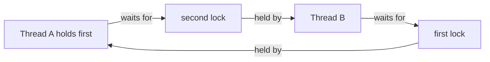

The Java Memory Model explains which cross-thread observations are legal; synchronization is how code establishes the ordering and mutual exclusion needed to protect shared state. A class is **thread-safe** when its contract remains correct under the concurrent access it allows.

The central design question is not “should this field be volatile?” but “which state must change together, and what prevents two threads from observing or creating an invalid state?”

## Race conditions and critical sections

A **race condition** is a correctness failure caused by the outcome depending on thread interleaving. When two threads perform `count++`, each increment is a read-modify-write sequence; the updates can overlap and one can be lost. A **critical section** is the part of an operation that must be protected so the invariant remains true.

Protect the state transition, not just one field read. If a balance check and debit must be atomic as a unit, locking only the debit does not protect the invariant.

## Intrinsic locks with `synchronized`

Every object has an associated monitor. A `synchronized` statement acquires that monitor before entering its body and releases it when the body completes, including when it exits by throwing an exception. Only one thread at a time can own a given monitor, and monitor ownership is reentrant for the owning thread.

```java
public class SafeCounter {
    private final Object lock = new Object();
    private long value;

    public void increment() {
        synchronized (lock) {
            value++;
        }
    }

    public long value() {
        synchronized (lock) {
            return value;
        }
    }
}
```

Both access paths use the same private lock, so the increment is indivisible relative to the getter, and unlocking the monitor happens-before a later lock of the same monitor. Keeping the lock private avoids making the synchronization policy depend on callers that could synchronize on the counter object themselves.

An instance `synchronized` method locks `this`; a `static synchronized` method locks the `Class` object for the declaring class. These locks are different. Public synchronized methods can expose an object's lock to external code and create unexpected contention or lock-order dependencies, so a private lock is often easier to reason about.

Use the smallest lock scope that still protects the whole invariant. Avoid holding a monitor while doing slow I/O, invoking unknown callbacks, or calling other components that may acquire unrelated locks.

## Waiting for a condition

`wait`, `notify`, and `notifyAll` operate on an object's monitor and wait set. A thread must own that monitor before calling one of them. `wait()` adds the thread to the object's wait set and releases its monitor ownership while waiting; before it returns, the thread reacquires the monitor. A notification does not transfer the lock directly to the waiting thread.

Always test the condition in a `while` loop under the same lock:

```java
public class WaitForReady {
    static final class Gate {
        private boolean ready;

        synchronized void awaitReady() throws InterruptedException {
            while (!ready) {
                wait();
            }
        }

        synchronized void open() {
            ready = true;
            notifyAll();
        }
    }

    public static void main(String[] args) throws InterruptedException {
        Gate gate = new Gate();
        Thread worker = new Thread(() -> {
            try {
                gate.awaitReady();
                System.out.println("Proceed");
            } catch (InterruptedException interrupted) {
                Thread.currentThread().interrupt();
            }
        });

        worker.start();
        gate.open();
        worker.join();
    }
}
```

The condition is the state (`ready`), not the notification. A notification can happen before a thread starts waiting, so code that waits for “a notification” without checking state can wait forever. The loop is also required because the JLS permits spurious wake-ups and because another thread may acquire the monitor first and change the condition before the awakened thread does.

`notify()` wakes one arbitrarily selected thread in the wait set; `notifyAll()` wakes all waiters. The awakened threads still have to compete to reacquire the monitor, and each must re-check its own condition. When a monitor protects multiple conditions, `notifyAll()` is often safer than choosing one unknown waiter, though it may wake threads whose conditions are still false.

`wait()` can throw `InterruptedException`. Propagate it when the method contract allows; otherwise restore the interrupt status if the current method cannot handle interruption. Do not silently swallow it.

## Deadlock, livelock, and starvation

These are different failures to make progress:

- **Deadlock:** threads wait forever for locks held by one another. A circular lock-order dependency is a common cause.
- **Livelock:** threads keep reacting to one another but make no useful progress, such as repeatedly backing off and retrying in sync.
- **Starvation:** a thread is continually denied the CPU or a needed lock/resource while other work proceeds.

This lock-order pattern can deadlock if two threads enter the two methods at the same time:

```java
public class LockOrderExample {
    private final Object first = new Object();
    private final Object second = new Object();

    void acquireFirstThenSecond() {
        synchronized (first) {
            synchronized (second) {
                System.out.println("Both locks held");
            }
        }
    }

    void acquireSecondThenFirst() {
        synchronized (second) {
            synchronized (first) {
                System.out.println("Both locks held");
            }
        }
    }
}
```

If one thread holds `first` and waits for `second` while another holds `second` and waits for `first`, neither can continue:



Use a consistent global lock order when an operation must acquire multiple locks, or redesign the operation so it does not hold one lock while acquiring another. Timeouts can help detect a stalled attempt when using explicit-lock APIs, but do not by themselves prove the system is free of deadlocks.

## Practical rules

- Identify the invariant and guard all reads and writes that depend on it with the same synchronization strategy.
- Use `synchronized` when intrinsic mutual exclusion and its visibility guarantees fit the design.
- Keep monitor ownership private where practical; document lock order when multiple locks are necessary.
- Guard condition waits with a `while` loop and update the condition before notifying.
- Choose `notifyAll()` when the correct individual waiter cannot be selected safely.
- Treat interruption as a control signal; propagate it or restore the interrupt status.
- Diagnose deadlock, livelock, and starvation separately: they need different remedies.

## Further reading

- [Java Language Specification, Java SE 21, Section 17.1: Synchronization](https://docs.oracle.com/javase/specs/jls/se21/html/jls-17.html#jls-17.1)
- [Java Language Specification, Java SE 21, Section 17.2: Wait Sets and Notification](https://docs.oracle.com/javase/specs/jls/se21/html/jls-17.html#jls-17.2)
- [Java Language Specification, Java SE 21, Section 8.4.3.6: `synchronized` Methods](https://docs.oracle.com/javase/specs/jls/se21/html/jls-8.html#jls-8.4.3.6)
- [Java 21 `Object.wait`](https://docs.oracle.com/en/java/javase/21/docs/api/java.base/java/lang/Object.html#wait())
- [Java 21 `Object.notifyAll`](https://docs.oracle.com/en/java/javase/21/docs/api/java.base/java/lang/Object.html#notifyAll())
