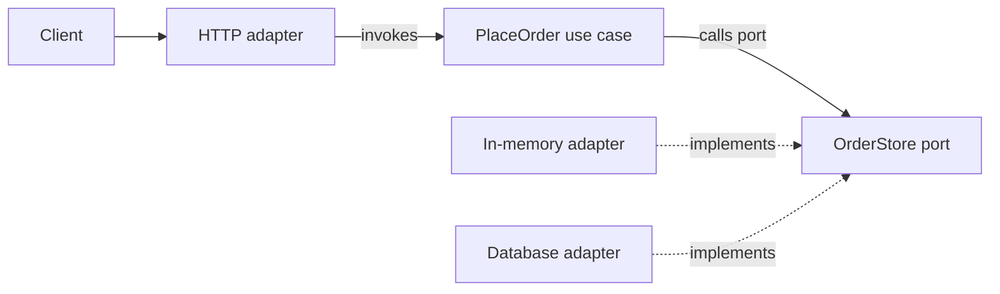
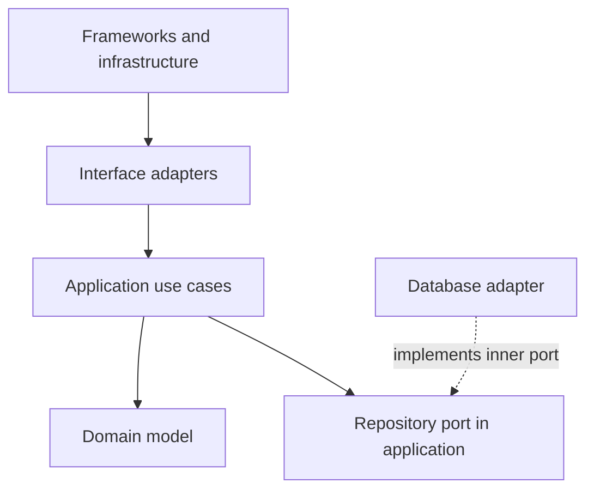
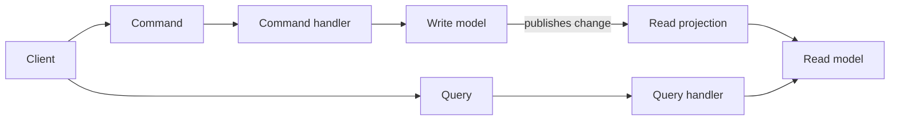
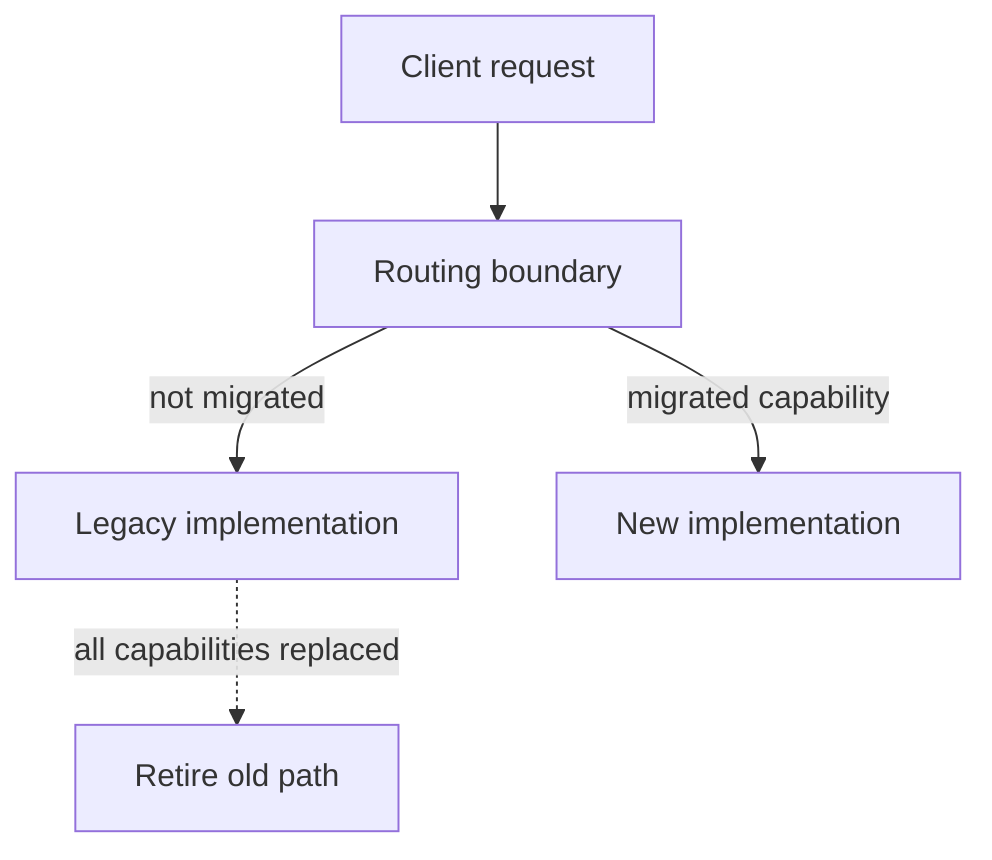

An architectural pattern describes the boundaries between major parts of a system: which code owns business rules, how outside systems interact with it, and which dependencies are allowed. The patterns here are Hexagonal Architecture (Ports and Adapters), Clean Architecture / Onion Architecture, CQRS, and the Strangler Fig pattern.

These are design tools, not frameworks. A small application does not need four layers of interfaces to save one record. Introduce boundaries where the system has meaningful variation, external dependencies, or rules that should remain testable without infrastructure.

## Hexagonal Architecture: Ports and Adapters

Hexagonal Architecture keeps application behavior inside a core and defines **ports** as the contracts through which the core interacts with the outside world. An **adapter** translates between a port and a particular delivery mechanism or external system.

- A driving (inbound) adapter invokes a use case: an HTTP endpoint, command-line interface, or message consumer.
- A driven (outbound) port is owned by the core and describes a capability it needs, such as saving an order.
- A driven adapter implements that port using a database, remote service, or in-memory test double.

The hexagon is a visual metaphor: it emphasizes that the core can have multiple interchangeable adapters, not that it must have six ports.



The use case depends on the port, not on a database class. This small, dependency-free example wires a driving adapter, a use case, a port, and an in-memory driven adapter:

```java
import java.util.ArrayList;
import java.util.List;
import java.util.Objects;

public class PortsAndAdaptersExample {
    record Order(String id) {
        Order {
            Objects.requireNonNull(id);
            if (id.isBlank()) {
                throw new IllegalArgumentException("id must not be blank");
            }
        }
    }

    interface OrderStore {
        void save(Order order);
    }

    static final class PlaceOrder {
        private final OrderStore orders;

        PlaceOrder(OrderStore orders) {
            this.orders = Objects.requireNonNull(orders);
        }

        Order execute(String id) {
            Order order = new Order(id);
            orders.save(order);
            return order;
        }
    }

    static final class InMemoryOrderStore implements OrderStore {
        private final List<Order> saved = new ArrayList<>();

        @Override
        public void save(Order order) {
            saved.add(order);
        }

        int size() {
            return saved.size();
        }
    }

    static final class ConsoleAdapter {
        private final PlaceOrder placeOrder;

        ConsoleAdapter(PlaceOrder placeOrder) {
            this.placeOrder = placeOrder;
        }

        void accept(String id) {
            System.out.println("Placed " + placeOrder.execute(id).id());
        }
    }

    public static void main(String[] args) {
        InMemoryOrderStore store = new InMemoryOrderStore();
        ConsoleAdapter console = new ConsoleAdapter(new PlaceOrder(store));
        console.accept("order-42");
        System.out.println("Stored orders: " + store.size());
    }
}
```

The in-memory adapter is a real implementation of the same port that a database adapter could implement. Tests can construct `PlaceOrder` with a small fake store and check its behavior without starting a database. A port should describe a useful application capability; avoid creating an interface for every class when no alternate implementation or test seam is needed.

## Clean Architecture and Onion Architecture

Clean and Onion Architecture are closely related ways to organize dependencies around business rules. Their diagrams and layer names differ, but the central rule is the same: **source-code dependencies point inward**, toward policies that change less often. Infrastructure can implement an interface declared by an inner layer, but the inner layer should not import a database or web framework to call it.



Read the solid arrows as compile-time dependency direction. The dashed relationship indicates that an outer database adapter implements a port declared inward; dependency injection connects the implementation at runtime. This separates the direction of control flow from the direction of source dependencies.

| Layer | Typical Java responsibilities | Should generally not depend on |
|---|---|---|
| Domain | Entities, value objects, domain invariants | Web, database, or dependency-injection APIs |
| Application | Use cases, orchestration, ports needed by use cases | Specific infrastructure implementations |
| Adapters | Controllers, presenters, persistence and messaging adapters | Other concrete adapters when a port can define the seam |
| Frameworks and infrastructure | Framework configuration, drivers, deployment integration | Inner code importing infrastructure details |

The application still needs an entry point and object graph. A framework may construct and inject adapters at the outer boundary; dependency injection does not change the architectural rule. Package layout can make direction visible—for example, `domain`, `application`, `adapter.web`, and `adapter.persistence`—but package names alone do not enforce it. Build checks or architecture tests can help prevent forbidden imports as a codebase grows.

Don't confuse **runtime call direction** with **source dependency direction**. A use case may call a repository interface, and a database adapter may execute the SQL, while the repository interface remains owned by the application layer. This inversion keeps business decisions testable and keeps database technology replaceable without requiring the domain model to know about the database.

## CQRS

**Command Query Responsibility Segregation (CQRS)** uses different models or paths for commands that change state and queries that return information. A command expresses an intent; a query asks for data without changing it.



This separation can make write-side invariants and read-side response shapes easier to evolve independently. It does **not** require separate databases, event sourcing, or microservices. Start with separate command and query handlers over shared storage if that solves the actual model mismatch.

The types can clarify the distinction without prescribing a persistence technology:

```java
import java.util.Optional;

public class CqrsContractsExample {
    record RenameProduct(String productId, String newName) {}

    record ProductView(String productId, String displayName) {}

    interface RenameProductHandler {
        void handle(RenameProduct command);
    }

    interface ProductQueries {
        Optional<ProductView> findById(String productId);
    }

    public static void main(String[] args) {
        RenameProduct command = new RenameProduct("p-42", "Travel Mug");
        System.out.println("Rename requested for " + command.productId());
    }
}
```

When a write model publishes changes to a separate read projection asynchronously, a successful command may become visible to queries only after projection catches up. That is **eventual consistency**: clients and operations need a defined way to tolerate or observe the delay. Separate stores also add operational work—projection rebuilds, duplicate delivery handling, schema evolution, and recovery. Do not introduce that complexity solely because CQRS diagrams often show two databases.

## Strangler Fig pattern

The **Strangler Fig** pattern replaces a legacy system incrementally. A routing boundary sends selected capabilities to the new implementation while the rest continue to use the old one; the boundary shifts until the old path can be retired.



For example, an application can route order reads to a new service while cancellation still uses the legacy implementation. The router is explicit about ownership instead of relying on clients to guess which system to call:

```java
public class StranglerRouterExample {
    interface Orders {
        String find(String id);
        void cancel(String id);
    }

    static final class LegacyOrders implements Orders {
        public String find(String id) {
            return "legacy order " + id;
        }

        public void cancel(String id) {
            System.out.println("Legacy cancellation for " + id);
        }
    }

    static final class NewOrderReads {
        String find(String id) {
            return "new order " + id;
        }
    }

    static final class OrderRouter implements Orders {
        private final LegacyOrders legacy;
        private final NewOrderReads newReads;

        OrderRouter(LegacyOrders legacy, NewOrderReads newReads) {
            this.legacy = legacy;
            this.newReads = newReads;
        }

        @Override
        public String find(String id) {
            return newReads.find(id);
        }

        @Override
        public void cancel(String id) {
            legacy.cancel(id);
        }
    }

    public static void main(String[] args) {
        Orders orders = new OrderRouter(new LegacyOrders(), new NewOrderReads());
        System.out.println(orders.find("42"));
        orders.cancel("42");
    }
}
```

The example has moved reads but not cancellations. A real migration must also decide which system owns each write, how data is copied and reconciled, how duplicate side effects are prevented, and how traffic can be rolled back. If both systems can independently update the same record, the router alone does not solve consistency.

## Choosing and combining the patterns

| Pattern | Boundary it makes explicit | Useful when |
|---|---|---|
| Ports and Adapters | Application capabilities and external integrations | Use cases need to survive changes in delivery or infrastructure |
| Clean / Onion | Dependency direction between policies and details | Business rules should remain independent of frameworks |
| CQRS | Commands versus queries and their models | Write invariants and read requirements differ materially |
| Strangler Fig | Old versus replaced system capabilities | A legacy replacement must ship in safe increments |

These patterns can be combined, but they solve different problems. Ports and Adapters or Clean Architecture can structure one service; CQRS may separate that service's read and write paths; a Strangler router can gradually move traffic from an older service to it. Combining patterns also combines their maintenance costs, so add each boundary only when it protects a real change or failure boundary.

## Practical rules

- Keep business rules independent of frameworks when long-term testability or technology replacement matters.
- Put an abstraction at a meaningful boundary, and let the module that needs the capability own its port.
- Treat dependency direction as a source-code rule, not as a diagram or runtime-injection convention alone.
- Start CQRS with separate handlers or models; add asynchronous projections and separate stores only when justified.
- Migrate legacy capabilities behind an observable routing boundary, with data ownership and rollback plans.
- Prefer a simpler layered design when the application is small and the extra boundaries would only add indirection.

## Further reading

- Martin Fowler, [CQRS](https://martinfowler.com/bliki/CQRS.html)
- Martin Fowler, [Strangler Fig Application](https://martinfowler.com/bliki/StranglerFigApplication.html)
- [Behavioral Patterns](./behavioral-patterns)
