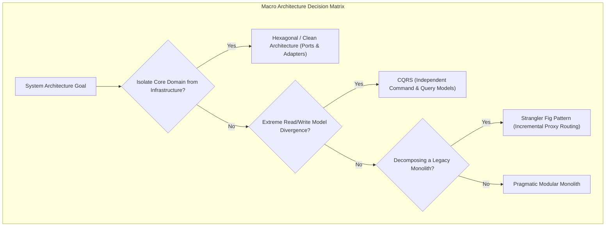
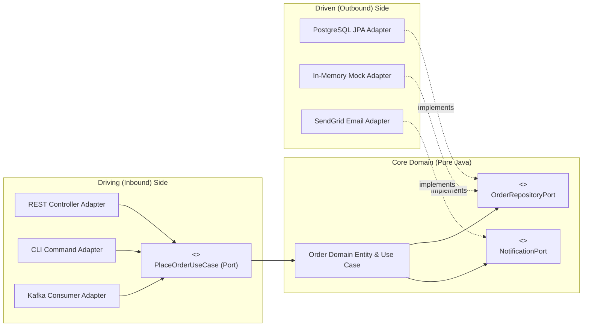
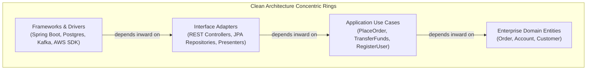
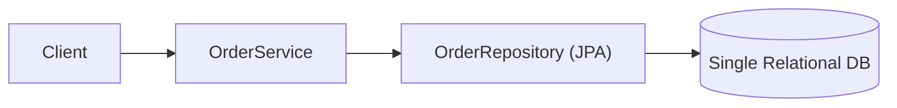
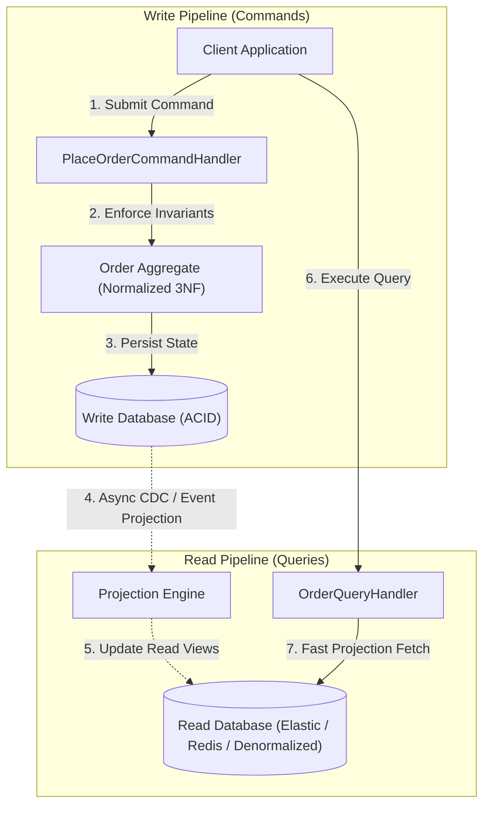
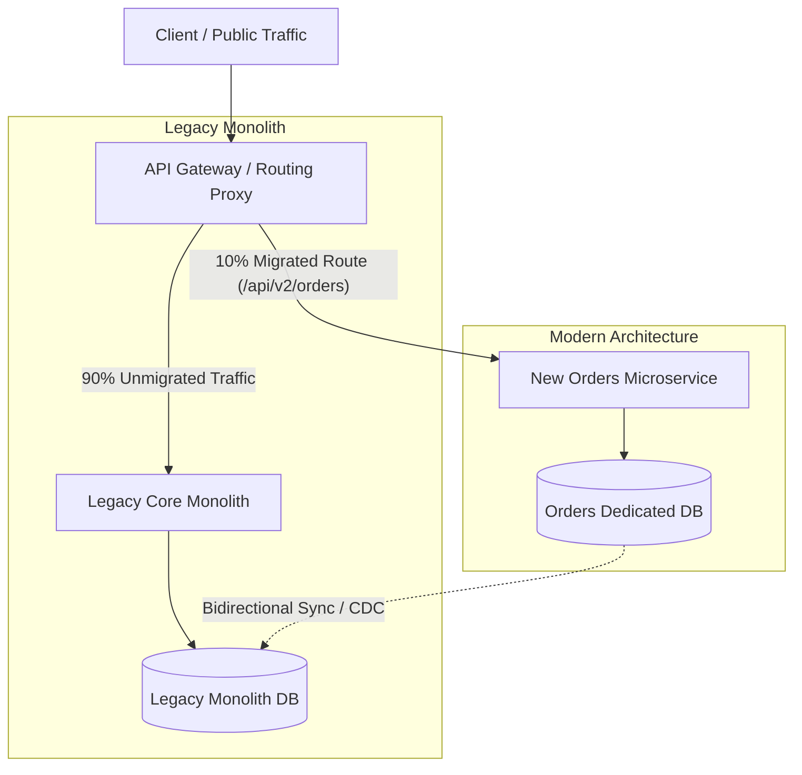

Most software projects begin with the classic **Three-Tier Architecture**:
```
Controller Layer  --->  Service Layer  --->  Repository / DAO Layer  --->  Database
```

In a small CRUD application with ten tables, this structure works well. But as the system scales to hundreds of thousands of lines of code, the three-tier model almost universally degenerates into a **Database-Driven Big Ball of Mud**:
- JPA/Hibernate entities annotated with `@Table` and `@Column` leak into web controllers and JSON responses.
- Database schemas dictate how business domain models are designed.
- Testing a single business rule requires spinning up a PostgreSQL Docker container or an H2 in-memory database because the business logic is inseparable from SQL queries and Spring annotations.

Macro architectural patterns solve this by establishing **sovereign domain boundaries**. They ensure that your business logic remains the pure, untouchable core of your application—independent of web frameworks, database engines, cloud providers, and delivery mechanisms.



---

## Hexagonal Architecture: Ports and Adapters

Invented by Alistair Cockburn in 2005, **Hexagonal Architecture** (also known as **Ports and Adapters**) fundamentally changes how an application interacts with external systems.

Cockburn observed a crucial truth: **To your core business logic, there is no fundamental difference between a human typing into a web browser, an automated JUnit test running in CI, and a message arriving on a Kafka queue.** All three are simply inputs attempting to drive the application. 

Likewise, there is no difference between a PostgreSQL database, an in-memory test mock, and a third-party REST API—they are simply external dependencies driven by the application.



### Driving vs Driven Ports

- **Driving (Inbound) Ports**: Interfaces exposed by the core application that define *what* the application can do (e.g., `PlaceOrderUseCase`, `CancelOrderUseCase`). Driving adapters (HTTP Controllers, CLI tools, gRPC endpoints) invoke these ports.
- **Driven (Outbound) Ports**: Interfaces defined and owned by the core application that specify *what the core needs* from the outside world (e.g., `OrderRepositoryPort`, `PaymentGatewayPort`). Driven adapters (Postgres Repositories, Stripe SDKs, AWS SQS producers) implement these ports.

### The Golden Rule of Port Ownership

> [!IMPORTANT]
> **The core domain owns the driven port interface.** 
> The database adapter does not tell the domain what data it can provide; the domain defines the exact contract it requires, and the database adapter is forced to conform to it.

### Pure Java 21 Implementation

```java
import java.math.BigDecimal;
import java.util.Objects;
import java.util.Optional;

// =========================================================================
// 1. CORE DOMAIN (Zero Frameworks, Zero Spring, Zero Database Imports!)
// =========================================================================

public record Order(String id, String customerId, BigDecimal amount) {
    public Order {
        Objects.requireNonNull(id, "Order ID cannot be null");
        Objects.requireNonNull(customerId, "Customer ID cannot be null");
        if (amount == null || amount.compareTo(BigDecimal.ZERO) <= 0) {
            throw new IllegalArgumentException("Amount must be strictly positive");
        }
    }
}

// Inbound Driving Port
public interface PlaceOrderUseCase {
    Order placeOrder(String customerId, BigDecimal amount);
}

// Outbound Driven Port (Owned by the Domain!)
public interface OrderRepositoryPort {
    void save(Order order);
    Optional<Order> findById(String id);
}

// Domain Service implementing the Inbound Port
public class PlaceOrderService implements PlaceOrderUseCase {
    private final OrderRepositoryPort orderRepository;

    public PlaceOrderService(OrderRepositoryPort orderRepository) {
        this.orderRepository = Objects.requireNonNull(orderRepository);
    }

    @Override
    public Order placeOrder(String customerId, BigDecimal amount) {
        String generatedId = "ORD-" + System.currentTimeMillis();
        Order order = new Order(generatedId, customerId, amount);
        
        // Execute business invariant verification...
        orderRepository.save(order);
        return order;
    }
}

// =========================================================================
// 2. DRIVEN OUTBOUND ADAPTERS (Infrastructure Details)
// =========================================================================

// Production Postgres Adapter
public class PostgresOrderAdapter implements OrderRepositoryPort {
    @Override
    public void save(Order order) {
        System.out.printf("[POSTGRES] Executing: INSERT INTO orders VALUES ('%s', '%s', %s)%n", 
            order.id(), order.customerId(), order.amount());
    }

    @Override
    public Optional<Order> findById(String id) {
        return Optional.empty(); // Simulated query
    }
}

// Blazingly fast In-Memory Adapter for Instant Unit Tests
public class InMemoryOrderAdapter implements OrderRepositoryPort {
    private final java.util.Map<String, Order> database = new java.util.concurrent.ConcurrentHashMap<>();

    @Override
    public void save(Order order) { database.put(order.id(), order); }

    @Override
    public Optional<Order> findById(String id) { return Optional.ofNullable(database.get(id)); }
}

// =========================================================================
// 3. DRIVING INBOUND ADAPTER (Delivery Mechanism)
// =========================================================================

public class OrderWebController {
    private final PlaceOrderUseCase placeOrderUseCase;

    public OrderWebController(PlaceOrderUseCase placeOrderUseCase) {
        this.placeOrderUseCase = placeOrderUseCase;
    }

    // Handles incoming JSON HTTP request
    public String handlePostCheckout(String customerId, double amount) {
        Order placed = placeOrderUseCase.placeOrder(customerId, BigDecimal.valueOf(amount));
        return "{\"status\": \"CREATED\", \"orderId\": \"" + placed.id() + "\"}";
    }
}
```

---

## Clean Architecture and Onion Architecture

Robert C. Martin's **Clean Architecture** and Jeffrey Palermo's **Onion Architecture** build upon Hexagonal Architecture by organizing the system into concentric layers governed by the **Inward Dependency Rule**:



### The Inward Dependency Rule

> **Source code dependencies must point only inward, toward higher-level policies.**
> Nothing in an inner circle can know anything at all about something in an outer circle.

- An `Order` entity in Layer 1 **must never import** a class from Spring, Jackson, or Hibernate.
- A Use Case in Layer 2 knows about Domain Entities, but knows nothing about HTTP request parameters or database column names.
- The outer Layer 4 (Spring Boot, Hibernate, AWS) is treated as a set of disposable plug-ins that can be replaced without changing a single line of business logic.

### The Boundary DTO Mapping Rule

A common shortcut that destroys Clean Architecture is passing JPA entities across layers:

```java
// CATASTROPHIC COUPLING:
@Entity
@Table(name = "users")
public class UserEntity { ... } // Used as Domain Entity AND Hibernate Entity AND REST DTO!
```

When a single class serves as your database schema, your domain model, and your REST API contract:
1. Adding a column in Postgres forces a change in your domain entity.
2. Changing your JSON response structure risks altering database table schema constraints.
3. Database lazy loading proxies leak into JSON serializers, triggering `LazyInitializationException`.

In Clean Architecture, each layer maintains its own data representations, with explicit mappers translating across boundaries:

```
[HTTP Request DTO] ---> (Controller maps to) ---> [Domain Command]
                                                       │
                                                       ▼
[Domain Entity]    <--- (Use Case processes) <─────────┘
       │
       ▼ (Persistence Adapter maps to)
[JPA @Entity Record] ---> [PostgreSQL Table]
```

---

## Enforcing Architectural Boundaries with ArchUnit

Architecture diagrams are useless if a junior developer on your team accidentally imports `org.springframework.stereotype.Service` into a pure domain entity.

In professional Java teams, architectural rules are **enforced in CI/CD using ArchUnit** (an automated Java architecture testing library):

```java
import com.tngtech.archunit.core.domain.JavaClasses;
import com.tngtech.archunit.core.importer.ClassFileImporter;
import com.tngtech.archunit.lang.ArchRule;
import org.junit.jupiter.api.Test;

import static com.tngtech.archunit.lang.syntax.ArchRuleDefinition.classes;
import static com.tngtech.archunit.lang.syntax.ArchRuleDefinition.noClasses;

public class ArchitectureTest {
    private final JavaClasses importedClasses = 
        new ClassFileImporter().importPackages("com.enterprise.ecommerce");

    @Test
    void domainMustNotDependOnInfrastructureOrFrameworks() {
        // Enforce the Inward Dependency Rule: Pure domain cannot import outer layers!
        ArchRule rule = noClasses()
            .that().resideInAPackage("..domain..")
            .should().dependOnClassesThat()
            .resideInAnyPackage("..infrastructure..", "..adapter..", "org.springframework..");

        rule.check(importedClasses);
    }

    @Test
    void drivenPortsMustBeInterfaces() {
        // Enforce that ports are pure interfaces
        ArchRule rule = classes()
            .that().resideInAPackage("..domain.port..")
            .should().beInterfaces();

        rule.check(importedClasses);
    }
}
```

If any developer violates layer isolation, the test fails immediately during `mvn test` or `gradle test`, blocking the pull request before bad architecture can enter production.

---

## Command Query Responsibility Segregation (CQRS)

In traditional applications, the same object model is used for both writing data and querying data:



As applications grow, this shared model creates severe conflicts:
- **Write Side Demands**: Transactional integrity, strict normalization (3NF), fine-grained invariants, locks, and complex validation rules.
- **Read Side Demands**: Fast denormalized joins, aggregated dashboards, search indexing, pagination, and multi-table projections.

Attempting to satisfy both requirements with a single JPA entity model leads to bloated entities with 60 fields, agonizing `@ManyToOne` join performance, and database locking contention.

**Command Query Responsibility Segregation (CQRS)** completely separates the write pipeline from the read pipeline:



### The Inherent Trade-Off: Eventual Consistency

When you separate write models from read models using asynchronous event projections (such as Kafka, Debezium Change Data Capture, or RabbitMQ), the system becomes **eventually consistent**.

When a user submits a command (`PlaceOrder`), the write model saves the transaction instantly. However, the projection engine may take 50 to 200 milliseconds to update the read view in the denormalized database. 

If the client immediately redirects to the order history dashboard, the newly created order might not appear yet!

#### How Senior Architects Handle Eventual Consistency
1. **Optimistic UI Updates**: The frontend UI renders the submitted data immediately into the client-side state without waiting for the read projection.
2. **Version Stamping**: The command returns a version stamp (`version = 4`). The query endpoint allows the client to pass `waitForVersion=4`, holding the HTTP response briefly until the read projection catches up.
3. **Read-Your-Own-Writes Routing**: If a user just modified an entity, route their subsequent queries directly to the write database replica for the next 5 seconds.

---

## The Strangler Fig Pattern: Safe Monolith Decomposition

Attempting a **"Big Bang Rewrite"** (halting feature development for two years to rewrite a 15-year-old monolithic legacy application from scratch in modern microservices) is one of the most reliable ways to bankrupt a software company.

In 2004, Martin Fowler introduced the **Strangler Fig Pattern**, named after the strangler fig tree that seeds in the upper branches of a host tree, gradually sends aerial roots to the forest floor, surrounds the host trunk, and eventually replaces the host completely.



### The Three Operational Phases

1. **Transform (Intercept)**: Place an API Gateway or reverse proxy (such as Envoy, Nginx, or AWS API Gateway) in front of the legacy monolith. All client traffic flows through the gateway to the legacy system transparently.
2. **Coexist (Carve Out)**: Build the first bounded context (e.g., the Orders service) as a clean modern service. Configure the gateway to route `/api/v2/orders` to the new service, while all other routes continue hitting the monolith.
3. **Eliminate**: Repeat the process capability by capability. When the final legacy feature has been extracted to modern services, decommission the monolithic server and its database.

### The Dual-Write and Data Synchronization Challenge

The hardest part of a Strangler Fig migration is not routing HTTP traffic; it is **data synchronization**.

If the new Orders service needs customer data from the legacy database, and legacy batch jobs still read from the legacy orders table:
- **Never perform dual-writes from application code**: If the write to Service A succeeds and the write to Service B fails across a network boundary, your databases are permanently out of sync.
- **Use Change Data Capture (CDC)**: Deploy a tool like **Debezium** tailing the PostgreSQL/Oracle transaction log (WAL / Redo Log) to stream changes to Kafka. The new microservice consumes the Kafka stream to maintain its local projections safely.

---

## Senior Engineer Interview Crucible

### What is the core difference between Driving (Inbound) and Driven (Outbound) ports in Hexagonal Architecture, and who owns the port interface?
**Driving (Inbound) Ports** define the public use-case API of the application core (e.g., `PlaceOrderUseCase`). They are invoked by driving adapters (HTTP controllers, message listeners, CLI handlers) to initiate business workflows.

**Driven (Outbound) Ports** define external capabilities required by the application core to fulfill business logic (e.g., `OrderRepositoryPort`, `PaymentGatewayPort`). They are implemented by driven infrastructure adapters (JPA repositories, Stripe clients, message publishers).

Crucially, **the core domain owns both port interfaces**. Driven ports live in the domain package, forcing infrastructure adapters to conform to domain requirements rather than allowing infrastructure details to dictate domain structure.

### Why is sharing JPA/Hibernate entity classes across the UI layer and domain model considered a severe architectural defect in Clean Architecture?
Sharing JPA entities across boundaries introduces three critical defects:
1. **Coupling to Infrastructure**: The domain model becomes permanently bound to relational database concepts (`@Entity`, `@Table`, `@JoinColumn`, cascade types), preventing the domain from evolving independently of database schemas.
2. **Persistence Context Hazards**: Exposing JPA entities to web controllers frequently causes `LazyInitializationException` when JSON serializers attempt to serialize uninitialized lazy collections outside of an open Hibernate session.
3. **Security and Over-Posting Vulnerabilities**: Exposing entity objects directly to HTTP endpoints allows malicious users to send unexpected JSON fields that map directly to database columns, accidentally overwriting sensitive properties (e.g., modifying `isAdmin` or `balance`).

### When is CQRS with separate read/write data stores worth the operational overhead, and how do you handle eventual consistency in the UI?
CQRS with separate stores is justified when:
1. Read traffic dramatically exceeds write traffic (e.g., a 100:1 ratio), requiring asymmetric scaling.
2. Complex reporting, full-text search, or aggregation queries degrade write transaction performance.
3. Business rules demand complex aggregate validation that conflicts with denormalized query representations.

Eventual consistency can be managed via:
- **Optimistic UI Rendering**: Updating the frontend client state immediately upon command acceptance before the read projection completes.
- **Version Tracking**: Passing an expected version token in the query request, causing the query service to hold the response briefly until the projection reaches that version.
- **Read-Your-Own-Writes Caching**: Temporarily routing query requests from the modifying user directly to the primary database replica for a short time window.

### In a Strangler Fig migration, how do you handle bidirectional data synchronization when the legacy monolith and the new microservice must coexist for months?
Bidirectional synchronization should avoid synchronous distributed transactions (2PC) or dual-writes in application code, which introduce split-brain risks. 

The industry standard approach is **asynchronous Change Data Capture (CDC)**:
1. Tools like **Debezium** tail the transaction logs (WAL/Redo Log) of the legacy database, streaming every row mutation to Apache Kafka topics.
2. The new microservice consumes these Kafka events to populate its own autonomous datastore.
3. For reverse synchronization (when the new service writes data that legacy systems still need), the new service publishes domain events to Kafka, and an anti-corruption adapter writes the updates back into the legacy database.
4. An **Anti-Corruption Layer (ACL)** translates legacy data formats into clean modern domain models, preventing legacy concepts from polluting the new architecture.
