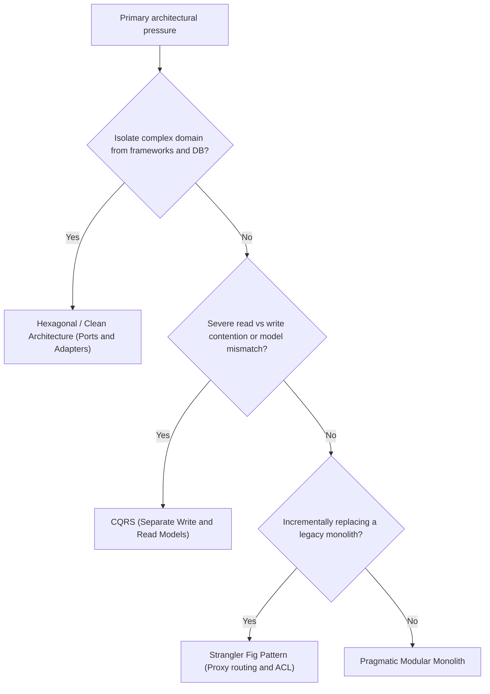
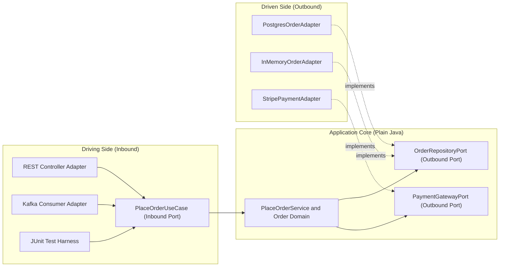
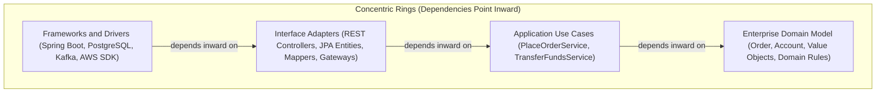
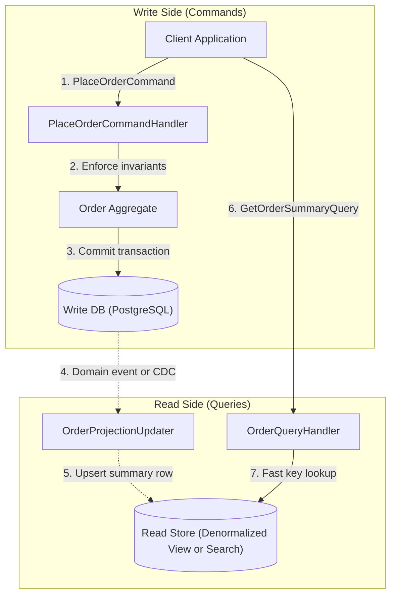
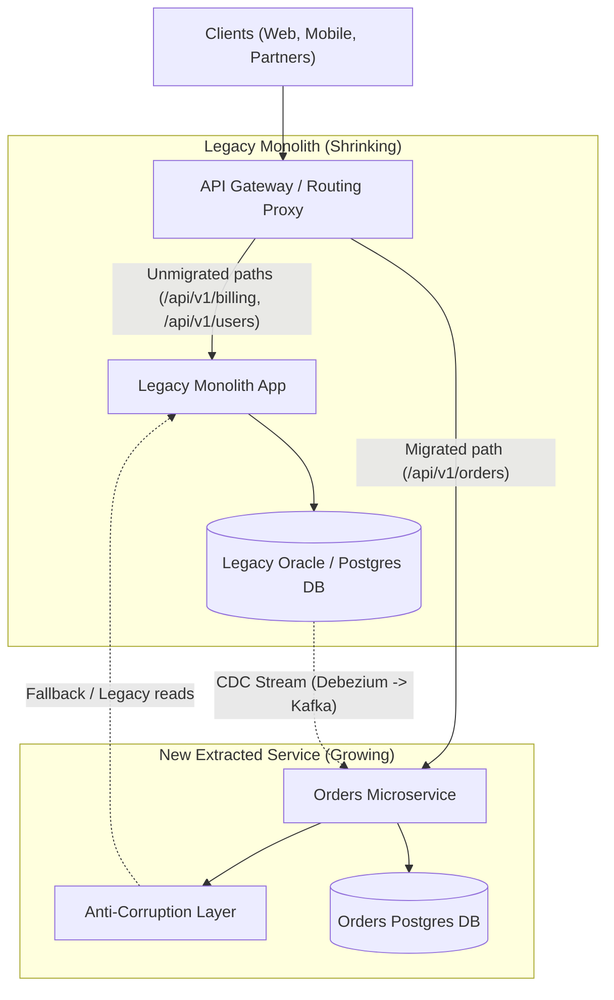

Most Java services start with a familiar three-tier layout:

```text
Controller  --->  Service  --->  Repository (JPA / JDBC)  --->  Database
```

For a small CRUD service with ten tables and straightforward rules, that layout is fast to build and easy for new teammates to follow. Problems show up when the codebase grows over a few years and the business logic gets more involved:

- JPA `@Entity` classes leak into controllers, so database schema changes break JSON APIs and lazy-loaded collections throw `LazyInitializationException` during serialization.
- Core business rules get tangled up with Spring annotations, Hibernate sessions, and HTTP error handling.
- Unit testing a pricing or approval rule requires booting an entire Spring context and a Postgres or H2 database.

Architectural patterns exist to control where dependencies point so that your core business rules stay decoupled from delivery mechanisms (HTTP, Kafka, CLI) and storage details (PostgreSQL, Redis, external APIs). Each pattern solves a specific structural pressure, and each comes with real boilerplate and operational costs you should weigh honestly before adopting it.



## Hexagonal Architecture (Ports and Adapters)

Alistair Cockburn introduced Hexagonal Architecture (Ports and Adapters) in 2005 around a practical observation: your business logic should not care whether a request arrived from an HTTP controller, a Kafka consumer, a scheduled job, or a JUnit test. All of those are simply external actors driving the application. Likewise, the business logic should not care whether orders are saved to PostgreSQL, DynamoDB, or an in-memory `Map` during tests.

To achieve that separation, the application core sits in the center and communicates with the outside world exclusively through interfaces called **ports**. Concrete **adapters** sit outside the core and translate between external technologies and those ports.



### Driving vs Driven Ports

- **Driving (Inbound) Ports** define what the application can do (for example, `PlaceOrderUseCase` or `CancelOrderUseCase`). Inbound adapters such as Spring `@RestController` classes, gRPC services, or message listeners call these interfaces.
- **Driven (Outbound) Ports** define what the application needs from the outside world (for example, `OrderRepositoryPort` or `PaymentGatewayPort`). Outbound adapters implement them using JDBC, JPA, HTTP clients, or message producers.

> [!IMPORTANT]
> **The core owns both port interfaces.** Driven ports live in the domain or application package, expressed in domain types (`Order`, `OrderId`, `Money`). The persistence adapter conforms to the domain's contract, not the other way around.

### Hexagonal Implementation in Java 21

Notice how the core types have zero imports from Spring, Jackson, or Jakarta Persistence:

```java
import java.math.BigDecimal;
import java.util.Map;
import java.util.Objects;
import java.util.Optional;
import java.util.UUID;
import java.util.concurrent.ConcurrentHashMap;

// -------------------------------------------------------------------------
// 1. CORE DOMAIN AND PORTS (Plain Java, zero framework imports)
// -------------------------------------------------------------------------

public record Order(String id, String customerId, BigDecimal amount) {
    public Order {
        Objects.requireNonNull(id, "Order ID must not be null");
        Objects.requireNonNull(customerId, "Customer ID must not be null");
        if (amount == null || amount.compareTo(BigDecimal.ZERO) <= 0) {
            throw new IllegalArgumentException("Order amount must be positive");
        }
    }
}

// Inbound (driving) port
public interface PlaceOrderUseCase {
    Order placeOrder(String customerId, BigDecimal amount);
}

// Outbound (driven) ports owned by the core
public interface OrderRepositoryPort {
    void save(Order order);
    Optional<Order> findById(String id);
}

public interface PaymentGatewayPort {
    void authorize(String orderId, BigDecimal amount);
}

// Application service implementing the inbound port
public class PlaceOrderService implements PlaceOrderUseCase {
    private final OrderRepositoryPort orderRepository;
    private final PaymentGatewayPort paymentGateway;

    public PlaceOrderService(OrderRepositoryPort orderRepository, PaymentGatewayPort paymentGateway) {
        this.orderRepository = Objects.requireNonNull(orderRepository);
        this.paymentGateway = Objects.requireNonNull(paymentGateway);
    }

    @Override
    public Order placeOrder(String customerId, BigDecimal amount) {
        String orderId = "ORD-" + UUID.randomUUID();
        Order order = new Order(orderId, customerId, amount);
        paymentGateway.authorize(order.id(), order.amount());
        orderRepository.save(order);
        return order;
    }
}

// -------------------------------------------------------------------------
// 2. DRIVEN ADAPTERS (Outbound infrastructure)
// -------------------------------------------------------------------------

public class PostgresOrderAdapter implements OrderRepositoryPort {
    @Override
    public void save(Order order) {
        // Maps domain Order to SQL/JPA and writes to PostgreSQL
        System.out.printf("[POSTGRES] INSERT INTO orders (id, customer_id, amount) VALUES ('%s', '%s', %s)%n",
            order.id(), order.customerId(), order.amount());
    }

    @Override
    public Optional<Order> findById(String id) {
        return Optional.empty();
    }
}

// Fast fake for unit tests (no Spring context or Docker container required)
public class InMemoryOrderAdapter implements OrderRepositoryPort {
    private final Map<String, Order> store = new ConcurrentHashMap<>();

    @Override
    public void save(Order order) {
        store.put(order.id(), order);
    }

    @Override
    public Optional<Order> findById(String id) {
        return Optional.ofNullable(store.get(id));
    }
}

// -------------------------------------------------------------------------
// 3. DRIVING ADAPTER (Inbound HTTP controller)
// -------------------------------------------------------------------------

public class OrderWebController {
    private final PlaceOrderUseCase placeOrderUseCase;

    public OrderWebController(PlaceOrderUseCase placeOrderUseCase) {
        this.placeOrderUseCase = placeOrderUseCase;
    }

    public record CreateOrderRequest(String customerId, BigDecimal amount) {}
    public record CreateOrderResponse(String status, String orderId) {}

    public CreateOrderResponse handlePostOrder(CreateOrderRequest request) {
        Order placed = placeOrderUseCase.placeOrder(request.customerId(), request.amount());
        return new CreateOrderResponse("CREATED", placed.id());
    }
}
```

With this setup, wiring `PlaceOrderService` to `InMemoryOrderAdapter` and a stub `PaymentGatewayPort` lets you run hundreds of business-rule tests in milliseconds. Spring configuration lives in an outer bootstrap package that creates the `@Bean` wiring, keeping the core portable and simple to reason about.

## Clean Architecture and Onion Architecture

Jeffrey Palermo's **Onion Architecture** (2008) and Robert C. Martin's **Clean Architecture** (2012) share the same dependency-inversion foundation as Hexagonal Architecture. The main addition is explicitly organizing the inside of the application into concentric rings rather than treating the interior as one flat core.



### The Inward Dependency Rule

Source code dependencies may only point inward, toward stable business policies. Outer layers can import inner layers, but inner layers never import outer layers:

- **Domain Entities** contain business rules and invariants that hold regardless of the application workflow. They do not import Spring, Jackson, or JPA.
- **Application Use Cases** orchestrate domain objects and call outbound ports to fetch or persist state. They know nothing about HTTP status codes, JSON formatting, or SQL dialect.
- **Interface Adapters** convert data between external formats (HTTP JSON, Kafka Avro, JPA `@Entity` rows) and domain types.
- **Frameworks and Drivers** hold Spring Boot auto-configuration, database drivers, and broker clients.

### Boundary Mapping Instead of Shared JPA Entities

A common shortcut that breaks Clean Architecture is annotating one class with `@Entity`, `@Table`, and Jackson annotations, then returning it straight from a controller. That creates three headaches:
1. Renaming or normalizing a database column can accidentally change your public JSON contract.
2. Serializing a JPA entity outside an open Hibernate session triggers `LazyInitializationException` or N+1 queries.
3. Accepting a JPA entity directly as a `@RequestBody` invites over-posting bugs where a client supplies unexpected fields like `role` or `accountBalance`.

Keeping a dedicated persistence model and translating at the adapter boundary avoids those leaks:

```java
// Outer persistence adapter translates between JPA entity and pure domain Order
public class JpaOrderMapper {

    public OrderJpaEntity toJpaEntity(Order domainOrder) {
        OrderJpaEntity entity = new OrderJpaEntity();
        entity.setId(domainOrder.id());
        entity.setCustomerId(domainOrder.customerId());
        entity.setAmount(domainOrder.amount());
        return entity;
    }

    public Order toDomain(OrderJpaEntity entity) {
        return new Order(entity.getId(), entity.getCustomerId(), entity.getAmount());
    }
}
```

Mapping does add code. Libraries like MapStruct can generate compile-time mappers when records have many fields, though for small records a handwritten 10-line mapper is often clearer and easier to debug.

### Enforcing Layer Rules With ArchUnit

Architecture diagrams rot quickly once a team is under deadline pressure. If someone adds `@Transactional` or imports a JPA repository into `..domain..`, code review can miss it. **ArchUnit** lets you verify package dependency rules as ordinary JUnit tests in CI:

```java
import com.tngtech.archunit.core.domain.JavaClasses;
import com.tngtech.archunit.core.importer.ClassFileImporter;
import com.tngtech.archunit.lang.ArchRule;
import org.junit.jupiter.api.Test;

import static com.tngtech.archunit.lang.syntax.ArchRuleDefinition.classes;
import static com.tngtech.archunit.lang.syntax.ArchRuleDefinition.noClasses;

class ArchitectureTest {

    private final JavaClasses importedClasses =
        new ClassFileImporter().importPackages("com.example.commerce");

    @Test
    void domainShouldNotDependOnFrameworksOrAdapters() {
        ArchRule rule = noClasses()
            .that().resideInAPackage("..domain..")
            .should().dependOnClassesThat()
            .resideInAnyPackage("..adapter..", "..infrastructure..", "org.springframework..", "jakarta.persistence..");

        rule.check(importedClasses);
    }

    @Test
    void portsShouldBeInterfaces() {
        ArchRule rule = classes()
            .that().resideInAPackage("..port..")
            .should().beInterfaces();

        rule.check(importedClasses);
    }
}
```

Whenever a pull request breaks layer isolation, `mvn test` or `gradle test` fails immediately with the exact offending class and import.

## CQRS (Command Query Responsibility Segregation)

In a typical CRUD application, the same JPA entity graph serves both writes and reads. That works fine until write requirements and read requirements pull the model in opposite directions:

- **Writes** need normalized tables, strict aggregate invariants, optimistic locking, and clean transactional boundaries.
- **Reads** need fast denormalized views, cross-table joins, pagination, full-text search, and summary counters for dashboards.

Trying to serve complex reporting screens through a heavily normalized JPA aggregate graph often results in slow multi-way joins, N+1 queries, and bloated entities with dozens of lazy associations.

**CQRS** separates the write model (Commands that mutate state) from the read model (Queries that return projections). Importantly, CQRS does not require separate databases on day one.

### Lightweight CQRS vs Separate-Datastore CQRS

There are two levels of CQRS:
1. **Single-database CQRS (most common starting point)**: Writes go through rich domain aggregates (often persisted with JPA), while reads bypass the domain model completely and run tailored SQL queries (via Spring `JdbcClient`, jOOQ, or JPA constructor projections) straight into immutable Java records. You keep strong consistency because both sides share one database.
2. **Separate-datastore CQRS**: Writes commit to an ACID relational store (such as PostgreSQL) and publish events (or stream WAL changes via Debezium). Asynchronous projectors update a specialized read store (such as Elasticsearch, Redis, or a denormalized Postgres read replica).



### Separate Write and Read Models in Java 21

Here is how the write side and read projection stay cleanly separated in Java:

```java
import java.math.BigDecimal;
import java.time.Instant;
import java.util.List;
import java.util.Map;
import java.util.Optional;
import java.util.UUID;
import java.util.concurrent.ConcurrentHashMap;

// --- WRITE SIDE ---

public record PlaceOrderCommand(String customerId, String customerName, List<OrderLineInput> lines) {}
public record OrderLineInput(String sku, int quantity, BigDecimal unitPrice) {}
public record OrderPlacedEvent(String orderId, String customerId, String customerName,
                               int itemCount, BigDecimal totalAmount, Instant placedAt) {}

public interface OrderEventBus {
    void publish(OrderPlacedEvent event);
}

public class PlaceOrderCommandHandler {
    private final OrderRepositoryPort writeRepository;
    private final OrderEventBus eventBus;

    public PlaceOrderCommandHandler(OrderRepositoryPort writeRepository, OrderEventBus eventBus) {
        this.writeRepository = writeRepository;
        this.eventBus = eventBus;
    }

    public String handle(PlaceOrderCommand command) {
        if (command.lines() == null || command.lines().isEmpty()) {
            throw new IllegalArgumentException("Order must contain at least one line item");
        }

        BigDecimal total = command.lines().stream()
            .map(l -> l.unitPrice().multiply(BigDecimal.valueOf(l.quantity())))
            .reduce(BigDecimal.ZERO, BigDecimal::add);

        int itemCount = command.lines().stream().mapToInt(OrderLineInput::quantity).sum();
        String orderId = "ORD-" + UUID.randomUUID();

        // Persist normalized write model
        writeRepository.save(new Order(orderId, command.customerId(), total));

        // Emit event to update read projections (via Outbox/CDC in production)
        eventBus.publish(new OrderPlacedEvent(
            orderId, command.customerId(), command.customerName(), itemCount, total, Instant.now()
        ));
        return orderId;
    }
}

// --- READ SIDE (Denormalized Projection) ---

public record OrderSummaryView(
    String orderId,
    String customerName,
    int itemCount,
    BigDecimal totalAmount,
    Instant placedAt
) {}

public class OrderProjectionStore {
    private final Map<String, OrderSummaryView> views = new ConcurrentHashMap<>();

    // Projector handles events asynchronously to build query-optimized records
    public void onOrderPlaced(OrderPlacedEvent event) {
        views.put(event.orderId(), new OrderSummaryView(
            event.orderId(),
            event.customerName(),
            event.itemCount(),
            event.totalAmount(),
            event.placedAt()
        ));
    }

    // Query handler reads flat view with zero joins
    public Optional<OrderSummaryView> findSummary(String orderId) {
        return Optional.ofNullable(views.get(orderId));
    }
}
```

### Handling Eventual Consistency

When the read model is updated asynchronously, there is a replication lag (often tens to hundreds of milliseconds, or longer during traffic spikes) between committing a command and seeing the update in the read view. If a user submits an order and the browser immediately queries `GET /orders`, the new order might not be there yet.

Teams typically handle this in one of three ways:
- **Optimistic UI updates**: The command returns the newly created resource ID and key fields so the frontend renders the confirmed order immediately without waiting on the read store.
- **Version / watermark waiting**: The command returns a monotonic version or event offset. Subsequent queries pass `minVersion=42`, and the query service polls briefly (with a tight timeout) until the projection reaches version 42.
- **Read-your-own-writes routing**: After a user mutates data, route that user's reads to the primary write store (or a short-lived user-scoped cache) for a few seconds before falling back to the read projection.

## Strangler Fig Pattern for Migrating Monoliths

Replacing a 10-year-old monolith with a "big bang rewrite" rarely ends well. Freezing product features for 18 months while trying to re-implement every undocumented edge case in a new system usually produces a late replacement that still misses legacy behaviors.

Martin Fowler popularized the **Strangler Fig Pattern** as a lower-risk alternative. Named after fig trees that grow around a host tree before eventually replacing it, the pattern puts a routing layer in front of the monolith and extracts one bounded capability at a time into new services while production traffic keeps running.



### The Three Phases of a Strangler Fig Migration

1. **Intercept**: Place a reverse proxy or API Gateway (Envoy, Nginx, Kong, or Spring Cloud Gateway) in front of the monolith. At first, 100 percent of traffic simply passes through to the legacy system unchanged. This establishes a single control point for routing, logging, and canary rollouts.
2. **Coexist**: Carve out one well-bounded slice (often a read-heavy feature or an edge domain like Notifications or Order Tracking first, before tackling core billing). Route traffic for that slice to the new service—initially as a dark/shadow mirror or a 5 percent canary—while the rest of the application stays on the monolith.
3. **Eliminate**: Once the new service handles 100 percent of traffic for that capability and legacy dependencies on its tables are gone, delete the dead code paths in the monolith. Repeat capability by capability until nothing remains in the host application.

### Routing Traffic at the Gateway

Here is a Spring Cloud Gateway configuration routing `/api/v1/orders/**` to the newly carved-out Orders service while keeping all other legacy routes on the monolith, including a header-based canary rule for internal testing before global cutover:

```yaml
spring:
  cloud:
    gateway:
      routes:
        # Canary rule: route internal QA or opted-in tenants to the new Orders service first
        - id: orders-service-canary
          uri: http://orders-service:8081
          predicates:
            - Path=/api/v1/orders/**
            - Header=X-Migration-Cohort, canary
          filters:
            - AddResponseHeader=X-Served-By, orders-v2

        # Fallback: remaining orders traffic still hits the legacy monolith until cutover
        - id: legacy-monolith-fallback
          uri: http://legacy-monolith:8080
          predicates:
            - Path=/api/v1/**
          filters:
            - AddResponseHeader=X-Served-By, legacy-monolith
```

Once the canary cohort shows matching outputs, healthy latency, and clean error rates, you widen the predicate (weight-based routing: 10 percent, 50 percent, 100 percent) and eventually remove the legacy route for `/api/v1/orders/**`.

### Shadow Verification and Anti-Corruption Facade in Java

During coexistence, the new service often has to read legacy customer or pricing data whose schema uses cryptic column names and string flags. Placing a Strangler Facade / Anti-Corruption Layer between the new domain and the legacy system keeps legacy quirks out of the new codebase, and lets you safely verify parity before cutting over:

```java
import java.math.BigDecimal;
import java.util.Objects;

// Legacy payload returned by the old monolith API
public record LegacyOrderPayload(String ordNo, String custCd, double grossAmt, String stsFlg) {}

// Clean domain model in the new Orders service
public record ModernOrder(String orderId, String customerId, BigDecimal totalAmount, OrderStatus status) {}

public enum OrderStatus { PENDING, CONFIRMED, CANCELLED }

public interface LegacyOrderClient {
    LegacyOrderPayload fetchLegacyOrder(String orderId);
}

// Anti-Corruption Layer translating legacy conventions into clean domain types
public class LegacyOrderAntiCorruptionAdapter {
    private final LegacyOrderClient legacyClient;

    public LegacyOrderAntiCorruptionAdapter(LegacyOrderClient legacyClient) {
        this.legacyClient = Objects.requireNonNull(legacyClient);
    }

    public ModernOrder fetchAsDomainOrder(String orderId) {
        LegacyOrderPayload raw = legacyClient.fetchLegacyOrder(orderId);
        return new ModernOrder(
            raw.ordNo().trim(),
            raw.custCd().trim(),
            BigDecimal.valueOf(raw.grossAmt()),
            mapLegacyStatus(raw.stsFlg())
        );
    }

    private OrderStatus mapLegacyStatus(String legacyFlag) {
        return switch (legacyFlag) {
            case "01", "NEW" -> OrderStatus.PENDING;
            case "02", "OK" -> OrderStatus.CONFIRMED;
            case "99", "X" -> OrderStatus.CANCELLED;
            default -> throw new IllegalStateException("Unrecognized legacy status flag: " + legacyFlag);
        };
    }
}
```

### The Hardest Part: Data Synchronization Without Dual-Writes

Routing HTTP paths is usually the easy 20 percent of a Strangler Fig migration. The hard 80 percent is disentangling the shared monolith database while both systems need overlapping data.

Avoid **application-level dual-writes** (writing to `newDb` and then writing to `legacyDb` in the same service method). If the first write commits and the network drops before the second write, the two databases silently diverge, and reconciling millions of rows later is painful.

Instead, teams rely on two safer patterns:
- **Change Data Capture (CDC)**: Run Debezium against the legacy database's write-ahead log (PostgreSQL WAL, MySQL binlog, Oracle redo log) to stream row changes to Kafka. The new service consumes those topics to keep its own database populated while reads migrate over.
- **Transactional Outbox for reverse sync**: Once you flip writes to the new service, legacy batch jobs or reports might still read the old database for months. Have the new service write both its domain state and an outbox event row in one local ACID transaction, then relay that event via Kafka to a small sync worker that updates the legacy tables through an ACL. Once legacy consumers are retired, you turn off the reverse sync worker and drop the legacy tables.

## Honest Trade-Offs: When a Modular Monolith Is Better

Hexagonal Architecture, Clean Architecture, and CQRS solve real problems, but applying all of them by default to every service is one of the fastest ways to slow a team down.

Consider what you actually pay when you adopt strict Hexagonal/Clean Architecture and CQRS:
- **Mapping overhead**: Every field addition touches an HTTP DTO, a command record, a domain entity, a JPA entity, a mapper, and a read projection.
- **Indirection**: Navigating from a controller method to the SQL query takes four jumps through interfaces and adapters, which adds friction during debugging.
- **Operational complexity**: Separate read/write stores and CDC pipelines require schema governance, dead-letter queues, projection rebuild tooling, and monitoring for replication lag.

If you are building a greenfield product, a small-to-medium internal tool, or a service owned by a single 5-person team with straightforward CRUD semantics, a **pragmatic modular monolith** is usually the better choice:
- Organize packages by business capability (`com.example.orders`, `com.example.billing`, `com.example.inventory`) rather than technical layer (`controllers`, `services`, `repositories`).
- Keep internal classes package-private and expose only clean module entrypoints (tools like **Spring Modulith** and **ArchUnit** enforce module boundaries automatically).
- Use JPA directly inside a module when domain logic is simple, and introduce Ports & Adapters or CQRS selectively only for the specific modules that actually have complex invariants, high read/write contention, or external integration churn.

Good architecture is proportional to the problem. Starting with a clean modular monolith gives you well-defined seams so you can introduce Hexagonal isolation, CQRS projections, or extract a service later when real load or team size justifies the cost.

## Interview Questions

### What is the difference between Driving and Driven ports in Hexagonal Architecture, and why does port ownership matter?

Driving (inbound) ports describe the use cases the application offers to external callers, such as `PlaceOrderUseCase`, and are invoked by inbound adapters like REST controllers or Kafka listeners. Driven (outbound) ports describe external capabilities the application depends on, such as `OrderRepositoryPort` or `PaymentGatewayPort`, and are implemented by outbound adapters like JPA repositories or payment SDK wrappers.

The core application owns both port interfaces. Because driven ports live inside the core and speak in domain types, infrastructure adapters have to adapt to the domain rather than letting database schemas or third-party SDK models dictate how business logic is written.

### Why is returning a JPA entity directly from a REST controller risky in larger applications?

It couples your public API contract directly to your database schema. Renaming a table column or splitting a table can break API clients unexpectedly. It also exposes persistence lifecycle details to JSON serializers: accessing a `@OneToMany` lazy collection outside an open Hibernate session throws `LazyInitializationException`, or triggers hidden N+1 queries if Open Session in View is left enabled. Finally, binding incoming JSON straight onto a managed entity creates mass-assignment security risks if sensitive fields are not explicitly excluded.

### Can you use CQRS without running two separate databases?

Yes, and that is often the most practical place to start. Within a single PostgreSQL database, your write side can use domain aggregates and JPA to enforce invariants cleanly, while your read side executes direct SQL queries (via `JdbcClient`, jOOQ, or native queries) straight into flat Java record DTOs. You eliminate ORM overhead and N+1 read issues without introducing Kafka, Debezium, or eventual consistency. Only introduce a separate read store like Elasticsearch or Redis when read scaling, full-text search, or heavy aggregations genuinely outgrow the primary database.

### Why are application-level dual-writes discouraged during a Strangler Fig migration?

Writing to a new service database and a legacy database inside the same application method has no atomic guarantee across two separate datastores. If the first commit succeeds and the process crashes or the network times out before the second write, the two databases drift out of sync with no automatic recovery. Using Change Data Capture (like Debezium reading the database transaction log) or the Transactional Outbox pattern ensures that every committed write is reliably propagated asynchronously, with retries and replayability if a downstream consumer goes down.
