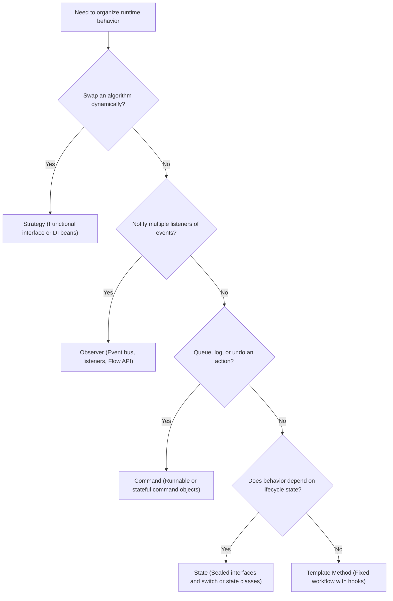
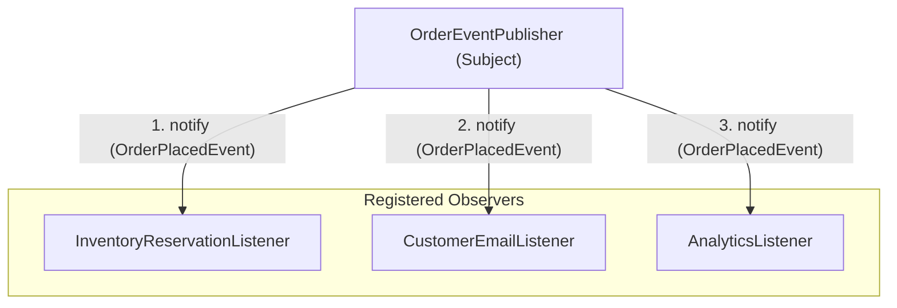
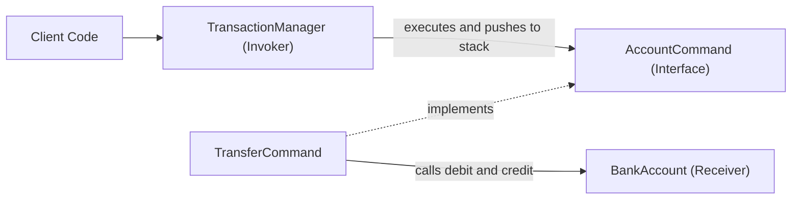
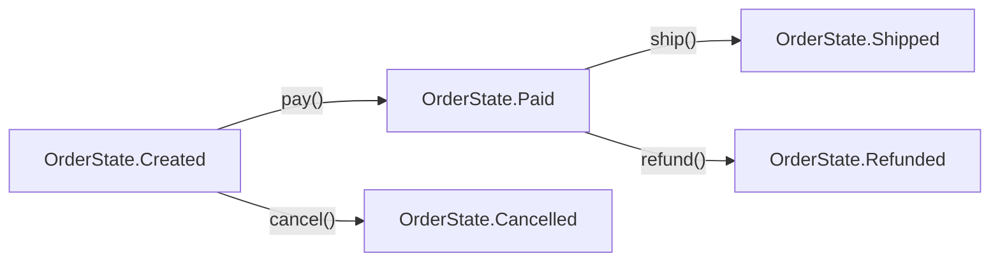
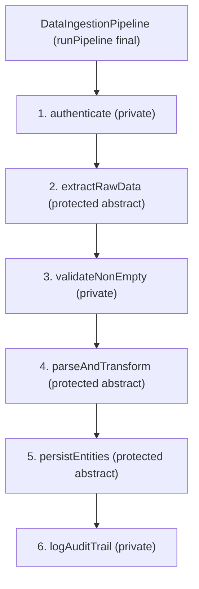

Creational patterns control how objects get constructed, and structural patterns shape how they are composed. Behavioral patterns deal with what happens once those objects are alive: how they make decisions, notify each other of state changes, and pass control around at runtime.

In Java codebases that grow without these patterns, control flow usually piles up in a few familiar ways. You end up with a 500-line service method full of `if-else` chains checking status enums and carrier strings, or a checkout workflow that directly calls email, inventory, and analytics services in a single rigid sequence. Adding one new requirement forces you to edit code that already works.

Modern Java changes how you implement several of these Gang of Four patterns. Lambdas and functional interfaces remove most of the class boilerplate that Strategy, Observer, and simple Commands used to require in Java 5. At the same time, State machines and Template Method workflows still benefit from explicit types, and Java 21's sealed interfaces and pattern matching make state transitions much safer than they used to be.



## Strategy: Swapping Algorithms Without Branch Sprawl

The Strategy pattern encapsulates a family of interchangeable algorithms behind a common contract so the calling code does not need to know which variant it is running.

Without Strategy, code that varies by policy tends to accumulate conditional branches every time the business adds a new rule:

```java
// Hard to extend: every new carrier forces edits to this method
public BigDecimal calculateShipping(Order order, String carrier) {
    if ("FEDEX".equalsIgnoreCase(carrier)) {
        return calculateFedExRates(order);
    } else if ("UPS".equalsIgnoreCase(carrier)) {
        return calculateUpsRates(order);
    } else if ("DHL".equalsIgnoreCase(carrier)) {
        return calculateDhlRates(order);
    }
    throw new IllegalArgumentException("Unknown carrier: " + carrier);
}
```

### Functional Strategies With Lambdas

In older Java, extracting each pricing or shipping rule meant writing a separate concrete class for every policy, even when the rule was three lines of math. Because a strategy contract usually has a single abstract method, a `@FunctionalInterface` lets callers pass lambdas or method references directly:

```java
import java.math.BigDecimal;
import java.math.RoundingMode;
import java.util.Objects;

@FunctionalInterface
public interface PricingStrategy {
    BigDecimal computeTotal(BigDecimal basePrice);
}

public class OrderCheckout {
    private final PricingStrategy pricingStrategy;

    public OrderCheckout(PricingStrategy pricingStrategy) {
        this.pricingStrategy = Objects.requireNonNull(pricingStrategy);
    }

    public BigDecimal process(BigDecimal basePrice) {
        return pricingStrategy.computeTotal(basePrice).setScale(2, RoundingMode.HALF_UP);
    }

    public static void main(String[] args) {
        PricingStrategy regular = price -> price;
        PricingStrategy seasonalDiscount = price -> price.multiply(new BigDecimal("0.80"));
        PricingStrategy vipFixedOff = price ->
            price.subtract(new BigDecimal("15.00")).max(BigDecimal.ZERO);

        BigDecimal cartValue = new BigDecimal("100.00");

        System.out.println("Regular: " + new OrderCheckout(regular).process(cartValue));
        System.out.println("Seasonal: " + new OrderCheckout(seasonalDiscount).process(cartValue));
        System.out.println("VIP: " + new OrderCheckout(vipFixedOff).process(cartValue));
    }
}
```

### When a Strategy Should Still Be a Class

Lambdas work well for stateless formulas, comparators (`Comparator.comparing(...)`), and small policies. Once a strategy needs injected collaborators (an HTTP client for live FedEx quotes, a rate table from Redis, or retry configuration), promote it to a concrete class.

In Spring or plain Java, a common pattern is pairing named strategy implementations with a lookup map so selection happens cleanly at runtime without an `if-else` chain:

```java
import java.math.BigDecimal;
import java.util.List;
import java.util.Map;
import java.util.function.Function;
import java.util.stream.Collectors;

public interface ShippingRateStrategy {
    String carrierCode();
    BigDecimal quote(BigDecimal weightKg, String destinationZip);
}

public class ShippingCalculator {
    private final Map<String, ShippingRateStrategy> strategiesByCarrier;

    public ShippingCalculator(List<ShippingRateStrategy> strategies) {
        this.strategiesByCarrier = strategies.stream()
            .collect(Collectors.toUnmodifiableMap(
                s -> s.carrierCode().toUpperCase(),
                Function.identity()
            ));
    }

    public BigDecimal calculate(String carrier, BigDecimal weightKg, String destinationZip) {
        ShippingRateStrategy strategy = strategiesByCarrier.get(carrier.toUpperCase());
        if (strategy == null) {
            throw new IllegalArgumentException("Unsupported carrier: " + carrier);
        }
        return strategy.quote(weightKg, destinationZip);
    }
}
```

Adding a new carrier now means registering a new `ShippingRateStrategy` bean or passing another instance into the constructor. `ShippingCalculator` never changes.

## Observer: Decoupled Event Notification

The Observer pattern sets up a one-to-many notification relationship. A publisher (historically called the Subject) keeps track of interested subscribers (Observers). When something meaningful happens, the publisher notifies every registered subscriber without knowing their concrete types or what they do with the event.



Because an observer interface usually has one callback method (`onEvent(T event)`), Java lambdas remove the need for anonymous inner classes when registering lightweight listeners. Java's standard library also offers `java.util.concurrent.Flow` (introduced in Java 9) when you need asynchronous streams with backpressure, and Spring provides `ApplicationEventPublisher` with `@EventListener` and `@TransactionalEventListener` for application-wide events.

### The Lapsed Listener Problem

The most common bug in hand-rolled Observer implementations is a memory leak known as the Lapsed Listener Problem.

Suppose a singleton event publisher holds a `List<OrderListener>`. A short-lived component (a UI panel, a per-session handler, or a temporary worker) subscribes to that publisher and later goes out of scope without unsubscribing. Because the publisher still holds a strong reference to the listener, the garbage collector cannot reclaim it. Over hours or days in a busy JVM, those unreachable listeners accumulate on the heap.

### Thread-Safe Publisher With Explicit Unsubscription

A clean way to prevent leaked listeners is to return an `AutoCloseable` subscription handle from `subscribe(...)` and store listeners in a `CopyOnWriteArrayList`. `CopyOnWriteArrayList` makes iteration safe if one listener subscribes or unsubscribes during a broadcast, which is a common trade-off when reads (event publications) far outnumber writes (subscriptions).

```java
import java.math.BigDecimal;
import java.util.List;
import java.util.Objects;
import java.util.concurrent.CopyOnWriteArrayList;

public class OrderEventPublisher {

    public record OrderPlacedEvent(String orderId, String customerEmail, BigDecimal amount) {}

    @FunctionalInterface
    public interface OrderListener {
        void onOrderPlaced(OrderPlacedEvent event);
    }

    public interface Subscription extends AutoCloseable {
        @Override
        void close();
    }

    private final List<OrderListener> listeners = new CopyOnWriteArrayList<>();

    public Subscription subscribe(OrderListener listener) {
        Objects.requireNonNull(listener, "Listener must not be null");
        listeners.add(listener);
        return () -> listeners.remove(listener);
    }

    public void publish(OrderPlacedEvent event) {
        Objects.requireNonNull(event, "Event must not be null");
        for (OrderListener listener : listeners) {
            try {
                listener.onOrderPlaced(event);
            } catch (RuntimeException ex) {
                // Isolate failures so one broken listener does not block the rest
                System.err.printf("Listener %s failed for order %s: %s%n",
                    listener.getClass().getSimpleName(), event.orderId(), ex.getMessage());
            }
        }
    }
}
```

Callers can pass a lambda and manage its lifetime deterministically with `try-with-resources`, or keep the `Subscription` handle and call `close()` during component shutdown:

```java
import java.math.BigDecimal;

public class ObserverDemo {
    public static void main(String[] args) {
        OrderEventPublisher publisher = new OrderEventPublisher();

        // Long-lived listener
        OrderEventPublisher.Subscription auditSub = publisher.subscribe(
            event -> System.out.println("Audit log: " + event.orderId())
        );

        // Short-lived listener scoped to a block
        try (var tempAnalyticsSub = publisher.subscribe(
                event -> System.out.println("Temp analytics: " + event.amount()))) {
            publisher.publish(new OrderEventPublisher.OrderPlacedEvent(
                "ORD-101", "alice@example.com", new BigDecimal("250.00")));
        }

        // Only the audit listener receives this event; tempAnalyticsSub was removed
        publisher.publish(new OrderEventPublisher.OrderPlacedEvent(
            "ORD-102", "bob@example.com", new BigDecimal("80.00")));

        auditSub.close();
    }
}
```

Note one important detail about synchronous observers: `publish(...)` runs every listener on the caller's thread. If an email listener blocks on an external SMTP server for five seconds, checkout slows down by five seconds too. For slow or failure-prone side effects, hand the work off to an executor, a message queue, or an asynchronous listener.

## Command: Modeling Operations as Objects

The Command pattern turns an action into a standalone object containing everything needed to run it later. That separation lets you queue commands on a thread pool, log them for auditing, retry them after transient failures, or maintain an undo stack.

Four roles participate in a classic Command design:
- **Command**: The contract declaring `execute()` (and `undo()` if reversible).
- **Concrete Command**: Captures the parameters and target receiver for one specific action.
- **Receiver**: The domain object or service that performs the real work.
- **Invoker**: Schedules, executes, or tracks history of commands without knowing their details.



### When Lambdas Are Enough vs When You Need Command Objects

If you only need deferred execution (such as submitting tasks to an `ExecutorService` or scheduling callbacks), you do not need custom command classes. Java's `Runnable` and `Callable<V>` are already the Command pattern:

```java
ExecutorService executor = Executors.newVirtualThreadPerTaskExecutor();
executor.submit(() -> invoiceService.generatePdf(orderId));
```

A dedicated command class (or record) becomes worthwhile when the operation carries extra responsibilities that a single lambda cannot express cleanly: undo state, idempotency keys, retry counts, serialization to a database or queue, or structured audit logs.

### Stateful Undoable Command Example

Here is an in-memory ledger where each transfer encapsulates both execution and rollback:

```java
import java.math.BigDecimal;
import java.util.ArrayDeque;
import java.util.Deque;
import java.util.Objects;

public class BankAccount {
    private final String accountId;
    private BigDecimal balance;

    public BankAccount(String accountId, BigDecimal initialBalance) {
        this.accountId = Objects.requireNonNull(accountId);
        this.balance = Objects.requireNonNull(initialBalance);
    }

    public void debit(BigDecimal amount) {
        if (amount.compareTo(BigDecimal.ZERO) <= 0) {
            throw new IllegalArgumentException("Debit amount must be positive");
        }
        if (balance.compareTo(amount) < 0) {
            throw new IllegalStateException("Insufficient funds in account " + accountId);
        }
        balance = balance.subtract(amount);
    }

    public void credit(BigDecimal amount) {
        if (amount.compareTo(BigDecimal.ZERO) <= 0) {
            throw new IllegalArgumentException("Credit amount must be positive");
        }
        balance = balance.add(amount);
    }

    public BigDecimal getBalance() { return balance; }
    public String getAccountId() { return accountId; }
}

public interface AccountCommand {
    void execute();
    void undo();
}

public class TransferCommand implements AccountCommand {
    private final BankAccount fromAccount;
    private final BankAccount toAccount;
    private final BigDecimal amount;
    private boolean executed = false;

    public TransferCommand(BankAccount from, BankAccount to, BigDecimal amount) {
        this.fromAccount = Objects.requireNonNull(from);
        this.toAccount = Objects.requireNonNull(to);
        this.amount = Objects.requireNonNull(amount);
    }

    @Override
    public void execute() {
        if (executed) {
            throw new IllegalStateException("TransferCommand has already been executed");
        }
        fromAccount.debit(amount);
        toAccount.credit(amount);
        executed = true;
    }

    @Override
    public void undo() {
        if (!executed) {
            throw new IllegalStateException("Cannot undo a command that was not executed");
        }
        toAccount.debit(amount);
        fromAccount.credit(amount);
        executed = false;
    }
}

public class TransactionManager {
    private final Deque<AccountCommand> history = new ArrayDeque<>();

    public void execute(AccountCommand command) {
        command.execute();
        history.push(command);
    }

    public void rollbackLast() {
        if (!history.isEmpty()) {
            history.pop().undo();
        }
    }
}
```

> [!WARNING]
> **In-memory undo does not work for external side effects.** You can reverse a field update in JVM memory, but you cannot un-send an email or un-charge a credit card at a remote payment provider. Across service boundaries, model reversals as explicit compensating actions (such as issuing a refund transaction) rather than pretending an external call can be undone.

## State: Explicit Lifecycle Transitions

Objects with lifecycles (orders, support tickets, payment authorizations, network connections) behave differently depending on their current state. A naive implementation stores an enum field and scatters state checks across every method:

```java
public void approveOrder() {
    if (this.status == Status.SHIPPED || this.status == Status.DELIVERED) {
        throw new IllegalStateException("Order is already finalized");
    } else if (this.status == Status.DRAFT) {
        throw new IllegalStateException("Submit the order before approving");
    } else if (this.status == Status.SUBMITTED) {
        this.status = Status.APPROVED;
    }
}
```

When you have six states and eight operations, those checks quickly drift out of sync. Adding a seventh state means hunting through every method in the class to make sure nothing was missed.

Unlike Strategy, State does not collapse cleanly into lambdas because each state typically carries state-specific data (a `Paid` order has a `transactionId`; a `Shipped` order has a `trackingNumber`; a `Created` order has neither) and governs which transitions are legal.

### Modern Java 21: Sealed Interfaces and Pattern Matching

Java 21 gives you a clean way to build finite state machines using a `sealed interface` of `record` states and exhaustive `switch` expressions. Each state holds only the data that actually exists in that state, eliminating nullable fields that only make sense halfway through an object's lifecycle.



```java
import java.util.Objects;

public class OrderWorkflow {

    public sealed interface OrderState
        permits OrderState.Created, OrderState.Paid, OrderState.Shipped,
                OrderState.Cancelled, OrderState.Refunded {

        String orderId();

        record Created(String orderId) implements OrderState {}
        record Paid(String orderId, String transactionId) implements OrderState {}
        record Shipped(String orderId, String transactionId, String trackingNumber) implements OrderState {}
        record Cancelled(String orderId, String reason) implements OrderState {}
        record Refunded(String orderId, String transactionId, String reason) implements OrderState {}
    }

    private OrderState currentState;

    public OrderWorkflow(String orderId) {
        this.currentState = new OrderState.Created(Objects.requireNonNull(orderId));
    }

    public void pay(String transactionId) {
        Objects.requireNonNull(transactionId);
        currentState = switch (currentState) {
            case OrderState.Created c -> new OrderState.Paid(c.orderId(), transactionId);
            case OrderState.Paid p -> throw new IllegalStateException("Order is already paid");
            case OrderState.Shipped s -> throw new IllegalStateException("Order is already shipped");
            case OrderState.Cancelled c -> throw new IllegalStateException("Cannot pay a cancelled order");
            case OrderState.Refunded r -> throw new IllegalStateException("Cannot pay a refunded order");
        };
    }

    public void ship(String trackingNumber) {
        Objects.requireNonNull(trackingNumber);
        currentState = switch (currentState) {
            case OrderState.Paid p -> new OrderState.Shipped(p.orderId(), p.transactionId(), trackingNumber);
            case OrderState.Created c -> throw new IllegalStateException("Cannot ship an unpaid order");
            case OrderState.Shipped s -> throw new IllegalStateException("Order is already shipped");
            case OrderState.Cancelled c -> throw new IllegalStateException("Cannot ship a cancelled order");
            case OrderState.Refunded r -> throw new IllegalStateException("Cannot ship a refunded order");
        };
    }

    public void cancel(String reason) {
        Objects.requireNonNull(reason);
        currentState = switch (currentState) {
            case OrderState.Created c -> new OrderState.Cancelled(c.orderId(), reason);
            case OrderState.Paid p -> throw new IllegalStateException("Use refund() for a paid order");
            case OrderState.Shipped s -> throw new IllegalStateException("Cannot cancel a shipped order");
            case OrderState.Cancelled c -> throw new IllegalStateException("Order is already cancelled");
            case OrderState.Refunded r -> throw new IllegalStateException("Order is already refunded");
        };
    }

    public void refund(String reason) {
        Objects.requireNonNull(reason);
        currentState = switch (currentState) {
            case OrderState.Paid p -> new OrderState.Refunded(p.orderId(), p.transactionId(), reason);
            case OrderState.Created c -> throw new IllegalStateException("Cannot refund an unpaid order");
            case OrderState.Shipped s -> throw new IllegalStateException("Shipped orders require a return first");
            case OrderState.Cancelled c -> throw new IllegalStateException("Cannot refund a cancelled order");
            case OrderState.Refunded r -> throw new IllegalStateException("Order is already refunded");
        };
    }

    public OrderState getCurrentState() {
        return currentState;
    }
}
```

Because `OrderState` is sealed and none of the `switch` expressions have a `default` branch, adding a new state (say, `Delivered`) causes a compile error in every transition method until you decide explicitly what `pay`, `ship`, `cancel`, and `refund` should do for that state.

When each state also carries heavy behavior of its own (dozens of lines of logic per state rather than simple transitions), the classic object-oriented State pattern (putting methods directly on the `OrderState` interface and implementing them in concrete state classes) keeps `OrderWorkflow` small and places each state's behavior next to its data.

## Template Method: Fixed Workflows With Extension Hooks

Sometimes multiple workflows follow the exact same sequence of steps, and only a couple of steps vary. For example, every batch data importer in a system must authenticate, fetch raw data, verify the payload is non-empty, parse it into domain records, save the result, and write an audit log entry.

The Template Method pattern puts the fixed skeleton in a `final` method on an abstract base class and delegates the varying steps to `protected` hook methods. Subclasses cannot accidentally skip authentication or reorder the audit step because the skeleton method cannot be overridden.



### Implementing a Template Method Pipeline

```java
import java.nio.charset.StandardCharsets;
import java.util.Arrays;
import java.util.List;
import java.util.Objects;

public abstract class DataIngestionPipeline<T> {

    // Marked final so subclasses cannot bypass validation or auditing
    public final void runPipeline(String sourceUri) {
        Objects.requireNonNull(sourceUri, "sourceUri must not be null");
        authenticate(sourceUri);
        byte[] rawBytes = extractRawData(sourceUri);
        validateNonEmpty(sourceUri, rawBytes);
        List<T> records = parseAndTransform(rawBytes);
        persistEntities(records);
        logAuditTrail(sourceUri, records.size());
    }

    private void authenticate(String uri) {
        System.out.println("[AUTH] Checking credentials for " + uri);
    }

    private void validateNonEmpty(String uri, byte[] rawBytes) {
        if (rawBytes == null || rawBytes.length == 0) {
            throw new IllegalArgumentException("Ingestion source is empty: " + uri);
        }
    }

    protected abstract byte[] extractRawData(String uri);
    protected abstract List<T> parseAndTransform(byte[] rawData);
    protected abstract void persistEntities(List<T> entities);

    private void logAuditTrail(String uri, int count) {
        System.out.printf("[AUDIT] Ingested %d records from %s%n", count, uri);
    }
}

public class CsvProductIngestionPipeline extends DataIngestionPipeline<String> {

    @Override
    protected byte[] extractRawData(String uri) {
        // In production, read from S3, SFTP, or disk
        return "SKU-100\nSKU-200\nSKU-300".getBytes(StandardCharsets.UTF_8);
    }

    @Override
    protected List<String> parseAndTransform(byte[] rawData) {
        String content = new String(rawData, StandardCharsets.UTF_8);
        return Arrays.stream(content.split("\\R"))
            .filter(line -> !line.isBlank())
            .toList();
    }

    @Override
    protected void persistEntities(List<String> entities) {
        System.out.println("Persisting products: " + entities);
    }
}
```

### Pitfall: Calling Overridable Methods From Constructors

Inheritance introduces a subtle trap when writing abstract base classes. Never invoke an overridable method from a superclass constructor:

```java
// Bug: calling an overridable method during superclass construction
public abstract class BaseService {
    protected BaseService() {
        init(); // Dispatches to the subclass before subclass fields are initialized
    }

    protected abstract void init();
}

public class DatabaseService extends BaseService {
    private final String connectionUrl = "jdbc:postgresql://localhost:5432/app";

    @Override
    protected void init() {
        // Throws NullPointerException: connectionUrl is still null here
        System.out.println("Connecting to " + connectionUrl.toUpperCase());
    }
}
```

According to the Java Language Specification, superclass constructors finish before subclass field initializers and subclass constructors run. When `BaseService()` calls `init()`, dynamic dispatch invokes `DatabaseService.init()`, where `connectionUrl` still holds its default value of `null`.

> [!CAUTION]
> Keep superclass constructors limited to assigning fields and validating arguments. If initialization requires subclass behavior, provide an explicit `start()` or `initialize()` lifecycle method called after construction finishes.

### Template Method vs Composition With Functional Hooks

Template Method relies on inheritance, which locks subclasses into a single parent class and makes it harder to mix and match individual steps (for instance, reusing S3 extraction with both CSV and JSON parsers). In Java, if the hooks are small and independent, you can often replace the abstract base class with a `final` coordinator class that accepts functional interfaces (such as `Function<String, byte[]> extractor`, `Function<byte[], List<T>> parser`, and `Consumer<List<T>> persister`). Use inheritance-based Template Method when subclasses share protected helper utilities, stateful lifecycle hooks, or a framework contract like Spring's `OncePerRequestFilter`.

## Choosing the Right Pattern

| Pattern | Core Problem Solved | Modern Java Implementation |
| :--- | :--- | :--- |
| **Strategy** | Swap an algorithm without branching in the caller | `@FunctionalInterface` and lambdas, or DI-managed classes in a lookup map |
| **Observer** | Broadcast events to decoupled subscribers | Functional listeners with `AutoCloseable` handles, `CopyOnWriteArrayList`, Spring Events, `Flow` |
| **Command** | Decouple invocation from execution; queue, audit, or undo | `Runnable`/`Callable` for simple tasks; dedicated classes/records when undo or metadata is needed |
| **State** | Enforce valid transitions and state-dependent behavior | `sealed interface` + `record` states + exhaustive `switch`, or concrete state classes |
| **Template Method** | Enforce a fixed multi-step workflow with customizable hooks | Abstract class with `final` template method, or a final coordinator taking functional hooks |

## Interview Questions

### Strategy and State look almost identical in a UML diagram. How do they differ in practice?

Both rely on composition and delegation to vary behavior at runtime, so their class diagrams look nearly identical. The difference is intent and who drives the change.

With **Strategy**, the caller selects an algorithm (for example, injecting a `ShippingRateStrategy` or passing a `Comparator`) and the strategies do not know about one another. The context rarely switches its own strategy mid-operation. With **State**, the object moves through a lifecycle, and transitions depend on what state it is currently in. Either the context's transition methods or the state objects themselves decide the next valid state, while callers simply invoke domain operations like `pay()` or `ship()`.

### What causes the Lapsed Listener Problem in Observer, and how do you avoid it?

It happens when a long-lived publisher keeps strong references to short-lived subscribers. Even after the rest of the application drops all references to a subscriber, the publisher's listener list keeps it reachable, so the garbage collector cannot reclaim it.

There are two standard ways to prevent it. First, return an explicit `Subscription` handle (ideally `AutoCloseable`) from `subscribe(...)` so callers unsubscribe deterministically in `try-with-resources` or shutdown hooks. Second, if callers cannot reliably manage lifecycles, store listeners via `WeakReference` and prune cleared references during publication, though weak references do not work well with inline lambdas that have no other strong reference keeping them alive.

### Why is calling an overridable method from a superclass constructor dangerous in Java?

Java initializes objects top-down: the superclass constructor runs completely before the subclass's field initializers and constructor body execute. If the superclass constructor calls a non-final, non-private method that a subclass overrides, JVM dynamic dispatch invokes the subclass method while all subclass fields still hold default zero values (`null`, `0`, `false`). That commonly causes `NullPointerException` or silently corrupts invariants.

### When do Java 21 sealed interfaces improve on the classic GoF State pattern, and when are classic state classes still better?

Sealed interfaces paired with records and pattern matching `switch` shine when states hold different fields and you want all transition rules visible in one place with compiler-checked exhaustiveness. Adding a new state immediately flags every `switch` expression that has not been updated, so missing cases become compile errors instead of runtime surprises.

Classic polymorphic state classes still make sense when each state has substantial, distinct behavior across many methods. Putting each state's logic into its own class avoids turning every method on the context into a huge `switch` block.
