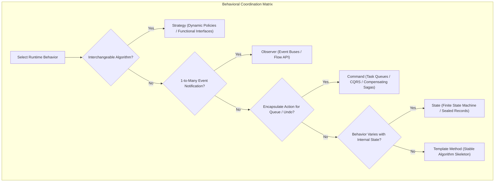
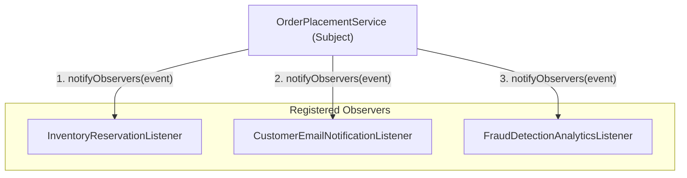
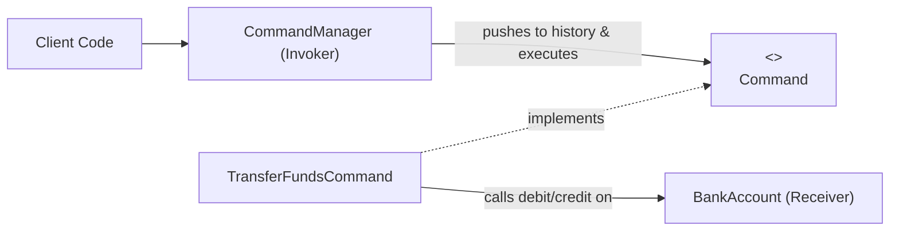
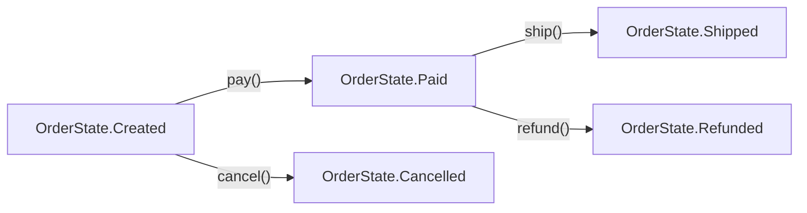
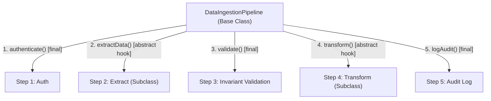

If creational patterns govern how objects are born, and structural patterns define their physical anatomy, **behavioral patterns** orchestrate how objects communicate, make decisions, and distribute control flow at runtime.

Without behavioral patterns, enterprise code rapidly degrades into procedural sprawl:
- A single 1,000-line method filled with 15 nested `if-else` and `switch` blocks inspecting internal object flags.
- Tightly coupled components where changing how an order is taxed forces changes to how it is shipped and archived.
- Fire-and-forget callback chains that leak memory because listeners are never garbage collected.

Behavioral patterns decouple the **sender of a request** from the **receiver of the request**, and separate **what** needs to be done from **how** it is executed.



---

## Strategy: Decoupling Algorithms from Workflows

> *"Define a family of algorithms, encapsulate each one, and make them interchangeable. Strategy lets the algorithm vary independently from clients that use it."* — Gang of Four

In traditional code, varying an algorithm results in sprawling conditional statements:

```java
// CODE SMELL: Violates Open/Closed Principle
public BigDecimal calculateShipping(Order order, String carrier) {
    if ("FEDEX".equalsIgnoreCase(carrier)) {
        return calculateFedExRates(order);
    } else if ("UPS".equalsIgnoreCase(carrier)) {
        return calculateUpsRates(order);
    } else if ("DHL".equalsIgnoreCase(carrier)) {
        return calculateDhlRates(order);
    }
    throw new IllegalArgumentException("Unknown carrier");
}
```

The **Strategy** pattern extracts each algorithm into its own class implementing a common interface.

### Modern Java 21: Functional Strategies and Lambdas

In modern Java, you do not always need a verbose hierarchy of strategy classes. Because the strategy interface is usually a single-method `@FunctionalInterface`, you can pass lambdas and method references directly:

```java
import java.math.BigDecimal;
import java.util.Objects;

@FunctionalInterface
public interface PricingStrategy {
    BigDecimal computeTotal(BigDecimal basePrice);
}

public class OrderCheckout {
    private final PricingStrategy pricingStrategy;

    public OrderCheckout(PricingStrategy pricingStrategy) {
        this.pricingStrategy = Objects.requireNonNull(pricingStrategy);
    }

    public BigDecimal process(BigDecimal basePrice) {
        return pricingStrategy.computeTotal(basePrice);
    }

    public static void main(String[] args) {
        // Strategy 1: Regular pricing (Pass-through lambda)
        OrderCheckout regular = new OrderCheckout(price -> price);

        // Strategy 2: Black Friday 20% discount strategy
        OrderCheckout blackFriday = new OrderCheckout(price -> 
            price.multiply(BigDecimal.valueOf(0.80)));

        // Strategy 3: VIP Member fixed fee reduction
        OrderCheckout vip = new OrderCheckout(price -> 
            price.subtract(BigDecimal.valueOf(15.00)).max(BigDecimal.ZERO));

        BigDecimal cartValue = BigDecimal.valueOf(100.00);
        System.out.println("Regular: " + regular.process(cartValue));
        System.out.println("Black Friday: " + blackFriday.process(cartValue));
        System.out.println("VIP: " + vip.process(cartValue));
    }
}
```

When a strategy requires rich state, dependencies (such as an external tax API), or complex configuration, promote it to a dedicated concrete class managed via Spring Dependency Injection.

---

## Observer: Decoupled Event Notification

> *"Define a one-to-many dependency between objects so that when one object changes state, all its dependents are notified and updated automatically."* — Gang of Four

The Observer pattern is the foundation of event-driven architecture, UI toolkits, Spring Application Events, and reactive message streaming.

A **Subject (Publisher)** maintains an internal registry of **Observers (Subscribers)**. When a domain event occurs (such as `OrderPlacedEvent`), the publisher broadcasts the event to all registered observers without knowing their concrete identities.



### The Lapsed Listener Memory Leak

The most dangerous production pitfall in the Observer pattern is the **Lapsed Listener Problem**.

If a long-lived publisher holds a strong reference to a short-lived subscriber, the Java Garbage Collector cannot reclaim the subscriber, even if the application has discarded all other references to it! In high-throughput systems, this causes continuous heap bloat and eventual out-of-memory crashes.

### Production Implementation with Safe Registration

Use an `AutoCloseable` subscription token and `CopyOnWriteArrayList` to ensure thread-safe registration and deterministic unsubscription:

```java
import java.util.List;
import java.util.Objects;
import java.util.concurrent.CopyOnWriteArrayList;

public class OrderEventPublisher {
    public record OrderPlacedEvent(String orderId, String customerEmail, double amount) {}

    @FunctionalInterface
    public interface OrderListener {
        void onOrderPlaced(OrderPlacedEvent event);
    }

    public interface Subscription extends AutoCloseable {
        @Override
        void close(); // Guarantees unsubscription
    }

    // Thread-safe list prevents ConcurrentModificationException during broadcast
    private final List<OrderListener> listeners = new CopyOnWriteArrayList<>();

    public Subscription subscribe(OrderListener listener) {
        Objects.requireNonNull(listener);
        listeners.add(listener);
        
        // Return a deterministic unsubscription handle
        return () -> listeners.remove(listener);
    }

    public void publish(OrderPlacedEvent event) {
        for (OrderListener listener : listeners) {
            try {
                listener.onOrderPlaced(event);
            } catch (Exception ex) {
                // Defensive isolation: One failing listener must NEVER prevent other listeners from running!
                System.err.printf("[ERROR] Listener %s failed: %s%n", 
                    listener.getClass().getSimpleName(), ex.getMessage());
            }
        }
    }
}
```

### Using Subscription Tokens Cleanly

```java
public class ObserverDemo {
    public static void main(String[] args) {
        OrderEventPublisher publisher = new OrderEventPublisher();

        // Register a temporary analytics listener using try-with-resources
        try (var sub = publisher.subscribe(event -> 
                System.out.println("Analytics: Captured order " + event.orderId()))) {
            
            publisher.publish(new OrderEventPublisher.OrderPlacedEvent("ORD-101", "alice@test.com", 250.0));
        } // Automatically unsubscribes here!

        // Subsequent publish does NOT invoke the analytics listener; zero memory leak!
        publisher.publish(new OrderEventPublisher.OrderPlacedEvent("ORD-102", "bob@test.com", 80.0));
    }
}
```

---

## Command: Encapsulating Requests as Objects

> *"Encapsulate a request as an object, thereby letting you parameterize clients with different requests, queue or log requests, and support undoable operations."* — Gang of Four

The Command pattern decouples the object that invokes an operation from the objects that know how to execute it. It models operations as first-class citizens.

The pattern relies on four collaborators:
1. **Command Interface**: Declares `execute()` and optional `undo()`.
2. **Concrete Command**: Binds a specific action to a Receiver.
3. **Receiver**: The worker that executes the actual business logic (e.g., Database, FileSystem, PaymentApi).
4. **Invoker**: Holds commands and coordinates their execution history, queueing, or scheduling.



### Production Implementation: Undoable Transaction Ledger

```java
import java.math.BigDecimal;
import java.util.ArrayDeque;
import java.util.Deque;
import java.util.Objects;

// 1. The Receiver: Owns the domain business logic
public class BankAccount {
    private final String accountId;
    private BigDecimal balance;

    public BankAccount(String accountId, BigDecimal initialBalance) {
        this.accountId = accountId;
        this.balance = initialBalance;
    }

    public void debit(BigDecimal amount) {
        if (balance.compareTo(amount) < 0) {
            throw new IllegalStateException("Insufficient funds in account " + accountId);
        }
        balance = balance.subtract(amount);
    }

    public void credit(BigDecimal amount) {
        balance = balance.add(amount);
    }

    public BigDecimal getBalance() { return balance; }
    public String getAccountId() { return accountId; }
}

// 2. The Command Interface
public interface AccountCommand {
    void execute();
    void undo();
}

// 3. Concrete Command: Encapsulates state needed for execution AND rollback
public class TransferCommand implements AccountCommand {
    private final BankAccount fromAccount;
    private final BankAccount toAccount;
    private final BigDecimal amount;
    private boolean executed = false;

    public TransferCommand(BankAccount from, BankAccount to, BigDecimal amount) {
        this.fromAccount = Objects.requireNonNull(from);
        this.toAccount = Objects.requireNonNull(to);
        this.amount = Objects.requireNonNull(amount);
    }

    @Override
    public void execute() {
        fromAccount.debit(amount);
        toAccount.credit(amount);
        executed = true;
    }

    @Override
    public void undo() {
        if (!executed) throw new IllegalStateException("Cannot undo a command that was never executed");
        toAccount.debit(amount);
        fromAccount.credit(amount);
        executed = false;
    }
}

// 4. The Invoker: Manages execution pipeline and undo history stack
public class TransactionManager {
    private final Deque<AccountCommand> history = new ArrayDeque<>();

    public void executeTransaction(AccountCommand command) {
        command.execute();
        history.push(command);
    }

    public void rollbackLast() {
        if (!history.isEmpty()) {
            AccountCommand lastCommand = history.pop();
            lastCommand.undo();
        }
    }
}
```

> [!WARNING]
> **Undo vs Compensating Transactions**:
> You can easily undo state inside JVM memory. But you **cannot** physically undo an external network I/O call (such as a sent email, an SMS notification, or a charge processed through an external payment gateway). For distributed actions, use the **Saga Pattern**: execute a new *compensating transaction* (e.g., issuing an explicit refund) rather than pretending you can turn back time.

---

## State: Finite State Machines without Switch Spaghetti

> *"Allow an object to alter its behavior when its internal state changes. The object will appear to change its class."* — Gang of Four

When an entity transitions through multiple lifecycles (e.g., `Draft -> Submitted -> Approved -> Shipped -> Delivered`), junior engineers write methods like this:

```java
// STATE MACHINE SPAGHETTI:
public void approveOrder() {
    if (this.status == Status.SHIPPED || this.status == Status.DELIVERED) {
        throw new IllegalStateException("Already finished!");
    } else if (this.status == Status.DRAFT) {
        throw new IllegalStateException("Must submit before approving!");
    } else if (this.status == Status.SUBMITTED) {
        this.status = Status.APPROVED;
    }
}
```

Every new status adds dozens of checks across every method. The **State** pattern encapsulates each state as an independent class, delegating actions to the active state object.

### Modern Java 21: Sealed Interfaces & Pattern Matching for FSMs

In modern Java 21, you can implement bulletproof Finite State Machines using **Sealed Interfaces** and **Pattern Matching**. The Java compiler guarantees that all possible states are exhaustively checked without needing fallback defaults!



```java
public class OrderFsm {
    // 1. Sealed Hierarchy: Closed set of valid states
    public sealed interface OrderState 
        permits OrderState.Created, OrderState.Paid, OrderState.Shipped, OrderState.Cancelled {}

    public record Created(String orderId) implements OrderState {}
    public record Paid(String orderId, String transactionId) implements OrderState {}
    public record Shipped(String orderId, String trackingNumber) implements OrderState {}
    public record Cancelled(String orderId, String reason) implements OrderState {}

    private OrderState currentState;

    public OrderFsm(String orderId) {
        this.currentState = new Created(orderId);
    }

    // 2. State-driven Transitions with Compiler-Enforced Exhaustiveness
    public void pay(String txId) {
        currentState = switch (currentState) {
            case Created c -> new Paid(c.orderId(), txId);
            case Paid p -> throw new IllegalStateException("Order is already paid!");
            case Shipped s -> throw new IllegalStateException("Cannot pay an order that is already shipped!");
            case Cancelled c -> throw new IllegalStateException("Cannot pay a cancelled order!");
        };
    }

    public void ship(String trackingNum) {
        currentState = switch (currentState) {
            case Paid p -> new Shipped(p.orderId(), trackingNum);
            case Created c -> throw new IllegalStateException("Cannot ship an unpaid order!");
            case Shipped s -> throw new IllegalStateException("Order is already shipped!");
            case Cancelled c -> throw new IllegalStateException("Cannot ship a cancelled order!");
        };
    }

    public OrderState getCurrentState() { return currentState; }
}
```

By leveraging Java 21 sealed types, invalid transitions are rejected explicitly, and adding a new state forces the compiler to flag every single `switch` in the codebase that needs to handle it.

---

## Template Method: Invariant Workflows with Subclass Hooks

> *"Define the skeleton of an algorithm in an operation, deferring some steps to subclasses. Template Method lets subclasses redefine certain steps of an algorithm without changing the algorithm's structure."* — Gang of Four

The Template Method embodies the **Hollywood Principle**: *"Don't call us, we'll call you."*

When multiple classes share a fixed, mandatory sequence of operations (such as data ingestion: `Authenticate -> Read -> Validate -> Parse -> Persist -> Audit`), you define the algorithm skeleton in a base class method marked **`final`**. Subclasses override specific hook methods to provide customized step logic.



### Production Implementation: Safe Ingestion Pipeline

```java
import java.util.List;
import java.util.Objects;

public abstract class DataIngestionPipeline<T> {
    // The Template Method: Marked final to prevent subclasses from altering the sequence!
    public final void runPipeline(String sourceUri) {
        authenticate(sourceUri);
        byte[] rawBytes = extractRawData(sourceUri);
        
        if (rawBytes.length == 0) {
            throw new IllegalArgumentException("Ingestion source is empty: " + sourceUri);
        }

        List<T> domainEntities = parseAndTransform(rawBytes);
        persistEntities(domainEntities);
        logAuditTrail(sourceUri, domainEntities.size());
    }

    // Invariant step 1
    private void authenticate(String uri) {
        System.out.println("[AUTH] Verifying cryptographic credentials for: " + uri);
    }

    // Subclass hook step 2
    protected abstract byte[] extractRawData(String uri);

    // Subclass hook step 3
    protected abstract List<T> parseAndTransform(byte[] rawData);

    // Subclass hook step 4
    protected abstract void persistEntities(List<T> entities);

    // Invariant step 5
    private void logAuditTrail(String uri, int count) {
        System.out.printf("[AUDIT] Successfully ingested %d records from %s%n", count, uri);
    }
}
```

### The Constructor Antipattern in Template Method

A catastrophic bug in Java occurs when an abstract base class invokes an overridable method inside its constructor:

```java
// SEVERE BUG IN TEMPLATE METHOD:
public abstract class BaseService {
    public BaseService() {
        init(); // DANGEROUS! Calls overridden subclass method!
    }

    protected abstract void init();
}

public class DatabaseService extends BaseService {
    private String connectionUrl = "jdbc:postgresql://localhost:5432/prod";

    @Override
    protected void init() {
        // Runs BEFORE connectionUrl is initialized!
        System.out.println("Connecting to: " + connectionUrl.toUpperCase()); 
        // THROWS NullPointerException because connectionUrl is null at this point!
    }
}
```

In Java, superclass constructors execute **before** subclass field initializers run. When `BaseService` calls `init()`, `DatabaseService.connectionUrl` has not been initialized yet and evaluates to `null`, causing an immediate `NullPointerException`!

> [!CAUTION]
> **Never call overridable methods inside a constructor**. Keep constructors purely for assigning final fields.

---

## Behavioral Patterns Comparison Matrix

| Pattern | Primary Intent | Modern Java 21 Mechanism |
| :--- | :--- | :--- |
| **Strategy** | Swap algorithms dynamically without altering workflow. | Lambdas, `@FunctionalInterface`, Method References |
| **Observer** | Broadcast state changes to multiple listeners without coupling. | `java.util.concurrent.Flow`, Spring Events, `CopyOnWriteArrayList` |
| **Command** | Encapsulate operations as objects for queueing and undo. | `Runnable`, `Callable`, Records, CQRS command buses |
| **State** | Vary behavior dynamically based on internal state transitions. | Sealed Interfaces + Pattern Matching `switch` |
| **Template Method** | Define an immutable execution skeleton with subclass hooks. | Abstract base class with `final` template method |

---

## Senior Engineer Interview Crucible

### Compare Strategy and State patterns: both share virtually identical class diagrams, so how do their intents and state transition ownership differ?
While both patterns use composition and delegation to swap behavior at runtime, their architectural intents are completely distinct:
1. **Strategy**: The client typically chooses and configures the strategy once (e.g., injecting a `PricingStrategy` at startup). Strategies are usually independent, stateless algorithms that know nothing about one another. The context rarely changes its own strategy during execution.
2. **State**: The context transitions between different states dynamically during its operational lifecycle. Concrete state classes frequently know about each other and trigger transitions to the next state (e.g., `PaidState` transitions the context to `ShippedState`). The client interacts with the context, unaware of the internal state machine.

### What is the Lapsed Listener Problem in the Observer pattern, and how does weak referencing or explicit lifecycle unsubscription remediate it?
The Lapsed Listener Problem occurs when a short-lived subscriber registers itself with a long-lived publisher (e.g., a singleton event bus). Because the publisher maintains a strong object reference to the subscriber in its listener list, the subscriber cannot be garbage collected even after the rest of the application has discarded it.

To remediate this:
1. **Explicit Subscription Tokens**: Have `subscribe()` return an `AutoCloseable` or `Subscription` handle so callers can deterministically unregister inside `finally` or `try-with-resources`.
2. **Weak References**: Store listeners inside `java.lang.ref.WeakReference` or a `WeakHashMap`. If no other strong references to the subscriber exist, the GC reclaims it, and the publisher drops the dead reference during the next broadcast cycle.

### Why is calling an overridable method from an abstract base class constructor a dangerous antipattern in the Template Method pattern?
In Java's object lifecycle specification, a superclass constructor must execute in full before the subclass constructor and subclass field initializers run. 

If the base class constructor invokes an overridable hook method (`init()`), polymorphism resolves the call to the subclass's overridden implementation. Because the subclass fields have not yet been initialized by the JVM, any field access in the overridden method will read default uninitialized values (`null`, `0`, or `false`), frequently triggering unexpected `NullPointerException` or corrupting initialization state.

### In modern Java 21, how do Sealed Interfaces paired with Pattern Matching in switch provide a compelling alternative to the traditional Gang of Four State pattern?
The traditional Gang of Four State pattern requires creating a separate class for every single state, which distributes domain transition logic across dozens of files and makes visualizing the entire state machine difficult.

In Java 21, modeling states as records permitted by a **Sealed Interface** centralizes state transitions into concise, functional pattern matching `switch` expressions. 

The Java compiler enforces **exhaustiveness checking**: if a new state (e.g., `Refunded`) is added to the sealed interface, the compiler immediately flags an error on every single `switch` expression in the codebase that fails to handle the new state. This guarantees compile-time verification of your finite state machine without runtime type casts or class proliferation.
