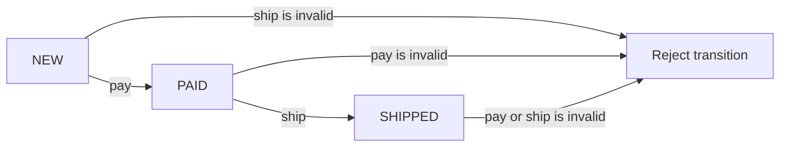

Behavioral patterns organize how objects collaborate and how behavior is selected. They help when a growing set of conditionals, callbacks, or tightly coupled operations makes the rules difficult to change or test.

The patterns in this lesson are Strategy, Observer, Command, State, and Template Method. Each moves a different kind of variation into an explicit object or contract.

## Strategy

A **Strategy** encapsulates one algorithm behind an interface so a client can use a different policy without changing its workflow. It commonly uses composition and constructor injection:

```java
import java.math.BigDecimal;
import java.util.Objects;

public class StrategyExample {
    interface DiscountPolicy {
        BigDecimal discountFor(BigDecimal subtotal);
    }

    static final class NoDiscount implements DiscountPolicy {
        @Override
        public BigDecimal discountFor(BigDecimal subtotal) {
            return BigDecimal.ZERO;
        }
    }

    static final class MemberDiscount implements DiscountPolicy {
        @Override
        public BigDecimal discountFor(BigDecimal subtotal) {
            return subtotal.multiply(new BigDecimal("0.10"));
        }
    }

    static final class Checkout {
        private final DiscountPolicy policy;

        Checkout(DiscountPolicy policy) {
            this.policy = Objects.requireNonNull(policy);
        }

        BigDecimal total(BigDecimal subtotal) {
            return subtotal.subtract(policy.discountFor(subtotal));
        }
    }

    public static void main(String[] args) {
        Checkout checkout = new Checkout(new MemberDiscount());
        System.out.println(checkout.total(new BigDecimal("100.00")));
    }
}
```

Strategy is appropriate when algorithms vary independently of the workflow. For a tiny one-off operation, a function parameter or lambda may be enough; a named strategy type is useful when the policy has identity, configuration, or a substantial contract.

## Observer

An **Observer** lets one subject notify registered listeners when an event occurs. The publisher does not need to know each listener's concrete type:

```java
import java.util.ArrayList;
import java.util.List;
import java.util.function.Consumer;

public class ObserverExample {
    @FunctionalInterface
    interface Subscription extends AutoCloseable {
        @Override
        void close();
    }

    static final class PriceFeed {
        private final List<Listener> listeners = new ArrayList<>();

        private final class Listener implements Subscription {
            private final Consumer<Integer> callback;

            private Listener(Consumer<Integer> callback) {
                this.callback = callback;
            }

            @Override
            public void close() {
                listeners.remove(this);
            }
        }

        Subscription subscribe(Consumer<Integer> listener) {
            Listener registration = new Listener(
                    java.util.Objects.requireNonNull(listener));
            listeners.add(registration);
            return registration;
        }

        void publish(int cents) {
            for (Listener listener : List.copyOf(listeners)) {
                listener.callback.accept(cents);
            }
        }
    }

    public static void main(String[] args) {
        PriceFeed feed = new PriceFeed();
        try (Subscription ignored = feed.subscribe(
                cents -> System.out.println("Price: " + cents))) {
            feed.publish(1250);
        }
    }
}
```

The snapshot allows a listener to subscribe or unsubscribe during notification without modifying the list being traversed. This simple implementation is synchronous and not thread-safe; production code must define listener exception handling, concurrent registration, and subscription cleanup.

Observer notification is not automatically backpressured or asynchronous. For high-volume asynchronous streams with explicit demand, use a reactive-streams abstraction rather than treating a callback list as equivalent.

## Command

A **Command** packages a request and its parameters as an object. Commands can be queued, logged, retried, or placed in a history. Undo is possible only when the command has enough information to reverse its effect:

```java
import java.util.ArrayDeque;
import java.util.Deque;

public class CommandExample {
    interface Command {
        void execute();
        void undo();
    }

    static final class TextBuffer {
        private final StringBuilder text = new StringBuilder();

        void append(String value) {
            text.append(value);
        }

        void removeSuffix(String suffix) {
            int start = text.length() - suffix.length();
            if (start < 0 || !text.substring(start).equals(suffix)) {
                throw new IllegalStateException("Command history no longer matches");
            }
            text.delete(start, text.length());
        }

        String value() {
            return text.toString();
        }
    }

    static final class AppendCommand implements Command {
        private final TextBuffer buffer;
        private final String text;

        AppendCommand(TextBuffer buffer, String text) {
            this.buffer = buffer;
            this.text = text;
        }

        @Override
        public void execute() {
            buffer.append(text);
        }

        @Override
        public void undo() {
            buffer.removeSuffix(text);
        }
    }

    static final class History {
        private final Deque<Command> completed = new ArrayDeque<>();

        void execute(Command command) {
            command.execute();
            completed.push(command);
        }

        void undoLast() {
            Command command = completed.peek();
            if (command != null) {
                command.undo();
                completed.pop();
            }
        }
    }

    public static void main(String[] args) {
        TextBuffer buffer = new TextBuffer();
        History history = new History();
        history.execute(new AppendCommand(buffer, "Java"));
        history.execute(new AppendCommand(buffer, " patterns"));
        history.undoLast();
        System.out.println(buffer.value());
    }
}
```

Undoing a local text append is straightforward; undoing an external payment or email is not. For irreversible operations, a compensating action is not the same thing as restoring the original world state.

## State

The **State** pattern delegates behavior to an object representing the current state. Instead of scattering state-dependent rules across a large `switch`, the context forwards operations to the active state:

```java
public class StateExample {
    interface OrderState {
        String name();

        default void pay(Order order) {
            throw new IllegalStateException("Cannot pay from " + name());
        }

        default void ship(Order order) {
            throw new IllegalStateException("Cannot ship from " + name());
        }
    }

    static final class NewOrder implements OrderState {
        public String name() { return "NEW"; }
        public void pay(Order order) { order.transitionTo(new PaidOrder()); }
    }

    static final class PaidOrder implements OrderState {
        public String name() { return "PAID"; }
        public void ship(Order order) { order.transitionTo(new ShippedOrder()); }
    }

    static final class ShippedOrder implements OrderState {
        public String name() { return "SHIPPED"; }
    }

    static final class Order {
        private OrderState state = new NewOrder();

        void pay() {
            state.pay(this);
        }

        void ship() {
            state.ship(this);
        }

        private void transitionTo(OrderState next) {
            state = next;
        }

        String status() {
            return state.name();
        }
    }

    public static void main(String[] args) {
        Order order = new Order();
        order.pay();
        order.ship();
        System.out.println(order.status());
    }
}
```

The transition graph is explicit: payment is valid only from `NEW`, and shipping only from `PAID`. Operations that are invalid for a state fail at that state's boundary:



For a small finite state machine with very simple behavior, an enum and a transition table may be clearer than one class per state. Use state objects when state-specific operations or transitions are growing enough to separate cleanly.

## Template Method

A **Template Method** defines the stable steps of an algorithm in a base class and delegates selected steps to subclasses. The template is often `final` so subclasses cannot reorder the workflow:

```java
import java.util.List;

public class TemplateMethodExample {
    abstract static class ReportExporter {
        public final String export(List<String> rows) {
            validate(rows);
            String body = format(rows);
            return "REPORT\n" + body + "\nEND";
        }

        private void validate(List<String> rows) {
            if (rows.isEmpty()) {
                throw new IllegalArgumentException("Report needs at least one row");
            }
        }

        protected abstract String format(List<String> rows);
    }

    static final class CommaJoinExporter extends ReportExporter {
        @Override
        protected String format(List<String> rows) {
            return String.join(",", rows);
        }
    }

    static final class LineExporter extends ReportExporter {
        @Override
        protected String format(List<String> rows) {
            return String.join("\n", rows);
        }
    }

    public static void main(String[] args) {
        ReportExporter exporter = new CommaJoinExporter();
        System.out.println(exporter.export(List.of("Ada", "Grace")));
    }
}
```

The comma-joined formatter is intentionally small; it is not a full CSV encoder for values containing commas, quotes, or line breaks. Template Method uses inheritance to vary selected steps, while Strategy uses composition to supply a replaceable policy. Prefer Strategy when behavior needs runtime replacement or multiple independent combinations; use Template Method when the algorithm's sequence is stable and subclass hooks are a natural extension point. Avoid calling overridable methods from constructors.

## Compare the patterns

| Pattern | Encapsulates | Typical question |
|---|---|---|
| Strategy | Interchangeable algorithm | Which policy should this workflow use? |
| Observer | Event notification | Who needs to hear that this event occurred? |
| Command | Request as an object | Can this operation be queued, logged, or undone? |
| State | State-dependent behavior | Which operations are valid in the current state? |
| Template Method | Algorithm skeleton | Which steps vary while the overall sequence stays fixed? |

## Practical rules

- Use Strategy for independent, replaceable algorithms.
- Give Observer subscriptions an explicit lifecycle and define delivery/error semantics.
- Make Command effects and undo limitations explicit.
- Keep State transitions valid and observable; do not let callers mutate state arbitrarily.
- Keep Template Method's stable sequence small and its subclass hooks intentional.
- Prefer a simple function, enum, or conditional while it remains easier to understand than the pattern.

## Further reading

- [Composition over Inheritance](../level-1/composition-over-inheritance)
- [Structural Patterns](./structural-patterns)
- [Java 21 `Consumer`](https://docs.oracle.com/en/java/javase/21/docs/api/java.base/java/util/function/Consumer.html)
