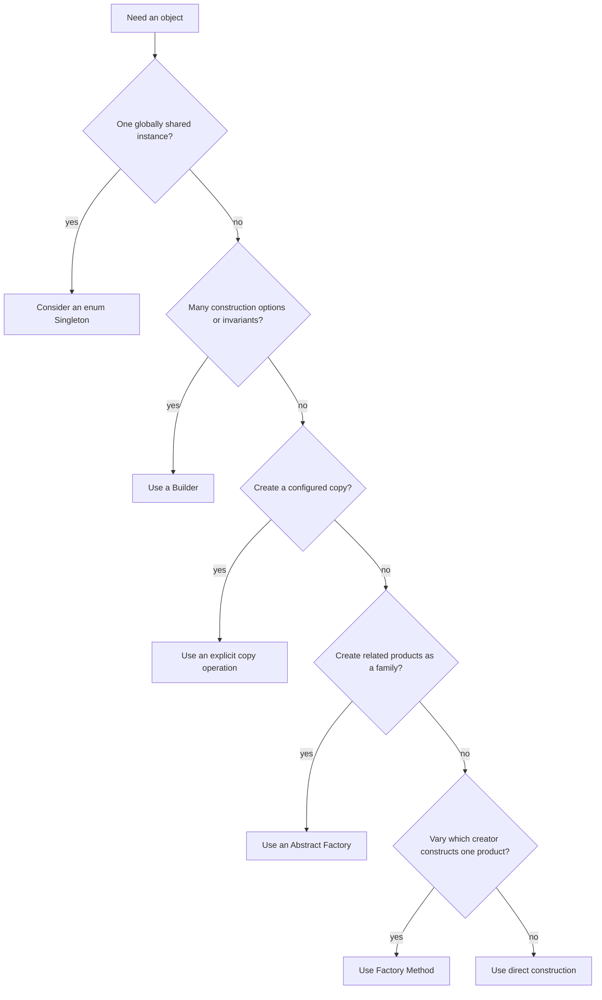

Object creation can become difficult when callers must know concrete implementation classes, coordinate a family of compatible objects, or initialize an object through many optional parameters. Creational patterns name recurring ways to control that construction.

A pattern is a vocabulary for a design trade-off, not a requirement to wrap every `new` expression. Prefer direct construction until a real variation, construction invariant, or lifecycle concern makes a pattern useful.

## Choosing the creation mechanism



The patterns differ in what is varying: one instance's lifecycle, one creator's product, a compatible product family, a complex constructor, or a copy of an existing prototype.

## Singleton

A **Singleton** restricts a type to one instance and provides a well-known access point. In Java, an enum with one constant is a compact option when a singleton is genuinely required:

```java
import java.util.concurrent.atomic.AtomicLong;

public class EnumSingletonExample {
    enum MetricsRegistry {
        INSTANCE;

        private final AtomicLong requests = new AtomicLong();

        void recordRequest() {
            requests.incrementAndGet();
        }

        long requestCount() {
            return requests.get();
        }
    }

    public static void main(String[] args) {
        MetricsRegistry.INSTANCE.recordRequest();
        System.out.println(MetricsRegistry.INSTANCE.requestCount());
    }
}
```

Enum constants are initialized as part of class initialization, which Java serializes per class. An enum singleton also avoids several pitfalls of hand-written lazy singletons, including ordinary serialization creating another instance.

The pattern still creates global shared state. That can hide dependencies, complicate tests, and require synchronization if its mutable state is accessed concurrently. A singleton is not a substitute for dependency management; inject a service when callers should be able to choose or replace its implementation.

## Factory Method

A **Factory Method** lets a creator subtype decide which product implementation to construct. It is useful when a workflow is stable but one product varies:

```java
public class FactoryMethodExample {
    interface MessageSender {
        void send(String recipient, String message);
    }

    static final class EmailSender implements MessageSender {
        @Override
        public void send(String recipient, String message) {
            System.out.println("Email to " + recipient + ": " + message);
        }
    }

    static final class SmsSender implements MessageSender {
        @Override
        public void send(String recipient, String message) {
            System.out.println("SMS to " + recipient + ": " + message);
        }
    }

    abstract static class AlertService {
        final void alert(String recipient, String message) {
            MessageSender sender = createSender();
            sender.send(recipient, message);
        }

        protected abstract MessageSender createSender();
    }

    static final class EmailAlertService extends AlertService {
        @Override
        protected MessageSender createSender() {
            return new EmailSender();
        }
    }

    static final class SmsAlertService extends AlertService {
        @Override
        protected MessageSender createSender() {
            return new SmsSender();
        }
    }

    public static void main(String[] args) {
        AlertService service = new EmailAlertService();
        service.alert("user@example.test", "System update");
    }
}
```

The creator hierarchy has a cost: adding a product choice may require another creator subtype. If the choice is ordinary configuration, a constructor-injected `Supplier<MessageSender>` or factory object may be simpler.

## Abstract Factory

An **Abstract Factory** creates a family of related products without requiring the client to name their concrete classes. The important property is family consistency: a client that requests a platform-specific button and dialog gets matching products from one factory.

```java
public class AbstractFactoryExample {
    interface Button {
        String render();
    }

    interface Dialog {
        String render();
    }

    interface WidgetFactory {
        Button createButton();
        Dialog createDialog();
    }

    record WindowsButton() implements Button {
        public String render() { return "Windows button"; }
    }

    record WindowsDialog() implements Dialog {
        public String render() { return "Windows dialog"; }
    }

    record MacButton() implements Button {
        public String render() { return "Mac button"; }
    }

    record MacDialog() implements Dialog {
        public String render() { return "Mac dialog"; }
    }

    static final class WindowsFactory implements WidgetFactory {
        public Button createButton() { return new WindowsButton(); }
        public Dialog createDialog() { return new WindowsDialog(); }
    }

    static final class MacFactory implements WidgetFactory {
        public Button createButton() { return new MacButton(); }
        public Dialog createDialog() { return new MacDialog(); }
    }

    static void renderScreen(WidgetFactory factory) {
        System.out.println(factory.createButton().render());
        System.out.println(factory.createDialog().render());
    }

    public static void main(String[] args) {
        renderScreen(new WindowsFactory());
    }
}
```

Adding another family adds another factory and its products. Adding a new product kind, such as a menu, changes the factory contract and each family implementation. Abstract Factory is a useful trade-off when family consistency matters more than making each new product kind frictionless.

## Builder

A **Builder** separates construction of a complex object from its final representation. It is useful when a type has required values, many optional values, or invariants that should be checked once before creating an immutable result:

```java
import java.util.ArrayList;
import java.util.List;
import java.util.Objects;

public class BuilderExample {
    record Report(String title, List<String> sections) {
        Report {
            sections = List.copyOf(sections);
        }
    }

    static final class ReportBuilder {
        private final String title;
        private final List<String> sections = new ArrayList<>();

        ReportBuilder(String title) {
            this.title = Objects.requireNonNull(title);
        }

        ReportBuilder addSection(String section) {
            sections.add(Objects.requireNonNull(section));
            return this;
        }

        Report build() {
            if (title.isBlank()) {
                throw new IllegalStateException("title must not be blank");
            }
            return new Report(title, sections);
        }
    }

    public static void main(String[] args) {
        Report report = new ReportBuilder("Quarterly Results")
                .addSection("Revenue")
                .addSection("Costs")
                .build();
        System.out.println(report);
    }
}
```

The required title is supplied up front, while optional sections are added fluently. `Report` copies the list so later builder mutations cannot change the built result. For a small object with only a few required fields, a normal constructor or record may be clearer than introducing a builder.

## Prototype

A **Prototype** creates a new object by copying an existing configured instance. In Java, an explicit copy constructor or method is often easier to understand than `Object.clone()`, whose shallow-copy semantics and checked `CloneNotSupportedException` complicate class design:

```java
import java.util.List;

public class PrototypeExample {
    record QueryTemplate(String table, List<String> columns) {
        QueryTemplate {
            columns = List.copyOf(columns);
        }

        QueryTemplate copy() {
            return new QueryTemplate(table, columns);
        }

        QueryTemplate withTable(String newTable) {
            return new QueryTemplate(newTable, columns);
        }
    }

    public static void main(String[] args) {
        QueryTemplate base =
                new QueryTemplate("customers", List.of("id", "name"));
        QueryTemplate reportQuery = base.withTable("monthly_customers");

        System.out.println(base.table());
        System.out.println(reportQuery.table());
    }
}
```

Here the record and copied list are immutable, so the copy can safely share its column values. If a prototype contains mutable nested objects, decide explicitly whether to make a shallow or deep copy and which fields must remain independent. “Copy” is a domain decision, not automatically a recursive duplication.

## Comparing the patterns

| Pattern | What varies or is protected | Common cost |
|---|---|---|
| Singleton | Instance count and access point | Global state and hidden coupling |
| Factory Method | Product selected by a creator subtype | More creator subclasses |
| Abstract Factory | A compatible family of products | New product kinds affect all factories |
| Builder | Valid construction of a complex object | Extra builder type and mutable construction phase |
| Prototype | Starting state copied from an existing object | Copy depth and shared mutable references |

## Practical rules

- Start with direct construction; add a pattern when a concrete change or invariant justifies it.
- Prefer constructor injection over global singleton access when dependencies should be replaceable.
- Use Factory Method for one creator-varying product and Abstract Factory for related product families.
- Use Builder for complex construction, not merely to avoid a short constructor.
- Prefer explicit copy methods and constructors over implicit shallow-copy assumptions.
- Document ownership and mutability when copying objects.

## Further reading

- [Singletons and class initialization in the Java Language Specification](https://docs.oracle.com/javase/specs/jls/se21/html/jls-12.html#jls-12.4)
- [Java 21 `Object.clone`](https://docs.oracle.com/en/java/javase/21/docs/api/java.base/java/lang/Object.html#clone())
