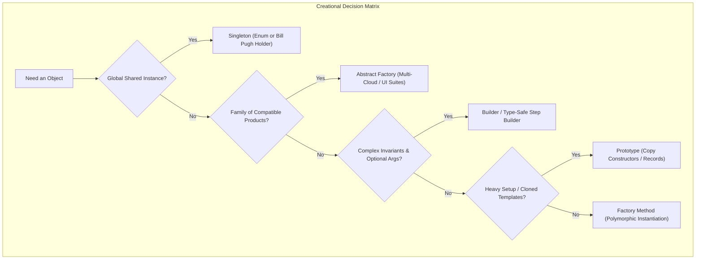
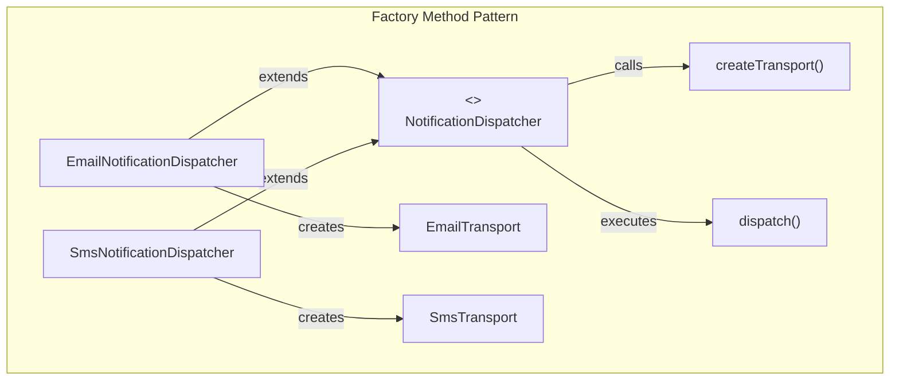
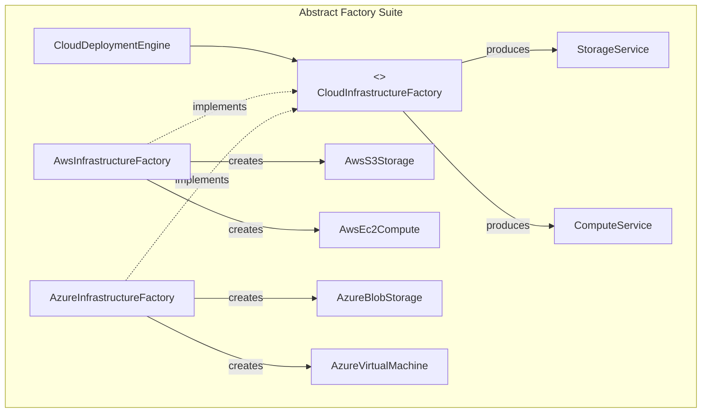

In beginner code, object creation begins and ends with the `new` keyword:

```java
Order order = new Order("ORD-101", customer, items, discount, shipping, tax, notes, metadata);
```

As systems scale to millions of lines of code, hardcoding `new ConcreteClass()` everywhere introduces tight architectural coupling:
1. **Constructor Sprawl**: When an object has dozens of configurations, you end up with "Telescoping Constructors" (overloading constructors with 2, 4, 6, and 10 arguments) or mutable JavaBeans that leak half-initialized state.
2. **Implementation Lock-In**: If your business logic directly instantiates `new PostgresOrderRepository()`, your domain is permanently glued to PostgreSQL.
3. **Lifecycle Coordination**: When objects represent expensive physical resources (connection pools, hardware drivers, or heavy AI model weights), uncontrolled instantiation exhausts memory and triggers violent GC pauses.

Creational design patterns decouple the client from the **who**, **how**, and **when** of object instantiation.



---

## Singleton: Managing Global State Responsibly

The **Singleton** pattern guarantees that a class has only one instance and provides a global point of access to it.

While often abused as an architectural antipattern (introducing hidden global mutable state and making unit tests non-deterministic), singletons are essential for root runtime coordinators: hardware interfaces, metrics registries, and configuration roots.

In Java, implementing a thread-safe, performant singleton requires deep knowledge of JVM internals.

### The Evolution of Java Singletons

#### The Thread-Safe Double-Checked Locking (DCL)
Prior to Java 5, DCL was fundamentally broken due to JVM memory instruction reordering. In Java 5+, declaring the instance `volatile` inserts a hardware memory barrier, preventing the reference from being published before the constructor completes:

```java
public final class DclSingleton {
    private static volatile DclSingleton instance;
    private final String state;

    private DclSingleton() {
        this.state = "Initialized";
    }

    public static DclSingleton getInstance() {
        DclSingleton result = instance; // Read volatile once into local variable
        if (result == null) {
            synchronized (DclSingleton.class) {
                result = instance;
                if (result == null) {
                    instance = result = new DclSingleton();
                }
            }
        }
        return result;
    }
}
```

#### The Bill Pugh Holder Idiom (Zero Synchronization Cost)
The Bill Pugh idiom achieves lazy initialization without needing `volatile` or `synchronized`. It leverages the Java Virtual Machine's ClassLoader specification:

```java
public final class BillPughSingleton {
    private BillPughSingleton() {}

    // Static nested class is NOT loaded into Metaspace until getInstance() is called!
    private static class InstanceHolder {
        private static final BillPughSingleton INSTANCE = new BillPughSingleton();
    }

    public static BillPughSingleton getInstance() {
        return InstanceHolder.INSTANCE; // Triggers class initialization of InstanceHolder
    }
}
```

The JVM guarantees that class initialization (`<clinit>`) is strictly thread-safe and protected by internal ClassLoader mutexes. The nested class is loaded only when referenced, providing high-performance lazy loading with zero synchronization overhead.

#### The Joshua Bloch Enum Singleton (The Gold Standard)
Both DCL and Bill Pugh singletons can be compromised via Java Reflection (`Constructor.setAccessible(true)`) or Serialization (deserializing a stream produces a new instance unless `readResolve()` is implemented).

Joshua Bloch demonstrated in *Effective Java* that an **Enum Singleton** is the only implementation that is 100% immune to both reflection and serialization attacks:

```java
public enum MetricsHub {
    INSTANCE;

    private final Map<String, Long> metrics = new ConcurrentHashMap<>();

    public void increment(String counter) {
        metrics.compute(counter, (k, v) -> (v == null) ? 1L : v + 1);
    }

    public long getCount(String counter) {
        return metrics.getOrDefault(counter, 0L);
    }
}
```

By JVM specification, the `Constructor.newInstance()` method explicitly throws `IllegalArgumentException("Cannot reflectively create enum objects")` when invoked on enums, and Java's serialization mechanism guarantees that enum constants are resolved strictly by name.

---

## Factory Method: Polymorphic Instantiation

> *"Define an interface for creating an object, but let subclasses decide which class to instantiate."* — Gang of Four

The Factory Method pattern replaces direct constructor calls with a polymorphic method. It is the premier choice when a high-level framework provides the orchestration workflow, but individual client extensions must supply the concrete domain objects.



### Production Implementation

```java
// 1. The Product Interface
public interface MessageTransport {
    void deliver(String destination, String payload);
}

public class EmailTransport implements MessageTransport {
    @Override public void deliver(String dest, String body) {
        System.out.println("Connecting to SMTP server... Sent email to " + dest);
    }
}

public class SmsTransport implements MessageTransport {
    @Override public void deliver(String dest, String body) {
        System.out.println("Invoking Twilio REST API... Sent SMS to " + dest);
    }
}

// 2. The Abstract Creator (Owns the High-Level Workflow)
public abstract class NotificationDispatcher {
    // The Factory Method
    protected abstract MessageTransport createTransport();

    // High-level business template
    public void dispatch(String recipient, String message) {
        System.out.println("Recording audit log before transmission...");
        MessageTransport transport = createTransport(); // Polymorphic creation!
        transport.deliver(recipient, message);
        System.out.println("Transmission completed successfully.");
    }
}

// 3. Concrete Creators
public class EmailNotificationDispatcher extends NotificationDispatcher {
    @Override
    protected MessageTransport createTransport() {
        return new EmailTransport();
    }
}

public class SmsNotificationDispatcher extends NotificationDispatcher {
    @Override
    protected MessageTransport createTransport() {
        return new SmsTransport();
    }
}
```

---

## Abstract Factory: Families of Compatible Products

While the Factory Method pattern creates a single product, the **Abstract Factory** pattern provides an interface for creating an entire **family of related or dependent objects** without specifying their concrete classes.

The defining architectural characteristic of Abstract Factory is **family compatibility**. You cannot accidentally mix an AWS S3 Bucket with an Azure Cosmos Database client in the same cluster context.



### Production Implementation: Multi-Cloud Suite

```java
// Product Family 1: Storage
public interface StorageService { void upload(String path, byte[] data); }
public class S3Storage implements StorageService {
    @Override public void upload(String p, byte[] d) { System.out.println("Uploaded to AWS S3: " + p); }
}
public class AzureBlobStorage implements StorageService {
    @Override public void upload(String p, byte[] d) { System.out.println("Uploaded to Azure Blob: " + p); }
}

// Product Family 2: Compute
public interface ComputeService { void launch(String instanceType); }
public class Ec2Compute implements ComputeService {
    @Override public void launch(String type) { System.out.println("Provisioning AWS EC2: " + type); }
}
public class AzureVmCompute implements ComputeService {
    @Override public void launch(String type) { System.out.println("Provisioning Azure VM: " + type); }
}

// The Abstract Factory Contract
public interface CloudInfrastructureFactory {
    StorageService createStorage();
    ComputeService createCompute();
}

// Concrete Factory 1: AWS
public class AwsCloudFactory implements CloudInfrastructureFactory {
    @Override public StorageService createStorage() { return new S3Storage(); }
    @Override public ComputeService createCompute() { return new Ec2Compute(); }
}

// Concrete Factory 2: Azure
public class AzureCloudFactory implements CloudInfrastructureFactory {
    @Override public StorageService createStorage() { return new AzureBlobStorage(); }
    @Override public ComputeService createCompute() { return new AzureVmCompute(); }
}

// Client Code: Completely cloud-agnostic!
public class DeploymentPipeline {
    private final StorageService storage;
    private final ComputeService compute;

    public DeploymentPipeline(CloudInfrastructureFactory factory) {
        // Guaranteed to receive compatible components from the SAME vendor
        this.storage = factory.createStorage();
        this.compute = factory.createCompute();
    }

    public void deployArtifact(String name, byte[] artifact) {
        compute.launch("standard-c4");
        storage.upload("/artifacts/" + name, artifact);
    }
}
```

---

## Builder: Fluent Construction and Compile-Time Step Builders

The **Builder** pattern separates the complex construction of an object from its internal representation. It is the premier defense against the **Telescoping Constructor Antipattern**:

```java
// TELESCOPING CONSTRUCTOR NIGHTMARE:
User u = new User("Alice", "Smith", 28, null, true, false, "Admin", null, 0);
```

### The Compile-Time Step Builder Pattern

Standard fluent builders allow developers to call `.build()` prematurely, causing `IllegalStateException` at runtime if mandatory fields are missing.

A **Step Builder** uses an interface state machine to enforce mandatory fields at **compile time**. The developer's IDE auto-completion physically will not present the `.build()` method until every mandatory requirement is satisfied!

```java
public final class UserRegistration {
    private final String email;      // Mandatory
    private final String password;   // Mandatory
    private final String phone;      // Optional
    private final boolean verified;  // Optional

    private UserRegistration(Builder builder) {
        this.email = builder.email;
        this.password = builder.password;
        this.phone = builder.phone;
        this.verified = builder.verified;
    }

    // Step 1 Interface
    public interface EmailStep {
        PasswordStep email(String email);
    }

    // Step 2 Interface
    public interface PasswordStep {
        BuildStep password(String password);
    }

    // Final Step Interface (Enables Optionals and build)
    public interface BuildStep {
        BuildStep phoneNumber(String phone);
        BuildStep verified(boolean verified);
        UserRegistration build();
    }

    // Static Entry Point
    public static EmailStep builder() {
        return new Builder();
    }

    private static class Builder implements EmailStep, PasswordStep, BuildStep {
        private String email;
        private String password;
        private String phone;
        private boolean verified = false;

        @Override
        public PasswordStep email(String email) {
            if (email == null || !email.contains("@")) throw new IllegalArgumentException("Invalid email");
            this.email = email;
            return this;
        }

        @Override
        public BuildStep password(String password) {
            if (password == null || password.length() < 8) throw new IllegalArgumentException("Password too short");
            this.password = password;
            return this;
        }

        @Override
        public BuildStep phoneNumber(String phone) {
            this.phone = phone;
            return this;
        }

        @Override
        public BuildStep verified(boolean verified) {
            this.verified = verified;
            return this;
        }

        @Override
        public UserRegistration build() {
            return new UserRegistration(this);
        }
    }
}
```

### Compile-Time Enforcement in Action

```java
// Compiles cleanly:
UserRegistration user = UserRegistration.builder()
    .email("alice@example.com") // Returns PasswordStep
    .password("SuperSecret123!") // Returns BuildStep
    .phoneNumber("+1-555-0199") // Optional
    .build();

// COMPILATION ERROR: UserRegistration.builder().email("...").build();
// The method 'build()' does not exist on interface 'PasswordStep'!
```

---

## Prototype: Cloned Templates vs Broken Object.clone()

The **Prototype** pattern creates new objects by cloning an existing configured instance. It is optimal when object creation involves heavy computation, deep file parsing, or expensive database queries.

### Why Object.clone() is Broken

Java provides `java.lang.Cloneable` and `Object.clone()`, but Joshua Bloch and the Java architect community widely advise against using it:
1. `Cloneable` is a marker interface that does not declare the `clone()` method.
2. `Object.clone()` is `protected`. To call it, classes must override it and cast from `Object`.
3. It creates instances **without calling any constructor**, violating object initialization guarantees.
4. It performs a **shallow copy** by default, meaning nested mutable collections or objects are shared between the prototype and clone, causing severe mutation bugs.

### The Modern Java Approach: Copy Constructors and Records

Use explicit copy constructors or copy factory methods:

```java
import java.util.ArrayList;
import java.util.Collections;
import java.util.List;

public class GameBoardSnapshot {
    private final String layoutName;
    private final List<String> activeUnits;

    // Standard constructor
    public GameBoardSnapshot(String layoutName, List<String> activeUnits) {
        this.layoutName = layoutName;
        this.activeUnits = new ArrayList<>(activeUnits); // Defensive copy
    }

    // Prototype Copy Constructor: Deep copy of mutable state
    public GameBoardSnapshot(GameBoardSnapshot prototype) {
        this.layoutName = prototype.layoutName;
        this.activeUnits = new ArrayList<>(prototype.activeUnits); // Deep clone
    }

    public GameBoardSnapshot withAdditionalUnit(String unit) {
        GameBoardSnapshot clone = new GameBoardSnapshot(this);
        clone.activeUnits.add(unit);
        return clone;
    }

    public List<String> getUnits() {
        return Collections.unmodifiableList(activeUnits);
    }
}
```

---

## Creational Patterns Comparison Matrix

| Pattern | Granularity | Key Motivation | Modern Java Idiom |
| :--- | :--- | :--- | :--- |
| **Singleton** | 1 Object | Exactly one shared coordinator. | `enum Instance { INSTANCE; }` or Bill Pugh Holder |
| **Factory Method** | 1 Product Hierarchy | Defer product choice to subclasses. | Virtual methods returning interface / `Supplier<T>` |
| **Abstract Factory** | Product Families | Enforce cross-product family compatibility. | Injected suite interfaces (Cloud, UI platforms) |
| **Builder** | Complex Composition | Eliminate telescoping constructors & enforce invariants. | Type-safe Step Builders & Immutable Records |
| **Prototype** | Pre-configured Duplication | Avoid expensive initialization by copying state. | Copy constructors, Copy factory methods |

---

## Senior Engineer Interview Crucible

### Why is Joshua Bloch's Enum Singleton immune to reflection attacks and serialization anomalies that break traditional Singletons?
Traditional Singletons can be bypassed through reflection by setting `Constructor.setAccessible(true)` and invoking `newInstance()`. They also fail during deserialization because Java's deserializer bypasses constructors and instantiates a new object in the heap unless `readResolve()` is explicitly defined.

An Enum Singleton is completely immune because:
1. The JVM's `Constructor.newInstance()` method contains an explicit check: if the class being instantiated is an `Enum`, it immediately throws `IllegalArgumentException("Cannot reflectively create enum objects")`.
2. The Java serialization specification mandates that enum constants are serialized strictly by their declared name. During deserialization, the JVM uses `Enum.valueOf()` to resolve the exact singleton instance already loaded in Metaspace, guaranteeing that duplicate instances can never be created.

### How does the Bill Pugh Singleton idiom achieve lazy initialization and thread safety without using the synchronized keyword?
The Bill Pugh idiom relies on the **Java ClassLoader initialization phase specification** (JLS 12.4). The outer class does not initialize its static nested holder class upon loading. 

When `getInstance()` is called for the first time, the JVM references `InstanceHolder.INSTANCE`. This triggers class loading and initialization of `InstanceHolder`. The JVM guarantees that static class initializers are executed under an internal ClassLoader lock, ensuring that the singleton instance is created exactly once and made visible across all CPU cores without any runtime synchronization overhead on subsequent reads.

### Compare Factory Method and Abstract Factory: what are the structural and semantic trade-offs between them?
**Factory Method** relies on **inheritance**. It defines an abstract method in a base class, allowing derived subclasses to instantiate a single concrete product. The client typically invokes a business template method on the creator that internally calls the factory method.

**Abstract Factory** relies on **object composition**. It defines an interface with multiple factory methods that instantiate an entire family of related or dependent products (e.g., matching UI buttons and dialogs, or cloud compute and storage services). 

The trade-off: Abstract Factory makes it easy to swap an entire product family at runtime simply by injecting a different factory implementation, but adding a brand-new product type (e.g., adding `createMenu()` to a widget factory) breaks the interface and requires modifying every concrete factory class in the codebase.

### What is the Step Builder pattern, and how does it prevent runtime IllegalStateException during object construction at compile time?
The standard fluent Builder pattern allows calling `.build()` at any point in the chain, requiring runtime checks to verify that mandatory fields were provided. 

The **Step Builder** pattern models object construction as a **finite state machine using nested interfaces**. Each step interface represents a mandatory field and returns the next step interface in the sequence. The terminal step interface provides optional parameter methods and the final `.build()` method. Because the `.build()` method physically does not exist on earlier step interfaces, the Java compiler prevents the code from compiling if any mandatory field is omitted, eliminating construction-time runtime exceptions.
