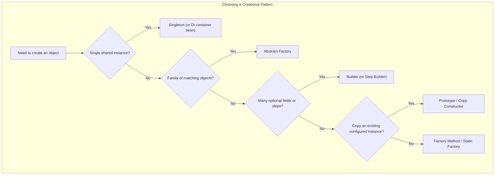
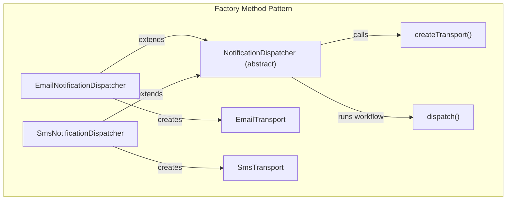
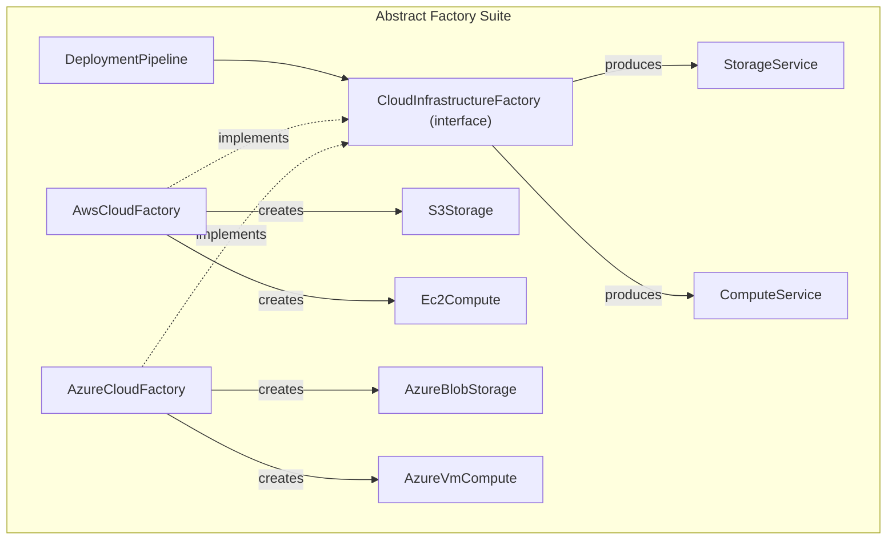

Calling `new` directly works fine for small, self-contained value objects. Once a codebase grows, scattering `new ConcreteClass(...)` across business logic creates three recurring headaches:

1. **Unreadable constructors**: Classes with several optional settings accumulate overloaded "telescoping constructors" (`new Order(id, customer, items, null, true, false, 0)`) or mutable setters that leave objects half-initialized.
2. **Tight coupling to concrete types**: Calling `new AwsS3Storage()` directly inside a service locks that service to AWS and makes testing harder.
3. **Uncontrolled resource lifecycles**: Repeatedly instantiating heavy resources like connection pools, thread pools, or parsed configuration graphs wastes memory and slows down startup and GC.

Creational patterns separate *using* an object from *deciding how and when to build it*. At the same time, modern Java (records, lambdas, static factory methods) and dependency injection containers like Spring have replaced a lot of classic Gang of Four boilerplate. Knowing both the traditional pattern and the modern Java idiom helps you write cleaner code.



---

## Singleton

The **Singleton** pattern ensures a class has only one instance and provides a shared access point to it.

Before writing a manual Singleton in Java, ask one question first: **are you using a dependency injection container like Spring, Micronaut, or Guice?**

### When Spring DI Replaces Manual Singleton

In a Spring application, beans are singleton-scoped per `ApplicationContext` by default. You write a normal class with a regular constructor, let Spring create and share one instance, and inject it wherever it is needed:

```java
@Component
public class MetricsRegistry {
    private final Map<String, LongAdder> counters = new ConcurrentHashMap<>();

    public void increment(String name) {
        counters.computeIfAbsent(name, key -> new LongAdder()).increment();
    }

    public long count(String name) {
        LongAdder adder = counters.get(name);
        return adder == null ? 0L : adder.sum();
    }
}
```

This avoids the main downside of classic singletons: hidden global state that leaks between unit tests. With constructor injection, each test can instantiate a fresh `MetricsRegistry` without resetting static fields.

When you *are* writing a standalone library, CLI tool, or low-level runtime utility without a DI container, Java gives you three well-known thread-safe ways to implement a manual Singleton.

### Double-Checked Locking (DCL)

Before Java 5, Double-Checked Locking could expose a partially constructed object to another thread due to instruction reordering. Under the Java 5+ Memory Model, declaring the field `volatile` establishes a happens-before relationship so other threads see the fully initialized object:

```java
public final class DclConfigCache {
    private static volatile DclConfigCache instance;
    private final String environment;

    private DclConfigCache() {
        this.environment = System.getProperty("app.env", "dev");
    }

    public static DclConfigCache getInstance() {
        DclConfigCache localRef = instance; // Read volatile once on the hot path
        if (localRef == null) {
            synchronized (DclConfigCache.class) {
                localRef = instance;
                if (localRef == null) {
                    instance = localRef = new DclConfigCache();
                }
            }
        }
        return localRef;
    }

    public String environment() {
        return environment;
    }
}
```

Reading `instance` into `localRef` avoids a second volatile read in the common case where the singleton already exists. DCL is useful if you need lazy initialization that depends on instance parameters or error recovery, though it is easy to get subtly wrong if you forget `volatile`.

### Initialization-on-Demand Holder (Bill Pugh Idiom)

If you want lazy, thread-safe initialization without explicit `synchronized` or `volatile`, use a static nested holder class:

```java
public final class ConfigHolderSingleton {
    private ConfigHolderSingleton() {}

    // Not initialized until getInstance() references InstanceHolder.INSTANCE
    private static final class InstanceHolder {
        private static final ConfigHolderSingleton INSTANCE = new ConfigHolderSingleton();
    }

    public static ConfigHolderSingleton getInstance() {
        return InstanceHolder.INSTANCE;
    }
}
```

This relies directly on the Java Language Specification (JLS 12.4.2): class initialization (`<clinit>`) is guaranteed by the JVM to run at most once and to be properly synchronized across threads. Simply loading `ConfigHolderSingleton` does not initialize `InstanceHolder`; initialization happens on the first call to `getInstance()`. After that, reads have zero locking overhead.

### Enum Singleton

Both DCL and the Holder idiom have two edge cases: reflective code can call `Constructor.setAccessible(true)` to instantiate a second copy (unless guarded by a check or strong encapsulation), and implementing `Serializable` without a `readResolve()` method creates a new instance on deserialization.

As Joshua Bloch popularized in *Effective Java*, a single-element `enum` closes both holes automatically:

```java
import java.util.Map;
import java.util.concurrent.ConcurrentHashMap;
import java.util.concurrent.atomic.LongAdder;

public enum AppMetrics {
    INSTANCE;

    private final Map<String, LongAdder> counters = new ConcurrentHashMap<>();

    public void increment(String metric) {
        counters.computeIfAbsent(metric, k -> new LongAdder()).increment();
    }

    public long getCount(String metric) {
        LongAdder adder = counters.get(metric);
        return adder == null ? 0L : adder.sum();
    }
}
```

The JDK's `Constructor.newInstance()` explicitly rejects `enum` types with `IllegalArgumentException("Cannot reflectively create enum objects")`, and Java serialization writes only the enum constant's name and resolves it back to the existing heap instance via `Enum.valueOf()`. The main limitation is that an enum cannot extend another class (though it can implement interfaces) and is eagerly initialized when the enum class is first referenced.

---

## Factory Method

> *"Define an interface for creating an object, but let subclasses decide which class to instantiate."* (Gang of Four)

Factory Method lets a base class define a workflow in terms of an abstract product while leaving the concrete product creation to subclasses.



### Inheritance-Based Factory Method

```java
public interface MessageTransport {
    void deliver(String destination, String payload);
}

public final class EmailTransport implements MessageTransport {
    @Override
    public void deliver(String destination, String payload) {
        System.out.println("SMTP -> " + destination + ": " + payload);
    }
}

public final class SmsTransport implements MessageTransport {
    @Override
    public void deliver(String destination, String payload) {
        System.out.println("SMS -> " + destination + ": " + payload);
    }
}

public abstract class NotificationDispatcher {
    // Factory Method overridden by subclasses
    protected abstract MessageTransport createTransport();

    // Shared workflow stays in one place
    public void dispatch(String recipient, String message) {
        System.out.println("Audit: preparing message for " + recipient);
        MessageTransport transport = createTransport();
        transport.deliver(recipient, message);
        System.out.println("Audit: delivery finished");
    }
}

public final class EmailNotificationDispatcher extends NotificationDispatcher {
    @Override
    protected MessageTransport createTransport() {
        return new EmailTransport();
    }
}

public final class SmsNotificationDispatcher extends NotificationDispatcher {
    @Override
    protected MessageTransport createTransport() {
        return new SmsTransport();
    }
}
```

### Modern Java Alternative: Static Factories and `Supplier<T>`

In day-to-day Java, creating a parallel subclass hierarchy just to swap one object creation call is often heavier than necessary. Two lighter idioms cover most cases:

1. **Static factory methods**: Methods like `List.of(...)`, `Optional.ofNullable(...)`, and `Duration.ofSeconds(...)` give creation descriptive names, can return subtypes or cached instances, and avoid exposing implementation classes.
2. **Injected `Supplier<T>`**: Instead of making `NotificationDispatcher` abstract, pass `Supplier<MessageTransport>` into its constructor (`new NotificationDispatcher(EmailTransport::new)`). You keep the exact same polymorphic creation without forcing inheritance.

---

## Abstract Factory

Factory Method creates one product. **Abstract Factory** defines an interface for creating a *family of related objects* that must work together, without tying the caller to concrete classes.

Think of cloud providers: if a deployment pipeline needs object storage, compute instances, and a secrets manager, mixing AWS S3 with an Azure VM client in the same environment is usually a bug. An Abstract Factory guarantees that every component produced by a given factory comes from the same consistent family.



### Multi-Cloud Example

```java
public interface StorageService {
    void upload(String path, byte[] data);
}

public interface ComputeService {
    void launch(String instanceType);
}

public final class S3Storage implements StorageService {
    @Override
    public void upload(String path, byte[] data) {
        System.out.println("Uploading to AWS S3: " + path);
    }
}

public final class Ec2Compute implements ComputeService {
    @Override
    public void launch(String instanceType) {
        System.out.println("Starting AWS EC2 instance: " + instanceType);
    }
}

public final class AzureBlobStorage implements StorageService {
    @Override
    public void upload(String path, byte[] data) {
        System.out.println("Uploading to Azure Blob: " + path);
    }
}

public final class AzureVmCompute implements ComputeService {
    @Override
    public void launch(String instanceType) {
        System.out.println("Starting Azure VM: " + instanceType);
    }
}

// Abstract Factory
public interface CloudInfrastructureFactory {
    StorageService createStorage();
    ComputeService createCompute();
}

public final class AwsCloudFactory implements CloudInfrastructureFactory {
    @Override public StorageService createStorage() { return new S3Storage(); }
    @Override public ComputeService createCompute() { return new Ec2Compute(); }
}

public final class AzureCloudFactory implements CloudInfrastructureFactory {
    @Override public StorageService createStorage() { return new AzureBlobStorage(); }
    @Override public ComputeService createCompute() { return new AzureVmCompute(); }
}

// Cloud-agnostic client
public class DeploymentPipeline {
    private final StorageService storage;
    private final ComputeService compute;

    public DeploymentPipeline(CloudInfrastructureFactory factory) {
        this.storage = factory.createStorage();
        this.compute = factory.createCompute();
    }

    public void deployArtifact(String name, byte[] artifact) {
        compute.launch("standard-c4");
        storage.upload("/artifacts/" + name, artifact);
    }
}
```

You see this pattern in the JDK too: `java.sql.Connection` acts as an abstract factory for database-specific `Statement`, `PreparedStatement`, and `CallableStatement` objects that all belong to the same JDBC driver.

The trade-off with Abstract Factory is symmetric with OCP: adding a brand-new family (such as `GcpCloudFactory`) is easy because you only add new classes, whereas adding a new product method to `CloudInfrastructureFactory` (such as `createQueue()`) forces you to update every concrete factory implementation.

---

## Builder

The **Builder** pattern separates constructing a complex object from its representation, letting you assemble an immutable instance step by step with readable method names.

It solves the telescoping constructor problem, where call sites turn into positional guesswork:

```java
// Hard to read and easy to swap two boolean or String arguments by mistake
HttpClientConfig config = new HttpClientConfig("https://api.example.com", 5000, 10000, true, false, 3, null);
```

Standard library builders like `java.net.http.HttpRequest.newBuilder()` and `StringBuilder` show how natural fluent construction feels when there are many optional settings.

### When Java Records Replace Verbose Builders

Before writing a 70-line Builder class in Java 21, check whether a `record` is already enough. If an object has two to four required fields with distinct types and sensible validation, a `record` with a compact constructor and a static factory method is far cleaner:

```java
import java.time.Duration;
import java.util.Objects;

public record RetryPolicy(int maxAttempts, Duration initialDelay, boolean jitterEnabled) {
    public RetryPolicy {
        if (maxAttempts < 1) {
            throw new IllegalArgumentException("maxAttempts must be >= 1");
        }
        Objects.requireNonNull(initialDelay, "initialDelay must not be null");
        if (initialDelay.isNegative()) {
            throw new IllegalArgumentException("initialDelay must not be negative");
        }
    }

    public static RetryPolicy standard() {
        return new RetryPolicy(3, Duration.ofMillis(200), true);
    }
}
```

Reach for a Builder when a type has many optional parameters, several parameters of the same type (such as four `String` or `boolean` arguments where positional calls invite bugs), or cross-field invariants that are clearer to validate inside `build()`.

### Fluent Builder with Required Constructor Arguments

A pragmatic Java idiom is to pass required fields into `builder(...)` and expose optional fields as fluent methods. That keeps the builder concise while preventing callers from forgetting mandatory fields:

```java
import java.time.Duration;
import java.util.Objects;

public final class HttpClientConfig {
    private final String baseUrl;
    private final Duration connectTimeout;
    private final Duration readTimeout;
    private final int maxRetries;
    private final boolean followRedirects;

    private HttpClientConfig(Builder builder) {
        this.baseUrl = builder.baseUrl;
        this.connectTimeout = builder.connectTimeout;
        this.readTimeout = builder.readTimeout;
        this.maxRetries = builder.maxRetries;
        this.followRedirects = builder.followRedirects;
    }

    public static Builder builder(String baseUrl) {
        return new Builder(baseUrl);
    }

    public String baseUrl() { return baseUrl; }
    public Duration connectTimeout() { return connectTimeout; }
    public Duration readTimeout() { return readTimeout; }
    public int maxRetries() { return maxRetries; }
    public boolean followRedirects() { return followRedirects; }

    public static final class Builder {
        private final String baseUrl;
        private Duration connectTimeout = Duration.ofSeconds(5);
        private Duration readTimeout = Duration.ofSeconds(10);
        private int maxRetries = 0;
        private boolean followRedirects = true;

        private Builder(String baseUrl) {
            this.baseUrl = Objects.requireNonNull(baseUrl, "baseUrl is required");
        }

        public Builder connectTimeout(Duration timeout) {
            this.connectTimeout = Objects.requireNonNull(timeout);
            return this;
        }

        public Builder readTimeout(Duration timeout) {
            this.readTimeout = Objects.requireNonNull(timeout);
            return this;
        }

        public Builder maxRetries(int retries) {
            if (retries < 0) {
                throw new IllegalArgumentException("retries cannot be negative");
            }
            this.maxRetries = retries;
            return this;
        }

        public Builder followRedirects(boolean follow) {
            this.followRedirects = follow;
            return this;
        }

        public HttpClientConfig build() {
            return new HttpClientConfig(this);
        }
    }
}
```

### Compile-Time Step Builder

If you have several mandatory fields and want named fluent steps *plus* compile-time enforcement (so calling `.build()` too early will not even compile), you can chain step interfaces:

```java
public final class UserRegistration {
    private final String email;
    private final String password;
    private final String phone;
    private final boolean verified;

    private UserRegistration(Builder builder) {
        this.email = builder.email;
        this.password = builder.password;
        this.phone = builder.phone;
        this.verified = builder.verified;
    }

    public interface EmailStep {
        PasswordStep email(String email);
    }

    public interface PasswordStep {
        BuildStep password(String password);
    }

    public interface BuildStep {
        BuildStep phoneNumber(String phone);
        BuildStep verified(boolean verified);
        UserRegistration build();
    }

    public static EmailStep builder() {
        return new Builder();
    }

    private static final class Builder implements EmailStep, PasswordStep, BuildStep {
        private String email;
        private String password;
        private String phone;
        private boolean verified;

        @Override
        public PasswordStep email(String email) {
            if (email == null || !email.contains("@")) {
                throw new IllegalArgumentException("Invalid email");
            }
            this.email = email;
            return this;
        }

        @Override
        public BuildStep password(String password) {
            if (password == null || password.length() < 8) {
                throw new IllegalArgumentException("Password must be at least 8 characters");
            }
            this.password = password;
            return this;
        }

        @Override
        public BuildStep phoneNumber(String phone) {
            this.phone = phone;
            return this;
        }

        @Override
        public BuildStep verified(boolean verified) {
            this.verified = verified;
            return this;
        }

        @Override
        public UserRegistration build() {
            return new UserRegistration(this);
        }
    }
}
```

```java
// Valid: every mandatory step is satisfied before build() becomes visible
UserRegistration user = UserRegistration.builder()
        .email("alice@example.com")
        .password("CorrectHorse99!")
        .phoneNumber("+1-555-0199")
        .build();

// Compile error: PasswordStep does not define build()
// UserRegistration invalid = UserRegistration.builder().email("alice@example.com").build();
```

Step Builders shine in public SDKs and fluent DSLs where guiding IDE autocomplete matters. Inside internal application code, they add extra interfaces for every mandatory field, so a regular Builder with required parameters in `builder(...)` is usually simpler to maintain.

---

## Prototype

The **Prototype** pattern creates new objects by copying an already configured instance rather than building one from scratch. It helps when setting up an object involves expensive parsing, geometry calculation, or large template graphs, or when a caller wants to clone an object through an interface without knowing its concrete class.

### Why Java Developers Avoid `Object.clone()`

Java includes `java.lang.Cloneable` and `Object.clone()`, but they are widely considered a historical design mistake:

- `Cloneable` is an empty marker interface; it does not even declare `clone()`.
- `Object.clone()` is `protected`, returns `Object`, and throws the checked `CloneNotSupportedException`.
- It bypasses constructors completely and cannot safely reassign `final` fields to deep copies.
- By default it performs a shallow field-by-field copy, so mutable collections or nested objects end up shared between the original and the clone.

### Copy Constructors and Immutable `with*` Methods vs. Polymorphic Prototype

In modern Java, **copy constructors** and **immutable records with wither methods** cover most cloning needs cleanly:

```java
import java.util.ArrayList;
import java.util.List;
import java.util.Objects;

public record GameBoardSnapshot(String layoutName, List<String> activeUnits) {
    // Compact constructor makes a defensive immutable copy
    public GameBoardSnapshot {
        Objects.requireNonNull(layoutName);
        activeUnits = List.copyOf(activeUnits);
    }

    // Copy-and-modify helper returning a fresh snapshot
    public GameBoardSnapshot withAdditionalUnit(String unit) {
        List<String> updated = new ArrayList<>(activeUnits);
        updated.add(Objects.requireNonNull(unit));
        return new GameBoardSnapshot(layoutName, updated);
    }
}
```

For mutable classes, write an explicit copy constructor that deep-copies mutable fields:

```java
import java.util.ArrayList;
import java.util.Collections;
import java.util.List;

public final class MutableDocumentTemplate {
    private final String title;
    private final List<String> sections;

    public MutableDocumentTemplate(String title, List<String> sections) {
        this.title = title;
        this.sections = new ArrayList<>(sections);
    }

    // Explicit copy constructor
    public MutableDocumentTemplate(MutableDocumentTemplate source) {
        this.title = source.title;
        this.sections = new ArrayList<>(source.sections);
    }

    public void addSection(String section) {
        sections.add(section);
    }

    public List<String> sections() {
        return Collections.unmodifiableList(sections);
    }
}
```

When do you still need the classic **Prototype** interface (`copy()`) instead of just a copy constructor? When the caller only holds a base type or interface and does not know the concrete subclass at compile time. Constructors are not polymorphic in Java, so `new Shape(shape)` cannot preserve whether `shape` is a `Circle` or a `Polygon`. A `Prototype` method like `Shape copy()` dispatches dynamically to the right subclass copy constructor:

```java
public sealed interface GraphicNode permits CircleNode, TextNode {
    GraphicNode copy();
}

public record CircleNode(int x, int y, int radius) implements GraphicNode {
    @Override
    public GraphicNode copy() {
        return new CircleNode(x, y, radius);
    }
}

public record TextNode(int x, int y, String text) implements GraphicNode {
    @Override
    public GraphicNode copy() {
        return new TextNode(x, y, text);
    }
}
```

---

## Pattern Comparison

| Pattern | Scope | Primary Goal | Modern Java Idiom |
| :--- | :--- | :--- | :--- |
| **Singleton** | One shared instance | Coordinate shared state or resource | Spring singleton bean; otherwise `enum` or Holder class |
| **Factory Method** | One product hierarchy | Defer concrete class choice | Static factory methods or injected `Supplier<T>` |
| **Abstract Factory** | Family of products | Keep related components compatible | Injected suite interface (cloud, JDBC, UI toolkits) |
| **Builder** | Complex object | Readable construction with defaults/invariants | `record` for simple types; Builder / Step Builder for complex ones |
| **Prototype** | Duplicating configured objects | Clone expensive or polymorphic templates | Copy constructors, record `with*` methods, or `copy()` interface |

---

## Interview Questions

### Why is an Enum Singleton safer than Double-Checked Locking against reflection and serialization?

With Double-Checked Locking or a Holder class, reflective code that bypasses access checks can invoke the private constructor to create a second instance, and standard Java deserialization allocates a brand-new heap object unless you implement `readResolve()`. For an `enum`, `Constructor.newInstance()` explicitly throws `IllegalArgumentException` if you try to construct an enum reflectively. On deserialization, the JVM reads only the enum constant's name and looks up the existing instance via `Enum.valueOf()`, so no duplicate instance is created.

### How does the Initialization-on-Demand Holder idiom achieve thread-safe lazy initialization without `synchronized`?

It relies on class initialization rules in JLS 12.4.2. Loading the outer class does not initialize its static nested `InstanceHolder` class. The first time a thread calls `getInstance()`, referencing `InstanceHolder.INSTANCE` triggers class initialization of `InstanceHolder`. The JVM acquires an internal initialization lock during `<clinit>`, guarantees the static field is initialized exactly once and published safely to all threads, and requires no runtime locking on any subsequent call.

### When should you avoid writing a manual Singleton altogether?

Whenever you are inside a dependency injection container like Spring, or whenever the object holds mutable state that affects unit tests. A static `getInstance()` call hides dependencies inside method bodies and leaks state across tests. Making the class a normal constructor-injected dependency (scoped as a singleton in the DI container) gives you one shared instance in production while letting tests instantiate isolated copies.

### What is the difference between a copy constructor and the Prototype pattern?

A copy constructor requires the caller to know the exact concrete class at compile time (`new DocumentTemplate(existing)`). That is simple and sufficient for `final` classes and records. The Prototype pattern adds a polymorphic `copy()` method on a shared interface or base class so callers can duplicate objects whose concrete subtype is only known at runtime.
