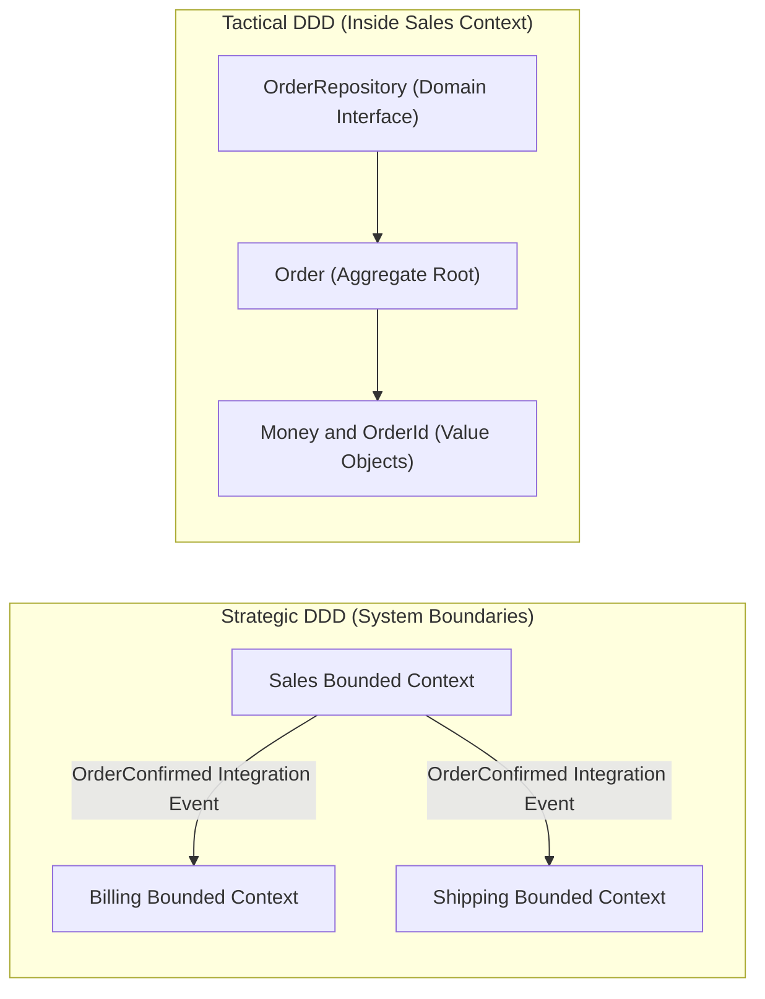
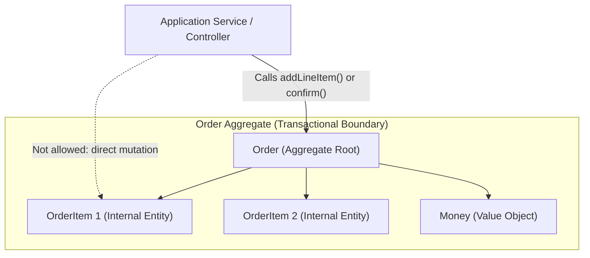
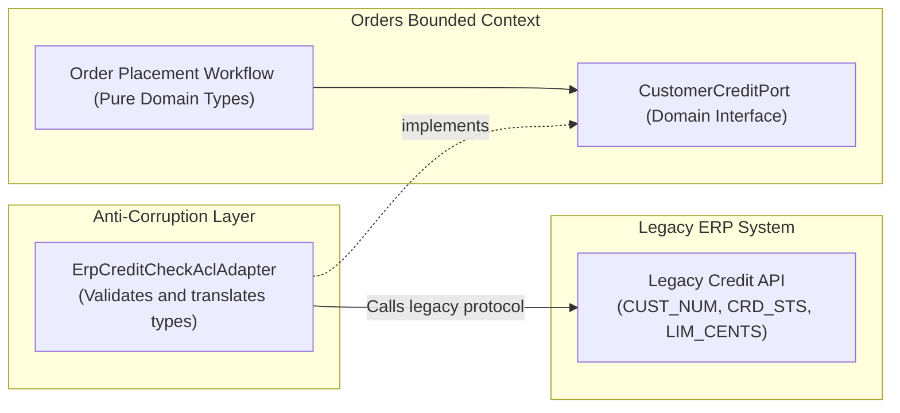

Many Java services drift into what Martin Fowler called the **Anemic Domain Model**: classes like `Order`, `Customer`, and `Invoice` contain nothing but private fields, getters, and setters, while all the actual business rules live scattered across `@Service` classes.

That split feels harmless at first, but it erodes over time. A rule like "an order cannot be modified after checkout" gets checked in `OrderController`, skipped in `AdminBulkImportService`, and forgotten in a scheduled batch job. Because any caller can invoke `order.setStatus(...)` or `order.getItems().clear()`, there is no single place where an object guarantees its own validity.

Domain-Driven Design (DDD), introduced by Eric Evans, addresses this by keeping business rules right next to the data they govern and organizing the codebase around clear business boundaries.

## Strategic vs Tactical Domain-Driven Design

DDD has two halves, and applying the second half without the first is a common mistake.

**Strategic DDD** operates at the system and team level. It asks where the natural boundaries of the business sit:
- **Ubiquitous Language**: Developers and domain experts use the same terms in conversations, tickets, and code. If warehouse staff talk about a `Shipment` being `Dispatched`, the code should not call it `OrderDeliveryHelper.processStatus3()`.
- **Bounded Contexts**: A single word rarely means the exact same thing across an entire company. In the **Sales** context, a `Product` has a catalog description, marketing images, and list price. In the **Inventory** context, that same product is a `StockItem` with warehouse aisle coordinates and reorder thresholds. In **Billing**, it is just a SKU and tax code. Trying to build one giant shared `Product` entity across all three teams creates constant merge conflicts and bloated schemas. Each Bounded Context owns its own model.
- **Context Maps**: Explicit definitions of how Bounded Contexts integrate (for example, via published events, shared kernels, or Anti-Corruption Layers).

**Tactical DDD** operates *inside* a single Bounded Context. It gives you the concrete Java building blocks (Value Objects, Entities, Aggregates, Domain Events, Repositories, and Anti-Corruption Layers) to write self-validating domain code.



Tactical patterns pay off most in a company's **Core Domain**, where complex rules change often and give the business an edge. For simple supporting subdomains (like a user preferences screen or static lookup tables), plain CRUD is usually cheaper and cleaner.

## Entities vs Value Objects vs Aggregates

Inside a Bounded Context, domain concepts fall into three core categories:
- **Value Object**: Defined entirely by its attribute values, has no lifecycle ID, and is immutable.
- **Entity**: Defined by a persistent identity that stays the same even as its attributes change over time.
- **Aggregate**: A cluster of Entities and Value Objects treated as one consistency boundary, accessed through a single Aggregate Root.

### Value Objects With Java 21 Records

Two Value Objects with identical fields are interchangeable. A 20 USD bill is equivalent to any other 20 USD bill; you never "mutate" a 20 USD bill into a 25 USD bill, you produce a different amount.

Java records fit Value Objects naturally because they are immutable, generate value-based `equals()` and `hashCode()`, and support compact constructors that reject invalid state at creation time:

```java
import java.math.BigDecimal;
import java.math.RoundingMode;
import java.util.Currency;
import java.util.Objects;
import java.util.UUID;

// Typed identifiers prevent accidentally swapping CustomerId and OrderId arguments
public record OrderId(UUID value) {
    public OrderId {
        Objects.requireNonNull(value, "OrderId value must not be null");
    }

    public static OrderId newId() {
        return new OrderId(UUID.randomUUID());
    }
}

public record CustomerId(UUID value) {
    public CustomerId {
        Objects.requireNonNull(value, "CustomerId value must not be null");
    }
}

public record ProductId(String sku) {
    public ProductId {
        if (sku == null || sku.isBlank()) {
            throw new IllegalArgumentException("Product SKU must not be blank");
        }
    }
}

public record Money(BigDecimal amount, Currency currency) {

    public Money {
        Objects.requireNonNull(amount, "Amount must not be null");
        Objects.requireNonNull(currency, "Currency must not be null");
        if (amount.compareTo(BigDecimal.ZERO) < 0) {
            throw new IllegalArgumentException("Monetary amount cannot be negative: " + amount);
        }
        amount = amount.setScale(currency.getDefaultFractionDigits(), RoundingMode.HALF_UP);
    }

    public static Money zero(Currency currency) {
        return new Money(BigDecimal.ZERO, currency);
    }

    public Money add(Money other) {
        Objects.requireNonNull(other, "Other money must not be null");
        if (!this.currency.equals(other.currency)) {
            throw new IllegalArgumentException(
                "Currency mismatch: cannot add " + other.currency + " to " + this.currency);
        }
        return new Money(this.amount.add(other.amount), this.currency);
    }

    public Money multiply(int quantity) {
        if (quantity < 0) {
            throw new IllegalArgumentException("Quantity cannot be negative");
        }
        return new Money(this.amount.multiply(BigDecimal.valueOf(quantity)), this.currency);
    }
}
```

Wrapping raw `UUID` and `String` values in typed records like `OrderId` and `CustomerId` also eliminates "primitive obsession." If a method takes `(OrderId, CustomerId)`, passing them in the wrong order becomes a compile error instead of a subtle runtime bug.

### Entities: Continuity Over Time

An Entity tracks an object whose attributes change while its identity stays fixed. A customer can update their email address and shipping address and remain the same customer. Unlike Value Objects, Entity equality compares **only the identifier**, and state changes happen through explicit domain methods rather than generic setters:

```java
import java.util.Objects;

public record EmailAddress(String value) {
    public EmailAddress {
        if (value == null || !value.contains("@")) {
            throw new IllegalArgumentException("Invalid email address: " + value);
        }
    }
}

public class Customer {
    private final CustomerId id;
    private String fullName;
    private EmailAddress email;

    public Customer(CustomerId id, String fullName, EmailAddress email) {
        this.id = Objects.requireNonNull(id);
        this.fullName = requireNonBlank(fullName);
        this.email = Objects.requireNonNull(email);
    }

    public void changeEmail(EmailAddress newEmail) {
        this.email = Objects.requireNonNull(newEmail);
    }

    public void rename(String newFullName) {
        this.fullName = requireNonBlank(newFullName);
    }

    private static String requireNonBlank(String value) {
        if (value == null || value.isBlank()) {
            throw new IllegalArgumentException("Customer name must not be blank");
        }
        return value.trim();
    }

    public CustomerId getId() { return id; }
    public String getFullName() { return fullName; }
    public EmailAddress getEmail() { return email; }

    @Override
    public boolean equals(Object o) {
        if (this == o) return true;
        if (!(o instanceof Customer other)) return false;
        return this.id.equals(other.id);
    }

    @Override
    public int hashCode() {
        return Objects.hash(id);
    }
}
```

## Aggregate Roots as Transactional Invariant Boundaries

Most real invariants span more than one object. An `Order` owns a list of `OrderItem` entities and a calculated `totalAmount`. If external code could fetch an `OrderItem` directly and increase its quantity, the order's `totalAmount` would fall out of sync, or an already-shipped order might silently gain new items.

An **Aggregate** solves this by grouping tightly related Entities and Value Objects inside a strict boundary, with one designated Entity acting as the **Aggregate Root**.



### Four Core Aggregate Design Rules

1. **All external interaction goes through the root**: Outside code holds references only to the Aggregate Root (`Order`), never mutable references to child entities (`OrderItem`). Collection getters return unmodifiable views (`List.copyOf(...)`).
2. **Enforce invariants before mutating state**: Every method on the root validates all rules across itself and its children before changing any field. If a check fails, the aggregate remains untouched in its previous valid state.
3. **Reference other aggregates by ID only**: `Order` stores a `CustomerId`, never a direct `Customer` object reference. Holding direct object references across aggregates causes ORMs to load huge object graphs, triggers unintended cascades, and makes splitting services or sharding tables much harder.
4. **Modify one aggregate per transaction**: Keep aggregates as small as your true invariants allow. If an action affects two different aggregates (for example, confirming an `Order` and reserving `Inventory`), commit the first aggregate and emit a Domain Event so the second aggregate updates asynchronously.

### Implementing a Self-Validating Order Aggregate Root

Notice in `addLineItem` below that we compute `updatedTotal` and check the corporate order limit *before* mutating `this.items` or `this.totalAmount`. Mutating fields first and throwing afterward would leave the in-memory object corrupted if the caller catches the exception.

```java
import java.math.BigDecimal;
import java.time.Instant;
import java.util.ArrayList;
import java.util.Currency;
import java.util.List;
import java.util.Objects;
import java.util.UUID;

public enum OrderStatus { DRAFT, CONFIRMED, CANCELLED }

public sealed interface DomainEvent permits OrderConfirmedEvent {}

public record OrderConfirmedEvent(
    OrderId orderId,
    CustomerId customerId,
    Money totalAmount,
    Instant occurredAt
) implements DomainEvent {}

public class OrderItem {
    private final UUID itemId;
    private final ProductId productId;
    private final Money unitPrice;
    private final int quantity;

    // Package-private constructor: only the Order aggregate root creates items
    OrderItem(UUID itemId, ProductId productId, Money unitPrice, int quantity) {
        this.itemId = Objects.requireNonNull(itemId);
        this.productId = Objects.requireNonNull(productId);
        this.unitPrice = Objects.requireNonNull(unitPrice);
        if (quantity <= 0 || quantity > 100) {
            throw new IllegalArgumentException("Item quantity must be between 1 and 100");
        }
        this.quantity = quantity;
    }

    public Money subtotal() {
        return unitPrice.multiply(quantity);
    }

    public UUID getItemId() { return itemId; }
    public ProductId getProductId() { return productId; }
    public Money getUnitPrice() { return unitPrice; }
    public int getQuantity() { return quantity; }
}

public class Order {
    private static final BigDecimal MAX_ORDER_AMOUNT = new BigDecimal("50000.00");

    private final OrderId id;
    private final CustomerId customerId;
    private final List<OrderItem> items = new ArrayList<>();
    private final List<DomainEvent> domainEvents = new ArrayList<>();
    private OrderStatus status;
    private Money totalAmount;

    public Order(OrderId id, CustomerId customerId, Currency currency) {
        this.id = Objects.requireNonNull(id);
        this.customerId = Objects.requireNonNull(customerId);
        this.status = OrderStatus.DRAFT;
        this.totalAmount = Money.zero(Objects.requireNonNull(currency));
    }

    public void addLineItem(ProductId productId, Money unitPrice, int quantity) {
        if (this.status != OrderStatus.DRAFT) {
            throw new IllegalStateException("Cannot modify items on an order in state " + this.status);
        }

        OrderItem candidate = new OrderItem(UUID.randomUUID(), productId, unitPrice, quantity);
        Money updatedTotal = this.totalAmount.add(candidate.subtotal());

        if (updatedTotal.amount().compareTo(MAX_ORDER_AMOUNT) > 0) {
            throw new IllegalStateException(
                "Order total exceeds the 50,000 USD limit: " + updatedTotal.amount());
        }

        // Mutate state only after every invariant check succeeds
        this.items.add(candidate);
        this.totalAmount = updatedTotal;
    }

    public void confirm() {
        if (this.status != OrderStatus.DRAFT) {
            throw new IllegalStateException("Only DRAFT orders can be confirmed");
        }
        if (this.items.isEmpty()) {
            throw new IllegalStateException("Cannot confirm an empty order");
        }

        this.status = OrderStatus.CONFIRMED;
        this.domainEvents.add(new OrderConfirmedEvent(
            this.id, this.customerId, this.totalAmount, Instant.now()
        ));
    }

    public List<DomainEvent> pullDomainEvents() {
        List<DomainEvent> pending = List.copyOf(this.domainEvents);
        this.domainEvents.clear();
        return pending;
    }

    public List<OrderItem> getItems() {
        return List.copyOf(this.items);
    }

    public OrderId getId() { return id; }
    public CustomerId getCustomerId() { return customerId; }
    public OrderStatus getStatus() { return status; }
    public Money getTotalAmount() { return totalAmount; }
}
```

Notice there are no public setters anywhere on `Order` or `OrderItem`. It is not possible to put an `Order` into `CONFIRMED` status with zero items or exceed the 50,000 USD order limit through normal code paths.

## Domain Events and Event-Driven Decoupling

When an `Order` transitions to `CONFIRMED`, several downstream things usually need to happen: inventory reserves stock, billing prepares an invoice, and notifications sends an email. Calling all three services directly from `OrderApplicationService.confirmOrder(...)` tangles unrelated modules together and stretches a single database transaction across network calls.

Instead, the aggregate records an immutable **Domain Event** (`OrderConfirmedEvent`) capturing a fact that already happened (always named in past tense).

### Dispatching Events Safely Around Transactions

In the pure-Java `Order` class above, the aggregate collects events in memory without importing Spring. The application service saves the aggregate and publishes the collected events:

```java
public class ConfirmOrderService {
    private final OrderRepository orderRepository;
    private final DomainEventPublisher eventPublisher;

    public ConfirmOrderService(OrderRepository orderRepository, DomainEventPublisher eventPublisher) {
        this.orderRepository = orderRepository;
        this.eventPublisher = eventPublisher;
    }

    // Wrapped in a database transaction by the outer application layer
    public void confirmOrder(OrderId orderId) {
        Order order = orderRepository.findById(orderId)
            .orElseThrow(() -> new IllegalArgumentException("Order not found: " + orderId));

        order.confirm();
        orderRepository.save(order);

        for (DomainEvent event : order.pullDomainEvents()) {
            eventPublisher.publish(event);
        }
    }
}
```

If your team uses Spring Data JPA directly on aggregates and accepts Spring imports in the domain layer, Spring Data offers `AbstractAggregateRoot<T>` with a `registerEvent(...)` helper that publishes registered events automatically when `repository.save(...)` runs.

> [!WARNING]
> **Watch transaction timing when publishing events.** If a listener sends an email or pushes a Kafka message *before* the database transaction commits, and the transaction later rolls back on a constraint error, downstream systems receive a phantom event for an order that does not exist. For in-process side effects in Spring, use `@TransactionalEventListener(phase = TransactionPhase.AFTER_COMMIT)`. For cross-service messaging over Kafka or RabbitMQ, write the event to an **Outbox table** inside the same database transaction and relay it asynchronously.

## Repositories vs DAO Antipatterns

Developers often treat "Repository" as a synonym for "DAO" (Data Access Object), renaming `OrderItemDao` to `OrderItemRepository` without changing how persistence is modeled. The distinction matters because it directly affects whether your aggregate boundaries hold up.

| Aspect | Data Access Object (DAO) | Domain Repository |
| :--- | :--- | :--- |
| **Mental model** | Mirrors database tables and SQL statements | Mimics an in-memory collection of aggregates |
| **Granularity** | One DAO per table (`OrderDao`, `OrderItemDao`) | One Repository per **Aggregate Root** (`OrderRepository`) |
| **Ownership** | Lives in the persistence/data layer | Interface lives in the **domain** layer; implementation lives in infrastructure |
| **Method vocabulary** | `insertRow()`, `updateStatusColumn()`, `deleteItemById()` | `save(Order)`, `findById(OrderId)`, `findUnconfirmedBefore(Instant)` |
| **Child entities** | Allows querying and mutating child rows directly | Never exposes child entities for direct mutation outside the root |

In DDD, you do **not** create an `OrderItemRepository`. `OrderItem` has no standalone lifecycle outside `Order`. Allowing a service to call `orderItemRepository.deleteById(itemId)` bypasses `Order`'s invariants and leaves `Order.totalAmount` wrong in the database.

### Domain-Owned Repository Interface vs Persistence Adapter

Keep the repository contract in the domain package using domain types, and place the JDBC or JPA implementation in an outer adapter package:

```java
import java.time.Instant;
import java.util.List;
import java.util.Optional;

// Lives in com.example.orders.domain (pure Java, no Spring or JPA annotations)
public interface OrderRepository {
    Optional<Order> findById(OrderId id);
    void save(Order order);
    List<Order> findDraftsCreatedBefore(Instant cutoff);
}

// Antipattern to avoid:
// public interface OrderItemRepository extends JpaRepository<OrderItemEntity, UUID> {}
// Exposing child rows directly lets callers bypass Order's invariants.
```

The infrastructure adapter (for example, `JpaOrderRepositoryAdapter implements OrderRepository`) maps between the `Order` aggregate and its underlying `orders` and `order_items` tables, saving the whole aggregate atomically inside one transaction.

## Anti-Corruption Layers (ACL) in Legacy Integration

Most real Java systems do not exist in isolation. Your clean new Orders bounded context often has to check customer credit limits against a 20-year-old ERP system or consume SOAP/XML payloads with cryptic field names (`CUST_CRD_FLG`, `AMT_CENTS`, `STS_01`), nullable dates, and inconsistent error codes.

If you import those legacy DTOs directly into your domain services, legacy assumptions spread across your entire codebase. Soon your own `Order` class has `if ("02".equals(erpCode))` checks scattered everywhere.

An **Anti-Corruption Layer (ACL)** isolates that translation behind a domain-defined port and a dedicated adapter:



### Implementing an Anti-Corruption Layer in Java 21

```java
import java.math.BigDecimal;
import java.util.Currency;
import java.util.Objects;

// 1. Clean contract owned by our Orders domain
public interface CustomerCreditPort {
    CreditStanding checkStanding(CustomerId customerId);
}

public record CreditStanding(boolean approved, Money availableLimit) {}

// 2. Messy wire DTO returned by the legacy ERP client
public record ErpCreditResponse(String custNum, String crdSts, Long limCents, String ccyCode) {}

public interface LegacyErpHttpClient {
    ErpCreditResponse fetchCreditProfile(String legacyCustomerCode);
}

// 3. Anti-Corruption Layer adapter isolating all legacy quirks
public class ErpCreditCheckAclAdapter implements CustomerCreditPort {
    private final LegacyErpHttpClient erpClient;

    public ErpCreditCheckAclAdapter(LegacyErpHttpClient erpClient) {
        this.erpClient = Objects.requireNonNull(erpClient);
    }

    @Override
    public CreditStanding checkStanding(CustomerId customerId) {
        String legacyCode = "CUST-" + customerId.value().toString().substring(0, 8).toUpperCase();
        ErpCreditResponse raw = erpClient.fetchCreditProfile(legacyCode);

        if (raw == null || raw.crdSts() == null) {
            throw new IllegalStateException("Legacy ERP returned an empty credit profile for " + legacyCode);
        }

        Currency currency = Currency.getInstance(
            raw.ccyCode() == null || raw.ccyCode().isBlank() ? "USD" : raw.ccyCode().trim()
        );
        long safeCents = raw.limCents() == null ? 0L : Math.max(0L, raw.limCents());
        BigDecimal amount = BigDecimal.valueOf(safeCents, currency.getDefaultFractionDigits());

        boolean approved = switch (raw.crdSts().trim()) {
            case "A", "OK", "ACTIVE" -> true;
            case "H", "HOLD", "BLOCKED" -> false;
            default -> throw new IllegalStateException("Unknown ERP credit status: " + raw.crdSts());
        };

        return new CreditStanding(approved, new Money(amount, currency));
    }
}
```

If the legacy team later renames `CRD_STS` or adds a new `"SUSPENDED"` flag, only `ErpCreditCheckAclAdapter` changes. Your `Order` aggregate and application services never learn that `"CUST-"` prefixes or cent-based longs ever existed.

## Interview Questions

### Why does DDD recommend referencing other Aggregate Roots by ID rather than by direct object reference?

An Aggregate marks a transactional consistency boundary. If `Order` holds a direct reference to a `Customer` aggregate, it becomes trivial for a service to mutate both inside one database transaction (`order.confirm(); order.getCustomer().deductPoints(50);`). That widens database lock scope, increases deadlock risk under concurrency, and encourages ORMs like Hibernate to pull large transitive object graphs into memory.

Storing `CustomerId` instead keeps each aggregate self-contained. You can enforce each aggregate's invariants in its own transaction, keep persistence queries predictable, and coordinate cross-aggregate updates with Domain Events. It also leaves the door open to move `Customer` and `Order` into separate databases or services later without rewriting the domain model.

### Why does the Anemic Domain Model show up so often in Spring Boot codebases?

Most introductory Spring tutorials teach a strict `Controller -> Service -> JpaRepository -> @Entity` template where the `@Entity` class mirrors a database table with Lombok `@Data` (generating getters and setters for every column). Developers naturally treat entities as passive data structures and put all validation and state transitions in `@Service` methods.

That works fine for simple CRUD screens, but in a complex domain it splits data from the rules protecting that data. Moving invariants and state transitions onto the entity or aggregate root, and removing public setters, centralizes business rules where they cannot be bypassed.

### How do you enforce a business rule that spans two different Aggregates?

First, check whether the rule really requires strict immediate consistency. Many business rules that stakeholders initially describe as "instant" are actually fine with eventual consistency once you talk through failure handling (for instance, confirming an order and asynchronously reserving inventory, with a cancellation/refund step if stock ran out). In that case, commit the first aggregate, publish a Domain Event (via an Outbox if crossing services), and let a handler update the second aggregate.

If the rule truly requires strong immediate consistency inside a single Bounded Context and database, you have two choices: either rethink your boundary because the two concepts actually belong inside the same Aggregate, or use a stateless **Domain Service** to load both aggregates, check the cross-aggregate rule, and coordinate the update within a single transaction while keeping contention carefully bounded.

### What is the difference between a Domain Event and an Integration Event?

A **Domain Event** lives inside one Bounded Context. It uses that context's internal language and types (like `OrderId` and `Money`) and coordinates internal side effects or updates to other aggregates within the same service.

An **Integration Event** is a public contract published across Bounded Contexts or microservices over a broker like Kafka or RabbitMQ. It deliberately strips internal domain details, uses versioned schemas (such as JSON Schema, Avro, or Protobuf) with backwards-compatibility rules, and includes operational metadata like event IDs, timestamps, and correlation IDs so external consumers are insulated from internal refactorings.
