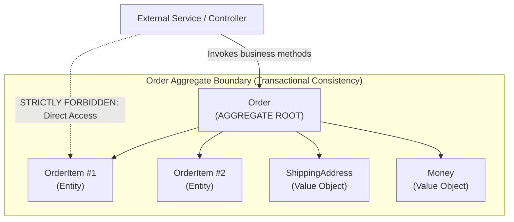
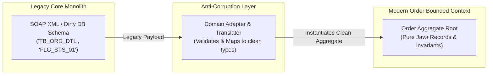

In the early days of enterprise Java, object-oriented development frequently degenerated into the **Anemic Domain Model** antipattern. 

Developers created classes that were little more than bags of getters and setters (Data Transfer Objects masquerading as domain models), while the actual business logic was smeared across hundreds of procedural `@Service` classes. Business rules like *"an order cannot be canceled once it has shipped"* or *"a bank account balance cannot fall below its credit limit"* were checked in some services, forgotten in others, and bypassed entirely by batch jobs. The domain logic lacked encapsulation, transactional boundaries were arbitrary, and refactoring was terrifying.

**Domain-Driven Design (DDD)**, pioneered by Eric Evans, provides the architectural blueprint for designing software that mirrors complex real-world business domains. While *Strategic DDD* focuses on Bounded Contexts and Context Maps, **Tactical DDD** provides the concrete programming building blocks: Entities, Value Objects, Aggregates, Aggregate Roots, Domain Events, Repositories, and Anti-Corruption Layers.

In this deep dive, we explore how to implement rich, self-validating tactical DDD patterns in modern Java, how to enforce transactional consistency boundaries, and how to eliminate the anemic domain model forever.

---

### Entities vs Value Objects: Identity vs Attribute Equality

The foundational building blocks of any DDD model are Entities and Value Objects:

```
Domain Model Building Blocks
  |-- Value Object: Defined entirely by its attributes (Immutable, no ID)
  `-- Entity: Defined by its unique thread of identity (Mutable lifecycle, persistent ID)
```

#### Value Objects: Immutability and Self-Validation
A **Value Object** has no identity. If two Value Objects possess identical attributes, they are completely interchangeable. A five-dollar bill in your wallet has the same purchasing power as any other five-dollar bill. If you modify a Value Object, you do not mutate it; you instantiate a new one.

In modern Java, **Java Records** are the quintessential implementation of Value Objects:

```java
public record Money(BigDecimal amount, Currency currency) {

    // Compact constructor enforces domain invariants upon instantiation
    public Money {
        Objects.requireNonNull(amount, "Amount cannot be null");
        Objects.requireNonNull(currency, "Currency cannot be null");
        if (amount.compareTo(BigDecimal.ZERO) < 0) {
            throw new IllegalArgumentException("Monetary amount cannot be negative");
        }
    }

    public Money add(Money other) {
        if (!this.currency.equals(other.currency)) {
            throw new CurrencyMismatchException(
                "Cannot add " + other.currency + " to " + this.currency);
        }
        return new Money(this.amount.add(other.amount), this.currency);
    }
}
```

Value Objects bring tremendous safety:
- **Zero Setter Methods**: Invariant checking happens in the constructor; invalid states cannot physically exist in memory.
- **Side-Effect Free Methods**: `add()` returns a new instance, eliminating pointer-aliasing bugs.
- **Automatic Structural Equality**: Records automatically generate `equals()` and `hashCode()` based on all component fields.

#### Entities: Continuity and Identity
An **Entity** represents an individual concept with a continuous lifecycle. Even if all its attributes change—a user changes their name, email, and address—it remains the exact same user. An Entity must have an explicit identifier (e.g., `CustomerId`, `OrderId`):

```java
public class Customer {
    private final CustomerId id; // Immutable Identity
    private String fullName;
    private EmailAddress email;   // Value Object
    private PostalAddress address;// Value Object

    public Customer(CustomerId id, String fullName, EmailAddress email, PostalAddress address) {
        this.id = Objects.requireNonNull(id);
        this.fullName = Objects.requireNonNull(fullName);
        this.email = Objects.requireNonNull(email);
        this.address = Objects.requireNonNull(address);
    }

    // Two entities are equal IF AND ONLY IF their IDs match
    @Override
    public boolean equals(Object o) {
        if (this == o) return true;
        if (!(o instanceof Customer other)) return false;
        return this.id.equals(other.id);
    }

    @Override
    public int hashCode() {
        return Objects.hash(id);
    }
}
```

---

### Aggregates and Aggregate Roots: Consistency Boundaries

In complex business domains, entities do not live in isolation. An `Order` contains multiple `OrderItem` entities and a `ShippingAddress` value object. 

If external services can directly update an `OrderItem`'s quantity, they can violate the parent `Order`'s invariants (e.g., maximum order value, inventory allocations, or bulk discount limits). 

An **Aggregate** is a cluster of associated Entities and Value Objects treated as a single transactional unit. Every Aggregate has a single gateway Entity designated as the **Aggregate Root**:



#### The 4 Golden Rules of Aggregates:
1. **Root Gateway Only:** Outside code can **only** hold a reference to the Aggregate Root. External code is strictly forbidden from directly calling setters or methods on internal entities.
2. **Invariant Protection:** The Aggregate Root is solely responsible for verifying and maintaining all business invariants across all its children before committing state changes.
3. **Reference Other Aggregates Strictly by ID:** An Aggregate Root must never hold a direct object pointer to another Aggregate Root (e.g., `Order` holds `CustomerId`, never a direct reference to `Customer customer`). This prevents massive object-graph loading in ORMs and enables seamless database sharding.
4. **One Transaction = One Aggregate:** A single database transaction should modify exactly **one** Aggregate instance. If business logic requires mutating two aggregates, use eventual consistency via Domain Events.

---

### Implementing a Rich Aggregate Root

Here is an enterprise-grade `Order` Aggregate Root demonstrating encapsulation, defensive copying, and invariant enforcement:

```java
public class Order {

    private final OrderId id;
    private final CustomerId customerId; // References other aggregate strictly by ID
    private final List<OrderItem> items = new ArrayList<>();
    private OrderStatus status;
    private Money totalAmount;

    public Order(OrderId id, CustomerId customerId) {
        this.id = Objects.requireNonNull(id);
        this.customerId = Objects.requireNonNull(customerId);
        this.status = OrderStatus.DRAFT;
        this.totalAmount = Money.zero(Currency.getInstance("USD"));
    }

    // Business Method: Enforces invariants before state mutation
    public void addLineItem(ProductId productId, Money unitPrice, int quantity) {
        if (this.status != OrderStatus.DRAFT) {
            throw new OrderAlreadySubmittedException("Cannot modify items in a " + this.status + " order");
        }
        if (quantity <= 0 || quantity > 100) {
            throw new InvalidQuantityException("Item quantity must be between 1 and 100");
        }

        OrderItem newItem = new OrderItem(new OrderItemId(UUID.randomUUID()), productId, unitPrice, quantity);
        this.items.add(newItem);

        // Recalculate total invariant
        this.totalAmount = this.totalAmount.add(newItem.subtotal());

        if (this.totalAmount.amount().compareTo(new BigDecimal("50000.00")) > 0) {
            throw new OrderLimitExceededException("Total order amount exceeds corporate $50,000 credit limit");
        }
    }

    public void checkout() {
        if (this.items.isEmpty()) {
            throw new EmptyOrderException("Cannot checkout an empty order");
        }
        this.status = OrderStatus.CONFIRMED;
    }

    // Defensive Copy: Prevents external callers from modifying items via items.clear()
    public List<OrderItem> getItems() {
        return Collections.unmodifiableList(this.items);
    }

    public OrderId getId() { return id; }
    public OrderStatus getStatus() { return status; }
    public Money getTotalAmount() { return totalAmount; }
}
```

Notice that there are **no setter methods**. The object protects its own state: it is physically impossible to create an `Order` in `CONFIRMED` state with zero items, or with a negative price.

---

### Domain Events: Decoupling Side Effects

When an aggregate's state changes, other parts of the system often need to react. For example, when an `Order` is confirmed:
- The Inventory Service must reserve stock.
- The Notification Service must send an email confirmation.
- The Analytics Service must record the conversion.

If the `OrderService` synchronously calls all these services, it creates tight coupling and sprawling transactions.

A **Domain Event** is an immutable record capturing something meaningful that occurred in the domain. In Java, Domain Events are modeled as Records:

```java
public record OrderConfirmedEvent(
    OrderId orderId, 
    CustomerId customerId, 
    Money totalAmount, 
    Instant occurredOn
) {}
```

#### Publishing Events with Spring Data AbstractAggregateRoot

Spring Data provides `AbstractAggregateRoot<A>`, which allows aggregate entities to register domain events that are automatically dispatched to Spring's event bus when the entity is saved via its repository:

```java
public class Order extends AbstractAggregateRoot<Order> {

    private OrderId id;
    private OrderStatus status;

    public void confirmPayment() {
        if (this.status != OrderStatus.PENDING_PAYMENT) {
            throw new IllegalStateException("Order is not awaiting payment");
        }

        this.status = OrderStatus.PAID;

        // Register domain event inside the aggregate
        registerEvent(new OrderPaidEvent(this.id, Instant.now()));
    }
}
```

In the persistence layer:

```java
@Transactional
public void processPayment(OrderId orderId) {
    Order order = orderRepository.findById(orderId).orElseThrow();
    order.confirmPayment();
    // Saving the order automatically fires OrderPaidEvent to @TransactionalEventListener beans!
    orderRepository.save(order); 
}
```

---

### Repositories vs DAO Antipatterns

A common misconception among developers is that a **Repository** is just a modern name for a **Data Access Object (DAO)**. They are fundamentally different architectural abstractions:

| Dimension | Data Access Object (DAO) | Domain Repository |
| :--- | :--- | :--- |
| **Abstraction Level** | Storage-centric (mirrors database tables) | Domain-centric (mimics in-memory collection) |
| **Scope** | One DAO per database table (`ItemDAO`, `OrderDAO`) | One Repository per **Aggregate Root** (`OrderRepository`) |
| **API Vocabulary** | `insert()`, `update()`, `delete()`, `executeSQL()` | `add()`, `get()`, `remove()`, `findOverdueOrders()` |
| **Internal Entities** | Allows direct querying/mutating of internal child rows | Never exposes child entities directly; saves whole Aggregate |

In DDD, you **never** create an `OrderItemRepository`. An `OrderItem` has no independent lifecycle outside of its parent `Order`. You persist and retrieve the `Order` aggregate as a cohesive whole.

---

### The Anti-Corruption Layer (ACL)

When your microservice must integrate with legacy systems, third-party payment gateways, or sprawling monoliths, their messy data structures and terminology will inevitably bleed into your pristine domain model.

An **Anti-Corruption Layer (ACL)** acts as a bidirectional translation firewall:



The ACL guarantees that if the legacy system alters its database columns or SOAP schemas, only the translator layer changes; your core domain rules remain completely untouched.

---

## Senior Engineer Interview Crucible

### Why does Domain-Driven Design strictly forbid direct references between different Aggregate Roots?
**Answer:** In DDD, an Aggregate defines a **transactional consistency boundary**. If Aggregate A holds a direct memory pointer to Aggregate B (e.g., `Order` holds `Customer customer`), developers will inevitably mutate both aggregates within the same transaction (`order.confirm(); order.getCustomer().deductLoyaltyPoints(50);`). This leads to long-running distributed database locks, deadlocks, and severe scalability bottlenecks. 

Furthermore, direct object graphs wreak havoc on ORMs (triggering unintended cascade updates and N+1 query storms) and prevent horizontal database partitioning (sharding). By referencing other aggregate roots strictly by identity (e.g., `CustomerId`), aggregates can be stored in completely different databases, modified independently, and kept eventually consistent via asynchronous Domain Events.

### What is the "Anemic Domain Model" antipattern, and why does it frequently emerge in Spring Boot applications?
**Answer:** An Anemic Domain Model occurs when domain entities are reduced to passive data holders containing only private fields, getters, and setters, while all business rules and state validations are implemented in procedural `@Service` classes. 

This antipattern frequently emerges in Spring Boot because early tutorials taught a rigid three-tier architecture: Controller -> Service -> DAO/Entity. Developers treated entities as 1:1 mirrors of relational database tables and placed all logic in the Service layer. This violates the core object-oriented principle of encapsulation (bundling data together with the behaviors that operate on that data). It leads to code duplication across services, scattered validation rules, and impossible-to-guarantee business invariants.

### How do you handle a business rule that requires validating invariants across multiple Aggregates simultaneously?
**Answer:** There are two sanctioned DDD approaches:

1. **Domain Service (Synchronous Single-Node):** If the rule must be evaluated instantaneously within the same bounded context, create a stateless **Domain Service**. The domain service loads both aggregates, evaluates the business rule, and coordinates their updates. However, this should still be avoided across distributed service boundaries.
2. **Saga / Eventual Consistency (The Production Standard):** In distributed cloud systems, DDD prescribes **Eventual Consistency**. Aggregate A performs its local state change, ensures its own invariants, and publishes a Domain Event (`OrderCreatedEvent`). A downstream event handler consumes the event, loads Aggregate B, and executes its state change. If Aggregate B fails its invariant (e.g., customer exceeded credit limit), a compensating event is published to cancel or roll back Aggregate A.

### What is the difference between a Domain Event and an Integration Event?
**Answer:**
- **Domain Event:** Represents an event within a single **Bounded Context**. It is designed using rich internal domain terminology and often carries detailed internal identifiers. It is typically handled synchronously or asynchronously within the same application process (e.g., via Spring's `ApplicationEventPublisher`) to decouple internal side effects.
- **Integration Event:** Designed to communicate state changes across **different Bounded Contexts or external microservices** (typically published over Apache Kafka or RabbitMQ). An Integration Event represents an explicit public contract. It deliberately strips internal domain implementation details, adheres to strict backwards-compatible schema versioning (such as Apache Avro or Protocol Buffers), and includes metadata (such as trace IDs and event schemas) to prevent leaking internal domain models to foreign services.
