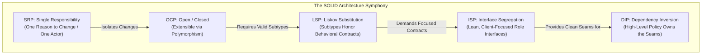
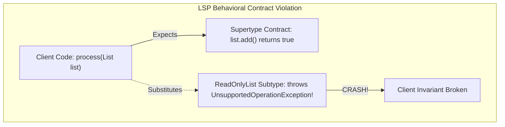
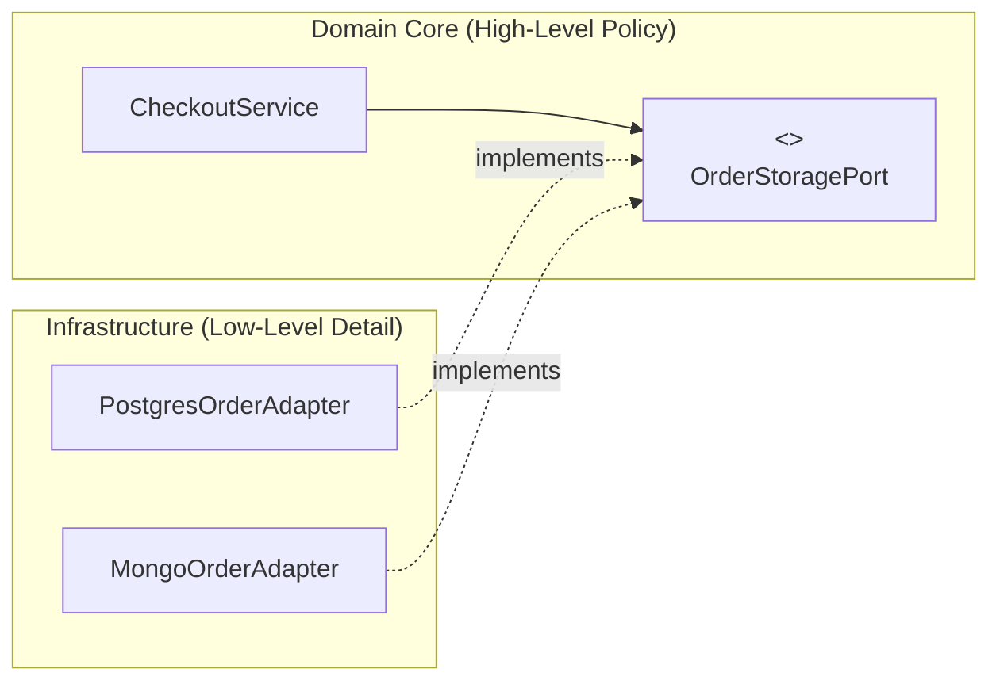

Every software engineer has walked into a legacy codebase where touching three lines of code in the checkout controller breaks the PDF invoice generator, corrupts database transactions, and causes twenty unit tests to fail.

This fragility is known as **code rot**. It is not caused by lack of effort; it is caused by uncontrolled coupling and misplaced responsibilities.

In the early 2000s, Robert C. Martin ("Uncle Bob") curated five foundational object-oriented design heuristics, later popularized by Michael Feathers under the acronym **SOLID**:
- **S**: Single Responsibility Principle (SRP)
- **O**: Open/Closed Principle (OCP)
- **L**: Liskov Substitution Principle (LSP)
- **I**: Interface Segregation Principle (ISP)
- **D**: Dependency Inversion Principle (DIP)

SOLID principles are not dogmatic laws that require creating twenty interfaces for a ten-line script. They are **defensive heuristics** designed to create clear seams, isolate business policy from infrastructure details, and ensure that your codebase can absorb continuous business change without collapsing.



---

## Single Responsibility Principle (SRP)

> *"A class should have one, and only one, reason to change."* — Robert C. Martin

Many junior developers misinterpret SRP to mean "a class should only do one thing" or "a class should only have one method." That is a misunderstanding. 

Uncle Bob later clarified the true intent of SRP: **"A module should be responsible to one, and only one, actor or stakeholder."**

An actor is a source of change: the CFO (financial rules), the COO (inventory operations), or the CTO/DBA (database persistence and infrastructure). When a single class attempts to satisfy multiple actors, changes requested by one stakeholder will inadvertently break functionality relied upon by another.

### The God-Class Antipattern

```java
// VIOLATION OF SRP: Satisfies the CFO, the Marketing Lead, and the DBA in one class
public class OrderService {
    public void processOrder(Order order) {
        // 1. Accounting Policy (Actor: Finance / CFO)
        BigDecimal tax = order.calculateVatTax();
        order.applyTax(tax);

        // 2. Notification Policy (Actor: Marketing / Customer Support)
        String htmlEmail = "<h1>Thank you for your order!</h1>";
        SmtpClient.sendEmail(order.getCustomerEmail(), htmlEmail);

        // 3. Persistence Policy (Actor: DBA / Infrastructure)
        try (Connection conn = DriverManager.getConnection("jdbc:postgresql://...")) {
            PreparedStatement ps = conn.prepareStatement("INSERT INTO orders VALUES (...)");
            ps.executeUpdate();
        } catch (SQLException e) {
            throw new RuntimeException("Database error", e);
        }
    }
}
```

If Marketing decides to migrate email delivery to SendGrid or reformat the HTML template, you are forced to edit and recompile `OrderService`. A syntax error or regression introduced for Marketing now risks taking down core order processing and financial tax calculation.

### The Refactored Architecture

Decompose responsibilities so that each class answers to a single stakeholder:

```java
import java.math.BigDecimal;
import java.util.Objects;

// 1. Domain Service: Answers strictly to Finance / Business Operations
public class OrderProcessor {
    private final TaxCalculator taxCalculator;
    private final OrderRepository orderRepository;
    private final NotificationService notificationService;

    public OrderProcessor(TaxCalculator taxCalculator, 
                          OrderRepository orderRepository, 
                          NotificationService notificationService) {
        this.taxCalculator = Objects.requireNonNull(taxCalculator);
        this.orderRepository = Objects.requireNonNull(orderRepository);
        this.notificationService = Objects.requireNonNull(notificationService);
    }

    public void process(Order order) {
        BigDecimal tax = taxCalculator.computeTax(order);
        order.applyTax(tax);
        
        orderRepository.save(order);
        notificationService.notifyCustomer(order);
    }
}

// 2. Infrastructure Interfaces: Seams isolated from the domain
interface TaxCalculator { BigDecimal computeTax(Order order); }
interface OrderRepository { void save(Order order); }
interface NotificationService { void notifyCustomer(Order order); }
```

---

## Open/Closed Principle (OCP)

> *"Software entities (classes, modules, functions) should be open for extension, but closed for modification."* — Bertrand Meyer

When new business requirements arrive (such as adding crypto payment processing, a new shipping carrier, or an export format), you should be able to extend the system's behavior **without editing existing, battle-tested source code**.

If adding a new payment method requires opening a core service class and adding another `else if` branch to a 500-line `switch` statement, your architecture violates OCP. Every edit to an existing class re-opens it to regression risks, requiring complete re-testing of all previous payment pathways.

### The Brittle Switch Antipattern

```java
// VIOLATION OF OCP: Every new gateway modifies this core class
public class PaymentGateway {
    public void executePayment(PaymentType type, BigDecimal amount) {
        if (type == PaymentType.CREDIT_CARD) {
            // Process Stripe charge
        } else if (type == PaymentType.PAYPAL) {
            // Process PayPal OAuth and transfer
        } else if (type == PaymentType.BITCOIN) {
            // Process blockchain transaction
        } else {
            throw new UnsupportedOperationException("Unknown payment type");
        }
    }
}
```

### The Strategy & Registry Pattern

Make the core orchestrator closed to modification, while keeping the pipeline open to new strategies:

```java
import java.math.BigDecimal;
import java.util.Map;
import java.util.concurrent.ConcurrentHashMap;

// 1. The Stable Strategy Contract
public interface PaymentMethod {
    String providerName();
    void pay(BigDecimal amount);
}

// 2. Closed Orchestrator: Never modifies when new providers are added
public class PaymentEngine {
    private final Map<String, PaymentMethod> registry = new ConcurrentHashMap<>();

    public void register(PaymentMethod method) {
        registry.put(method.providerName(), method);
    }

    public void execute(String providerName, BigDecimal amount) {
        PaymentMethod method = registry.get(providerName);
        if (method == null) {
            throw new IllegalArgumentException("Unsupported provider: " + providerName);
        }
        method.pay(amount);
    }
}

// 3. New Extensions: Purely additive code in new files
public final class ApplePayPaymentMethod implements PaymentMethod {
    @Override public String providerName() { return "APPLE_PAY"; }
    @Override public void pay(BigDecimal amount) {
        System.out.println("Processing Apple Pay token for amount: " + amount);
    }
}
```

---

## Liskov Substitution Principle (LSP)

> *"Subtypes must be behaviorally substitutable for their base types without altering the correctness of the program."* — Barbara Liskov

LSP is the most mathematically rigorous and frequently violated principle in object-oriented programming. 

Many developers assume that if code compiles, subtyping is safe. But Java's type checker only validates method names, parameter types, and return types. **The compiler cannot verify behavioral contracts, invariants, or runtime semantics.**

### The Formal Rules of Substitutability

For a subtype `S` to safely substitute for base type `T`:
1. **Preconditions cannot be strengthened in a subtype**: A subclass cannot demand stricter validation or narrower inputs than the parent. If `Parent.deposit(double amount)` accepts any amount greater than zero, `Child.deposit(double amount)` cannot throw an exception when the amount is less than 1,000.
2. **Postconditions cannot be weakened in a subtype**: A subclass cannot return looser guarantees or incomplete state than the parent promised.
3. **Invariants of the supertype must be preserved**: Any internal condition that the supertype holds true must remain true in the subtype.
4. **No unexpected exceptions**: A subtype cannot throw checked exceptions that the base type method signature did not declare.

### The Classic LSP Violation: ReadOnlyList

A famous LSP violation in Java occurs when developers attempt to reuse an existing collection via inheritance:

```java
import java.util.ArrayList;

// VIOLATION OF LSP: Mathematical model clashes with behavioral contract
public class ReadOnlyList<E> extends ArrayList<E> {
    @Override
    public boolean add(E e) {
        // BREAKS LSP! Violates the behavioral contract of List.add()
        throw new UnsupportedOperationException("This list is read-only!");
    }
}
```

A client receiving `List<String>` expects `list.add("hello")` to succeed and append the element. When `ReadOnlyList` throws an `UnsupportedOperationException`, the client program crashes because the subtype failed to honor the behavioral contract of the supertype.



> [!IMPORTANT]
> If a subtype must throw `UnsupportedOperationException` to disable inherited methods, **that inheritance relationship is an architectural error**. Use composition instead.

---

## Interface Segregation Principle (ISP)

> *"Clients should not be forced to depend upon interfaces that they do not use."* — Robert C. Martin

The Interface Segregation Principle warns against creating **"Fat Interfaces"** (monolithic interfaces containing dozens of unrelated methods).

When an interface contains methods that serve multiple distinct client needs, every implementing class is forced to provide dummy implementations or throw runtime exceptions for the methods it does not support. Even worse, whenever a method signature changes for Client A, Client B is forced to recompile, even though it never called that method.

### The Fat Interface Antipattern

```java
// VIOLATION OF ISP: A monolithic interface coupling unrelated workflows
public interface MultiFunctionWorker {
    void writeCode();
    void attendMeeting();
    void eatLunch();
    void reviewPullRequest();
}

// A Continuous Integration Bot implementing the fat interface:
public class AutomationBot implements MultiFunctionWorker {
    @Override public void writeCode() { /* Automated codegen */ }
    @Override public void reviewPullRequest() { /* Static analysis check */ }

    @Override
    public void attendMeeting() {
        // BOT DOES NOT ATTEND MEETINGS! Forced dummy code:
        throw new UnsupportedOperationException("Bots do not attend meetings");
    }

    @Override
    public void eatLunch() {
        // BOT DOES NOT EAT! Forced dummy code:
        throw new UnsupportedOperationException("Bots do not eat");
    }
}
```

### The Role Interface Pattern

Split fat interfaces into cohesive, client-specific **Role Interfaces**:

```java
// Cohesive, surgical role interfaces
public interface CodeProducer {
    void writeCode();
}

public interface CodeReviewer {
    void reviewPullRequest();
}

public interface MeetingParticipant {
    void attendMeeting();
}

// Human software engineer implements all three roles:
public class SoftwareEngineer implements CodeProducer, CodeReviewer, MeetingParticipant {
    @Override public void writeCode() { System.out.println("Writing Java..."); }
    @Override public void reviewPullRequest() { System.out.println("Reviewing diffs..."); }
    @Override public void attendMeeting() { System.out.println("Discussing sprint goals..."); }
}

// Automation bot implements only the roles it actually fulfills:
public class CiBot implements CodeProducer, CodeReviewer {
    @Override public void writeCode() { System.out.println("Auto-generating client stubs..."); }
    @Override public void reviewPullRequest() { System.out.println("Checking SonarQube quality gate..."); }
}
```

The Java standard library provides masterclass examples of ISP: `Comparable<T>`, `Iterable<T>`, `AutoCloseable`, `Callable<V>`, and `Runnable`. Each is a focused, single-purpose role interface.

---

## Dependency Inversion Principle (DIP)

> *"High-level modules should not depend on low-level modules. Both should depend on abstractions. Abstractions should not depend on details; details should depend on abstractions."* — Robert C. Martin

In traditional procedural programming, dependencies flow downward: High-Level Business Rules call Data Access Objects, which call Low-Level Database Drivers and SQL statements.

```
Traditional Flow:  [Business Domain] ---> [Postgres Database SQL]
```

The fatal flaw with downward dependency is that **your business domain becomes held hostage by your infrastructure**. If you switch from PostgreSQL to MongoDB or want to run a mock database in a unit test, you must rewrite your high-level business logic.

The Dependency Inversion Principle **inverts the direction of control**:
- The high-level business domain defines its own seams (**Ports / Interfaces**).
- The low-level database, message broker, and HTTP frameworks implement those interfaces (**Adapters**).



Notice the arrow direction: the low-level infrastructure module points **inward** toward the high-level domain interface. The domain has zero compile-time dependencies on databases or external frameworks!

### Hexagonal Architecture (Ports and Adapters) in Pure Java

```java
import java.math.BigDecimal;
import java.util.Objects;

// 1. High-Level Domain Contract (The "Port") - Lives in the domain package
public interface AccountRepository {
    Account findById(String accountId);
    void updateBalance(Account account);
}

// 2. High-Level Business Policy - Zero imports of JDBC, Hibernate, or Spring!
public class TransferFundsUseCase {
    private final AccountRepository repository;

    // Injected via Constructor (Dependency Injection)
    public TransferFundsUseCase(AccountRepository repository) {
        this.repository = Objects.requireNonNull(repository);
    }

    public void transfer(String fromId, String toId, BigDecimal amount) {
        Account from = repository.findById(fromId);
        Account to = repository.findById(toId);

        from.debit(amount);
        to.credit(amount);

        repository.updateBalance(from);
        repository.updateBalance(to);
    }
}

// 3. Low-Level Detail (The "Adapter") - Lives in the infrastructure package
public class PostgresAccountAdapter implements AccountRepository {
    @Override
    public Account findById(String accountId) {
        // Raw JDBC / Hibernate query execution
        return new Account(accountId, BigDecimal.valueOf(5000));
    }

    @Override
    public void updateBalance(Account account) {
        // Execute SQL UPDATE accounts SET balance = ? WHERE id = ?
    }
}
```

### Clarifying the Terminology: DIP vs IoC vs DI

- **Dependency Inversion Principle (DIP)**: The high-level architectural rule stating that high-level policies should not depend on low-level details.
- **Inversion of Control (IoC)**: The broad design pattern where the control flow of a program is inverted (e.g., frameworks calling your code via lifecycles rather than your code calling libraries).
- **Dependency Injection (DI)**: The specific creational mechanism used to deliver concrete dependencies into an object (e.g., via constructor arguments or frameworks like Spring / Guice).

---

## Pragmatic Architecture: Avoiding the "Architecture Astronaut" Trap

A junior developer writes code without abstractions. A mid-level developer uses abstractions everywhere. A senior architect knows when **not** to abstract.

Blindly applying SOLID to every trivial class leads to the **Architecture Astronaut Antipattern**:
- Creating an interface with only one implementation (`OrderService` and `OrderServiceImpl`) when no polymorphism or alternative implementation will ever exist.
- Creating 15 separate micro-classes for a simple 30-line calculation.
- Sacrificing readability and navigability in your IDE for theoretical extensibility that never gets utilized.

> [!TIP]
> **The Rule of Three**: Do not introduce an interface or strategy abstraction the very first time you write a feature. Wait until you see a concrete second or third variation. Allow the design to emerge naturally from real business requirements rather than speculative anticipation.

---

## Senior Engineer Interview Crucible

### How does Uncle Bob's definition of SRP ("one reason to change") map to business stakeholders, and how do you detect when a class violates it?
Uncle Bob defined a "reason to change" as an **actor or stakeholder** who requests changes to the software. A class violates SRP when it mixes responsibilities that serve distinct business actors (such as financial calculation rules requested by the CFO, notification templates requested by Marketing, and database persistence schemas managed by the DBA). 

You can detect SRP violations when:
1. Multiple developers working on completely unrelated business stories must modify the same class file concurrently, causing frequent merge conflicts.
2. A bug fix for one feature (e.g., changing email formatting) inadvertently breaks an unrelated feature (e.g., invoice total computation).
3. The class requires dozens of diverse mocks and dependencies simply to run a focused unit test.

### Give a concrete example of a Liskov Substitution Principle violation involving preconditions and postconditions.
Consider a base class `BankAccount`:
```java
public class BankAccount {
    public void withdraw(BigDecimal amount) {
        // Precondition: amount > 0
        // Postcondition: balance is reduced by amount
    }
}
```
If a subclass `PremiumAccount` overrides `withdraw` and adds a check `if (amount < 100) throw new IllegalArgumentException("Minimum withdrawal is 100")`, it has **strengthened the precondition**. Client code written against `BankAccount` that successfully passes an amount of 50 will now crash unexpectedly when given a `PremiumAccount`.

Conversely, if `SpecialAccount` overrides `withdraw` but fails to update the balance or returns without executing the debit, it has **weakened the postcondition**, violating the caller's guarantee that the funds were deducted.

### How do the Open/Closed Principle and the Dependency Inversion Principle work together to enable Hexagonal (Ports and Adapters) architecture?
DIP and OCP are symbiotic in Hexagonal Architecture. 

DIP dictates that the high-level business core defines its own interfaces ("Ports") without depending on external databases, web frameworks, or third-party APIs. Infrastructure adapters implement these ports, pointing inward. 

Because the domain core coordinates workflows exclusively through these port abstractions, the application is **Closed for modification** (the core domain logic never changes when infrastructure changes). Simultaneously, the application is **Open for extension** (OCP) because engineers can plug in new database adapters, mock test adapters, or message queue consumers simply by implementing the existing port interface, without touching a single line of domain code.

### When does adhering strictly to SOLID lead to the "Architecture Astronaut" antipattern, and how do you balance pragmatism with purity?
Strict, unyielding adherence to SOLID leads to over-engineering when developers introduce abstractions speculatively before any real variation exists. Common symptoms include creating paired interfaces for every single class (`UserService` / `UserServiceImpl`), writing extensive boilerplate adapters for single-use internal helpers, and fragmenting logic across dozens of microscopic classes, making standard code navigation difficult.

Pragmatic architects balance SOLID by applying the **YAGNI (You Aren't Gonna Need It)** principle and the **Rule of Three**. Start with simple, cohesive concrete classes. Extract interfaces and inversion seams only when a real need arises—such as writing isolated unit tests, supporting multiple production implementations, or isolating volatile third-party libraries.
