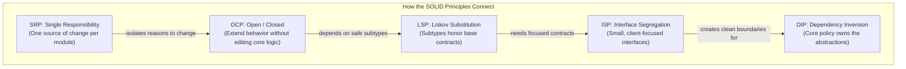
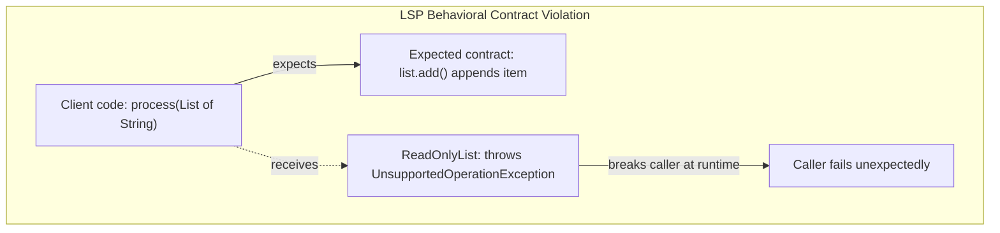
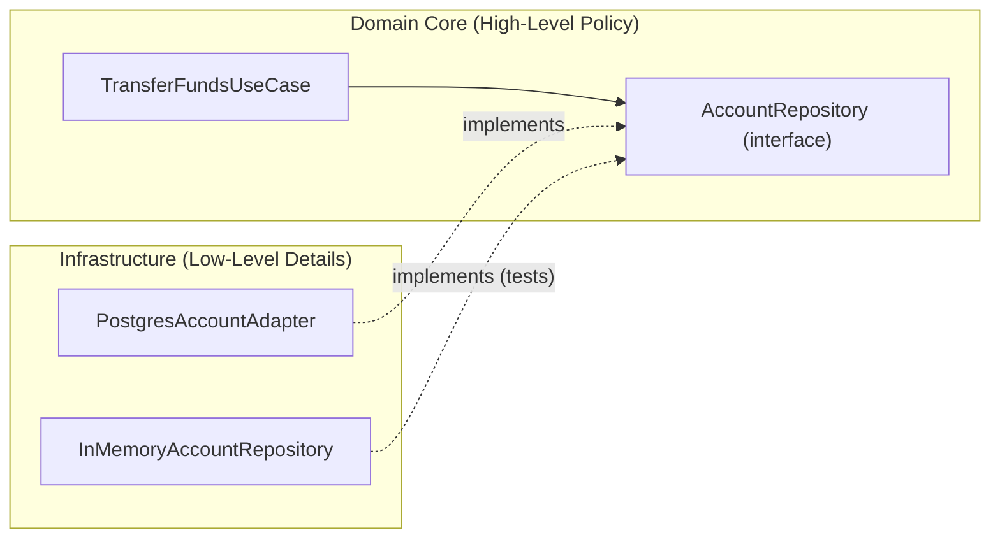

In a codebase that has grown without clear boundaries, small changes start causing unrelated failures. Editing a checkout flow breaks invoice formatting, changing an email template forces you to retest tax calculations, and every unit test needs half a dozen mocks just to instantiate one service.

That kind of fragility usually comes from misplaced responsibilities and tight coupling between business rules and infrastructure. In the early 2000s, Robert C. Martin gathered five object-oriented design principles that Michael Feathers later organized under the acronym **SOLID**:

- **S**: Single Responsibility Principle (SRP)
- **O**: Open/Closed Principle (OCP)
- **L**: Liskov Substitution Principle (LSP)
- **I**: Interface Segregation Principle (ISP)
- **D**: Dependency Inversion Principle (DIP)

Treat SOLID as a set of design heuristics rather than rigid rules. They help you place clean boundaries where code is likely to change, keep core business logic independent of databases and third-party APIs, and catch risky inheritance hierarchies early. Applied blindly, they also have a cost: extra files, extra indirection, and harder navigation. Knowing both how to apply each principle and where to stop is what makes them useful in real Java projects.



---

## Single Responsibility Principle (SRP)

> *"A class should have one, and only one, reason to change."* (Robert C. Martin)

A common misreading of SRP is "a class should only do one thing" or "a class should only have one method." Taken literally, that leads to tiny single-method classes scattered across dozens of packages.

Martin later restated SRP more clearly: **a module should be responsible to one, and only one, actor.** An actor is a group of stakeholders or a system concern that drives changes for its own reasons, such as finance (tax rules), customer support or marketing (email formatting), or platform engineering (database schema and persistence). When one class serves multiple actors, changes requested by one team can accidentally break behavior relied on by another.

### Before: One Class Serving Three Actors

Consider an `OrderService` that handles tax calculation, email composition, and direct JDBC persistence all inside one method:

```java
import java.math.BigDecimal;
import java.sql.Connection;
import java.sql.DriverManager;
import java.sql.PreparedStatement;
import java.sql.SQLException;

// Bad: mixes finance rules, email delivery, and raw JDBC persistence
public class OrderService {
    public void processOrder(Order order) {
        // 1. Accounting rule (Finance team)
        BigDecimal tax = order.subtotal().multiply(new BigDecimal("0.20"));
        order.applyTax(tax);

        // 2. Customer notification (Marketing / Support team)
        String htmlBody = "<h1>Order Confirmed</h1><p>Total: " + order.total() + "</p>";
        SmtpClient.sendEmail(order.customerEmail(), "Your order", htmlBody);

        // 3. Persistence (Database / Infrastructure team)
        try (Connection conn = DriverManager.getConnection("jdbc:postgresql://localhost:5432/shop");
             PreparedStatement ps = conn.prepareStatement(
                     "INSERT INTO orders (id, customer_email, total) VALUES (?, ?, ?)")) {
            ps.setString(1, order.id());
            ps.setString(2, order.customerEmail());
            ps.setBigDecimal(3, order.total());
            ps.executeUpdate();
        } catch (SQLException e) {
            throw new IllegalStateException("Failed to persist order " + order.id(), e);
        }
    }
}
```

If marketing switches email templates or moves from raw SMTP to SendGrid, you have to edit `OrderService`. If the database schema changes, you edit `OrderService` again. Even worse, you cannot unit-test the tax logic without either hitting a live PostgreSQL instance and SMTP server or hacking around static calls.

### After: Separating Responsibilities by Actor

Split the class so each collaborator owns one concern and `OrderProcessor` focuses strictly on coordinating the order workflow:

```java
import java.math.BigDecimal;
import java.util.Objects;

public interface TaxCalculator {
    BigDecimal computeTax(Order order);
}

public interface OrderRepository {
    void save(Order order);
}

public interface NotificationService {
    void sendOrderConfirmation(Order order);
}

public class OrderProcessor {
    private final TaxCalculator taxCalculator;
    private final OrderRepository orderRepository;
    private final NotificationService notificationService;

    public OrderProcessor(TaxCalculator taxCalculator,
                          OrderRepository orderRepository,
                          NotificationService notificationService) {
        this.taxCalculator = Objects.requireNonNull(taxCalculator);
        this.orderRepository = Objects.requireNonNull(orderRepository);
        this.notificationService = Objects.requireNonNull(notificationService);
    }

    public void process(Order order) {
        BigDecimal tax = taxCalculator.computeTax(order);
        order.applyTax(tax);

        orderRepository.save(order);
        notificationService.sendOrderConfirmation(order);
    }
}
```

Now a template redesign touches only the `NotificationService` implementation, a SQL change stays inside the `OrderRepository` implementation, and `OrderProcessor` can be tested in milliseconds with simple fakes.

### Where People Overdo SRP

Splitting responsibilities is helpful when concerns genuinely change for different reasons or belong to different layers (domain vs. I/O). Splitting a cohesive 60-line class into six single-method helper classes just to keep file lengths under 20 lines makes the code harder to read, not easier. If two pieces of logic always change together and share the same data invariants, they usually belong in the same class.

---

## Open/Closed Principle (OCP)

> *"Software entities (classes, modules, functions) should be open for extension, but closed for modification."* (Bertrand Meyer)

When your application grows to support a new payment provider, shipping carrier, or report format, ideally you should be able to add that behavior by writing new code rather than editing a central conditional block. Every time you open an existing, working class to add another `else if` branch, you risk breaking existing branches and have to re-verify all of them.

### Before: Growing Conditional Chains

```java
import java.math.BigDecimal;

public enum PaymentType {
    CREDIT_CARD, PAYPAL, BANK_TRANSFER
}

// Bad: every new payment provider requires modifying this class
public class PaymentGateway {
    public void executePayment(PaymentType type, BigDecimal amount) {
        if (type == PaymentType.CREDIT_CARD) {
            System.out.println("Charging card for " + amount);
        } else if (type == PaymentType.PAYPAL) {
            System.out.println("Initiating PayPal transfer for " + amount);
        } else if (type == PaymentType.BANK_TRANSFER) {
            System.out.println("Submitting wire transfer for " + amount);
        } else {
            throw new UnsupportedOperationException("Unknown payment type: " + type);
        }
    }
}
```

In a real system, each branch pulls in its own SDK client, retry rules, and error mapping. Adding Apple Pay means editing `PaymentGateway`, adding new constructor dependencies to it, and re-running the full suite for every existing payment type.

### After: Polymorphic Strategy and Registry

Define a narrow `PaymentMethod` interface and let `PaymentEngine` dispatch by provider name:

```java
import java.math.BigDecimal;
import java.util.Map;
import java.util.Objects;
import java.util.concurrent.ConcurrentHashMap;

public interface PaymentMethod {
    String providerName();
    void pay(BigDecimal amount);
}

public class PaymentEngine {
    private final Map<String, PaymentMethod> registry = new ConcurrentHashMap<>();

    public void register(PaymentMethod method) {
        Objects.requireNonNull(method);
        registry.put(method.providerName(), method);
    }

    public void execute(String providerName, BigDecimal amount) {
        PaymentMethod method = registry.get(providerName);
        if (method == null) {
            throw new IllegalArgumentException("Unsupported provider: " + providerName);
        }
        method.pay(amount);
    }
}

public final class ApplePayPaymentMethod implements PaymentMethod {
    @Override
    public String providerName() {
        return "APPLE_PAY";
    }

    @Override
    public void pay(BigDecimal amount) {
        System.out.println("Processing Apple Pay token for amount: " + amount);
    }
}
```

In a Spring application, Spring can even inject `List<PaymentMethod>` directly into `PaymentEngine`'s constructor, so dropping in a new `@Component` automatically registers the new provider without touching `PaymentEngine`.

### Trade-Off: Open Polymorphism vs. Exhaustive Sealed Types

OCP does not mean every `switch` statement is bad. You should only make an axis of variation open for extension when you actually expect new variants over time.

When the set of variants is fixed and well known (for example, the possible states of a payment result: `Approved`, `Declined`, `PendingReview`), Java 21's `sealed` interfaces combined with pattern matching in `switch` are often a better choice. With a sealed hierarchy, if someone adds a fourth variant later, the compiler flags every `switch` expression in the codebase that forgot to handle it. Use open interfaces for extensible plugins; use sealed hierarchies when you want compiler-checked exhaustiveness across a closed set of cases.

---

## Liskov Substitution Principle (LSP)

> *"Subtypes must be behaviorally substitutable for their base types without altering the correctness of the program."* (Barbara Liskov)

The Java compiler checks method signatures: names, parameter types, return types, and checked exceptions. It cannot check whether a subclass actually preserves the *behavior* that callers expect from the parent type. That gap is where LSP violations live.

For a subtype `S` to safely stand in for a supertype `T`, four behavioral rules have to hold:

1. **Preconditions cannot be strengthened**: A subtype cannot reject inputs that the base type accepts. If `Base.deposit(BigDecimal amount)` accepts any positive amount, `Sub.deposit(BigDecimal amount)` cannot throw an exception for amounts under 100.
2. **Postconditions cannot be weakened**: A subtype must deliver at least the state guarantees the base type promises after a call completes.
3. **Invariants must be preserved**: Any rule the base type guarantees about its internal state must still hold in the subtype.
4. **No surprise exceptions**: Java already stops subclasses from adding new checked exceptions, but throwing unexpected unchecked exceptions (like `UnsupportedOperationException`) to disable inherited methods still breaks callers at runtime.

### Classic Example 1: The Rectangle and Square Problem

In geometry, a square is a rectangle. In mutable object-oriented code, `Square extends Rectangle` breaks callers almost immediately:

```java
// Bad: Square breaks Rectangle's behavioral invariant
public class Rectangle {
    protected int width;
    protected int height;

    public void setWidth(int width) {
        this.width = width;
    }

    public void setHeight(int height) {
        this.height = height;
    }

    public int area() {
        return width * height;
    }
}

public class Square extends Rectangle {
    @Override
    public void setWidth(int width) {
        this.width = width;
        this.height = width;
    }

    @Override
    public void setHeight(int height) {
        this.width = height;
        this.height = height;
    }
}
```

Now look at a caller written against `Rectangle`:

```java
void resizeAndVerify(Rectangle rect) {
    rect.setWidth(5);
    rect.setHeight(4);
    // Caller reasonably expects 5 * 4 = 20.
    // With a Square, height overwrote width, so area() returns 16!
    if (rect.area() != 20) {
        throw new AssertionError("Expected area 20, got " + rect.area());
    }
}
```

The problem is that `Rectangle` implicitly promises that width and height can vary independently. `Square` violates that invariant because its sides must stay equal.

The fix is to stop modeling `Square` as a mutable subclass of `Rectangle`. Instead, let both implement a shared read-only `Shape` interface (and prefer immutable records when mutation is not needed):

```java
public sealed interface Shape permits ImmutableRectangle, ImmutableSquare {
    int area();
}

public record ImmutableRectangle(int width, int height) implements Shape {
    @Override
    public int area() {
        return width * height;
    }
}

public record ImmutableSquare(int side) implements Shape {
    @Override
    public int area() {
        return side * side;
    }
}
```

### Classic Example 2: Unsupported Collection Operations

Another common LSP problem shows up when someone subclasses a mutable collection to make it read-only:

```java
import java.util.ArrayList;

// Bad: breaks the List.add() contract inherited from ArrayList
public class ReadOnlyList<E> extends ArrayList<E> {
    @Override
    public boolean add(E element) {
        throw new UnsupportedOperationException("This list is read-only");
    }
}
```



Notice that even the Java standard library makes a deliberate compromise here: `List.of(...)`, `Arrays.asList(...)`, and `Collections.unmodifiableList(...)` all implement `List<E>` and document mutators like `add()` as *optional operations* that throw `UnsupportedOperationException`. The JDK designers accepted that trade-off back in Java 1.2 to avoid doubling the number of collection interfaces (`ReadableList` vs. `MutableList`).

In your own domain code, you do not have the JDK's backward-compatibility constraints. If you find yourself overriding inherited methods just to throw `UnsupportedOperationException`, treat that as a signal that inheritance is the wrong relationship. Wrap the list with composition and expose only the read methods callers are actually allowed to invoke.

> [!IMPORTANT]
> When a subclass has to disable or throw exceptions on inherited methods to stay valid, replace inheritance with composition or introduce a narrower shared interface.

---

## Interface Segregation Principle (ISP)

> *"Clients should not be forced to depend upon interfaces that they do not use."* (Robert C. Martin)

ISP targets "fat interfaces" that bundle unrelated capabilities into one contract. When an interface grows too wide, implementers have to write stub methods or throw `UnsupportedOperationException` for capabilities they do not support. Callers also end up coupled to methods they never invoke, which means changes for one caller ripple into unrelated parts of the codebase.

### Before: One Fat Interface

```java
// Bad: bundles human and automated responsibilities into one interface
public interface Worker {
    void writeCode();
    void reviewPullRequest();
    void attendStandup();
    void submitTimesheet();
}

public class CiAutomationBot implements Worker {
    @Override
    public void writeCode() {
        System.out.println("Generating API client stubs");
    }

    @Override
    public void reviewPullRequest() {
        System.out.println("Running static analysis checks");
    }

    @Override
    public void attendStandup() {
        throw new UnsupportedOperationException("Bots do not attend standups");
    }

    @Override
    public void submitTimesheet() {
        throw new UnsupportedOperationException("Bots do not submit timesheets");
    }
}
```

Notice how ISP and LSP reinforce each other: the fat interface forced `CiAutomationBot` into an LSP violation.

### After: Small Role Interfaces

Break the wide contract into small interfaces grouped by how clients actually use them:

```java
public interface CodeProducer {
    void writeCode();
}

public interface CodeReviewer {
    void reviewPullRequest();
}

public interface TeamMember {
    void attendStandup();
    void submitTimesheet();
}

public class SoftwareEngineer implements CodeProducer, CodeReviewer, TeamMember {
    @Override public void writeCode() { System.out.println("Implementing feature"); }
    @Override public void reviewPullRequest() { System.out.println("Reviewing PR diff"); }
    @Override public void attendStandup() { System.out.println("Sharing status update"); }
    @Override public void submitTimesheet() { System.out.println("Logging hours"); }
}

public class CiAutomationBot implements CodeProducer, CodeReviewer {
    @Override public void writeCode() { System.out.println("Generating API client stubs"); }
    @Override public void reviewPullRequest() { System.out.println("Running static analysis checks"); }
}
```

The Java standard library gives good examples of well-segregated interfaces: `Comparable<T>`, `Iterable<T>`, `AutoCloseable`, `Runnable`, and `Closeable`. Each expresses a clear capability that classes can adopt independently.

One caveat: ISP does not require every interface to have exactly one method. `ListIterator` or a repository with `findById` and `save` are fine when clients genuinely use those operations together. Split an interface when distinct groups of callers only ever touch distinct subsets of its methods.

---

## Dependency Inversion Principle (DIP)

> *"High-level modules should not depend on low-level modules. Both should depend on abstractions. Abstractions should not depend on details; details should depend on abstractions."* (Robert C. Martin)

Without DIP, dependencies follow the call stack downward: high-level business logic directly imports and instantiates concrete database classes, HTTP clients, or SDKs.

### Before: Business Policy Coupled to Persistence Details

```java
import java.math.BigDecimal;

// Bad: high-level transfer logic is directly tied to PostgreSQL
public class TransferFundsService {
    private final PostgresAccountDao accountDao = new PostgresAccountDao();

    public void transfer(String fromId, String toId, BigDecimal amount) {
        Account from = accountDao.queryById(fromId);
        Account to = accountDao.queryById(toId);

        from.debit(amount);
        to.credit(amount);

        accountDao.executeUpdateSql(from);
        accountDao.executeUpdateSql(to);
    }
}
```

Here `TransferFundsService` cannot be tested without PostgreSQL, cannot switch storage engines without editing business logic, and even leaks SQL terminology (`executeUpdateSql`) into the domain layer.

### After: Inverting the Dependency Direction

With DIP, the high-level domain defines the interface it needs (often called a **port** in Hexagonal Architecture), and low-level infrastructure modules implement that interface (an **adapter**).



Notice the arrow direction: the compile-time dependency from `PostgresAccountAdapter` now points *inward* toward the domain's `AccountRepository` interface, even though runtime calls still flow outward from the use case to PostgreSQL.

```java
import java.math.BigDecimal;
import java.util.HashMap;
import java.util.Map;
import java.util.Objects;

// 1. Domain interface (owned by the high-level package)
public interface AccountRepository {
    Account findById(String accountId);
    void save(Account account);
}

// 2. High-level policy: no JDBC, Hibernate, or Spring imports
public class TransferFundsUseCase {
    private final AccountRepository repository;

    public TransferFundsUseCase(AccountRepository repository) {
        this.repository = Objects.requireNonNull(repository);
    }

    public void transfer(String fromId, String toId, BigDecimal amount) {
        Account from = repository.findById(fromId);
        Account to = repository.findById(toId);

        from.debit(amount);
        to.credit(amount);

        repository.save(from);
        repository.save(to);
    }
}

// 3. Infrastructure adapter (lives in the persistence package)
public class PostgresAccountAdapter implements AccountRepository {
    @Override
    public Account findById(String accountId) {
        // Run SELECT query using JDBC or Spring Data JPA
        return new Account(accountId, BigDecimal.valueOf(5000));
    }

    @Override
    public void save(Account account) {
        // Run UPDATE accounts SET balance = ? WHERE id = ?
    }
}

// 4. Lightweight in-memory adapter for fast unit tests
public class InMemoryAccountRepository implements AccountRepository {
    private final Map<String, Account> store = new HashMap<>();

    public void seed(Account account) {
        store.put(account.id(), account);
    }

    @Override
    public Account findById(String accountId) {
        Account account = store.get(accountId);
        if (account == null) {
            throw new IllegalArgumentException("Unknown account: " + accountId);
        }
        return account;
    }

    @Override
    public void save(Account account) {
        store.put(account.id(), account);
    }
}
```

### Keeping DIP, IoC, and DI Straight

These three terms are closely related and often mixed up in interviews and code reviews:

- **Dependency Inversion Principle (DIP)**: The design principle saying high-level policies and low-level details should both depend on abstractions owned by the high-level side.
- **Inversion of Control (IoC)**: A broader architectural pattern where a framework or container controls application flow and calls your code (for example, Spring MVC invoking your controller method on an HTTP request).
- **Dependency Injection (DI)**: The concrete technique of passing dependencies into an object from the outside (typically through constructor parameters) rather than creating them with `new` inside the class.

You can use Dependency Injection without DIP (injecting a concrete `PostgresAccountDao` still couples you to PostgreSQL), and you can practice DIP with plain Java constructors without using a framework like Spring.

---

## Knowing When Not to Abstract

SOLID principles are easy to over-apply. A classic symptom in Java codebases is creating a matching interface for every single service class (`OrderService` and `OrderServiceImpl`) even when there will never be a second implementation, or introducing strategy registries and five layers of wrappers around a 25-line calculation.

Every abstraction adds indirection. When you jump to definition in an IDE and land on a single-implementation interface, you have paid a readability tax without getting flexibility in return.

> [!TIP]
> **Start concrete, extract when friction appears.** Write clear, cohesive concrete classes first. Introduce interfaces and extension seams when you hit a real driver: isolating external I/O (databases, HTTP APIs, clocks), supporting a second production implementation, or decoupling modules owned by different teams.

---

## Interview Questions

### How does "one reason to change" in SRP map to a real codebase, and what signs tell you a class is violating it?

In practice, a "reason to change" maps to an actor or stakeholder whose requirements evolve independently. In an e-commerce service, finance owns tax rules, marketing owns notification copy, and infrastructure owns persistence. When one class contains all three, you start seeing concrete warning signs: developers working on unrelated tickets hit merge conflicts in the same file, a formatting tweak breaks calculation tests, or unit testing a simple rule requires mocking database connections and HTTP clients.

### Give an example of an LSP violation involving preconditions or postconditions.

Suppose `BankAccount.withdraw(BigDecimal amount)` has the precondition `amount > 0` and the postcondition that the account balance decreases by `amount`. If a subclass `CorporateAccount` overrides `withdraw` and throws an exception whenever `amount < 100`, it has strengthened the precondition: callers that validly withdrew 50 from a `BankAccount` now fail when handed a `CorporateAccount`. Similarly, if a subclass overrides `withdraw` and skips updating the balance under some condition without throwing, it has weakened the postcondition that callers depend on.

### How do OCP and DIP work together in Hexagonal Architecture?

DIP puts the interfaces ("ports") inside the domain core so business logic has no compile-time dependency on databases, queues, or web frameworks. Infrastructure adapters implement those ports from the outside. Because the domain talks exclusively to its own interfaces, it stays closed for modification when you swap PostgreSQL for DynamoDB or replace an HTTP client with an in-memory stub, while staying open for extension through new adapter implementations.

### When is a `switch` statement on a `sealed` interface better than OCP-style polymorphism?

When the set of cases is fixed and you want the compiler to enforce that every consumer handles all of them. For instance, if a payment processor returns a `sealed interface PaymentOutcome permits Approved, Declined, TimedOut`, using pattern matching in a `switch` expression gives you compile-time exhaustiveness checking. If you instead expect teams to keep adding new plugins (like new payment gateways or file exporters) without modifying core code, an open interface is the better fit.
