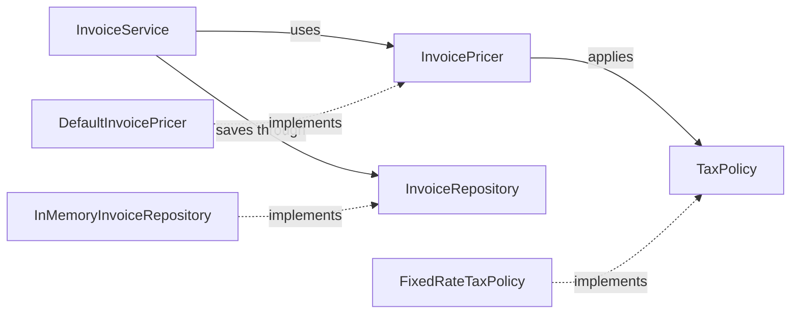

As an object-oriented codebase grows, a small requirement change can force edits across unrelated classes, break existing callers, or require replacing a dependency just to run a test. **SOLID** is a set of design principles for reducing those forms of coupling.

These principles are heuristics, not laws that require one class per method or an interface for every class. Their purpose is to make the likely points of change explicit and keep each module's contract clear.

## A design that can absorb change

Consider an invoice workflow. The application service should coordinate the use case, while pricing rules and persistence are replaceable details. The following example makes those roles explicit:



The high-level use case depends on contracts. Concrete pricing, tax, and storage choices can vary without making the use case know their implementation details:

```java
import java.math.BigDecimal;
import java.math.RoundingMode;
import java.util.ArrayList;
import java.util.List;
import java.util.Objects;

public class SolidInvoiceExample {
    record Line(BigDecimal unitPrice, int quantity) {
        Line {
            Objects.requireNonNull(unitPrice);
            if (unitPrice.signum() < 0 || quantity < 0) {
                throw new IllegalArgumentException("line values must be non-negative");
            }
        }
    }

    record Invoice(List<Line> lines) {
        Invoice {
            lines = List.copyOf(lines);
        }
    }

    interface TaxPolicy {
        // Accepts a non-negative amount and returns a non-negative amount rounded to two decimals.
        BigDecimal taxFor(BigDecimal netAmount);
    }

    interface InvoicePricer {
        BigDecimal total(Invoice invoice);
    }

    interface InvoiceRepository {
        void save(Invoice invoice, BigDecimal total);
    }

    static final class FixedRateTaxPolicy implements TaxPolicy {
        private final BigDecimal rate;

        FixedRateTaxPolicy(BigDecimal rate) {
            this.rate = Objects.requireNonNull(rate);
            if (rate.signum() < 0) {
                throw new IllegalArgumentException("rate must be non-negative");
            }
        }

        @Override
        public BigDecimal taxFor(BigDecimal netAmount) {
            return netAmount.multiply(rate).setScale(2, RoundingMode.HALF_UP);
        }
    }

    static final class DefaultInvoicePricer implements InvoicePricer {
        private final TaxPolicy taxPolicy;

        DefaultInvoicePricer(TaxPolicy taxPolicy) {
            this.taxPolicy = Objects.requireNonNull(taxPolicy);
        }

        @Override
        public BigDecimal total(Invoice invoice) {
            BigDecimal net = invoice.lines().stream()
                    .map(line -> line.unitPrice()
                            .multiply(BigDecimal.valueOf(line.quantity())))
                    .reduce(BigDecimal.ZERO, BigDecimal::add);
            return net.add(taxPolicy.taxFor(net));
        }
    }

    static final class InMemoryInvoiceRepository implements InvoiceRepository {
        private final List<Invoice> invoices = new ArrayList<>();

        @Override
        public void save(Invoice invoice, BigDecimal total) {
            invoices.add(invoice);
            System.out.println("Saved invoice for " + total);
        }
    }

    static final class InvoiceService {
        private final InvoicePricer pricer;
        private final InvoiceRepository repository;

        InvoiceService(InvoicePricer pricer, InvoiceRepository repository) {
            this.pricer = Objects.requireNonNull(pricer);
            this.repository = Objects.requireNonNull(repository);
        }

        BigDecimal submit(Invoice invoice) {
            BigDecimal total = pricer.total(invoice);
            repository.save(invoice, total);
            return total;
        }
    }

    public static void main(String[] args) {
        InvoicePricer pricer = new DefaultInvoicePricer(
                new FixedRateTaxPolicy(new BigDecimal("0.20")));
        InvoiceRepository repository = new InMemoryInvoiceRepository();
        InvoiceService service = new InvoiceService(pricer, repository);

        Invoice invoice = new Invoice(List.of(
                new Line(new BigDecimal("19.99"), 2)));
        System.out.println("Total: " + service.submit(invoice));
    }
}
```

The repository in this example is intentionally in-memory so the design can be compiled without a database dependency. A production repository would need an appropriate persistence and transaction contract.

## Single Responsibility Principle

The **Single Responsibility Principle (SRP)** says a module should have one coherent responsibility, often described as one reason to change. It is not a rule that a class may contain only one method. `InvoiceService` coordinates the application use case; `DefaultInvoicePricer` owns price calculation; `InvoiceRepository` represents persistence.

If the invoice service also formats PDFs, calculates tax, writes SQL, and sends email, changes to each concern can force edits to the same module. Separate responsibilities around cohesive policies, but avoid creating layers that merely forward every call without clarifying ownership.

## Open/Closed Principle

The **Open/Closed Principle (OCP)** recommends making a module open to the kinds of extension it is expected to need, while keeping stable behavior closed to repeated modification. Here, a new `TaxPolicy` can be supplied without adding a tax-type switch inside `InvoiceService`.

This does not mean “never edit existing code.” If requirements change, code changes. OCP is most useful when an extension point isolates a variation that is likely to recur; speculative abstraction for every imagined future is unnecessary.

## Liskov Substitution Principle

The **Liskov Substitution Principle (LSP)** requires that a subtype be usable wherever its declared supertype is expected without breaking that type's behavioral contract. Java's compiler checks signatures and types, but it cannot prove that a subclass preserves preconditions, postconditions, or invariants.

For example, every `TaxPolicy` implementation should accept the documented valid net amount and return a tax result that satisfies the policy contract. An implementation that rejects valid inputs unexpectedly, returns a negative tax, or changes the meaning of the total violates substitutability even though it compiles.

This principle also explains why an inheritance hierarchy can be mathematically plausible yet behaviorally invalid. See [Composition over Inheritance](../level-1/composition-over-inheritance) for the Rectangle/Square example.

## Interface Segregation Principle

The **Interface Segregation Principle (ISP)** says clients should not be forced to depend on methods they do not use. A single `InvoiceOperations` interface that combines pricing, persistence, rendering, and emailing would make each client depend on unrelated operations. Separate cohesive contracts let a pricing client depend on `TaxPolicy` without knowing how persistence works.

Small interfaces are useful when they represent real client needs or extension seams. Splitting every class into one-method interfaces without a reason adds indirection rather than reducing coupling.

## Dependency Inversion Principle

The **Dependency Inversion Principle (DIP)** says high-level policy should not depend directly on low-level details; both should depend on abstractions. In the example, `InvoiceService` depends on `InvoicePricer` and `InvoiceRepository`, not on `DefaultInvoicePricer` or a database driver.

Constructor injection supplies those dependencies from outside the service. This supports substituting a production adapter, test double, or alternate policy without changing the use-case class. Dependency inversion is about the direction of source-level dependency; it is not synonymous with a dependency-injection framework.

## How the principles reinforce one another

- SRP identifies distinct responsibilities and reasons for change.
- OCP uses stable boundaries to isolate likely variations.
- LSP keeps implementations behaviorally compatible with those boundaries.
- ISP keeps each boundary focused on the needs of its clients.
- DIP makes high-level policies depend on those boundaries rather than concrete details.

Do not treat SOLID as five independent checkboxes. A design that adds many interfaces can technically appear to satisfy DIP while making the code harder to follow. Start with a concrete change scenario, identify what should remain stable, and introduce an abstraction only when it clarifies that boundary.

## Practical review questions

- Does each module have a cohesive responsibility and a clear reason to change?
- Can a likely variation be added without editing stable policy code everywhere?
- Do implementations preserve the behavioral promises clients rely on?
- Are clients coupled only to the operations they actually need?
- Do high-level use cases depend on contracts instead of construction details?
- Is each abstraction paying for itself in flexibility, isolation, or clearer ownership?

## Further reading

- [Composition over Inheritance](../level-1/composition-over-inheritance)
- [Java Language Specification, Java SE 21, Interfaces](https://docs.oracle.com/javase/specs/jls/se21/html/jls-9.html)
