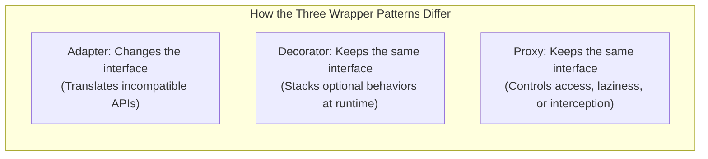
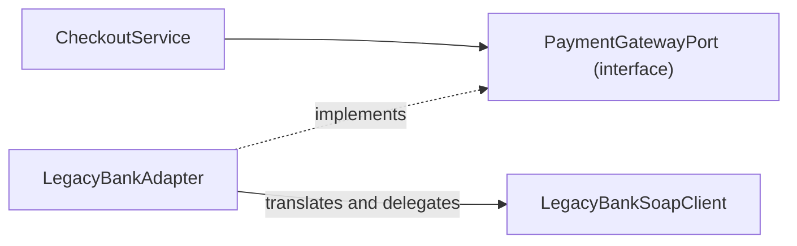
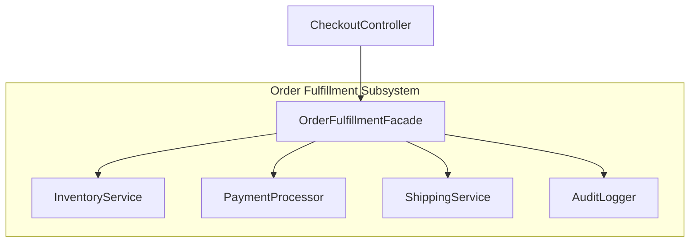
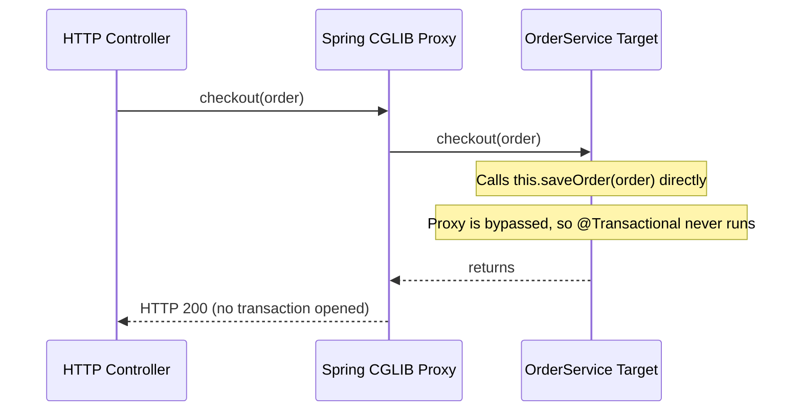
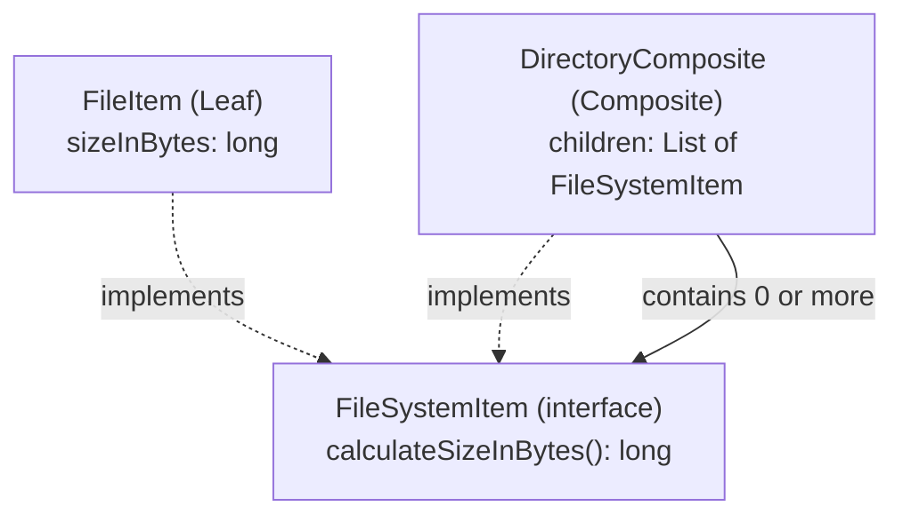

In production Java systems, most design friction has little to do with inheritance hierarchies and a lot to do with how objects connect to one another: wrapping legacy libraries, layering logging and retries around network calls, hiding noisy multi-service workflows, intercepting calls for transactions, and walking recursive tree structures.

Structural design patterns solve these wiring problems through object composition.

Three of them, **Adapter**, **Decorator**, and **Proxy**, look almost identical on a class diagram because all three wrap another object and delegate to it. What separates them is their intent and what they do to the interface:



The other two patterns covered here work at a different shape: **Facade** puts a clean front door in front of a multi-class subsystem, and **Composite** lets callers treat single leaf items and nested trees through one uniform interface.

---

## Adapter

> *"Convert the interface of a class into another interface clients expect. Adapter lets classes work together that couldn't otherwise because of incompatible interfaces."* (Gang of Four)

You reach for an Adapter whenever you have to integrate code you do not own (a third-party SDK, a legacy SOAP client, or a low-level JDK type) into a clean domain interface. Rather than letting vendor-specific types leak through your services, you write an **Object Adapter** that implements your target interface, holds a reference to the existing object, and translates parameters and return values.



### Real JDK and Spring Examples

You already use adapters across the Java ecosystem:

- **`Arrays.asList(T... a)`**: Adapts a fixed-size Java array into the `List<T>` interface. Changes to the list write straight through to the underlying array, and structural mutations (`add`, `remove`) throw `UnsupportedOperationException` because arrays cannot resize.
- **`InputStreamReader` and `OutputStreamWriter`**: Adapt byte-oriented `InputStream`/`OutputStream` objects into character-oriented `Reader`/`Writer` interfaces using a `Charset`.
- **Spring MVC `HandlerAdapter`**: Lets `DispatcherServlet` invoke different kinds of controllers (`@RequestMapping` methods, `HttpRequestHandler`, functional routes) through one uniform invocation contract.

### Domain Integration Example

Suppose your domain defines a clean `PaymentGatewayPort` using `BigDecimal` and a Java `record`, while an older bank client expects cents as a `long` and numeric ISO currency codes:

```java
import java.math.BigDecimal;
import java.math.RoundingMode;
import java.util.Objects;

// 1. Target interface expected by domain code
public interface PaymentGatewayPort {
    PaymentResult processCharge(String customerId, BigDecimal amount, String currency);
}

public record PaymentResult(String transactionId, boolean successful, String errorMessage) {}

// 2. Existing third-party / legacy class with an incompatible API
public final class LegacyBankSoapClient {
    public int executeWireTransfer(String senderAccount, long cents, int isoCurrencyCode) {
        System.out.printf("Legacy SOAP wire: account=%s, cents=%d, currencyCode=%d%n",
                senderAccount, cents, isoCurrencyCode);
        return 200;
    }
}

// 3. Object Adapter translating between the two contracts
public final class LegacyBankAdapter implements PaymentGatewayPort {
    private final LegacyBankSoapClient soapClient;

    public LegacyBankAdapter(LegacyBankSoapClient soapClient) {
        this.soapClient = Objects.requireNonNull(soapClient);
    }

    @Override
    public PaymentResult processCharge(String customerId, BigDecimal amount, String currency) {
        int currencyCode = switch (currency.toUpperCase()) {
            case "USD" -> 840;
            case "EUR" -> 978;
            case "GBP" -> 826;
            default -> throw new IllegalArgumentException("Unsupported currency: " + currency);
        };

        long cents = amount.multiply(BigDecimal.valueOf(100))
                .setScale(0, RoundingMode.HALF_UP)
                .longValueExact();

        int statusCode = soapClient.executeWireTransfer(customerId, cents, currencyCode);
        if (statusCode == 200) {
            return new PaymentResult("TX-" + System.currentTimeMillis(), true, null);
        }
        return new PaymentResult(null, false, "Bank rejected wire transfer with code " + statusCode);
    }
}
```

> [!TIP]
> In Java, prefer **Object Adapters** (composition) over **Class Adapters** (subclassing the adaptee). Because Java does not allow multiple class inheritance, composition is more flexible, works with `final` third-party classes like `LegacyBankSoapClient`, and lets you swap in a test double easily.

---

## Decorator

> *"Attach additional responsibilities to an object dynamically. Decorators provide a flexible alternative to subclassing for extending functionality."* (Gang of Four)

Suppose you have an `HttpClientPort` and want optional combinations of logging, retries, metrics, and rate limiting. Trying to model every combination with subclasses quickly gets out of hand: `LoggingHttpClient`, `RetryingHttpClient`, `LoggingRetryingHttpClient`, `MetricsLoggingRetryingHttpClient`, and so on.

The **Decorator** pattern avoids that explosion by wrapping the component behind the exact same interface. Each decorator adds one focused behavior before or after delegating to the wrapped component, and you can stack them in any order at runtime.

### Real JDK Examples

The `java.io` package is the classic Java decorator chain:

```java
import java.io.BufferedInputStream;
import java.io.FileInputStream;
import java.io.InputStream;
import java.util.zip.GZIPInputStream;

try (InputStream stream = new BufferedInputStream(
        new GZIPInputStream(
                new FileInputStream("events.json.gz")))) {
    byte[] payload = stream.readAllBytes();
}
```

`FileInputStream` reads raw bytes from disk, `GZIPInputStream` decompresses bytes on the fly, and `BufferedInputStream` reduces system calls by reading chunks into an internal buffer. Every wrapper extends `InputStream`, so the caller reads bytes without caring how many layers are stacked underneath.

You also see decorators in `java.util.Collections`: `Collections.synchronizedList(list)` and `Collections.unmodifiableList(list)` wrap an existing `List` and return another `List` with added synchronization or read-only checks.

### Composable HTTP Client Pipeline

```java
import java.io.IOException;
import java.util.Objects;

public interface HttpClientPort {
    String sendGet(String url) throws IOException;
}

public final class BasicHttpClient implements HttpClientPort {
    @Override
    public String sendGet(String url) throws IOException {
        System.out.println("Network GET -> " + url);
        return "{\"status\":\"OK\"}";
    }
}

public abstract class HttpClientDecorator implements HttpClientPort {
    protected final HttpClientPort delegate;

    protected HttpClientDecorator(HttpClientPort delegate) {
        this.delegate = Objects.requireNonNull(delegate);
    }

    @Override
    public String sendGet(String url) throws IOException {
        return delegate.sendGet(url);
    }
}

public final class LoggingClientDecorator extends HttpClientDecorator {
    public LoggingClientDecorator(HttpClientPort delegate) {
        super(delegate);
    }

    @Override
    public String sendGet(String url) throws IOException {
        long startNanos = System.nanoTime();
        System.out.println("[LOG] GET " + url);
        try {
            String response = delegate.sendGet(url);
            long elapsedMs = (System.nanoTime() - startNanos) / 1_000_000;
            System.out.printf("[LOG] Completed %s in %d ms%n", url, elapsedMs);
            return response;
        } catch (IOException e) {
            System.err.printf("[LOG] Failed %s: %s%n", url, e.getMessage());
            throw e;
        }
    }
}

public final class RetryingClientDecorator extends HttpClientDecorator {
    private final int maxAttempts;

    public RetryingClientDecorator(HttpClientPort delegate, int maxAttempts) {
        super(delegate);
        if (maxAttempts < 1) {
            throw new IllegalArgumentException("maxAttempts must be >= 1");
        }
        this.maxAttempts = maxAttempts;
    }

    @Override
    public String sendGet(String url) throws IOException {
        int attempt = 0;
        while (true) {
            try {
                attempt++;
                return delegate.sendGet(url);
            } catch (IOException e) {
                if (attempt >= maxAttempts) {
                    throw e;
                }
                System.out.printf("[RETRY] Attempt %d failed for %s, retrying%n", attempt, url);
            }
        }
    }
}
```

### Watch the Nesting Order

With decorators, wrapping order directly changes behavior:

- `new LoggingClientDecorator(new RetryingClientDecorator(client, 3))` logs **once** for the whole operation, measuring total latency across retries.
- `new RetryingClientDecorator(new LoggingClientDecorator(client), 3)` logs **every individual retry attempt** separately.

Also keep decorator chains shallow. Debugging a bug buried six wrappers deep, where stack traces bounce through forwarding methods, is a real maintenance cost if you overuse the pattern.

---

## Facade

> *"Provide a unified interface to a set of interfaces in a subsystem. Facade defines a higher-level interface that makes the subsystem easier to use."* (Gang of Four)

A **Facade** sits in front of several collaborating classes and offers a simpler, coarse-grained API for the most common workflows. Unlike an Adapter, it is not translating one legacy interface into another; it is shielding callers from having to orchestrate five or six subsystems directly.



### Real JDK and Spring Examples

- **Spring `JdbcTemplate`**: Hides the ceremony of acquiring a JDBC `Connection`, creating a `PreparedStatement`, iterating a `ResultSet`, translating checked `SQLException`s into unchecked `DataAccessException`s, and closing resources cleanly.
- **SLF4J `LoggerFactory`**: Gives application code a single facade over Logback, Log4j2, or `java.util.logging`.
- **`java.net.http.HttpClient`**: Exposes a single high-level entry point over connection pooling, HTTP/2 framing, TLS negotiation, and redirect handling.

### Order Fulfillment Facade

```java
import java.math.BigDecimal;
import java.util.Objects;

public class OrderFulfillmentFacade {
    private final InventoryService inventory;
    private final PaymentProcessor payment;
    private final ShippingService shipping;
    private final AuditLogger auditLogger;

    public OrderFulfillmentFacade(InventoryService inventory,
                                  PaymentProcessor payment,
                                  ShippingService shipping,
                                  AuditLogger auditLogger) {
        this.inventory = Objects.requireNonNull(inventory);
        this.payment = Objects.requireNonNull(payment);
        this.shipping = Objects.requireNonNull(shipping);
        this.auditLogger = Objects.requireNonNull(auditLogger);
    }

    public String completeOrder(String orderId, String customerId, String sku, BigDecimal amount) {
        auditLogger.log("Starting fulfillment for order " + orderId);

        if (!inventory.hasStock(sku)) {
            throw new IllegalStateException("SKU out of stock: " + sku);
        }

        inventory.reserve(sku);
        payment.charge(customerId, amount);
        String trackingNumber = shipping.dispatch(orderId, sku);

        auditLogger.log("Fulfilled order " + orderId + " with tracking " + trackingNumber);
        return trackingNumber;
    }
}

class InventoryService {
    boolean hasStock(String sku) { return true; }
    void reserve(String sku) {}
}

class PaymentProcessor {
    void charge(String customerId, BigDecimal amount) {}
}

class ShippingService {
    String dispatch(String orderId, String sku) { return "TRK-9901"; }
}

class AuditLogger {
    void log(String message) { System.out.println("[AUDIT] " + message); }
}
```

A Facade does not have to lock callers out of the underlying services. Callers with specialized needs can still use `ShippingService` directly, while typical controllers call `completeOrder(...)`. Watch out for one pitfall: do not let a Facade quietly turn into a giant God class filled with business logic. Its job is coordination and simplification, not owning every domain rule itself.

---

## Proxy

> *"Provide a surrogate or placeholder for another object to control access to it."* (Gang of Four)

A **Proxy** implements the same interface (or extends the same class) as the real target, just like a Decorator. The difference is purpose: a Decorator layers extra domain behavior chosen by the caller, whereas a Proxy stands in for the target to control access, defer expensive initialization, cache results, bridge network calls, or weave cross-cutting framework logic like transactions.

Common proxy variants include:

- **Virtual Proxy**: Delays creating an expensive object until the first method call that needs it (for example, Hibernate lazy-loaded associations).
- **Protection Proxy**: Enforces authorization checks before forwarding calls.
- **Remote Proxy**: Represents an object running in another JVM or service (gRPC stubs, RMI stubs).
- **Caching Proxy**: Returns a cached response when available instead of invoking the target.

### Manual Virtual and Protection Proxy

```java
public interface SensitiveReportGenerator {
    String generateReport(String userRole);
}

public final class RealReportGenerator implements SensitiveReportGenerator {
    public RealReportGenerator() {
        System.out.println("Initializing report engine and warming connection cache...");
    }

    @Override
    public String generateReport(String userRole) {
        return "Q3 Financial Ledger: Net Profit = USD 42,000,000";
    }
}

public final class SecureLazyReportProxy implements SensitiveReportGenerator {
    private volatile RealReportGenerator realSubject;

    @Override
    public String generateReport(String userRole) {
        if (!"ADMIN".equalsIgnoreCase(userRole)) {
            throw new SecurityException("Access denied for role: " + userRole);
        }

        RealReportGenerator subject = realSubject;
        if (subject == null) {
            synchronized (this) {
                subject = realSubject;
                if (subject == null) {
                    realSubject = subject = new RealReportGenerator();
                }
            }
        }
        return subject.generateReport(userRole);
    }
}
```

Notice that an unauthorized caller never even triggers the expensive `RealReportGenerator` constructor.

### JDK Dynamic Proxy vs. CGLIB (and ByteBuddy)

Writing proxy classes by hand quickly gets tedious when you want to intercept dozens of services. Java frameworks generate proxies at runtime using two main mechanisms.

**1. JDK Dynamic Proxy (`java.lang.reflect.Proxy`)**

Built directly into the JDK, `Proxy.newProxyInstance` generates an in-memory proxy class at runtime for one or more **interfaces** and routes every call through an `InvocationHandler`:

```java
import java.lang.reflect.InvocationHandler;
import java.lang.reflect.Method;
import java.lang.reflect.Proxy;

public class TimingProxyFactory {
    @SuppressWarnings("unchecked")
    public static <T> T withTiming(T target, Class<T> interfaceType) {
        InvocationHandler handler = (Object proxy, Method method, Object[] args) -> {
            long start = System.nanoTime();
            try {
                return method.invoke(target, args);
            } finally {
                long elapsedMicros = (System.nanoTime() - start) / 1_000;
                System.out.printf("[PROXY] %s took %d us%n", method.getName(), elapsedMicros);
            }
        };

        return (T) Proxy.newProxyInstance(
                interfaceType.getClassLoader(),
                new Class<?>[] { interfaceType },
                handler
        );
    }
}
```

Because JDK Dynamic Proxies work strictly on interfaces, you cannot use them to proxy a plain concrete class that does not implement an interface.

**2. CGLIB / ByteBuddy Subclass Proxies**

Libraries like CGLIB (repackaged inside Spring Core as `org.springframework.cglib`) and ByteBuddy (used by Hibernate 6 and Mockito) generate a **runtime subclass** of your concrete class in bytecode and override its methods to run interceptor logic before delegating to `super`.

| Aspect | JDK Dynamic Proxy | CGLIB / ByteBuddy Subclass Proxy |
| :--- | :--- | :--- |
| **Requirement** | Target must implement an interface | Works on concrete classes without interfaces |
| **Limitations** | Cannot proxy class-only methods | Cannot proxy `final` classes, `final` methods, or `private` methods |
| **Spring Boot 3 Default** | Used if `spring.aop.proxy-target-class=false` and bean has an interface | Default in Spring Boot 2 and 3 (`proxy-target-class=true`) |
| **Hibernate Lazy Entities** | Not used for entity classes | ByteBuddy generates entity proxy subclasses |

### The Spring `@Transactional` Self-Invocation Trap

Understanding how Spring proxies work explains one of the most common Spring bugs in production:

```java
@Service
public class OrderService {

    public void checkout(Order order) {
        // Direct call on 'this' bypasses the Spring proxy completely!
        this.saveOrder(order);
    }

    @Transactional
    public void saveOrder(Order order) {
        // Runs WITHOUT a transaction when called from checkout() above
    }
}
```



When the controller calls `checkout()`, the call enters the Spring proxy, which forwards it to the real `OrderService` instance. Inside `checkout()`, `this` points to the raw target object, not the proxy. Calling `this.saveOrder(order)` jumps straight to the method without passing through the transaction interceptor, so no transaction starts and exceptions will not roll back.

The cleanest fixes are to move the `@Transactional` method into a separate collaborator bean (often the right choice for SRP anyway), annotate `checkout()` itself if the whole method belongs in one transaction, or use Spring's `TransactionTemplate` for explicit programmatic transaction boundaries.

---

## Composite

> *"Compose objects into tree structures to represent part-whole hierarchies. Composite lets clients treat individual objects and compositions of objects uniformly."* (Gang of Four)

Tree structures show up everywhere: file systems (files and directories), UI layouts (buttons inside panels inside windows), organization charts, pricing bundles, and expression trees.

Without Composite, callers end up checking types everywhere (`if (node instanceof Directory) ... else if (node instanceof File) ...`). With Composite, both **leaves** (individual items) and **composites** (containers holding children) implement the same component interface.



Real examples in Java include `java.awt.Component` and `java.awt.Container`, XML DOM `org.w3c.dom.Node`, and Spring's `CompositeCacheManager` and `CompositeFilter`.

### File System Tree Example

```java
import java.util.ArrayList;
import java.util.Collections;
import java.util.List;
import java.util.Objects;

// 1. Component interface
public interface FileSystemItem {
    String name();
    long calculateSizeInBytes();
    void printTree(int indentLevel);
}

// 2. Leaf node
public record FileItem(String name, long sizeInBytes) implements FileSystemItem {
    public FileItem {
        Objects.requireNonNull(name);
        if (sizeInBytes < 0) {
            throw new IllegalArgumentException("Size cannot be negative");
        }
    }

    @Override
    public long calculateSizeInBytes() {
        return sizeInBytes;
    }

    @Override
    public void printTree(int indentLevel) {
        System.out.println("  ".repeat(indentLevel) + "- " + name + " (" + sizeInBytes + " bytes)");
    }
}

// 3. Composite node
public final class DirectoryComposite implements FileSystemItem {
    private final String name;
    private final List<FileSystemItem> children = new ArrayList<>();

    public DirectoryComposite(String name) {
        this.name = Objects.requireNonNull(name);
    }

    public DirectoryComposite add(FileSystemItem item) {
        children.add(Objects.requireNonNull(item));
        return this;
    }

    @Override
    public String name() {
        return name;
    }

    @Override
    public long calculateSizeInBytes() {
        return children.stream()
                .mapToLong(FileSystemItem::calculateSizeInBytes)
                .sum();
    }

    @Override
    public void printTree(int indentLevel) {
        System.out.println("  ".repeat(indentLevel) + "+ " + name + "/");
        for (FileSystemItem child : children) {
            child.printTree(indentLevel + 1);
        }
    }

    public List<FileSystemItem> children() {
        return Collections.unmodifiableList(children);
    }
}
```

### Walking the Tree Uniformly

```java
public class CompositeDemo {
    public static void main(String[] args) {
        DirectoryComposite root = new DirectoryComposite("root");
        DirectoryComposite etc = new DirectoryComposite("etc")
                .add(new FileItem("hosts", 120))
                .add(new FileItem("resolv.conf", 85));

        DirectoryComposite alice = new DirectoryComposite("alice")
                .add(new FileItem("resume.pdf", 450_000))
                .add(new FileItem("avatar.png", 1_200_000));

        DirectoryComposite home = new DirectoryComposite("home").add(alice);

        root.add(etc)
                .add(home)
                .add(new FileItem("boot.img", 10_000_000));

        root.printTree(0);
        System.out.printf("%nTotal size: %d bytes%n", root.calculateSizeInBytes());
    }
}
```

Notice that `add(...)` is placed only on `DirectoryComposite`, not on `FileSystemItem`. That favors **type safety** (you cannot accidentally call `add()` on a `FileItem`) over **uniformity** (where `FileSystemItem` declares `add()` and `FileItem` has to throw `UnsupportedOperationException`). In Java, keeping mutation methods on the composite class usually avoids LSP violations while keeping read/traversal operations completely uniform.

---

## Pattern Comparison

| Pattern | Primary Intent | Effect on Interface | JDK / Spring Examples |
| :--- | :--- | :--- | :--- |
| **Adapter** | Make incompatible interfaces work together | Changes the interface to match what callers expect | `Arrays.asList()`, `InputStreamReader`, Spring `HandlerAdapter` |
| **Decorator** | Add composable behavior at runtime | Keeps the same interface | `BufferedInputStream`, `GZIPInputStream`, `Collections.synchronizedList()` |
| **Facade** | Simplify a multi-class subsystem | Introduces a simpler, higher-level interface | Spring `JdbcTemplate`, SLF4J `LoggerFactory` |
| **Proxy** | Control access, laziness, or interception | Keeps the same interface (or subclasses target) | `java.lang.reflect.Proxy`, Spring `@Transactional` CGLIB proxies, Hibernate lazy proxies |
| **Composite** | Treat leaf items and nested trees uniformly | Shared component interface for leaves and containers | `java.awt.Container`, DOM `Node`, Spring `CompositeCacheManager` |

---

## Interview Questions

### Adapter, Decorator, and Proxy all wrap another object. How do you tell them apart?

Look at the interface and the reason the wrapper exists. An **Adapter** changes the interface so two incompatible types can talk to each other. A **Decorator** keeps the exact same interface and adds optional behavior that callers often assemble dynamically (like wrapping an `InputStream` with buffering and GZIP decompression). A **Proxy** also keeps the same interface, but its job is to control access to the target (lazy initialization, authorization, caching, remote calls, or framework interception), and the caller usually does not even know it is talking to a proxy.

### Why does a self-invocation to a `@Transactional` method in Spring skip the transaction?

Spring implements `@Transactional` by wrapping the bean in a proxy (CGLIB subclass proxy by default in Spring Boot 2 and 3). External calls hit the proxy first, which opens a transaction before delegating to the target method. When a method inside the bean calls `this.otherMethod()`, the call happens directly on the raw target instance and never passes through the proxy, so the transaction interceptor never executes.

### When does Spring use JDK Dynamic Proxies versus CGLIB, and what breaks CGLIB proxies?

JDK Dynamic Proxies (`java.lang.reflect.Proxy`) only work on interfaces. CGLIB generates a runtime subclass of the target class, so it can proxy concrete classes without requiring an interface; Spring Boot 2 and 3 enable CGLIB proxying by default via `spring.aop.proxy-target-class=true`. Because CGLIB relies on subclassing and method overriding, it cannot proxy `final` classes, `final` methods, or `private` methods.

### In the Composite pattern, why is putting `add()` on the `Composite` class instead of the root `Component` interface usually preferred in Java?

Putting `add()` on the root interface lets callers treat leaves and composites identically even during tree mutation, but forces every leaf class to throw `UnsupportedOperationException`, which breaks Liskov Substitution and turns mistakes into runtime errors. Keeping child-management methods on the `Composite` class lets the Java compiler catch invalid mutations at compile time while keeping read and traversal operations (`calculateSizeInBytes()`, `printTree()`) completely uniform.
