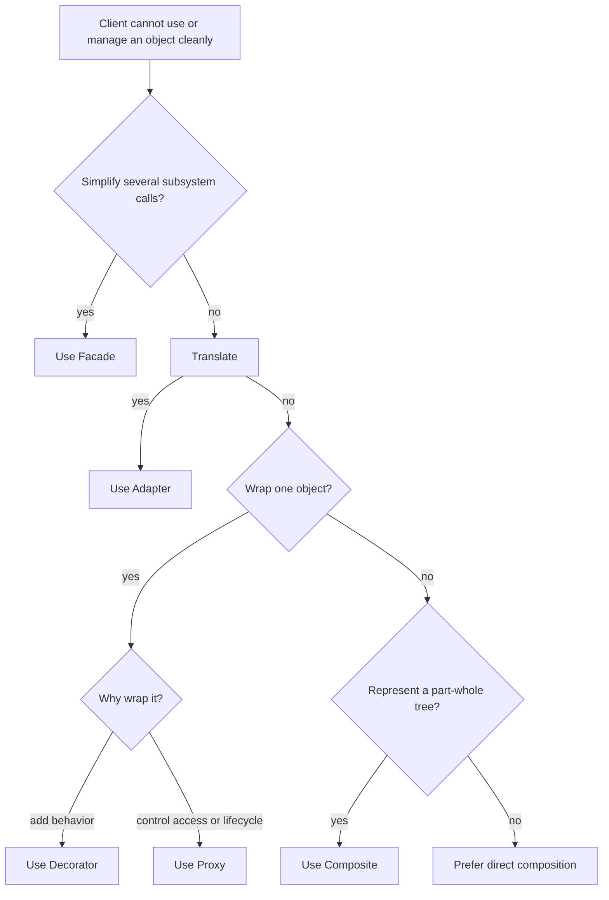

Structural patterns describe how objects and interfaces are composed to make a larger design easier to use or change. They do not all solve the same problem: some adapt a mismatched API, some wrap an object, and some represent a hierarchy.

The Level 6 curriculum covers Adapter, Decorator, Facade, Proxy, and Composite. Choose a pattern by the relationship that needs clarification, not by the number of classes it introduces.

## Identify the structural problem



Adapter, Decorator, and Proxy can all contain a reference to another object, but their intent differs: translate an interface, add behavior, or control access.

## Adapter

An **Adapter** makes an existing object usable through the interface expected by a client. An object adapter delegates to the legacy object; this avoids requiring the legacy class to inherit from a new type:

```java
public class AdapterExample {
    interface TextPrinter {
        String print(String text);
    }

    static final class LegacyRenderer {
        String renderLegacyText(String input) {
            return "[legacy] " + input;
        }
    }

    static final class RendererAdapter implements TextPrinter {
        private final LegacyRenderer legacy;

        RendererAdapter(LegacyRenderer legacy) {
            this.legacy = legacy;
        }

        @Override
        public String print(String text) {
            return legacy.renderLegacyText(text);
        }
    }

    public static void main(String[] args) {
        TextPrinter printer = new RendererAdapter(new LegacyRenderer());
        System.out.println(printer.print("Hello"));
    }
}
```

The adapter translates the call shape; it should not silently change the meaning of the operation. Validate units, encoding, nullability, and error mapping when the two APIs disagree on those semantics.

## Decorator

A **Decorator** wraps an object behind the same interface and adds behavior before or after delegating. Multiple decorators can be composed at runtime, avoiding a subclass for every combination:

```java
public class DecoratorExample {
    interface Notifier {
        void send(String message);
    }

    static final class ConsoleNotifier implements Notifier {
        @Override
        public void send(String message) {
            System.out.println(message);
        }
    }

    static final class PrefixDecorator implements Notifier {
        private final Notifier delegate;
        private final String prefix;

        PrefixDecorator(Notifier delegate, String prefix) {
            this.delegate = delegate;
            this.prefix = prefix;
        }

        @Override
        public void send(String message) {
            delegate.send(prefix + message);
        }
    }

    public static void main(String[] args) {
        Notifier notifier = new PrefixDecorator(
                new ConsoleNotifier(), "[important] ");
        notifier.send("Deployment complete");
    }
}
```

Decorator order can affect behavior: a retry wrapper around logging may log one operation, while logging around retry may log each attempt. A decorator should preserve the wrapped interface's contract, including error and resource-lifecycle behavior.

## Facade

A **Facade** offers a simpler entry point over several collaborating subsystem objects. It coordinates a common operation so each client does not need to understand the subsystem's call sequence:

```java
public class FacadeExample {
    static final class Inventory {
        boolean reserve(String item) {
            System.out.println("Reserved " + item);
            return true;
        }
    }

    static final class Payments {
        void charge(String account, int cents) {
            System.out.println("Charged " + cents + " cents to " + account);
        }
    }

    static final class Shipping {
        void dispatch(String item) {
            System.out.println("Dispatched " + item);
        }
    }

    static final class OrderFacade {
        private final Inventory inventory;
        private final Payments payments;
        private final Shipping shipping;

        OrderFacade(Inventory inventory, Payments payments, Shipping shipping) {
            this.inventory = inventory;
            this.payments = payments;
            this.shipping = shipping;
        }

        void place(String item, String account, int cents) {
            if (!inventory.reserve(item)) {
                throw new IllegalStateException("Item is unavailable");
            }
            payments.charge(account, cents);
            shipping.dispatch(item);
        }
    }

    public static void main(String[] args) {
        OrderFacade orders = new OrderFacade(
                new Inventory(), new Payments(), new Shipping());
        orders.place("book-42", "customer-7", 2500);
    }
}
```

A facade simplifies access; it does not automatically make a multi-step workflow transactional. A production order flow must define what happens if payment or shipping fails after inventory is reserved, potentially using transactions or compensating actions.

## Proxy

A **Proxy** presents the same interface as a target while controlling access to it. Common uses include lazy loading, access checks, remote invocation, or caching. A lazy proxy can defer expensive initialization until the first call:

```java
public class ProxyExample {
    interface Image {
        void display();
    }

    static final class RealImage implements Image {
        private final String path;

        RealImage(String path) {
            this.path = path;
            System.out.println("Loading " + path);
        }

        @Override
        public void display() {
            System.out.println("Displaying " + path);
        }
    }

    static final class LazyImageProxy implements Image {
        private final String path;
        private volatile RealImage target;

        LazyImageProxy(String path) {
            this.path = path;
        }

        private RealImage target() {
            RealImage image = target;
            if (image == null) {
                synchronized (this) {
                    image = target;
                    if (image == null) {
                        target = image = new RealImage(path);
                    }
                }
            }
            return image;
        }

        @Override
        public void display() {
            target().display();
        }
    }

    public static void main(String[] args) {
        Image image = new LazyImageProxy("diagram.png");
        image.display();
        image.display();
    }
}
```

The proxy preserves the `Image` interface and initializes the target only once, including when multiple threads call it concurrently. A security proxy can enforce authorization, but a proxy is not automatically a security boundary: every access path must be controlled, and the authorization policy must be correct.

Decorator and Proxy have similar wrapper shapes. Decorator's primary intent is to add interchangeable behavior; Proxy's primary intent is to manage access to the target or its lifecycle.

## Composite

A **Composite** represents a tree of parts and groups through one component interface. Clients can operate on a leaf or group uniformly:

```java
import java.util.List;

public class CompositeExample {
    interface FileSystemNode {
        long sizeInBytes();
    }

    record FileNode(long sizeInBytes) implements FileSystemNode {}

    record DirectoryNode(List<FileSystemNode> children)
            implements FileSystemNode {
        DirectoryNode {
            children = List.copyOf(children);
        }

        @Override
        public long sizeInBytes() {
            return children.stream()
                    .mapToLong(FileSystemNode::sizeInBytes)
                    .sum();
        }
    }

    public static void main(String[] args) {
        FileSystemNode tree = new DirectoryNode(List.of(
                new FileNode(120),
                new DirectoryNode(List.of(new FileNode(80), new FileNode(40)))));
        System.out.println(tree.sizeInBytes());
    }
}
```

The same `sizeInBytes` call works at each level, and the group delegates recursively to its children. Composite designs should define who owns child collections, whether duplicate children are allowed, and how cycles are prevented; otherwise recursion can fail to terminate.

## Practical rules

- Use Adapter when the client and an existing API disagree about interface shape.
- Use Decorator to add composable behavior while preserving the wrapped contract.
- Use Facade to simplify subsystem use, not to imply transactional guarantees it does not provide.
- Use Proxy to control access or lifecycle while preserving a subject interface.
- Use Composite when clients should treat tree parts and groups uniformly.
- Prefer straightforward composition when none of these forces is present.

## Further reading

- [Composition over Inheritance](../level-1/composition-over-inheritance)
- [SOLID Principles Basics](./solid-principles-basics)
