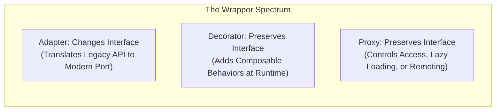
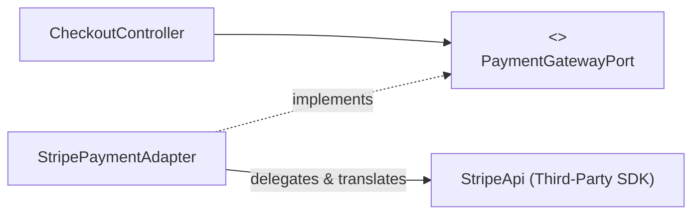
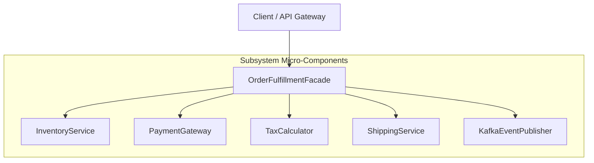
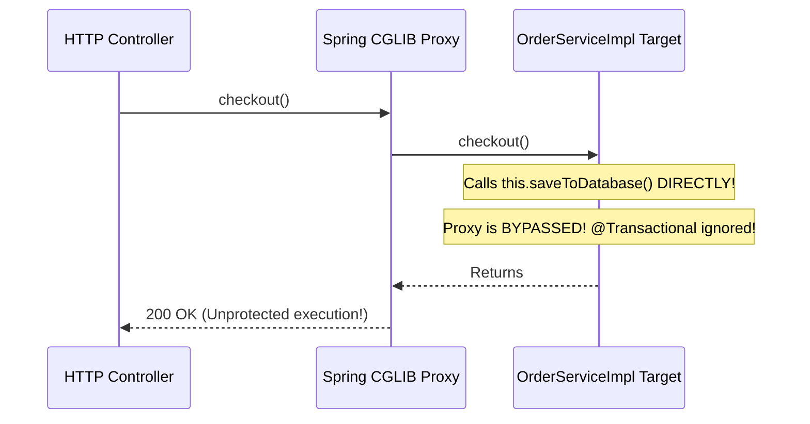
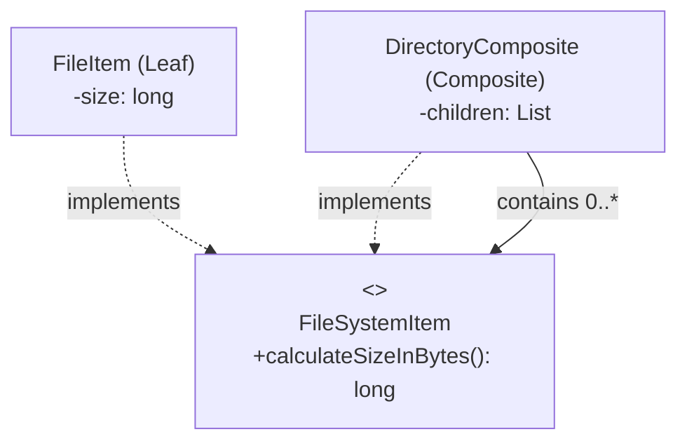

When engineers talk about object-oriented design, they often focus on inheritance hierarchies ("Dog is an Animal"). But in enterprise software, inheritance is rarely your biggest challenge. The real complexity lies in **object topology**: how dozens of disparate classes, third-party libraries, legacy protocols, and network stubs interlock to form a cohesive system.

Structural design patterns describe how classes and objects are composed into larger, flexible structures. 

One of the most common confusions in software architecture is the **"Wrapper Dilemma"**: Adapter, Decorator, and Proxy share almost identical class structures—they all wrap an underlying object. Yet their architectural intents could not be more different:



Alongside these wrappers, **Facade** simplifies access across an entire subsystem, while **Composite** allows you to treat individual objects and nested trees of objects uniformly.

---

## Adapter: Bridging Mismatched Interfaces

> *"Convert the interface of a class into another interface clients expect. Adapter lets classes work together that couldn't otherwise because of incompatible interfaces."* — Gang of Four

The Adapter pattern acts as a translator. When you integrate a third-party payment gateway, an old SOAP XML service, or a legacy database library into your clean domain architecture, their method signatures and data formats rarely align with your domain's interfaces.

Instead of polluting your clean domain code with legacy vendor types, you introduce an **Object Adapter** that implements your domain's target interface and delegates to the adaptee.



### Production Implementation

```java
import java.math.BigDecimal;
import java.util.Objects;

// 1. The Clean Domain Port (Target Interface)
public interface PaymentGatewayPort {
    PaymentResult processCharge(String customerId, BigDecimal amount, String currency);
}

public record PaymentResult(String transactionId, boolean successful, String errorMessage) {}

// 2. The Third-Party / Legacy Adaptee (Incompatible Signature & Types)
public final class LegacyBankSoapClient {
    public int executeWireTransfer(String senderAccount, long cents, int currencyCode) {
        System.out.printf("Legacy SOAP Wire: Account=%s, Cents=%d, Code=%d%n", 
            senderAccount, cents, currencyCode);
        return 200; // Returns raw HTTP-like status codes
    }
}

// 3. The Object Adapter (Translates between Domain and Legacy)
public final class LegacyBankAdapter implements PaymentGatewayPort {
    private final LegacyBankSoapClient soapClient;

    public LegacyBankAdapter(LegacyBankSoapClient soapClient) {
        this.soapClient = Objects.requireNonNull(soapClient);
    }

    @Override
    public PaymentResult processCharge(String customerId, BigDecimal amount, String currency) {
        // Translation 1: Currency ISO String -> Integer Code
        int currencyCode = "USD".equalsIgnoreCase(currency) ? 840 : 978;

        // Translation 2: BigDecimal Dollars -> Long Cents
        long cents = amount.multiply(BigDecimal.valueOf(100)).longValue();

        // Translation 3: Invoke legacy adaptee
        int statusCode = soapClient.executeWireTransfer(customerId, cents, currencyCode);

        // Translation 4: Map raw status code to clean domain Record
        if (statusCode == 200) {
            return new PaymentResult("TX-" + System.currentTimeMillis(), true, null);
        } else {
            return new PaymentResult(null, false, "Bank rejected wire transfer code: " + statusCode);
        }
    }
}
```

> [!TIP]
> Prefer **Object Adapters** (which use composition to wrap an instance) over **Class Adapters** (which use multiple inheritance / subclassing). Object adapters allow you to adapt an entire family of subclasses dynamically without tight inheritance coupling.

---

## Decorator: Dynamic and Composable Responsibilities

> *"Attach additional responsibilities to an object dynamically. Decorators provide a flexible alternative to subclassing for extending functionality."* — Gang of Four

When you use subclassing to add features, you encounter a combinatorial explosion of classes. If you have an `HttpClient` and want to add:
- Logging
- Metrics Gathering
- Automatic Retries
- Distributed Rate Limiting

Subclassing would require: `LoggingHttpClient`, `RetryingHttpClient`, `LoggingAndRetryingHttpClient`, `MetricsLoggingAndRetryingHttpClient`, and so on.

The **Decorator** pattern solves this by wrapping the target object behind the **exact same interface**. Decorators can be chained at runtime like Russian nesting dolls.

### Canonical Example: Java I/O Streams

The standard Java I/O library (`java.io`) is the most famous decorator architecture in software engineering:

```java
InputStream stream = new BufferedInputStream(
    new GZIPInputStream(
        new FileInputStream("data.tar.gz")
    )
);
```

Each wrapper implements `InputStream` and delegates to the next stream while adding buffering or decompression.

### Resilient HTTP Client Pipeline

Here is an industrial-strength decorator pipeline for an HTTP client:

```java
import java.io.IOException;

// 1. The Component Interface
public interface HttpClientPort {
    String sendGet(String url) throws IOException;
}

// 2. Concrete Core Component
public final class BasicHttpClient implements HttpClientPort {
    @Override
    public String sendGet(String url) throws IOException {
        System.out.println(">>> Executing physical network socket call to: " + url);
        return "{\"status\": \"OK\", \"data\": 42}";
    }
}

// 3. Abstract Decorator (Maintains delegate reference)
public abstract class HttpClientDecorator implements HttpClientPort {
    protected final HttpClientPort delegate;

    protected HttpClientDecorator(HttpClientPort delegate) {
        this.delegate = delegate;
    }

    @Override
    public String sendGet(String url) throws IOException {
        return delegate.sendGet(url);
    }
}

// 4. Logging Decorator
public final class LoggingClientDecorator extends HttpClientDecorator {
    public LoggingClientDecorator(HttpClientPort delegate) {
        super(delegate);
    }

    @Override
    public String sendGet(String url) throws IOException {
        long start = System.currentTimeMillis();
        System.out.println("[LOG] Starting request to: " + url);
        try {
            String response = delegate.sendGet(url);
            System.out.printf("[LOG] Finished %s in %d ms%n", url, (System.currentTimeMillis() - start));
            return response;
        } catch (IOException e) {
            System.err.printf("[LOG] Request to %s failed: %s%n", url, e.getMessage());
            throw e;
        }
    }
}

// 5. Retrying Decorator
public final class RetryingClientDecorator extends HttpClientDecorator {
    private final int maxRetries;

    public RetryingClientDecorator(HttpClientPort delegate, int maxRetries) {
        super(delegate);
        this.maxRetries = maxRetries;
    }

    @Override
    public String sendGet(String url) throws IOException {
        int attempts = 0;
        while (true) {
            try {
                return delegate.sendGet(url);
            } catch (IOException e) {
                if (++attempts >= maxRetries) {
                    System.err.println("[RETRY] Max retries exhausted for: " + url);
                    throw e;
                }
                System.out.printf("[RETRY] Attempt %d failed. Retrying...%n", attempts);
            }
        }
    }
}
```

### The "Order Matters" Trap in Decorators

Notice how decorating order fundamentally dictates runtime behavior:
- `new LoggingClientDecorator(new RetryingClientDecorator(client))` will log **only the overall request**, reporting the total time across all retries.
- `new RetryingClientDecorator(new LoggingClientDecorator(client))` will log **every single individual retry attempt** separately!

---

## Facade: Simplifying Subsystem Topologies

> *"Provide a unified interface to a set of interfaces in a subsystem. Facade defines a higher-level interface that makes the subsystem easier to use."* — Gang of Four

While an Adapter wraps a single object to alter its interface, a **Facade** wraps an **entire cluster of collaborating subsystems** to provide a simple, unified entry point.

Complex enterprise workflows often require coordinating five to ten discrete services: checking inventory, authorizing payments, calculating VAT tax, creating shipping labels, emitting analytics events, and scheduling notifications. Forcing the client controller to talk to all ten services introduces chaotic coupling.



### Production Implementation

```java
import java.math.BigDecimal;

public class OrderFulfillmentFacade {
    private final InventoryService inventory;
    private final PaymentProcessor payment;
    private final ShippingService shipping;
    private final AuditLogger auditLogger;

    public OrderFulfillmentFacade(InventoryService inventory, 
                                  PaymentProcessor payment, 
                                  ShippingService shipping, 
                                  AuditLogger auditLogger) {
        this.inventory = inventory;
        this.payment = payment;
        this.shipping = shipping;
        this.auditLogger = auditLogger;
    }

    public void completeOrder(String orderId, String customerId, String sku, BigDecimal amount) {
        auditLogger.log("Starting order fulfillment: " + orderId);

        if (!inventory.checkStock(sku)) {
            throw new IllegalStateException("SKU " + sku + " is out of stock!");
        }

        inventory.reserve(sku);
        payment.charge(customerId, amount);
        String trackingNumber = shipping.dispatch(orderId, sku);

        auditLogger.log("Order " + orderId + " fulfilled. Tracking: " + trackingNumber);
    }
}

// Subsystem components
class InventoryService { boolean checkStock(String sku) { return true; } void reserve(String sku) {} }
class PaymentProcessor { void charge(String cust, BigDecimal amount) {} }
class ShippingService { String dispatch(String order, String sku) { return "TRK-9901"; } }
class AuditLogger { void log(String msg) { System.out.println("[AUDIT] " + msg); } }
```

> [!NOTE]
> A Facade does not hide the underlying subsystems if a client genuinely needs low-level control. Advanced clients can still access `ShippingService` directly, but 95% of consumers will use the simple, coarse-grained Facade.

---

## Proxy: Access Control, Lazy Loading, and Interception

> *"Provide a surrogate or placeholder for another object to control access to it."* — Gang of Four

Like the Decorator, the **Proxy** implements the exact same interface as the target object. However, its primary intent is **access control, lifecycle management, or remote mediation**, rather than adding domain behavior.

### The Four Classic Proxy Archetypes

1. **Virtual Proxy**: Defers the instantiation of an expensive object until it is actually accessed (Lazy Loading).
2. **Protection Proxy**: Checks permissions and roles before granting access to sensitive methods.
3. **Remote Proxy**: Represents an object living in another address space or microservice (e.g., gRPC stubs, RMI).
4. **Caching / Memoization Proxy**: Transparently checks an in-memory cache before delegating expensive queries to the target.

### Production Implementation: Virtual & Protection Proxy

```java
import java.util.Objects;

// 1. The Subject Interface
public interface SensitiveReportGenerator {
    String generateReport(String userRole);
}

// 2. The Real Subject (Heavy initialization & confidential data)
public final class RealHeavyReportGenerator implements SensitiveReportGenerator {
    public RealHeavyReportGenerator() {
        System.out.println(">>> [HEAVY] Performing 5-second database warmup & memory allocation...");
    }

    @Override
    public String generateReport(String userRole) {
        return "CONFIDENTIAL FINANCIAL LEDGER: 2026 Q3 PROFIT = $42,000,000";
    }
}

// 3. The Proxy (Combines Virtual Lazy Loading and Security Protection)
public final class SecureLazyReportProxy implements SensitiveReportGenerator {
    private volatile RealHeavyReportGenerator realSubject;

    @Override
    public String generateReport(String userRole) {
        // Protection Proxy Check
        if (!"ADMIN".equalsIgnoreCase(userRole)) {
            throw new SecurityException("Access Denied! Role " + userRole + " cannot view financial ledgers.");
        }

        // Virtual Proxy Lazy Initialization (Double-Checked Locking)
        RealHeavyReportGenerator subject = realSubject;
        if (subject == null) {
            synchronized (this) {
                subject = realSubject;
                if (subject == null) {
                    realSubject = subject = new RealHeavyReportGenerator();
                }
            }
        }

        return subject.generateReport(userRole);
    }
}
```

### The Spring @Transactional Self-Invocation Trap

Modern frameworks like Spring, Hibernate, and Quarkus use dynamic proxies (via `java.lang.reflect.Proxy` or ByteBuddy) to implement `@Transactional`, `@Async`, and `@Cacheable`.

A notorious bug in Spring applications occurs when an internal method calls another annotated method in the same class:

```java
@Service
public class OrderService {
    public void checkout(Order order) {
        // Direct method call! Bypasses the Spring dynamic proxy!
        this.saveToDatabase(order); 
    }

    @Transactional // THIS ANNOTATION DOES NOT RUN!
    public void saveToDatabase(Order order) {
        // SQL queries executed without a database transaction!
    }
}
```

Because `checkout()` invokes `this.saveToDatabase()` directly on the internal target object rather than through the Spring proxy, the proxy's interceptor never triggers. No transaction is opened, and no rollback occurs on exception!



---

## Composite: Part-Whole Tree Hierarchies

> *"Compose objects into tree structures to represent part-whole hierarchies. Composite lets clients treat individual objects and compositions of objects uniformly."* — Gang of Four

When building directory structures, file systems, organizational charts, or nested UI view trees, you have two kinds of entities:
- **Leaf nodes**: Individual items that contain no children (e.g., a File, an Employee).
- **Composite nodes**: Containers that contain children, which may themselves be leaves or other composites (e.g., a Directory, a Department).

Without the Composite pattern, client code is plagued with recursive `instanceof` checks:
```java
if (node instanceof Directory) {
    for (Object child : ((Directory) node).getChildren()) { ... }
} else if (node instanceof File) {
    // Process file
}
```

The **Composite** pattern defines a single component interface that both leaves and composites implement, allowing clients to treat leaves and branches completely identically.



### Production Implementation

```java
import java.util.ArrayList;
import java.util.Collections;
import java.util.List;
import java.util.Objects;

// 1. The Component Interface
public interface FileSystemItem {
    String name();
    long calculateSizeInBytes();
    void renderHierarchy(int indentLevel);
}

// 2. The Leaf Node
public record FileItem(String name, long sizeInBytes) implements FileSystemItem {
    public FileItem {
        Objects.requireNonNull(name);
        if (sizeInBytes < 0) throw new IllegalArgumentException("Size cannot be negative");
    }

    @Override
    public long calculateSizeInBytes() {
        return sizeInBytes;
    }

    @Override
    public void renderHierarchy(int indentLevel) {
        System.out.println("  ".repeat(indentLevel) + "- [FILE] " + name + " (" + sizeInBytes + " bytes)");
    }
}

// 3. The Composite Node
public final class DirectoryComposite implements FileSystemItem {
    private final String name;
    private final List<FileSystemItem> children = new ArrayList<>();

    public DirectoryComposite(String name) {
        this.name = Objects.requireNonNull(name);
    }

    public DirectoryComposite add(FileSystemItem item) {
        children.add(Objects.requireNonNull(item));
        return this; // Fluent addition
    }

    @Override
    public String name() {
        return name;
    }

    @Override
    public long calculateSizeInBytes() {
        // Recursive aggregation across all leaves and sub-composites
        return children.stream()
            .mapToLong(FileSystemItem::calculateSizeInBytes)
            .sum();
    }

    @Override
    public void renderHierarchy(int indentLevel) {
        System.out.println("  ".repeat(indentLevel) + "+ [DIR] " + name);
        for (FileSystemItem child : children) {
            child.renderHierarchy(indentLevel + 1);
        }
    }

    public List<FileSystemItem> getChildren() {
        return Collections.unmodifiableList(children);
    }
}
```

### Running the Composite Tree

```java
public class CompositeDemo {
    public static void main(String[] args) {
        DirectoryComposite root = new DirectoryComposite("root");
        DirectoryComposite etc = new DirectoryComposite("etc");
        DirectoryComposite home = new DirectoryComposite("home");
        DirectoryComposite userAlice = new DirectoryComposite("alice");

        etc.add(new FileItem("hosts", 120));
        etc.add(new FileItem("resolv.conf", 85));

        userAlice.add(new FileItem("resume.pdf", 450_000));
        userAlice.add(new FileItem("avatar.png", 1_200_000));
        home.add(userAlice);

        root.add(etc);
        root.add(home);
        root.add(new FileItem("boot.img", 10_000_000));

        // Uniform execution!
        root.renderHierarchy(0);
        System.out.printf("%nTotal Root Size: %d bytes%n", root.calculateSizeInBytes());
    }
}
```

---

## Structural Patterns Comparison Matrix

| Pattern | Primary Intent | Interface Impact | Real-World Ecosystem Example |
| :--- | :--- | :--- | :--- |
| **Adapter** | Translate incompatible interfaces. | Changes the interface to match target port. | `InputStreamReader` (adapting `InputStream` to `Reader`), Slf4j Log4j bridges |
| **Decorator** | Add dynamic responsibilities without subclassing. | Preserves identical interface. | `java.io.BufferedInputStream`, `Collections.synchronizedList()` |
| **Facade** | Simplify a multi-component subsystem. | Introduces a new coarse-grained high-level interface. | Spring `JdbcTemplate`, SLF4J `LoggerFactory` |
| **Proxy** | Control access, lifecycle, or remote execution. | Preserves identical interface. | Spring `@Transactional` CGLIB proxies, Hibernate Lazy proxies |
| **Composite** | Model recursive part-whole tree hierarchies. | Unifies leaves and composites behind one interface. | DOM View Trees (`java.awt.Container`), Filesystems |

---

## Senior Engineer Interview Crucible

### Adapter, Decorator, and Proxy share almost identical class diagrams. Explain how their intents, contracts, and lifecycle bindings differ fundamentally.
While all three wrap an underlying object, their architectural purposes are distinct:
1. **Adapter**: Its goal is to resolve an **interface mismatch**. It alters the interface of the adaptee to conform to the client's expected target interface. The client is aware that it is communicating through a bridge to an external or legacy system.
2. **Decorator**: Its goal is to **enhance behavior dynamically** without subclassing. It strictly preserves the target's original interface. Multiple decorators can be stacked in arbitrary combinations at runtime, and the client believes it is interacting with the underlying component.
3. **Proxy**: Its goal is to **control access, mediate lifecycles, or enforce boundaries** (such as lazy initialization, security authentication, or network RPC). It strictly preserves the target's original interface, but unlike a decorator, the client is usually decoupled from proxy instantiation (the proxy often creates or manages the real subject internally).

### Why does invoking a method annotated with @Transactional from within the same class fail to execute within a transaction in Spring, and how does the Proxy pattern explain this?
Spring implements declarative transactions by creating a dynamic proxy (using CGLIB or JDK dynamic proxies) that wraps your service bean. When an external caller invokes a method on the bean, the invocation passes through the proxy, which opens a database transaction, begins interception, delegates to the target method, and commits or rolls back upon completion.

When a method inside the target class invokes another method on `this` (`this.annotatedMethod()`), the call is executed directly within the JVM memory frame of the target object. It completely bypasses the outer Spring proxy. Because the proxy interceptor is never invoked, Spring's transaction aspect never executes, causing the second method to run without a transactional context.

### In the Composite pattern, explain the trade-off between Transparency and Type Safety when deciding where to place child-management methods like add() and remove().
This trade-off is defined by Gang of Four:
- **Transparency**: Defining `add()`, `remove()`, and `getChild()` in the root `Component` interface. This allows clients to treat leaves and composites with complete uniformity—calling `add()` on any node without casting. The cost is **Type Safety**: a `Leaf` cannot have children, so its `add()` method must throw an `UnsupportedOperationException`, shifting errors from compile-time to runtime.
- **Type Safety**: Defining child-management methods exclusively on the concrete `Composite` class. Leaves never have `add()` methods, preventing illegal operations at compile time. The cost is **Transparency**: clients must explicitly cast components to `Composite` or use `instanceof` checks to add children, diminishing the clean uniformity of the pattern.

### How does dynamic proxying using java.lang.reflect.Proxy compare to runtime bytecode generation with ByteBuddy or CGLIB?
- **`java.lang.reflect.Proxy` (JDK Dynamic Proxies)**: Built into the standard JDK. It can **only proxy interfaces**; it cannot proxy concrete classes without interfaces. It uses Java Reflection and an `InvocationHandler`, which incurs slight overhead due to reflection invocation and boxing of primitives.
- **Bytecode Generation (ByteBuddy / CGLIB)**: Dynamically generates sub-classes at runtime directly in JVM bytecode. This allows proxying **concrete classes** without requiring interfaces (by subclassing the target class and overriding non-final methods). Frameworks like Spring Boot 2+ and 3 default to CGLIB/ByteBuddy proxies because they eliminate the strict requirement for domain interfaces on every service bean.
