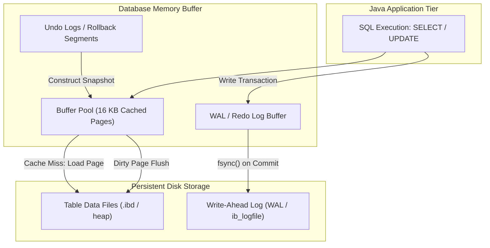
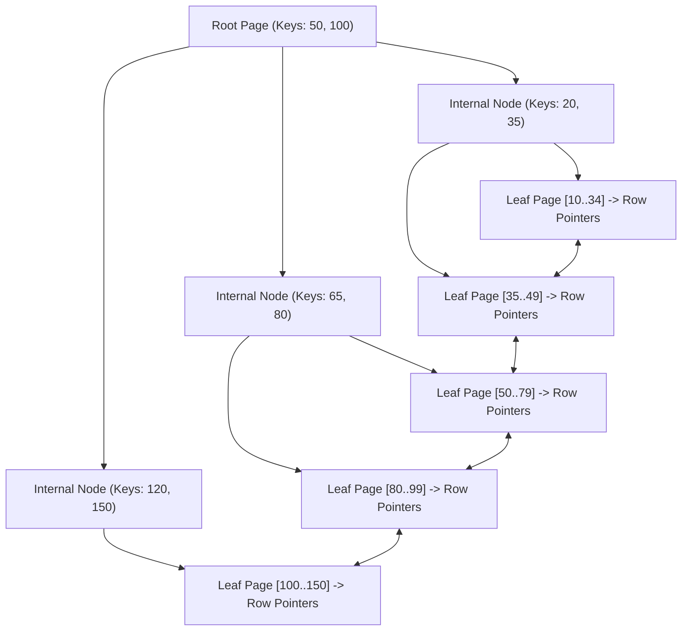
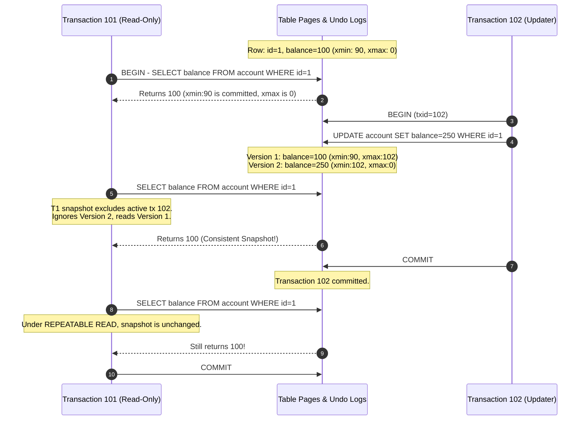
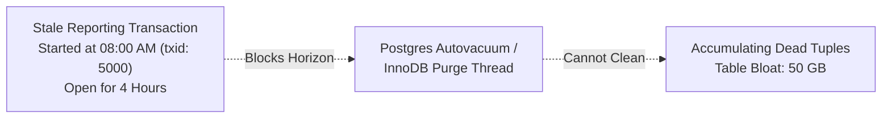

Most developers interact with databases through clean SQL queries or high-level Object-Relational Mapping (ORM) frameworks like Hibernate. You write `SELECT * FROM orders WHERE customer_id = 42`, and records appear in your application memory milliseconds later. 

Behind that simple query lies a sophisticated mechanical engine designed to solve two conflicting physical problems: spinning disk and solid-state drive (SSD) latency, and absolute crash durability. When hundreds of concurrent Java threads update bank balances, modify shopping carts, and scan analytics records, the database engine cannot lock entire tables or rewrite gigabytes of data on every commit.

To design high-throughput Java applications, eliminate serialization deadlocks, and troubleshoot mysterious database stalls, you must understand how data physically organizes on disk, how indexes navigate memory pages, and how Multi-Version Concurrency Control (MVCC) grants each transaction a private snapshot of reality.



---

## Page-Based Storage: How Tables Live on Disk

Operating systems and storage controllers do not read and write single bytes from NVMe drives or hard disks; they transfer data in fixed-size blocks (typically 4 KB). Relational database engines organize all table and index data into fixed-size logical units called **pages** (PostgreSQL defaults to 8 KB pages; MySQL InnoDB defaults to 16 KB pages).

### The Anatomy of a Slotted Page

A single data page contains a header, a slot array, and the actual row data stored from bottom to top:

```
+-----------------------------------------------------------------------+
| Page Header: LSN, Checksum, Free Space Pointers, Flags               |
+-----------------------------------------------------------------------+
| Line Pointer / Slot Array: [Offset 1] [Offset 2] [Offset 3] ...       |
+-----------------------------------------------------------------------+
|                          <--- Free Space --->                         |
+-----------------------------------------------------------------------+
| Row 3 Tuple Data (Variable length)                                    |
+-----------------------------------------------------------------------+
| Row 2 Tuple Data (Variable length)                                    |
+-----------------------------------------------------------------------+
| Row 1 Tuple Data (Variable length)                                    |
+-----------------------------------------------------------------------+
```

1. **Page Header**: Stores administrative metadata, including the Log Sequence Number (LSN) indicating the last WAL record that modified this page, the number of live tuples, and pointers to the free space boundaries.
2. **Slot Array (Line Pointers)**: Grows from the top downward. Each slot contains a byte offset pointing to the start of a row tuple within that page.
3. **Tuple Storage**: Rows are written from the bottom of the page upward into the available free space.

This slotted page architecture yields a crucial performance property: the physical identifier of any row (often called a `Tuple ID`, `TID`, or `RowID`) is represented as a composite pair:

```
Physical Row Address = (Page Number, Slot Index)
```

If a row updates and grows slightly in size, the database can shift rows around within that single 8 KB page without breaking index pointers. The index continues pointing to `(Page 42, Slot 3)`, and only the internal slot offset inside Page 42 changes.

### The Buffer Pool and Dirty Page Flushing

Disks are orders of magnitude slower than CPU registers and L1/L2 caches. To achieve sub-millisecond query execution, the database maintains a large in-memory cache called the **Buffer Pool** (InnoDB) or **Shared Buffers** (Postgres).

When a query requests a record, the engine checks whether the containing page exists in the Buffer Pool. If it is present (a cache hit), reading costs mere nanoseconds. If absent, the engine performs a synchronous disk read to populate the page into the buffer.

When an `UPDATE` executes:
1. The engine modifies the page directly in memory.
2. The page is marked as **dirty** (its in-memory content is newer than the version on disk).
3. The engine does **not** immediately write the entire 16 KB page back to disk. Doing so would cause catastrophic random write I/O.
4. Instead, background flusher threads asynchronously write dirty pages to storage using sequential batches and checkpointing algorithms.

---

## Index Architectures: B-Trees vs LSM-Trees

An index is a specialized physical data structure that avoids full-table sequential scans by maintaining keys in sorted order. While relational engines rely heavily on **B+ Trees**, modern distributed databases (such as Cassandra, RocksDB, and ScyllaDB) frequently use **Log-Structured Merge-Trees (LSM-Trees)**.

### The B+ Tree Anatomy

A B+ Tree is a self-balancing, multi-way search tree optimized for systems that read and write large memory pages:



Key structural invariants of the B+ Tree:
- **High Branching Factor (Fan-out)**: Unlike binary search trees where each node has at most two children, a B+ Tree node matches the database page size (e.g., 16 KB). If each index entry (key + child pointer) takes 16 bytes, a single page holds over 1,000 pointers. A 3-level B+ Tree can index over 1 billion rows with only 3 page lookups!
- **Data Exclusively in Leaves**: Internal nodes store only routing keys and page pointers. Leaf nodes hold the actual row data (Clustered Index) or row pointers (Secondary Index).
- **Doubly-Linked Leaf Chain**: All leaf pages link horizontally via next/previous pointers. When you execute a range scan such as `WHERE age BETWEEN 25 AND 35`, the engine performs one logarithmic traversal down to the start key `25`, and then walks the leaf chain sequentially without traversing up and down the tree.

### Clustered vs Secondary Indexes

In MySQL InnoDB, every table has an explicit **Clustered Index** keyed by the Primary Key. The leaf pages of the clustered index contain the complete row data for every column.

When you create a secondary index on `customer_email`:
1. The secondary index leaf pages store the email address and the corresponding **Primary Key value** (not a physical byte offset).
2. Searching by email requires a **two-step lookup (Bookmark Lookup)**:
   - Traverse the secondary index to find the customer's Primary Key `id = 1045`.
   - Traverse the clustered index using `id = 1045` to retrieve the rest of the columns (`first_name`, `billing_address`).
3. To bypass this second traversal, senior developers use **Covering Indexes**. If you index `(customer_email, first_name)`, the secondary index contains everything requested by `SELECT first_name WHERE customer_email = ?`, avoiding the clustered index lookup entirely.

### LSM-Trees: The Write-Optimized Alternative

While B+ Trees excel at point lookups and range scans, high-frequency random inserts cause random disk writes and page splits. LSM-Trees solve this by converting all mutations into sequential append operations:

1. **MemTable**: Incoming writes (inserts, updates, deletes) are written sequentially to a Write-Ahead Log and inserted into an in-memory sorted skip-list or red-black tree called the `MemTable`.
2. **SSTables (Sorted String Tables)**: When the MemTable exceeds a threshold (e.g., 64 MB), it is frozen and flushed to disk as an immutable sorted file called an `SSTable`.
3. **Compaction**: Background threads continuously merge multiple overlapping SSTables into new, consolidated files, discarding superseded versions and deleted keys (marked by tombstones).

| Feature | B+ Tree (Postgres, MySQL, Oracle) | LSM-Tree (Cassandra, RocksDB, ScyllaDB) |
| :--- | :--- | :--- |
| **Primary Optimization** | Read-heavy workloads, range scans | Write-heavy ingestion, append logs |
| **Write Amplification** | Higher (full page writes on dirty flushes) | Lower for writes, but compaction consumes I/O |
| **Point Lookup Cost** | Deterministic: O(log N) page reads | Variable: checks Bloom filters + multiple SSTables |
| **Storage Structure** | Mutable pages modified in-place | Immutable files merged sequentially |

---

## Write-Ahead Logging (WAL) and Crash Recovery

If dirty pages remain cached in volatile RAM for seconds before writing to disk, what happens when a data center suffers a sudden power loss? How does the database guarantee the **Durability** property of ACID?

The answer is the **Write-Ahead Log (WAL)** (referred to as the `Redo Log` in MySQL InnoDB).

### The Fundamental WAL Invariant

> **The WAL Rule**: No data page modified by a transaction may be written to permanent storage until the log records describing the modification have been written and flushed to durable disk storage via `fsync()`.

When a Java application issues a `COMMIT` over JDBC:
1. The database creates a compact binary log record describing the delta change (e.g., "Page 42, Slot 3, changed balance from 500 to 450").
2. The engine writes this log record to the WAL buffer and invokes the operating system system call `fsync()` to flush the log buffer to physical media.
3. Once the WAL record is safely persisted on disk, the commit returns success to the JDBC driver.
4. The heavy 16 KB data page in the Buffer Pool remains dirty in RAM and will flush later at leisure.

Because the WAL is an **append-only, sequential write stream**, the disk heads (or SSD flash controllers) write at maximum physical throughput without head thrashing.

### The ARIES Recovery Engine

When a crashed database server restarts, its data files on disk are inconsistent: some committed changes never reached the data files, while some uncommitted changes were prematurely written during background checkpointing.

The database runs the **ARIES (Algorithms for Recovery and Isolation Exploiting Semantics)** protocol:

1. **Analysis Phase**: Scans the WAL forward from the last known checkpoint to identify active transactions and dirty pages at the moment of the crash.
2. **Redo Phase (Repeating History)**: Rolls the database forward, reapplying all logged operations (both committed and uncommitted) to bring the internal page state precisely up to the millisecond of failure.
3. **Undo Phase**: Rolls back all transactions that were active when the power died, executing compensating undo actions in reverse chronological order to guarantee atomicity.

---

## Multi-Version Concurrency Control (MVCC) Mechanics

In early database architectures, readers locked out writers, and writers locked out readers. If a reporting query took 30 seconds to scan 5 million rows, every concurrent insert or update was blocked until the report completed.

Modern enterprise engines solve this with **Multi-Version Concurrency Control (MVCC)**: **readers never block writers, and writers never block readers**.

Instead of updating a row in-place, the database creates a new version of the row tuple whenever it is modified. Concurrent transactions see a specific, consistent snapshot of the data determined by their transaction start time.

### Row Header Hidden Columns

Every row in an MVCC engine contains hidden metadata columns tracking transaction visibility:

In PostgreSQL:
- `xmin`: The transaction ID (`txid`) of the transaction that inserted this version.
- `xmax`: The transaction ID that deleted or updated this version (initially 0 or null).

In MySQL InnoDB:
- `DB_TRX_ID`: The transaction ID that performed the last modification.
- `DB_ROLL_PTR`: A pointer to an undo log record containing the prior version of the row.

### A Concrete MVCC Walkthrough

Consider three concurrent transactions executing against a balance table:



When Transaction 101 reads the row, it evaluates visibility rules against its active **Read View (Snapshot)**:
- Is `xmin` committed? Yes (Tx 90).
- Is `xmin` less than Transaction 101's start timestamp? Yes.
- Is `xmax` uncommitted or greater than Transaction 101's view? Yes (Tx 102 was in flight).
- **Verdict**: The new version is invisible; Transaction 101 reads the original 100 balance.

### The Cost of MVCC: Dead Tuples and VACUUM

Because updates do not overwrite old rows, old row versions accumulate as **dead tuples** once all transactions that could possibly view them have terminated.

- **PostgreSQL**: Relies on the `VACUUM` process (and `autovacuum` background workers) to scan pages, freeze transaction IDs, remove dead tuples, and reclaim free space within pages.
- **MySQL InnoDB**: Stores prior row versions in separate **Undo Logs**. A background thread called the `Purge Thread` discards undo log segments once old read views terminate.

---

## Transaction Isolation Levels and Subversion

The SQL standard defines four isolation levels. Each level eliminates specific concurrent execution anomalies:

```
+------------------+---------------+------------------------+------------------+
| Isolation Level  | Dirty Read    | Non-Repeatable Read   | Phantom Read     |
+------------------+---------------+------------------------+------------------+
| READ UNCOMMITTED | YES (Allowed) | YES (Allowed)          | YES (Allowed)    |
| READ COMMITTED   | NO            | YES (Allowed)          | YES (Allowed)    |
| REPEATABLE READ  | NO            | NO                     | YES (Engine-dep) |
| SERIALIZABLE     | NO            | NO                     | NO               |
+------------------+---------------+------------------------+------------------+
```

### Read Committed (Default in Postgres, Oracle, SQL Server)
A new snapshot is generated **at the start of each individual SQL statement**. If Transaction A reads row 1, Transaction B updates row 1 and commits, and Transaction A reads row 1 again within the same transaction, Transaction A sees the new value.

### Repeatable Read (Default in MySQL InnoDB)
A snapshot is generated **at the start of the transaction** and remains immutable across all subsequent queries until commit.
*Subtle Production Hazard*: While Repeatable Read prevents non-repeatable reads on `SELECT`, execution anomalies can still occur during write conflicts!

```java
// Spring Data JPA Service
@Transactional(isolation = Isolation.REPEATABLE_READ)
public void awardBonus(Long accountId) {
    Account account = accountRepository.findById(accountId).orElseThrow();
    // Reads balance as 1,000 from the transaction snapshot
    
    // Concurrently, an external service debited 500 and committed!
    
    account.setBalance(account.getBalance() + 200); 
    accountRepository.save(account);
    // Overwrites balance to 1,200, silently obliterating the concurrent 500 debit!
}
```

To prevent this "lost update" anomaly under Repeatable Read, you must use **Pessimistic Locking** (`SELECT ... FOR UPDATE`) or **Optimistic Locking** (`@Version` column).

### Serializable (Strict Total Order)
Guarantees that concurrent transactions produce the exact same outcome as if they had executed sequentially, one after another.
Modern engines implement this via **Serializable Snapshot Isolation (SSI)** (Postgres) or **Next-Key Locking** (InnoDB). If the engine detects overlapping read/write dependencies (Write Skew), one of the transactions is aborted with a serialization error:

```
ERROR: could not serialize access due to read/write dependencies among transactions
SQLState: 40001
```

In Java, any service executing under `Isolation.SERIALIZABLE` **must** implement retry logic to handle serialization failure exceptions.

---

## Production Failure Modes & Operational Warfare

### The Long-Running Transaction Vacuum Blocker



**The Incident**: A background report runs an unindexed query inside a transaction that stays open for four hours. Meanwhile, high-throughput microservices perform 2,000 updates per second on the `orders` table.

**The Mechanical Failure**: The database cannot purge any dead tuple whose `xmax` is newer than the oldest active transaction snapshot (txid 5000). The `autovacuum` or purge thread is held back. The table and its indexes bloat from 2 GB to 60 GB on disk. Every index lookup now requires traversing bloated, half-empty pages, saturating disk I/O and causing application-wide query timeouts.

**The Fix**:
- Configure aggressive query and transaction timeouts:
  - In PostgreSQL: `idle_in_transaction_session_timeout = '30s'` and `statement_timeout = '60s'`.
  - In MySQL: `wait_timeout` and `interactive_timeout`.
- Monitor the age of the oldest active transaction in Prometheus via `pg_stat_activity` or `SHOW ENGINE INNODB STATUS`.

---

### Transaction ID Wraparound Catastrophe

**The Incident**: A PostgreSQL database under heavy write traffic stops accepting all write operations and forces itself into emergency read-only mode, rejecting all incoming application transactions.

**The Mechanical Failure**: PostgreSQL uses a 32-bit integer for transaction IDs (`txid`), supporting approximately 4.2 billion transactions. To prevent wraparound where new transactions appear to have occurred in the past, Postgres uses modulo arithmetic and a special `frozen` tuple bit. If a database completes 2 billion transactions without an autovacuum freeze worker advancing the freeze horizon, the engine halts all updates to prevent silent data corruption.

**The Fix**:
- Ensure `autovacuum = on` is never disabled in production.
- Monitor `pg_stat_database.datfrozenxid` to track the age of the oldest unfrozen transaction ID.
- Alert when transaction age exceeds 1 billion, allowing manual vacuuming before the 2-billion emergency shutdown threshold.

---

## Senior Engineer Interview Crucible

### Question 1: Why does a B+ Tree secondary index lookup in MySQL InnoDB require two traversals, and how does a Covering Index circumvent this?
**Answer:** In MySQL InnoDB, table data physically resides within the leaf nodes of the Clustered Index (keyed by Primary Key). Secondary indexes do not store physical disk pointers to rows; instead, their leaf nodes store the indexed key along with the corresponding row's Primary Key value. When executing a secondary index query, the engine first navigates the secondary index B+ Tree to find the Primary Key, and then performs a second B+ Tree search on the clustered index to read the table columns (the Bookmark Lookup). A Covering Index includes all columns referenced in the query `SELECT` and `WHERE` clauses (e.g., `INDEX (email, status, created_at)`). The engine can satisfy the query directly from the secondary index leaf node, completely skipping the secondary clustered index traversal.

### Question 2: In Write-Ahead Logging, why does the engine write changes to the WAL file before modifying the physical table pages on disk?
**Answer:** Table pages are scattered throughout storage and are updated using random I/O. If the database attempted to synchronously write modified 8 KB or 16 KB data pages to their permanent disk locations on every commit, disk I/O would immediately saturate, dropping transaction throughput to a crawl. The Write-Ahead Log records changes as a compact, sequential append-only stream. By writing the small delta record to the WAL and issuing an `fsync()`, the engine guarantees durability with minimal sequential I/O overhead. If power fails immediately afterward, the in-memory dirty pages in the Buffer Pool are lost, but the ARIES recovery process reads the sequential WAL log during restart and reapplies all committed changes to the physical data pages.

### Question 3: How does MVCC prevent dirty reads under the Read Committed isolation level without taking shared read locks on data rows?
**Answer:** Under MVCC, rows are never modified in-place; each update creates a new version of the row tuple marked with the inserting transaction ID (`xmin` in Postgres, `DB_TRX_ID` in InnoDB). When a query executes under Read Committed, the engine creates a snapshot (Read View) containing the list of all transaction IDs that are currently uncommitted or active at that exact statement start time. When inspecting a row version, the engine compares the row's creation ID against this active transaction list. If the version was created by a transaction that has not yet committed, the engine follows the pointer chain to the prior row version (or undo log entry) that was committed before statement execution began. Because the reader reconstructs the committed historical state, it never waits for the writer to commit and never observes uncommitted dirty data.

### Question 4: What is "Write Skew", and why does the standard Repeatable Read isolation level fail to prevent it?
**Answer:** Write Skew occurs when two concurrent transactions read overlapping data sets, make decisions based on the observed data, and then perform disjoint updates that together violate a global business invariant. A classic example is the "On-Call Doctor" problem: an invariant requires that at least one doctor remain on call. Two doctors concurrently check the database: both read that two doctors are currently on call. Doctor A updates their status to off-call and commits. Concurrently, Doctor B updates their status to off-call and commits. Under Repeatable Read, both transactions saw a valid snapshot showing two doctors on call, and neither modified the same physical row (Doctor A modified row A; Doctor B modified row B). No write lock collision occurred, yet the invariant was violated (zero doctors on call). Repeatable Read only protects against dirty, non-repeatable, and phantom modifications of the *same* records; preventing Write Skew requires explicit pessimistic locking (`SELECT ... FOR UPDATE`) or true `SERIALIZABLE` isolation with dependency graph tracking.
