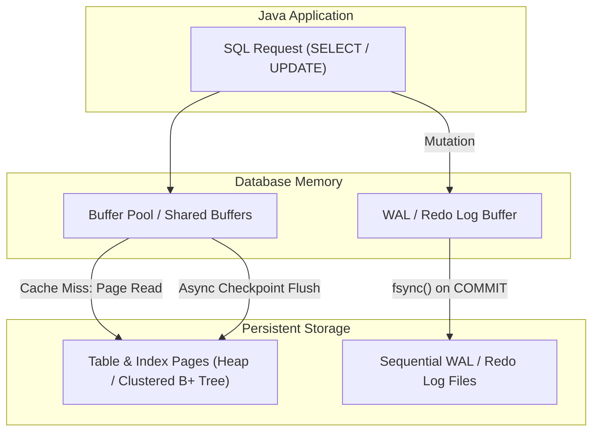
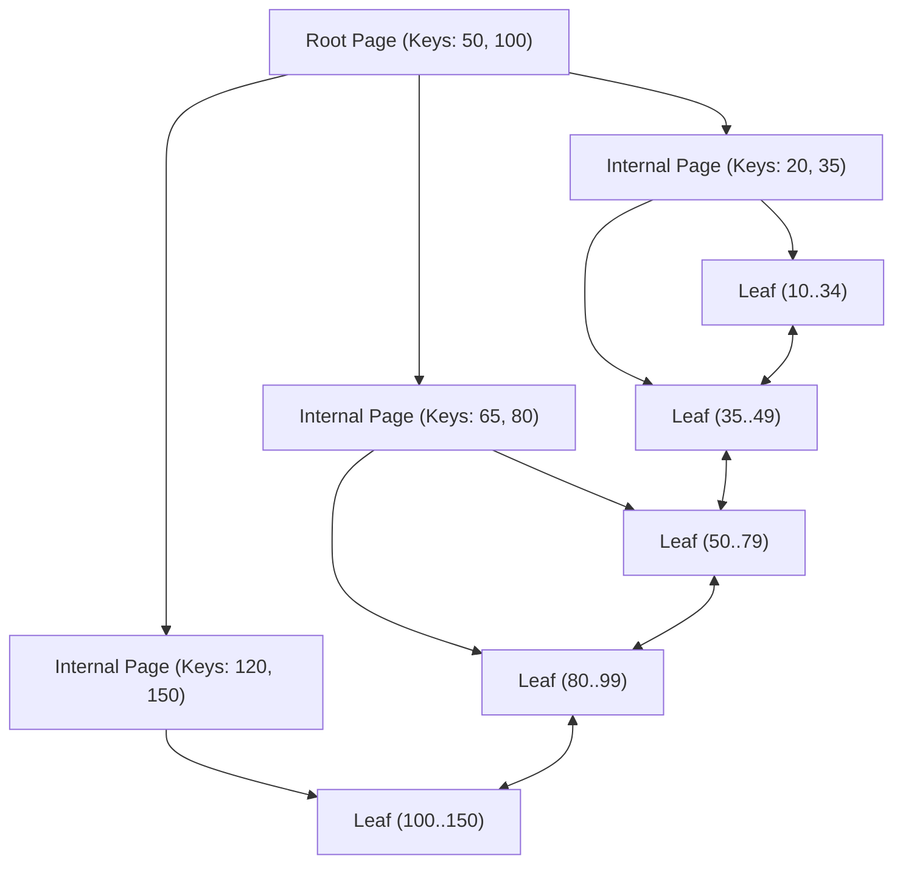
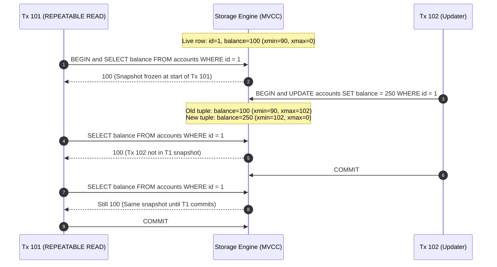
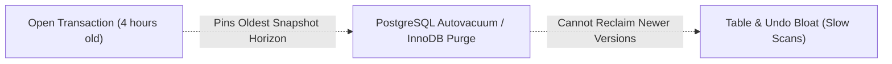

When a query slows down from 4 milliseconds to 4 seconds, or two concurrent checkout requests corrupt an inventory count, reading your Spring Data repository code rarely reveals the cause. The answer almost always lives one layer lower, inside the storage engine.

Every transactional database has to reconcile two competing realities: disk and SSD I/O is orders of magnitude slower than RAM, and yet committed writes must survive sudden power loss while hundreds of concurrent transactions read and modify the same tables. Understanding how engines lay out pages on disk, organize B+ Trees versus LSM-Trees, flush changes through a Write-Ahead Log, and isolate concurrent readers with MVCC gives you a clear mental model for diagnosing production stalls and subtle concurrency bugs.



## Slotted Pages and the Buffer Pool

Storage devices do not read or write individual bytes efficiently; they transfer data in fixed-size blocks. Relational engines mirror this by dividing every table and index file into fixed-size **pages** (8 KB by default in PostgreSQL, 16 KB in MySQL InnoDB).

Inside a typical slotted page, three regions share the same fixed block:

```text
+-------------------------------------------------------------------+
| Page Header: LSN, Checksum, Free Space Pointers, Flags            |
+-------------------------------------------------------------------+
| Line Pointer / Slot Array: [Offset 1] [Offset 2] [Offset 3] ...   |
+-------------------------------------------------------------------+
|                        <-- Free Space -->                         |
+-------------------------------------------------------------------+
| Tuple 3 Data (variable length)                                    |
| Tuple 2 Data (variable length)                                    |
| Tuple 1 Data (variable length)                                    |
+-------------------------------------------------------------------+
```

The slot array grows downward from the header while variable-length row tuples grow upward from the bottom. Because each slot stores a byte offset to its tuple, the database can reference a row by `(Page Number, Slot Index)` (called `ctid` in PostgreSQL). When the engine compacts free space inside a page, it shifts the tuple bytes and updates the slot offset without having to update external index pointers.

To avoid hitting disk on every query, the engine caches pages in a memory pool (**Shared Buffers** in PostgreSQL, **Buffer Pool** in InnoDB). An `UPDATE` modifies the page in RAM and marks it **dirty**, rather than synchronously writing that 8 KB or 16 KB page back to its random location on disk. Background writer and checkpointer processes flush dirty pages in batches later.

## B-Tree vs. LSM-Tree Storage Engines

Not all databases organize their on-disk indexes the same way. Relational databases generally favor **B+ Trees**, while write-heavy distributed stores (such as Cassandra, RocksDB, ScyllaDB, and HBase) favor **Log-Structured Merge-Trees (LSM-Trees)**.

### How B+ Trees Work

A B+ Tree is a self-balancing multi-way search tree sized to match database pages:



Because each internal page holds hundreds of routing keys and child pointers (high fan-out), a tree indexing tens of millions of rows is typically only 3 or 4 levels deep, and the root and upper branch pages almost always stay pinned in RAM. All leaf pages are linked horizontally so range queries (`WHERE created_at BETWEEN ... AND ...`) descend once to the starting key and then walk leaf pages sequentially.

### PostgreSQL Heap Tables vs. MySQL InnoDB Clustered Indexes

Even among B+ Tree engines, PostgreSQL and MySQL InnoDB organize table data differently, and that difference directly affects query performance and write costs:

- **PostgreSQL (Heap + Secondary Indexes)**: Table rows live in an unordered heap file. *Every* index, including the primary key index, is a separate B-Tree whose leaf entries point to the row's physical `(page, slot)` `ctid` in the heap. One consequence is that when an `UPDATE` creates a new tuple on a different page, every index on the table has to be updated to point to the new `ctid` (unless PostgreSQL can perform a **HOT, or Heap-Only Tuple**, update on the same page with no indexed columns modified).
- **MySQL InnoDB (Clustered Primary Key Index)**: The table *is* the primary key B+ Tree. Complete row data lives directly inside the leaf pages of the clustered index. Secondary indexes do not store physical disk offsets; instead, their leaf pages store the indexed key plus the **primary key value**.

Because InnoDB secondary indexes store the primary key, a lookup by email (`WHERE email = 'alice@example.com'`) performs two B+ Tree traversals: first through the `email` secondary index to get the primary key, and then through the clustered index to fetch the remaining columns (a **bookmark lookup**). Making the secondary index a **covering index** by including all queried columns avoids that second tree walk. It also explains why random UUIDv4 primary keys hurt InnoDB more severely than sequential IDs (like `BIGINT` or UUIDv7): random inserts cause frequent clustered leaf page splits, and wide primary keys bloat every secondary index on the table.

You can observe page reads and covering-index behavior directly in PostgreSQL with `EXPLAIN (ANALYZE, BUFFERS)`:

```sql
-- Standard index on email: needs a heap fetch to read status and created_at
CREATE INDEX idx_users_email ON users (email);

EXPLAIN (ANALYZE, BUFFERS)
SELECT status, created_at FROM users WHERE email = 'alice@example.com';
-- Index Scan using idx_users_email on users
--   Buffers: shared hit=4   (3 B-Tree pages + 1 heap page)

-- Covering index with INCLUDE: satisfies the query from index leaf pages alone
CREATE INDEX idx_users_email_covering
    ON users (email) INCLUDE (status, created_at);

EXPLAIN (ANALYZE, BUFFERS)
SELECT status, created_at FROM users WHERE email = 'alice@example.com';
-- Index Only Scan using idx_users_email_covering on users
--   Heap Fetches: 0
--   Buffers: shared hit=3   (zero heap page accesses)
```

### How LSM-Trees Work

In a B+ Tree, updating a single 100-byte row eventually forces a full 8 KB or 16 KB page to be rewritten on disk, and random inserts trigger page splits. **LSM-Trees** trade some read speed to turn every write into sequential append-only I/O:

1. **WAL + MemTable**: Incoming writes append to a disk WAL for durability and insert into an in-memory sorted structure (typically a skip list or red-black tree) called the **MemTable**.
2. **Immutable SSTables**: Once the MemTable reaches a size threshold (for example, 64 MB), it is frozen and flushed sequentially to disk as an immutable **Sorted String Table (SSTable)**. Deletes are written as special **tombstone** records rather than modifying old files in place.
3. **Compaction**: Background threads merge multiple SSTables into larger sorted files, dropping overwritten versions and expired tombstones.
4. **Reads and Bloom Filters**: A point lookup checks the MemTable first, then newer-to-older SSTables. To avoid reading dozens of SSTable files for a missing key, each SSTable keeps an in-memory **Bloom filter** that quickly rules out files that definitely do not contain the key.

| Characteristic | B+ Tree (PostgreSQL, InnoDB, Oracle) | LSM-Tree (RocksDB, Cassandra, ScyllaDB) |
| :--- | :--- | :--- |
| **Workload strength** | Mixed OLTP, point lookups, range scans | High-throughput write ingestion, time-series, append workloads |
| **Disk mutation model** | Mutable fixed-size pages updated in place (or appended to heap) | Immutable SSTable files merged sequentially via compaction |
| **Read path** | Predictable `O(log n)` single-tree traversal | May check MemTable + multiple SSTables (mitigated by Bloom filters) |
| **Operational overhead** | Page fragmentation, random dirty page flushes, VACUUM/Purge | Background compaction I/O spikes and temporary space amplification |

## Write-Ahead Logging (WAL) and Crash Recovery

Because dirty data pages sit in volatile RAM before checkpointing writes them to disk, a power outage would lose committed data unless those changes are recorded durably first. Every ACID relational engine enforces the **WAL rule**: no modified data page may be flushed to disk before the log records describing that change have been flushed to durable storage, and no `COMMIT` is acknowledged to the client until its commit record reaches disk via `fsync()`.

Appending compact delta records sequentially to the WAL is far faster than scattering random page writes across table files. In PostgreSQL, the first time a page is modified after a checkpoint, the WAL also logs a **full-page image** (`full_page_writes = on`) to guard against *torn pages* (where an OS crash writes only half of an 8 KB database page to a 4 KB disk sector).

When a database restarts after an unclean shutdown, recovery restores consistency following the classic **ARIES** (Algorithms for Recovery and Isolation Exploiting Semantics) three-phase design (used conceptually by InnoDB, DB2, and SQL Server, while PostgreSQL's MVCC design skips a traditional undo pass because uncommitted tuples are already invisible via transaction status metadata):

1. **Analysis**: Scan the WAL forward from the last checkpoint to discover which pages were dirty and which transactions were still uncommitted at the time of the crash.
2. **Redo**: Replay logged changes forward from the earliest dirty page LSN, bringing data pages back to their exact pre-crash state.
3. **Undo**: For engines that overwrite pages in place (like InnoDB), walk backward through uncommitted transactions using undo records to revert partial changes and restore atomicity.

## Multi-Version Concurrency Control (MVCC)

Without MVCC, a long-running reporting query would hold shared read locks on rows and stall every concurrent checkout trying to update them. MVCC avoids that bottleneck by keeping multiple versions of a row alive at the same time so each transaction sees a consistent **snapshot** of committed data. **Readers do not block writers, and writers do not block readers.** (Writers updating the *same* row still block each other via row locks.)

### PostgreSQL MVCC vs. InnoDB MVCC

The two most popular open-source relational databases implement MVCC in notably different ways:

- **PostgreSQL (Heap Tuples + `VACUUM`)**: An `UPDATE` does not overwrite the existing row in place. PostgreSQL stamps the old tuple's hidden `xmax` column with the updating transaction ID and writes a brand-new tuple into the heap with `xmin` set to that same transaction ID. Old dead tuples remain in the table heap until **autovacuum** scans the page, verifies that no active transaction snapshot can still see them, and marks their space reusable.
- **MySQL InnoDB (In-Place Update + Undo Logs)**: InnoDB overwrites the row in place inside the clustered index page and copies the previous version into a separate **Undo Log** (rollback segment). Hidden columns `DB_TRX_ID` and `DB_ROLL_PTR` link the current row back to older undo records. If a concurrent reader has an older snapshot, it follows the `DB_ROLL_PTR` chain to reconstruct the older row. A background **Purge Thread** cleans up undo segments once no active read view needs them.



### Inspecting PostgreSQL `ctid`, `xmin`, and `xmax` Directly

You can watch PostgreSQL's MVCC tuple versioning happen live in `psql` by selecting the hidden system columns:

```sql
CREATE TABLE accounts (
    id      int PRIMARY KEY,
    balance numeric(10, 2) NOT NULL
);

INSERT INTO accounts VALUES (1, 100.00);

SELECT ctid, xmin, xmax, id, balance FROM accounts WHERE id = 1;
--  ctid  | xmin | xmax | id | balance
-- -------+------+------+----+---------
--  (0,1) |  742 |    0 |  1 |  100.00

UPDATE accounts SET balance = 250.00 WHERE id = 1;

SELECT ctid, xmin, xmax, id, balance FROM accounts WHERE id = 1;
--  ctid  | xmin | xmax | id | balance
-- -------+------+------+----+---------
--  (0,2) |  743 |    0 |  1 |  250.00
```

Notice that `ctid` moved from `(0,1)` to `(0,2)` and `xmin` incremented from `742` to `743`. The old tuple at `(0,1)` is still sitting on page 0 with `xmax = 743` until `VACUUM` reclaims it.

## Transaction Isolation Levels and Anomalies

The SQL standard defines four isolation levels based on which concurrency anomalies they permit:

| Isolation Level | Dirty Read | Non-Repeatable Read | Phantom Read | Serialization / Write Skew |
| :--- | :--- | :--- | :--- | :--- |
| **Read Uncommitted** | Allowed (prevented in PG) | Allowed | Allowed | Allowed |
| **Read Committed** (PG default) | Prevented | Allowed | Allowed | Allowed |
| **Repeatable Read** (InnoDB default) | Prevented | Prevented | Prevented in PG & InnoDB snapshots | Allowed (Write Skew) |
| **Serializable** | Prevented | Prevented | Prevented | Prevented |

Here is what each anomaly looks like in practice:

- **Dirty Read**: Transaction A reads uncommitted changes written by Transaction B. If B rolls back, A acted on data that never existed. PostgreSQL maps `READ UNCOMMITTED` internally to `READ COMMITTED`, so dirty reads cannot happen there.
- **Non-Repeatable Read**: Transaction A reads a row and gets `100`. Transaction B updates that row to `250` and commits. Transaction A reads the same row again within the same transaction and now sees `250`.
- **Phantom Read**: Transaction A runs `SELECT COUNT(*) FROM orders WHERE status = 'PENDING'` and gets `5`. Transaction B inserts a new pending order and commits. Transaction A re-runs the count and gets `6`. (Note that PostgreSQL's `REPEATABLE READ` uses full Snapshot Isolation, which prevents phantom reads as well, though it still allows Write Skew.)
- **Write Skew (Serialization Anomaly)**: Two concurrent transactions read overlapping data, verify a shared business rule independently, and update *different* rows so that together they break the rule.

### Observing `READ COMMITTED` vs. `REPEATABLE READ`

In `READ COMMITTED`, PostgreSQL creates a fresh snapshot for every individual SQL statement. In `REPEATABLE READ`, it freezes a single snapshot for the entire transaction:

```sql
-- Session A (READ COMMITTED)                  -- Session B
BEGIN;
SELECT balance FROM accounts WHERE id = 1;
-- Returns 100.00
                                               BEGIN;
                                               UPDATE accounts SET balance = 250.00 WHERE id = 1;
                                               COMMIT;
SELECT balance FROM accounts WHERE id = 1;
-- Returns 250.00 (Non-repeatable read!)
COMMIT;

-- Now repeat with REPEATABLE READ in Session A:
BEGIN TRANSACTION ISOLATION LEVEL REPEATABLE READ;
SELECT balance FROM accounts WHERE id = 1;
-- Returns 250.00
                                               BEGIN;
                                               UPDATE accounts SET balance = 400.00 WHERE id = 1;
                                               COMMIT;
SELECT balance FROM accounts WHERE id = 1;
-- Still returns 250.00 (Snapshot frozen at first query)
COMMIT;
```

### Write Skew and How to Stop It

Suppose a hospital scheduling rule requires **at least one doctor on call** at all times. Both Alice and Bob are currently on call, and both submit a request to go off duty at the same moment:

```sql
-- Both Alice and Bob start with on_duty = true

-- Session A (Alice)                           -- Session B (Bob)
BEGIN ISOLATION LEVEL REPEATABLE READ;         BEGIN ISOLATION LEVEL REPEATABLE READ;

SELECT COUNT(*) FROM doctors                   SELECT COUNT(*) FROM doctors
WHERE on_duty = true;                          WHERE on_duty = true;
-- Returns 2 (safe to leave)                   -- Returns 2 (safe to leave)

UPDATE doctors SET on_duty = false             UPDATE doctors SET on_duty = false
WHERE name = 'Alice';                          WHERE name = 'Bob';

COMMIT; -- Succeeds                            COMMIT; -- ALSO succeeds!
-- Result: 0 doctors on duty. Invariant broken!
```

Neither transaction modified the same row, so row-level write locks did not conflict. PostgreSQL's `REPEATABLE READ` does not detect read-write dependency cycles across disjoint rows.

You have two clean ways to eliminate Write Skew:

**Option 1: Pessimistic locking with `SELECT ... FOR UPDATE`** locks all rows read during the check so the second transaction waits until the first commits:

```sql
BEGIN;
-- Locks every currently on-duty row until COMMIT or ROLLBACK
SELECT id FROM doctors WHERE on_duty = true FOR UPDATE;
-- Application checks returned row count >= 2 before proceeding
UPDATE doctors SET on_duty = false WHERE name = 'Alice';
COMMIT;
```

**Option 2: `SERIALIZABLE` isolation** (Serializable Snapshot Isolation in PostgreSQL) tracks predicate read locks and aborts one of the conflicting transactions with SQLState `40001`:

```sql
BEGIN TRANSACTION ISOLATION LEVEL SERIALIZABLE;
SELECT COUNT(*) FROM doctors WHERE on_duty = true;
UPDATE doctors SET on_duty = false WHERE name = 'Alice';
COMMIT;
-- Second concurrent transaction fails on COMMIT with:
-- ERROR: could not serialize access due to read/write dependencies among transactions
-- SQLSTATE: 40001
```

Whenever you use `SERIALIZABLE` (or optimistic locking via a `@Version` column) in Java, you must build a bounded retry loop around the transaction:

```java
public void executeSerializableWithRetry(Runnable txWork) {
    int maxAttempts = 3;
    for (int attempt = 1; attempt <= maxAttempts; attempt++) {
        try {
            txWork.run();
            return;
        } catch (DataAccessException ex) {
            if (!isSerializationFailure(ex) || attempt == maxAttempts) {
                throw ex;
            }
            // Brief jittered backoff before retrying with a fresh snapshot
        }
    }
}

private boolean isSerializationFailure(Throwable ex) {
    Throwable cur = ex;
    while (cur != null) {
        if (cur instanceof SQLException sqlEx && "40001".equals(sqlEx.getSQLState())) {
            return true;
        }
        cur = cur.getCause();
    }
    return false;
}
```

Watch out for **Lost Updates** as well. If your Java service reads `balance = 1000` in one query, adds `200` in Java memory, and runs `UPDATE accounts SET balance = 1200 WHERE id = ?`, a concurrent `-500` debit under `READ COMMITTED` will be silently overwritten. Either perform atomic relative updates in SQL (`SET balance = balance + 200`), use optimistic locking (`WHERE id = ? AND version = ?`), or lock the row with `SELECT ... FOR UPDATE`.

## Common Production Issues

### Long-Running Transactions Blocking Vacuum and Purge



A background reporting job, or a bug that leaves a connection `idle in transaction`, pins the database's oldest active snapshot horizon. As long as that transaction stays open, PostgreSQL's `autovacuum` cannot remove any dead tuple created after that transaction began, and InnoDB's purge thread cannot discard newer undo history. On a table receiving thousands of updates per second, dead tuples pile up rapidly, bloating the table and indexes from gigabytes to tens of gigabytes and degrading every query touching them.

Set defensive timeouts (`idle_in_transaction_session_timeout = '30s'` and `statement_timeout = '60s'` in PostgreSQL) and monitor active transactions and dead tuple counts regularly:

```sql
-- Find long-running or stuck transactions in PostgreSQL
SELECT pid, state, now() - xact_start AS tx_age, left(query, 80) AS query
FROM pg_stat_activity
WHERE xact_start IS NOT NULL
ORDER BY tx_age DESC
LIMIT 10;

-- Check dead tuple accumulation and last autovacuum runs
SELECT relname, n_live_tup, n_dead_tup, last_autovacuum
FROM pg_stat_user_tables
ORDER BY n_dead_tup DESC
LIMIT 10;
```

### Transaction ID Wraparound in PostgreSQL

PostgreSQL stores tuple visibility using 32-bit transaction IDs (about 4.2 billion values, split into 2 billion in the past and 2 billion in the future via circular arithmetic). Before any table's oldest unfrozen `xmin` gets close to 2 billion transactions old, `autovacuum` runs an anti-wraparound freeze pass to mark old committed tuples as permanently visible (`frozen`).

If `autovacuum` is disabled or cannot keep up on a heavily written table, PostgreSQL eventually refuses new writes and forces single-user recovery mode to prevent silent data loss. Never disable `autovacuum` globally, and alert well before transaction age approaches the limit:

```sql
-- Monitor distance to Transaction ID wraparound (alert above 500M-1B)
SELECT datname, age(datfrozenxid) AS xid_age
FROM pg_database
ORDER BY xid_age DESC;
```

## Interview Questions

### Why does an InnoDB secondary index lookup often require two B+ Tree traversals, and how does PostgreSQL differ?

In MySQL InnoDB, rows are physically stored inside the leaf pages of the primary key's clustered B+ Tree. Secondary index leaf pages store the indexed column value paired with the row's primary key rather than a physical page offset. Reading non-indexed columns via a secondary index therefore requires walking the secondary index to get the primary key, then walking the clustered index to fetch the row (a bookmark lookup). A covering index avoids the second lookup by including all needed columns in the secondary index. PostgreSQL instead stores rows in an unordered heap file and stores the physical `(page, slot)` `ctid` directly in every index leaf, so a secondary index lookup jumps directly to the heap page rather than traversing a second B-Tree.

### Why does the database flush changes to the WAL before flushing dirty table pages?

Table pages are scattered across disk files, so flushing an 8 KB or 16 KB page on every commit would produce heavy random write I/O and cripple throughput. The WAL is an append-only sequential file containing compact delta records. Writing to the WAL and calling `fsync()` guarantees durability at sequential I/O speed, allowing dirty table pages to remain in memory and flush asynchronously during checkpoints. If the server crashes before those pages reach disk, recovery replays the WAL to reconstruct all committed changes.

### How does MVCC avoid dirty reads under `READ COMMITTED` without locking rows for readers?

Updates create a new row version tagged with the writer's transaction ID (`xmin` in PostgreSQL, `DB_TRX_ID` + undo chain in InnoDB) rather than destroying the previous committed version immediately. At the start of each SQL statement under `READ COMMITTED`, the engine takes a snapshot listing currently in-progress transactions. When a reader encounters a tuple created by an uncommitted transaction, it skips that version (or follows the undo pointer in InnoDB) and reads the last committed version instead. Readers never wait on uncommitted writes and never see rolled-back data.

### Why does `REPEATABLE READ` fail to prevent Write Skew, and what are the two main fixes?

Under Snapshot Isolation (`REPEATABLE READ`), each transaction reads from a consistent snapshot and row locks only conflict when two transactions modify the *same* row. In Write Skew, two concurrent transactions read an overlapping set of rows to verify a shared rule, then each updates a *different* row, so no write-lock conflict occurs and both commit even though the combined result breaks the invariant. You can prevent it either by explicitly locking the read set with `SELECT ... FOR UPDATE` or by raising the isolation level to `SERIALIZABLE` and retrying transactions that abort with SQLState `40001`.
